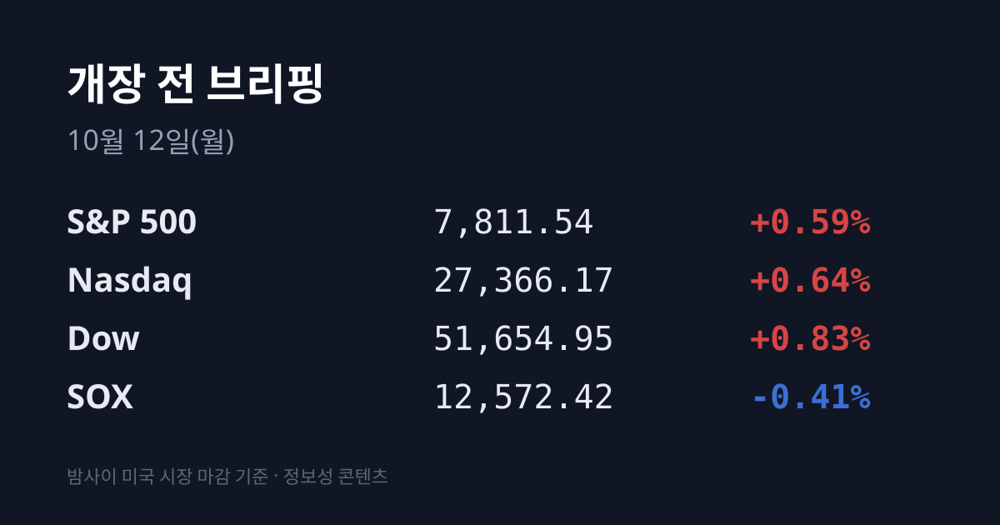
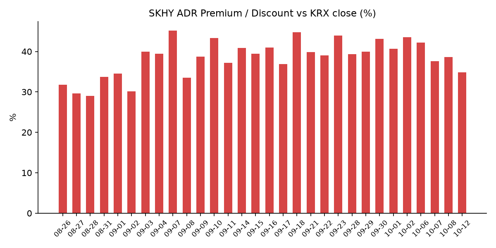
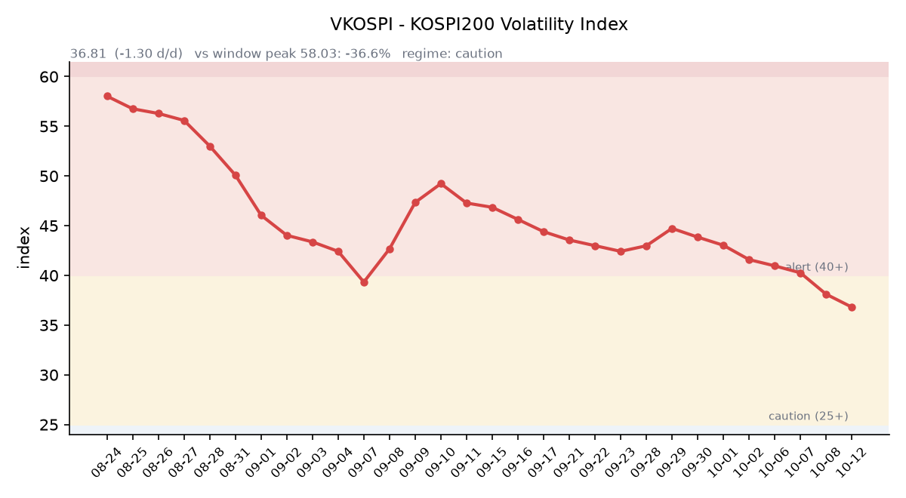

## ① 30초 요약

- 한국 증시는 10/08(목) 마감 후 한글날(10/09)과 주말로 4일을 쉬었고, 그사이 미국은 10/08·10/09 **2세션을** 거래했습니다. 아래 수치는 대부분 10/07 미국 종가 대비 2세션 누적입니다.
- <mark>반도체 지수(SOX)는 2세션 누적 −3.78%</mark>였습니다. 10/08 파이낸셜타임스(FT)가 OpenAI의 연환산 매출이 9월 말 약 500억 달러라고 보도하자 반도체가 −3.39% 빠졌고, 10/09 지수 반등 때도 반도체는 −0.41%로 오르지 못했습니다. 같은 기간 S&P500은 +0.13%, 다우는 +0.93%, 나스닥은 −0.63%입니다.
- SK하이닉스 ADR(SKHY)은 $169.03으로 2세션 누적 −5.17%였고, 괴리율은 +34.8%로 **3.73%포인트 줄었습니다.**
- 10/08 코스피는 삼성전자가 3분기 잠정 영업이익 107.4조원을 발표한 날 6,625.93(−2.62%)으로 마감했습니다. 외국인은 9거래일 연속 순매도했습니다.
- 브렌트유는 2세션 누적 +4.51%로 $104.72입니다. 주말에는 후티 반군의 미사일이 사우디 리야드·담맘 공항을 공격했고, 호르무즈 해협에서 유조선이 추가로 피격됐습니다.

## ② 밤사이 미국 시장 (공백 2세션)

| 지수 | 10/08 등락 | 10/09 종가 | 10/09 등락 | 2세션 누적 |
| :--- | ---: | ---: | ---: | ---: |
| S&P 500 | −0.47% | 7,811.54 | +0.59% | +0.13% |
| 나스닥 종합 | −1.25% | 27,366.17 | +0.64% | −0.63% |
| 다우 | +0.10% | 51,654.95 | +0.83% | +0.93% |
| 필라델피아 반도체(SOX) | −3.39% | 12,572.42 | −0.41% | −3.78% |

**10/08(목)** — FT는 OpenAI가 투자자들에게 9월 말 연환산 매출이 약 500억 달러에 근접했다고 알렸다고 보도했습니다. 그동안 알려진 680억~700억 달러보다 약 200억 달러 낮은 수치입니다. 인텔(약 −5.4%), Arm(약 −6.5%), AMD(약 −4%), 브로드컴(약 −3.9%)이 크게 내렸고, 레이 달리오의 AI 버블 경고도 겹쳤습니다. 후속 보도에서는 차이의 상당 부분이 파트너 클라우드 매출을 포함하는지에 따른 집계 방식 차이라고 설명됐습니다.

**10/09(금)** — 지수는 소프트웨어(IGV +2.81%)와 데이터센터 종목이 이끌며 올랐지만, 반도체 ETF(SMH)는 −0.65%였습니다. 스페이스X가 800MHz 주파수를 약 80억 달러에 사들인다는 보도에 T모바일·버라이즌·AT&T 등 통신주가 장중 7~11% 급락했습니다. 미시간대 10월 소비자심리 예비치는 46.3으로 9월(48.1)보다 낮아졌습니다.

<mark>메모리·반도체 대형주는 2세션 내내 약했습니다.</mark> 마이크론은 $1,088.00에서 $1,029.00으로 **−5.42%**, 엔비디아는 $229.28(−3.45%), TSMC ADR은 $453.31(−4.00%)입니다. 10/08·10/09 장 마감 뒤 반도체·빅테크 실적 발표는 없었습니다. 한국 시각 10/12 07:09 기준 미국 지수선물은 S&P500 +0.56%, 나스닥100 +0.45%입니다.

미 재무부 기준 10년물은 5.28%에서 5.22%를 거쳐 **5.24%로** 2세션 동안 4bp 내렸습니다. 30년물은 5.67%에서 5.60%(−7bp), 2년물은 4.77%에서 4.80%(+3bp), 10년물 실질금리(TIPS)는 2.91%(−1bp)이고, 10년물과 2년물의 차이는 0.44%p로 좁혀졌습니다. 오늘(10/12) 미국 채권시장은 콜럼버스데이로 쉬고 주식시장은 정상적으로 열립니다. VIX는 14.84, 달러인덱스는 102.21(10/09)입니다.

브렌트유는 10/08 하루 +4.07% 오른 뒤 10/09 $104.72로 마감했습니다. 미국 CNBC는 지난 1주 동안 호르무즈 해협 주변에서 유조선 9척이 피격됐고, 허리케인 이사이아스로 멕시코만 원유 생산의 약 25%(하루 50만 배럴)가 멈췄다고 전했습니다. WTI는 $91.85(+4.04%)입니다. 한국석유공사 10/09 기준 두바이유는 $108.50으로 브렌트보다 $3.78 비싸며, 10/07(약 $5.7)보다 차이가 줄었습니다. 금 12월물은 $4,216.3으로 2세션 동안 +1.83% 올랐고, 같은 기간 실질금리는 1bp 내렸으며 달러인덱스는 거의 그대로였습니다.

## ③ 괴리율 트래커 — SK하이닉스 ADR

| 항목 | 수치 |
| :--- | ---: |
| SKHY 종가 (10/09) | $169.03 (2세션 누적 −5.17%) |
| 본주 환산가 (×10×환율 1,341.07원) | 2,266,811원 |
| 본주 직전 종가 (10/08) | 1,681,000원 |
| **괴리율** | **+34.8%** |

SKHY는 10/08 $170.50(−4.35%), 10/09 $169.03(−0.86%)으로 이틀 연속 내렸습니다. 같은 기간 한국 본주는 10/08 하루만 거래해 −2.44%였기 때문에, 괴리율은 직전 +38.58%에서 **+34.85%로** 줄었습니다. SKHY 시간외 가격은 $169.71(+0.40%)입니다.

괴리율은 미국에 상장된 예탁증서(ADR) 가격을 본주 1주 기준으로 환산한 값과 한국 본주 종가를 비교한 수치입니다. 환산가가 본주보다 높은 프리미엄 상태에서는 전환 차익거래 구조상 본주 쪽에 매수 유인이 생기고, 디스카운트면 반대입니다. 오늘 값은 이 트래커 58거래일 기록에서 36위로 중하위권이며, 전 구간 1위는 07/31의 +62.0%입니다.

한국 시장 전체를 담는 EWY(iShares MSCI South Korea ETF)는 10/08 $176.29(−4.03%)로 같은 날 코스피(−2.62%)보다 더 내렸고, 한국이 쉰 10/09에는 $177.24(+0.54%)였습니다.

## ④ 변동성 트래커

**판정 한 줄**: <mark>'주의' 유지 — VKOSPI는 코스피가 −2.62% 내린 10/08에도 내려 7거래일 연속 하락했습니다.</mark> 레버리지 ETF 비중도 22%대에서 19%대로 내려왔습니다.

**기대 변동성**  VKOSPI **36.81**(10/08, 전일비 −1.30, −3.41%)로 '주의'(25~40) 구간입니다. 7거래일 연속 하락이며, 6월 고점 96.94 대비 −62.0%, 평시 상단인 25의 1.47배입니다.

**실현 변동성**  최근 5거래일 코스피 일별 등락률은 10/01 +1.95%, 10/02 +0.46%, 10/06 −0.89%, 10/07 −1.98%, 10/08 −2.62%였습니다. 최근 10거래일 중 ±3% 이상 등락일은 없습니다. 10/08 코스피는 6,808.68로 올라 출발했지만 장중 고점 6,810.83 이후 계속 밀려 그날 저가에서 마감했고, 일중 변동폭은 약 2.8%였습니다. 사흘만 거래한 지난주 코스피는 −5.39%였습니다.

**증폭 경로**  전체 ETF 거래대금 중 레버리지 ETF 비중은 **19.33%로** 직전(22.26%)보다 낮아졌습니다. KODEX 레버리지 1조6,252억원(회전율 31.64%), KODEX 코스닥150레버리지 5,244억원(14.26%), KODEX 200선물인버스2X 4,131억원(50.27%), KODEX 반도체레버리지 3,308억원(26.02%), TIGER 반도체TOP10레버리지 1,966억원(29.36%) 순입니다(네이버 ETF 목록, 10/12 07:17 스냅샷). 선물 베이시스는 +3.73(선물 1,048.25 − 현물 1,044.52)으로 직전 +5.12에서 더 좁혀졌습니다.

**청산 압력**  신용융자 잔고와 10월 반대매매 일별 금액은 이번에 최신치를 확인하지 못했습니다.

**하방 포지션**  공매도 순잔고는 T+2~3 공시 지연이 있어 개장 전 시점에는 확정치를 알 수 없습니다.

*미확인: 신용융자 잔고 최신치, 10월 반대매매 일별 금액, 공매도 순잔고 최신치, 오늘 개장 직전 밤의 코스피200 야간선물(한국거래소가 다음 날 아침 공개), DRAM·NAND 당일 현물가.*

## ⑤ 직전 거래일(10/08) 한국장 리뷰

| 지수 | 종가 | 등락 |
| :--- | ---: | ---: |
| 코스피 | 6,625.93 | −177.97 (−2.62%) |
| 코스닥 | 892.27 | −6.16 (−0.69%) |

코스피에서 <mark>외국인은 1조9,885억원, 기관은 1조6,714억원을 함께 순매도</mark>했고 개인은 2조9,061억원을 순매수했습니다(서울신문). 외국인은 9거래일 연속 매도입니다. 매체별로 수급 수치에 차이가 있어, 비즈니스코리아는 외국인 약 1조5,600억원, 기관 약 1조1,600억원 순매도로 보도했습니다. 프로그램 매매는 1조1,236억원 매도 우위(차익 2,455억원, 비차익 8,781억원)였고, 거래대금은 약 23조2천억원이었습니다. 상승 252개, 하락 625개 종목입니다. 코스닥에서는 외국인 640억원, 개인 506억원 순매수, 기관 1,068억원 순매도였습니다(비즈니스코리아).

삼성전자는 **262,000원(−2.42%)**, SK하이닉스는 1,681,000원(−2.44%)으로 마감했습니다. 삼성전자는 이날 아침 국내 기업 처음으로 분기 영업이익 100조원을 넘긴 3분기 잠정실적(영업이익 107.4조원)을 발표했지만, 매체들은 발표 이후 차익 실현과 자사주 매입 종료, 옵션 만기·반도체 ETF 리밸런싱 매도를 하락 이유로 꼽았습니다. 서울경제에 따르면 삼성전자 자사주 매입은 10/06 끝났고 SK하이닉스는 약 90%가 진행됐으며, 지난주 '기타법인' 순매수는 2조4,823억원으로 크게 줄었습니다. 지난주 외국인은 SK하이닉스를 3조6,399억원, 삼성전자를 8,839억원 순매도했습니다.

그 밖에 SK스퀘어 −8.06%, 삼성바이오로직스 −4.54%, 삼성생명 −4.27%, 삼성전기 −3.62%, 현대차 −3.42%, KB금융 −3.38%, 한미약품 −10.02%였고, LG에너지솔루션은 +2.56%(401,000원)였습니다. 동양고속·HLB글로벌은 상한가, 천일고속은 +22.57%였습니다.

원/달러는 서울 외환시장 주간 마감 기준 1,338.5원으로 10/07(1,340.4원)보다 1.9원 내렸습니다. 한국 시각 10/12 07:03 기준 환율은 1,341.07원, 달러/엔은 158.30입니다.

아시아 증시 10/09 종가는 닛케이225 69,030.92(−0.02%), 토픽스 4,104.81(+0.33%), 항셍 24,211.35(+1.79%), 상하이종합 3,813.79(+0.05%), CSI300 4,317.25(+0.16%)입니다. 대만 가권은 10/08 49,313.44(−0.99%)로 마감한 뒤 10/09 휴장했습니다. 일본 증시는 오늘(10/12) 휴장합니다.

## ⑥ 오늘의 캘린더 & 관전 포인트

- **오늘(10/12 월)** — 한국 증시 재개. 미국 콜럼버스데이(채권시장 휴장, 주식시장 정상 개장). 일본 증시 휴장. 래블업·엠에스바이오 공모 청약(~10/13). OCP 글로벌 서밋(~10/15, 미국 산호세).
- **10/13(화)** — 엘리스그룹 납입(공모가 90,500원). 미국 9월 NFIB 소기업 낙관지수. 미국 대형 은행 3분기 실적 발표 시작.
- **10/14(수)** — <mark>21:30 미국 9월 CPI</mark>. 중국 9월 물가·무역 지표. ASML 3분기 실적(10/14~15, 공식 일정 미확인). 10/15 03:00 연준 베이지북.
- **10/15(목)** — 21:30 미국 9월 PPI·소매판매. **10/16 03:00 TSMC 3분기 실적**(회사 가이던스 매출 446억~458억 달러).
- **10/16(금)** — 한국 9월 수출입물가지수. 미국 9월 산업생산.
- **10/22** 한국은행 금통위, **10/27** SK하이닉스 3분기 실적, **10/27~28** FOMC, **10/30** 일본은행 회의.

한국이 쉬는 동안 일어나 아직 국내 증시에 반영되지 않은 사건은 미국 반도체 2세션 −3.78%, 브렌트유 +4.51%, 주말 사우디 공항 피격과 호르무즈 유조선 추가 피격입니다. 증권가가 제시한 이번 주 코스피 범위는 6,600~7,100이고, 12개월 선행 PER은 5.26배입니다(서울경제). 시장 참가자들이 주시하는 레벨은 코스피 6,600선, SK하이닉스 1,700,000원 선, 원/달러 1,350원 선, VKOSPI 40 선입니다.

## ⑦ 정책 워치

10/10(토) 후티 반군 미사일이 사우디 리야드 킹칼리드 국제공항을 타격해 최소 12명이 숨지고 300명 이상이 다쳤습니다. 10/11(일)에는 담맘 킹파드 국제공항이 공격받았고 리야드 공항이 다시 피격돼 폐쇄가 연장됐습니다. 같은 날 호르무즈 해협에서 유조선 2척, 오만 소하르 정박지에서 유조선 1척이 피격됐습니다(영국 해사무역기구·폭스뉴스). 이란 최고국가안보회의는 호르무즈 해협 재개방을 위한 7개 조건에 대한 미국의 답변이 "불충분하다"고 밝혔고, 교전이 재개되면 걸프 지역의 미국 데이터·AI센터 등 인프라를 겨냥하겠다고 경고했습니다. 트럼프 대통령은 중간선거 전 이란 공격은 없다고 했지만, 후티에 대한 보복 타격 동참 가능성을 내비쳤습니다. 10/09 트럼프-푸틴 통화에서는 러시아의 디젤 대량 공급에 합의했습니다. 미·중, 북한 관련으로는 새 동향이 없었습니다.

공매도는 전면 재개 상태이며 10월 제도 변경 사항은 없었습니다.

## ⑧ 오늘의 질문

자사주 매입이 끝나 가는 가운데, 한국이 쉰 사이 미국 반도체가 −3.78% 빠진 것을 코스피 시총 1·2위는 어떻게 소화하는가.

---
*본 글은 공개된 시장 데이터를 정리한 정보성 콘텐츠이며, 특정 종목·상품의 매매 권유가 아닙니다. 모든 투자 판단과 책임은 투자자 본인에게 있습니다. 수치는 작성 시점 기준이며 이후 변동될 수 있습니다.*
