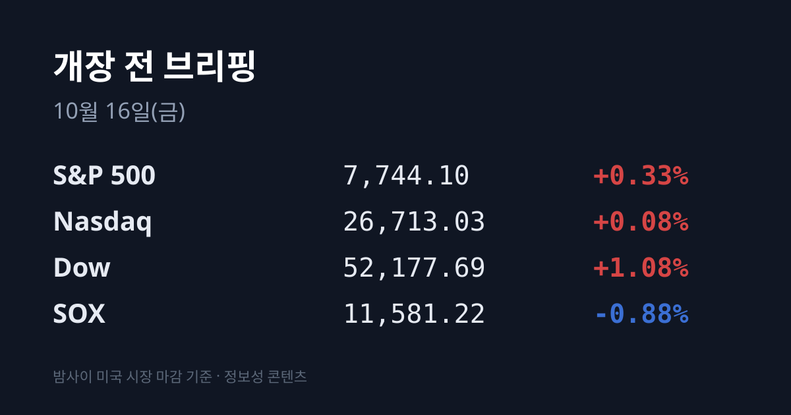
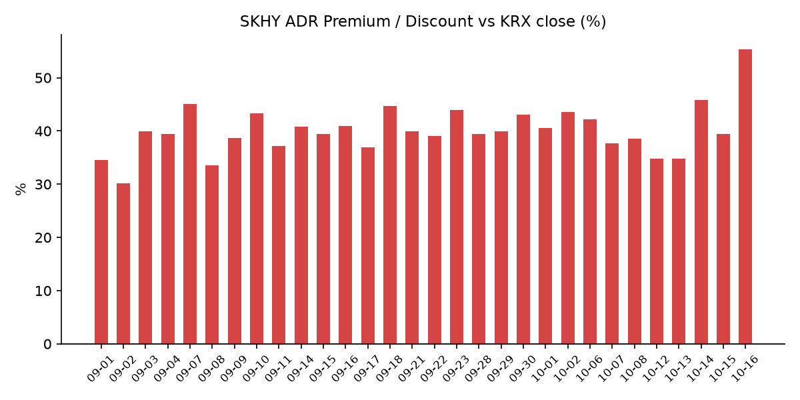
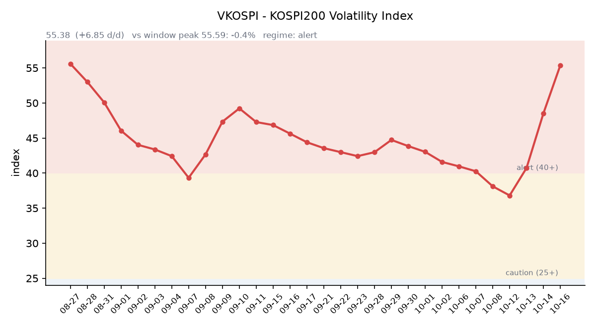

## ① 30초 요약

- <mark>10/15 코스피는 5,554.22(−7.57%), 코스닥은 760.82(−7.65%)로 마감했고 양대 시장에 1단계 서킷브레이커가 발동했습니다.</mark> 외국인은 코스피에서 3조6,340억원을 순매도해 8거래일 연속 매도였습니다.
- 밤사이 미국은 9월 생산자물가(PPI)가 전월비 +1.3%로 예상(+0.6%)을 크게 웃돌았는데도 국채 10년물이 5.086%로 내려, 다우 +1.08%, S&P500 +0.33%, 나스닥 +0.08%로 반등했습니다.
- 반도체 지수(SOX)는 **−0.88%로 7거래일 연속** 내렸습니다. TSMC는 6개 분기 연속 사상 최대 이익을 냈지만 ADR은 −1.80%였습니다.
- SKHY는 −0.98%로 본주(−11.06%)보다 훨씬 덜 내려, 괴리율이 +39.42%에서 **+55.28%로** 벌어졌습니다. EWY는 −2.26%였습니다.
- 10/14 기준 위탁매매 미수금은 1조3,535억원, 반대매매는 893억원으로 7/31 이후 가장 많았습니다.

## ② 밤사이 미국 시장

| 지수 | 10/15 종가 | 등락 |
| :--- | ---: | ---: |
| S&P 500 | 7,744.10 | +0.33% |
| 나스닥 종합 | 26,713.03 | +0.08% |
| 다우 | 52,177.69 | +1.08% |
| 필라델피아 반도체(SOX) | 11,581.22 | −0.88% |

미국 9월 PPI는 전월비 +1.3%로 예상(+0.6%)과 8월(+0.4%)을 크게 웃돌았고, 근원 PPI도 +0.7%(예상 +0.3%)였습니다. 4년 반 만의 최대 상승입니다. 9월 소매판매도 +0.8%로 예상(+0.3%)보다 높았습니다. 나스닥은 장 초반 1.4% 넘게 밀렸지만, <mark>국채금리가 내려가면서 헬스케어·소비재로 자금이 옮겨 가 지수가 반등했습니다</mark>(뉴스핌·톱스타뉴스). 시장에서는 AI 기업 차입 부담을 우려한 자금이 국채로 향했다는 해석이 나왔습니다. 러셀2000은 +1.37%였고, 일라이릴리·유나이티드헬스·월마트는 도이체방크의 투자의견 상향에 올랐습니다.

CME 페드워치 기준 10월 FOMC 금리 인상 확률은 PPI 발표 후 약 27~29%로 전날(약 35%)보다 낮아졌고, 12월까지의 누적 인상 확률은 67%로 반영됐습니다(뉴스핌·IBTimes).

반도체와 AI 서버 종목은 약했습니다. 엔비디아 $217.23(−1.84%), TSMC ADR $422.25(−1.80%), 브로드컴 −0.55%였고 마이크론은 $931.24(+1.87%)로 올랐습니다. 델테크놀로지스는 −6.92%, HPE는 −7.11%였습니다. 전날 15% 넘게 내렸던 코어위브는 젠슨 황 엔비디아 CEO가 구제금융이 필요하지 않을 것이라고 말한 뒤 +5.94%로 반등했습니다.

TSMC는 10/15 3분기 실적을 발표했습니다. 매출은 467억 달러(NT$1조4,942억)로 회사 가이던스 상단을 넘었고, 순이익은 NT$7,630억6,000만으로 6개 분기 연속 사상 최대였습니다. 매출총이익률은 2나노 공정 초기 비용 영향으로 66.4%였습니다. 4분기 매출 가이던스는 523억~543억 달러, 2026년 달러 기준 매출 성장률 전망은 44%로 올렸고 설비투자 600억~640억 달러는 유지했습니다(CNBC). 2027년 전망에는 신중한 태도를 보였다고 전해졌습니다(뉴스핌).

장 마감 뒤에는 인터랙티브브로커스가 주당순이익 0.67달러로 예상(0.68달러)을 소폭 밑돌아 시간외 −1%였고, 알코아는 1.82달러로 예상(1.47달러)을 웃돌았습니다(CNBC). 시간외 가격은 엔비디아 $217.48(+0.12%), TSMC ADR $424.59(+0.55%), 마이크론 $929.75(−0.16%)입니다. 한국 시각 10/16 07:06 기준 미국 지수선물은 S&P500 +0.02%, 나스닥100 −0.09%입니다.

미 국채 10년물은 5.086%로 전날(5.19%)보다 약 10bp 내려 3주 만의 최저였고, 2년물은 4.747%, 10년물과 2년물의 차이는 0.33%p입니다. 10년물 실질금리(TIPS)는 10/14 기준 2.84%로 전날(2.88%)보다 낮아졌습니다. VIX는 16.46(−2.43%)이었고, 달러인덱스는 한국 시각 07:05 기준 102.00(−0.54%)입니다.

WTI는 미국 원유 재고가 860만 배럴 줄었다는 발표에 $97.97(+3.03%)로 3주 최고였고, 브렌트유는 국제에너지기구(IEA) 회원국의 비축유 1억 배럴 방출 결정에 $105.92(−0.13%)였습니다. 금 12월물은 $4,170.10(+1.5%)로 올랐고, 같은 날 달러인덱스와 국채금리는 내렸습니다.

## ③ 괴리율 트래커 — SK하이닉스 ADR

| 항목 | 수치 |
| :--- | ---: |
| SKHY 종가 (10/15) | $146.11 (−0.98%) |
| 본주 환산가 (×10×환율 1,341.21원) | 1,959,642원 |
| 본주 직전 종가 (10/15) | 1,262,000원 |
| **괴리율** | **+55.3%** |

10/15 한국 본주는 −11.06% 내렸지만 미국 SKHY는 −0.98%에 그쳤습니다. 전날과 반대로 한국 쪽 하락폭이 훨씬 커서 괴리율은 전일 +39.42%에서 <mark>+55.28%로 15.86%포인트 벌어졌습니다.</mark> 7/31(+62.0%) 이후 가장 높은 값입니다. SKHY 시간외 가격은 $146.68(+0.39%)입니다.

괴리율은 미국에 상장된 예탁증서(ADR) 가격을 본주 1주 기준으로 환산한 값과 한국 본주 종가를 비교한 수치입니다. 환산가가 본주보다 높은 프리미엄 상태에서는 전환 차익거래 구조상 본주 쪽에 매수 유인이 생기고, 디스카운트면 반대입니다. 프리미엄이 커졌다는 것은 그 유인의 크기가 커졌다는 뜻입니다.

한국 시장 전체를 담는 EWY(iShares MSCI South Korea ETF)는 $156.22(−2.26%)였고, 시간외 가격은 $156.28(+0.04%)입니다. EWY의 10/15 미국 거래는 한국 10/15 장 마감(코스피 −7.57%) 이후 시간대를 담고 있습니다.

## ④ 변동성 트래커

**판정 한 줄**: <mark>'경보' 구간 상단, 위기(60)까지 4.6포인트 — VKOSPI가 하루 만에 10포인트 넘게 뛰었고 서킷브레이커와 반대매매 급증이 겹쳤습니다.</mark>

**기대 변동성**  VKOSPI **55.38**(10/15, 전일비 +10.47, +23.31%)로 '경보'(40~60) 구간입니다. 장중에는 57.22까지 올랐습니다. 하루 진정(44.91) 뒤 다시 급등했고, 6월 고점 96.94 대비 −42.9%, 평시 상단인 25의 2.22배입니다.

**실현 변동성**  최근 7거래일 코스피 일별 등락률은 10/06 −0.89%, 10/07 −1.98%, 10/08 −2.62%, 10/12 −3.65%, 10/13 −5.46%, 10/14 −0.44%, 10/15 −7.57%로 7거래일 연속 내렸습니다. 10/02 종가 7,003.74 대비 누적 **−20.7%입니다.** 최근 10거래일 중 ±3.5% 이상 등락일은 10/12·10/13·10/15 사흘입니다.

**매매 정지**  10/15 09:07 유가증권시장, 09:12 코스닥시장에 매도 사이드카가 발동했습니다. 이어 12:23 코스닥(−8.01%, 757.88), 12:38 유가증권시장(−8.00%, 5,528.05)에 1단계 서킷브레이커가 발동해 매매가 20분간 멈췄습니다. 유가증권시장 서킷브레이커는 올해 10번째, 코스닥은 5번째입니다(파이낸셜뉴스). 앞서 10/13 09:47에도 유가증권시장 매도 사이드카가 발동했습니다(한국거래소 KIND 시장운영 공시).

**증폭 경로**  전체 ETF 거래대금 중 레버리지 ETF 비중은 22.86%로 직전(21.98%)보다 높아졌습니다. KODEX 레버리지 2조4,413억원(회전율 63.74%), KODEX 200선물인버스2X 1조2,466억원(110.10%), KODEX 코스닥150레버리지 7,364억원(28.80%), KODEX 반도체레버리지 3,911억원(52.68%), KODEX SK하이닉스단일종목레버리지 2,750억원(25.28%) 순입니다(네이버 ETF 목록, 10/16 07:16 스냅샷). 인버스2X 회전율은 78.24%에서 110.10%로 뛰었습니다. 코스피200 선물 베이시스는 +0.60(선물 861.30 − 현물 860.70)으로 직전 +7.38에서 크게 좁혀졌습니다.

**청산 압력**  금융투자협회 집계로 반대매매는 10/12 271억원, 10/13 594억원, 10/14 **893억원으로** 늘어 7/31(1,220억원) 이후 가장 많았습니다. 위탁매매 미수금은 월초 약 9,800억원에서 10/14 1조3,535억원으로 불었습니다. 신용융자 잔고는 10/14 기준 33조7,057억원으로 10/13(34조2,529억원)보다 5,472억원 줄었습니다(파이낸셜뉴스·뉴시스).

**하방 포지션**  공매도 순잔고는 T+2~3 공시 지연이 있어 개장 전 시점에는 확정치를 알 수 없습니다.

*미확인: 공매도 순잔고 최신치, 10/15 신용융자·반대매매, 오늘 개장 직전 밤의 코스피200 야간선물(한국거래소가 다음 날 아침 공개), 10/15 프로그램 매매, DRAM·NAND 당일 현물가.*

## ⑤ 직전 거래일(10/15) 한국장 리뷰

| 지수 | 종가 | 등락 |
| :--- | ---: | ---: |
| 코스피 | 5,554.22 | −454.59 (−7.57%) |
| 코스닥 | 760.82 | −63.06 (−7.65%) |

코스피는 5,673.01(−5.59%)로 크게 내려 출발했고, 매도 사이드카와 서킷브레이커를 거쳐 5,554.22로 마감했습니다. 7/30 저점(5,593.56)을 밑돈 종가이며, 7거래일 연속 하락입니다. <mark>외국인은 3조6,340억원을 순매도해 8거래일 연속 매도</mark>했고, 기관은 1조6,906억원, 개인은 1조2,886억원을 순매수했습니다(재경일보, 매체에 따라 외국인 약 4조원으로 집계).

삼성전자는 210,000원(**−9.48%**), SK하이닉스는 1,262,000원(**−11.06%**)으로 마감했습니다. 매체들은 미국 9월 CPI 상회에 따른 금리 인상 우려, 전날 미국 반도체 지수 급락(−4.30%), AI 데이터센터 기업의 차입 부담과 수익성 우려, 중국 창신메모리(CXMT) 증설에 따른 공급 과잉 우려, 외국인 매도를 원인으로 꼽았습니다(재경일보·파이낸셜뉴스·헤럴드경제).

시가총액 상위에서는 삼성전기가 **−15.36%로** 가장 크게 내렸고 SK스퀘어 −10.21%, 현대차 −5.74%, LG에너지솔루션 −4.62%였습니다. 반면 삼성바이오로직스는 1,247,000원(+5.50%), 셀트리온 +1.28%, 하나금융지주 +0.66%로 올랐습니다.

코스닥에서는 외국인이 2,177억원을 순매수했고 기관이 1,632억원, 개인이 667억원을 순매도했습니다. 주성엔지니어링 −14.97%, 레인보우로보틱스 −9.44%, 에코프로비엠 −9.10%, 에코프로 −8.18%, 알테오젠 −4.90%였습니다. 전날 오른 2차전지 종목도 함께 내렸습니다.

원/달러는 서울 외환시장 주간 마감 기준 1,344.6원으로 6.3원 올랐습니다(재경일보). 한국 시각 10/16 07:13 기준 환율은 1,341.21원, 달러/엔은 158.02입니다.

아시아 증시 10/15 종가는 닛케이225 64,425.95(−4.90%), 토픽스 3,999.34(−2.38%), 대만 가권 46,969.87(−3.41%), 상하이종합 3,707.48(−1.59%), CSI300 4,166.01(−1.23%), 항셍 24,062.72(−1.03%)입니다. TSMC 실적은 대만 장 마감 뒤 나왔습니다.

## ⑥ 오늘의 캘린더 & 관전 포인트

- **오늘(10/16 금)** — 한국 9월 수출입물가지수. 미국 9월 산업생산. <mark>대만 증시는 TSMC 실적 발표 뒤 첫 거래입니다.</mark>
- **10/20~21** 티앤이코리아·크리에이츠 공모 청약, **10/22** 한국은행 금통위, **10/27** SK하이닉스 3분기 실적, **10/27~28** FOMC, **10/29** 삼성전자 3분기 확정 실적, **10/30** 일본은행 회의, **11/3** 미국 중간선거.

시장 참가자들이 주시하는 레벨은 코스피 5,500선과 7/30 저점 5,593.56, SK하이닉스 전일 종가 1,262,000원, 원/달러 1,355원 선, VKOSPI 60 선입니다.

## ⑦ 정책 워치

10/15 이억원 금융위원장이 금융감독원·한국거래소와 증시 긴급 점검회의를 열었습니다. 참석자들은 시장이 대외 불확실성에 다소 과도하게 반응한 측면이 있다고 평가했고, 허위 풍문·시세조종·불법 공매도 등 시장교란행위에 무관용 원칙으로 대응하며 변동성이 더 커지면 비상대응계획을 신속히 가동하겠다고 밝혔습니다. 증권사에는 무분별한 신용공여를 자제하라고 주문했습니다(뉴스1·마이데일리). 증권시장안정펀드 투입은 발표되지 않았습니다.

중동에서는 호르무즈 해협 선박 공격 보도가 있었고 미국-이란 협상은 진전이 없었습니다. 공매도는 전면 재개 상태이며 10월 제도 변경 사항은 없었습니다.

## ⑧ 오늘의 질문

미국이 한국 폭락을 −2.26%로만 평가한 하룻밤 뒤, 10/14에 쌓인 1조3,535억원의 미수금 정리 물량은 한국 시장에서 어느 정도로 소화되는가.

---
*본 글은 공개된 시장 데이터를 정리한 정보성 콘텐츠이며, 특정 종목·상품의 매매 권유가 아닙니다. 모든 투자 판단과 책임은 투자자 본인에게 있습니다. 수치는 작성 시점 기준이며 이후 변동될 수 있습니다.*
