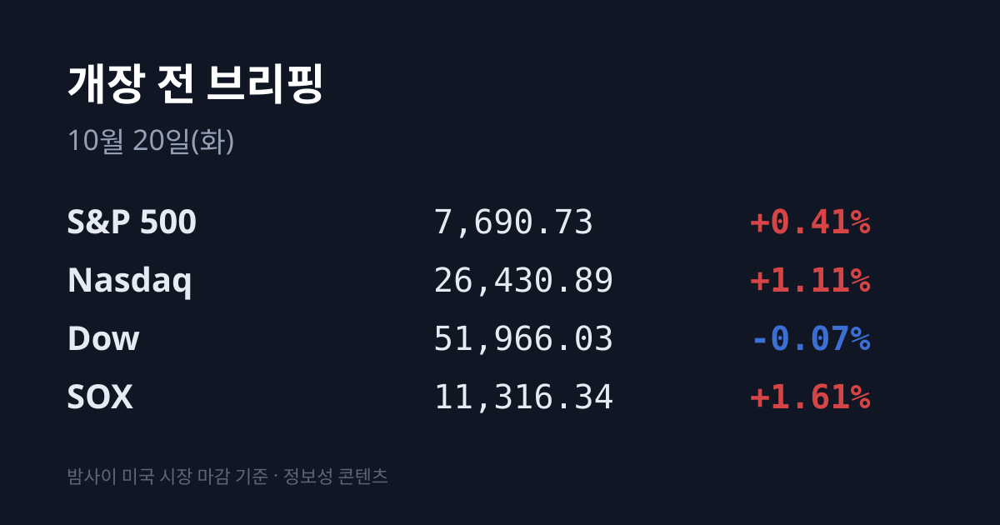
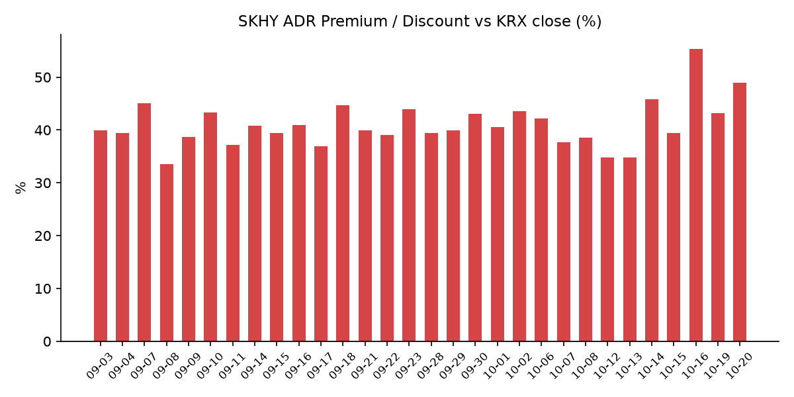
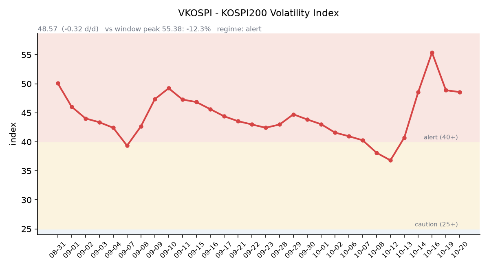

## ① 30초 요약

- 직전 거래일 10/19 코스피는 5,488.41(−3.17%)로 출발했다가 기관 순매수로 돌아서 <mark>5,768.01(+1.76%)로 이틀 연속 올랐습니다.</mark> 코스닥도 808.89(+1.78%)로 800선을 회복했습니다.
- 반등은 반도체가 아니라 2차전지·바이오·자동차가 이끌었습니다. 삼성SDI **+11.70%**, 에코프로 +11.19%, 삼성바이오로직스 +9.94%였고 삼성전자는 +1.16%, SK하이닉스는 +0.39%였습니다.
- 한국 장 마감 뒤 미국에서는 반도체 지수(SOX)가 +1.61%로 올라 8거래일 연속 하락을 끝냈습니다. 나스닥은 +1.11%, S&P500은 +0.41%, 다우는 −0.07%였습니다.
- SKHY는 $142.87(+4.67%)로 올라 괴리율이 +43.21%에서 +48.89%로 넓어졌습니다. EWY는 +4.08%였습니다.
- 미 국채 10년물은 5.14%, 30년물은 5.47%로 올랐고, 브렌트유는 $109.55입니다. 중국 3분기 GDP는 전년 대비 +4.5%로 시장 예상(4.4%)을 웃돌았습니다.

## ② 밤사이 미국 시장

| 지수 | 10/19 종가 | 등락 |
| :--- | ---: | ---: |
| S&P 500 | 7,690.73 | +0.41% |
| 나스닥 종합 | 26,430.89 | +1.11% |
| 다우 | 51,966.03 | −0.07% |
| 필라델피아 반도체(SOX) | 11,316.34 | +1.61% |

<mark>반도체 지수는 8거래일 연속 하락(이 기간 −15.7%, 2008년 10월 이후 최장)을 끝내고 반등했습니다.</mark> 지난주 급락한 AI 반도체에 저가 매수가 들어왔다는 해석이 나왔습니다(뉴스핌·톱스타뉴스). 마이크론 $905.35(+3.02%), 엔비디아 $217.09(+1.38%), 브로드컴 $334.59(+1.78%)였고 샌디스크는 약 +5.5%, 웨스턴디지털은 약 +6%였습니다. 인텔은 JP모건이 투자의견을 '비중축소'에서 '중립'으로 올리면서 +2.36%였습니다. 코어위브는 골드만삭스의 매수 상향에도 장 초반 상승분을 내주고 −0.45%로 마쳤습니다.

나스닥100은 장 초반 +2%를 넘었다가 차익 실현과 금리 상승으로 +1.17%까지 상승 폭이 줄었습니다. 다우는 비기술 업종 약세로 소폭 내렸고 S&P500 동일가중지수도 하락했습니다. 아마존은 모건스탠리가 최선호주로 꼽으면서 +4.98%, 테슬라는 +3.76%였습니다.

10/19 장 마감 뒤 주요 기업 실적 발표는 없었습니다. 넷플릭스·스페이스X 실적은 10/20(화) 장 마감 뒤, 테슬라·메타는 10/21(수) 장 마감 뒤 발표됩니다. 한국 시각 07:06~07:08 기준 지수선물은 S&P500 12월물 7,743.00(+0.11%), 나스닥100 12월물 29,766.75(+0.15%)입니다.

미 국채 10년물은 5.10%에서 **5.14%로** 올랐고, 2년물은 4.77%, 30년물은 5.47~5.48%, 10년물과 2년물의 차이는 0.38%p입니다. 10년물 실질금리(TIPS)는 10/16 기준 2.74%입니다. VIX는 19.99에서 18.43(−7.8%)으로 내렸습니다. CME 페드워치 기준 10월 FOMC 금리 인상 확률은 약 15%로, 지난주 9월 CPI 발표 직후 50%까지 올랐다가 내려왔습니다. 12월 회의에서는 인상이 우세하게 반영돼 있습니다(Chaincatcher·Forbes).

브렌트유 12월물은 $109.55(−0.28%), WTI 11월물은 $103.66(+2.2%, 만기 임박 계약), WTI 12월물은 $98.54(−0.5%), 두바이유는 $107.10이었습니다(페트로넷). 장중 미국의 일부 러시아 연료 제재 해제로 내렸다가, 후티 반군의 사우디 공항·아람코 시설 공격 주장으로 되돌아왔습니다(TheStreet·CNBC). 브렌트와 두바이의 가격 차이는 $2.45로 10/16($3.86)보다 좁아졌습니다. 금 12월물은 $4,161.60(−0.47%)로 내렸고, 같은 시간 달러인덱스는 101.97로 소폭 올랐습니다.

## ③ 괴리율 트래커 — SK하이닉스 ADR

| 항목 | 수치 |
| :--- | ---: |
| SKHY 종가 (10/19) | $142.87 (+4.67%) |
| 본주 환산가 (×10×환율 1,330.78원) | 1,901,285원 |
| 본주 직전 종가 (10/19) | 1,277,000원 |
| **괴리율** | **+48.9%** |

10/19 한국 본주는 +0.39% 올랐고, 그 뒤 미국 SKHY는 +4.67% 올랐습니다. 괴리율은 전일 +43.21%에서 <mark>+48.89%로 5.68%포인트 넓어졌습니다.</mark> 트래커 64거래일 중 3번째로 높은 값입니다(1위 07/31 +62.0%, 2위 10/16 +55.28%). 9~10월 통상 범위(+33.6~+45.9%)의 위쪽입니다. SKHY 시간외 가격은 $143.75(+0.62%)입니다.

괴리율은 미국에 상장된 예탁증서(ADR) 가격을 본주 1주 기준으로 환산한 값과 한국 본주 종가를 비교한 수치입니다. 환산가가 본주보다 높은 프리미엄 상태에서는 전환 차익거래 구조상 본주 쪽에 매수 유인이 생기고, 디스카운트면 반대입니다. 프리미엄이 넓어졌다는 것은 그 유인의 크기가 커졌다는 뜻입니다.

한국 시장 전체를 담는 EWY(iShares MSCI South Korea ETF)는 $156.58(**+4.08%**)였고, 시간외 가격은 $157.45(+0.55%)입니다. EWY의 10/19 세션에는 한국 10/19 장(+1.76%)과 그 뒤 미국 시간의 움직임이 함께 담겨 있습니다.

## ④ 변동성 트래커

**판정 한 줄**: <mark>'경보' 구간 유지, 하락 속도는 멈춤 — VKOSPI는 0.32포인트 내리는 데 그쳤고, 반대매매는 사흘 연속 줄었습니다.</mark>

**기대 변동성**  VKOSPI **48.57**(10/19, 전일비 −0.32, −0.65%)로 '경보'(40~60) 구간입니다. 장중에는 52.69까지 올랐습니다. 6월 고점 96.94 대비 −49.9%, 평시 상단인 25의 1.94배입니다.

**실현 변동성**  최근 8거래일 코스피 일별 등락률은 10/07 −1.98%, 10/08 −2.62%, 10/12 −3.65%, 10/13 −5.46%, 10/14 −0.44%, 10/15 −7.57%, 10/16 +2.05%, 10/19 +1.76%입니다. 10/02 종가 7,003.74 대비 누적 −17.6%입니다. 최근 10거래일 중 ±3% 이상 등락일은 10/12·10/13·10/15 사흘입니다. 10/19 하루에도 시가(−3.17%)와 종가(+1.76%)의 차이가 4.9%포인트였습니다.

**매매 정지**  최근 열흘 사이 10/16 12:55 코스닥시장 매수 사이드카, 10/15 09:07 유가증권시장·09:12 코스닥시장 매도 사이드카, 12:23 코스닥·12:38 유가증권시장 1단계 서킷브레이커, 10/13 09:47 유가증권시장 매도 사이드카가 발동했습니다(한국거래소 KIND 시장운영 공시).

**증폭 경로**  전체 ETF 거래대금 중 레버리지 ETF 비중은 **25.05%로** 직전(22.99%)보다 높아졌습니다. KODEX 레버리지 1조8,082억원(회전율 41.09%), KODEX 200선물인버스2X 1조3,391억원(144.41%), KODEX 코스닥150레버리지 5,562억원(17.94%), KODEX 반도체레버리지 3,634억원(43.17%), KODEX 2차전지산업레버리지 1,988억원(22.69%)입니다(네이버 ETF 목록, 10/20 07:17 스냅샷). 코스피200 선물 베이시스는 +1.95(선물 893.25 − 현물 891.30)로 직전 +2.89에서 좁아졌습니다.

**청산 압력**  반대매매는 10/13 593억원, 10/14 893억원, 10/15 805억원, 10/16 572억원으로 14일을 정점으로 줄었습니다. 10/16 신용융자 잔고는 매체마다 32조8,160억원(+661억원, 데일리안)과 32조2,528억원(−4,970억원, 서울경제)으로 엇갈립니다. 투자자예탁금은 10/12 100조4,389억원에서 10/16 94조4,030억원으로 4거래일 새 약 6조원 줄었습니다(금융투자협회 집계 보도).

**하방 포지션**  공매도 순잔고는 T+2~3 공시 지연이 있어 개장 전 시점에는 확정치를 알 수 없습니다.

*미확인: 공매도 순잔고 최신치, 10/19 신용융자·반대매매, 오늘 개장 직전 밤의 코스피200 야간선물(한국거래소가 다음 날 아침 공개), 프로그램 매매 차익·비차익 구분, DRAM·NAND 당일 현물가.*

## ⑤ 직전 거래일(10/19) 한국장 리뷰

| 지수 | 종가 | 등락 |
| :--- | ---: | ---: |
| 코스피 | 5,768.01 | +99.96 (+1.76%) |
| 코스닥 | 808.89 | +14.11 (+1.78%) |

코스피는 금요일 미국 기술주 급락 영향으로 5,488.41(−3.17%)에서 출발했지만 빠르게 상승으로 돌아섰습니다. 시장에서는 최근 급락 뒤 국내 투자자의 매수, 유가 하락, 미국 지수선물 상승을 배경으로 꼽았습니다(디지털데일리). <mark>기관이 약 5,740억~5,770억원을 순매수했고, 이 중 연기금은 2,153억원으로 9월 11일 이후 가장 많았습니다.</mark> 개인은 약 1조874억~1조1,065억원을 순매도했고, 외국인은 정규장 기준 187억~381억원 순매도(매체별 차이)였습니다. 넥스트레이드 프리마켓·메인마켓을 합치면 외국인은 6,247억원 순매수였습니다(뉴스핌). SK하이닉스 자사주 매입이 포함된 기타법인은 5,494억원, 프로그램 매매는 4,605억원 순매수였습니다.

삼성전자는 218,000원(+1.16%)으로 장중 206,500원까지 내렸다가 회복했고, SK하이닉스는 1,277,000원(+0.39%)으로 마감했습니다. 외국인은 삼성전자를 순매수 1위로 사들이고 SK하이닉스를 순매도 1위(약 2,180억원)로 팔았습니다(핀포인트뉴스·겟뉴스). 반도체 상승 폭이 작았던 배경으로는 AI 투자 수익성에 대한 우려가 꼽혔습니다. 중국 CXMT의 기술 추격, 딥시크의 저비용 모델, 코어위브 신용부도스와프(CDS) 프리미엄 급등, 앤트로픽 매출의 기대 하회 등이 거론됐습니다(겟뉴스). 반도체 소재·부품·장비주는 대체로 약했습니다.

<mark>2차전지주가 크게 올랐습니다.</mark> LG에너지솔루션 +7.20%(432,000원), 삼성SDI +11.70%, 포스코퓨처엠 +10.90%, 엘앤에프 +7.26%였고 코스닥의 에코프로 +11.19%(90,400원), 에코프로비엠 +8.33%였습니다. 중국 에너지저장장치(ESS) 기업들이 미국 규제·관세 부담으로 현지 사업을 사실상 포기했다는 대만 IT 매체 보도가 영향을 줬다는 분석입니다(미디어워치·비즈워치). 삼성바이오로직스는 +9.94%(1,427,000원), 기아는 5%대, 현대차는 +4.49% 올랐습니다. 외국인 순매수 상위에는 삼성SDI·SK스퀘어와 LS ELECTRIC·산일전기·두산에너빌리티 등 전력기기주가 올랐습니다(핀포인트뉴스).

코스닥에서는 외국인이 1,479억원을 순매도했고 기관 692억원, 개인 645억원은 순매수였습니다. 레인보우로보틱스 +7.23%, HLB +3.00%, 알테오젠 +2.14%였고 이오테크닉스 −2.34%, 리노공업 −1.98%였습니다.

원/달러는 서울 외환시장 주간 마감 기준 1,330.3원으로 1.1원 내렸습니다. 한국 시각 10/20 07:16 기준 환율은 1,330.78원, 달러/엔은 158.53입니다.

아시아 증시 10/19 종가는 닛케이225 64,916.70(−0.62%), 토픽스 4,067.48(+0.04%), 대만 가권 46,822.08(−0.61%), 상하이종합 3,730.92(+0.39%), CSI300 4,174.53(+0.09%)입니다. 항셍은 10/19 값이 게시되지 않았고 직전 10/16 종가는 24,186.83입니다. 중국 3분기 GDP는 전년 대비 +4.5%로 2분기(4.3%)보다 높았고, 1~9월 고정자산투자는 −7.2%, 부동산개발투자는 −20.6%였습니다(신화통신·SBS). 인도네시아 증시는 MSCI 등급 하향 우려로 5% 넘게 내렸습니다.

## ⑥ 오늘의 캘린더 & 관전 포인트

- **오늘(10/20 화)** — 다비오·유캐스트 공모 청약 마감, 크리에이츠·티앤이코리아·한화플러스제6호스팩 청약(10/20~21). 21:30 미국 9월 주택착공. 미국 장 마감 뒤 넷플릭스·스페이스X 실적.
- **10/21(수)** 06:00 한국 9월 생산자물가, <mark>관세청 10월 1~20일 수출입 잠정치.</mark> 인텔리빅스 청약(10/21~22). 미국 장 마감 뒤 테슬라·메타·텍사스인스트루먼트·램리서치·IBM 실적.
- **10/22(목)** 한국은행 금통위(현재 기준금리 3.00%), 재경부·금융위·금감원 종합 국정감사, 21:30 미국 주간 실업수당.
- **10/23(금)** 22:45 미국 10월 S&P글로벌 PMI, 23:00 미시간대 소비심리 확정치.
- **10/27:** SK하이닉스 3분기 실적, **10/27~28** FOMC, **10/29** 삼성전자 3분기 확정 실적, **10/30** 일본은행 회의, **11/3** 미국 중간선거.

시장 참가자들이 주시하는 레벨은 코스피 5,700선과 10/16 장중 고가 5,809.94, SK하이닉스 10/19 종가 1,277,000원, 원/달러 1,345원 선, 미 10년물 5.2% 선, VKOSPI 55 선입니다.

## ⑦ 정책 워치

10/19 국회 정무위원회의 금융감독원 국정감사에서는 단일종목 레버리지 ETF 도입 과정과 투자자 보호 대책이 쟁점으로 예고됐습니다(이코노믹리뷰). 같은 날부터 종목별 신용융자 쏠림 관리가 시행됐습니다. 공매도는 전면 재개 상태이며 10월 제도 변경 사항은 없습니다.

중동에서는 이란이 카타르를 통해 '7일 호르무즈 해협 재개방안'을 제출했고, 아락치 외무장관은 결정이 미국에 달려 있다고 밝혔습니다. 미 중부사령부는 이란 선박을 제외한 모든 선박에 항로가 열려 있다는 입장입니다. 후티 반군은 사우디 공항과 아람코 시설을 공격했다고 주장했으나 사우디 당국은 확인하지 않았습니다(CNBC·Fox).

## ⑧ 오늘의 질문

이틀 연속 반등을 2차전지·바이오·자동차가 이끄는 동안 외국인은 SK하이닉스를 순매도 1위로 팔았습니다. 괴리율 +48.9%로 넓어진 ADR 프리미엄은 이 매도 흐름과 어떤 관계에 있는가.

---
*본 글은 공개된 시장 데이터를 정리한 정보성 콘텐츠이며, 특정 종목·상품의 매매 권유가 아닙니다. 모든 투자 판단과 책임은 투자자 본인에게 있습니다. 수치는 작성 시점 기준이며 이후 변동될 수 있습니다.*
