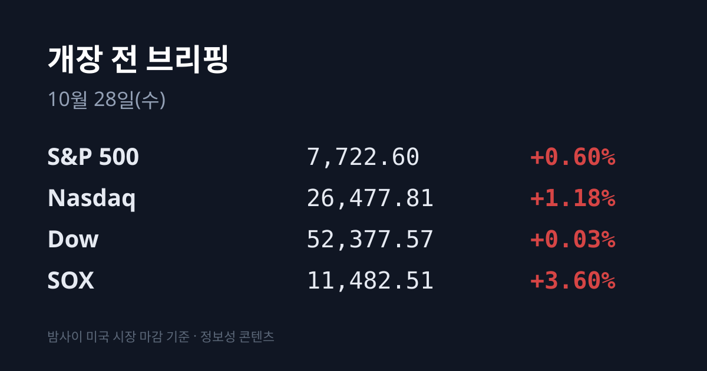
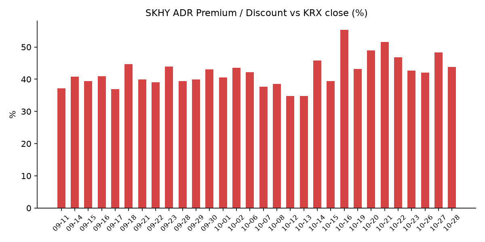
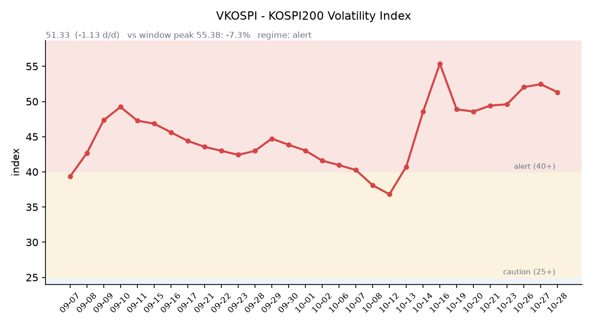

## ① 30초 요약

- 10/27 코스피는 외국인과 기관이 함께 사들이며 <mark>5,638.34(+3.09%)로 반등했고, 10:13에 매수 사이드카가 발동했습니다.</mark> 삼성전자 +4.23%, SK하이닉스 +5.18%였습니다.
- 밤사이 미국에서는 반도체가 이틀 연속 올라 **SOX +3.60%**, 나스닥 +1.18%로 마감했습니다. AMD +5.45%, 브로드컴 +4.00%였습니다.
- 장 마감 뒤 NXP는 시장 예상을 넘는 실적을 냈지만 4분기 매출 가이던스가 예상 수준에 그치며 시간외 −7.3%였습니다. 시게이트도 시간외 −5.7%입니다.
- SKHY는 +1.92%였으나 본주가 더 많이 올라 괴리율은 +43.80%로 4.53%포인트 줄었습니다.
- <mark>오늘(10/28) SK하이닉스가 3분기 실적과 추가 주주환원 방안을 발표</mark>하고, 한국 시각 내일 새벽 3시 FOMC 결과가 나옵니다.

## ② 밤사이 미국 시장

| 지수 | 10/27 종가 | 등락 |
| :--- | ---: | ---: |
| S&P 500 | 7,722.60 | +0.60% |
| 나스닥 종합 | 26,477.81 | +1.18% |
| 다우 | 52,377.57 | +0.03% |
| 필라델피아 반도체(SOX) | 11,482.51 | +3.60% |

10/27 뉴욕 증시는 반도체가 이틀 연속 강세를 보이며 나스닥이 1% 넘게 올랐습니다. 앤트로픽의 상장 신청서 공개 이후 AI 수요에 대한 기대가 이어졌고, 앤트로픽이 2분기에 약 9억7천만 달러의 영업이익을 냈다는 보도도 나왔습니다(뉴스1). <mark>SOX는 10/22 급락 이전인 10/21 종가에 0.2% 차이까지 다가섰습니다.</mark>

AMD $560.26(+5.45%), 브로드컴 $342.33(+4.00%), 인텔 $93.74(+3.61%), 마이크론 $928.76(+2.77%), 엔비디아 $217.94(+0.90%)였습니다. 브로드컴은 앤트로픽용 칩 공급과 관련한 대규모 금융 보도가 재료가 됐습니다. 엔비디아와 AMD는 메타에 각각 30억 달러, 10억 달러를 투자한다고 밝혔고, 메타는 −1.64%로 이틀째 내렸습니다. 테슬라는 +4.04%였고, 보잉은 737 MAX 증산 시점이 내년 하반기로 밀렸다고 밝힌 뒤 −10.69%였습니다.

장 마감 뒤에는 실적 반응이 엇갈렸습니다. 자동차·산업용 반도체 기업 NXP는 3분기 매출 37억8,600만 달러(전년 대비 +19%), 조정 주당순이익 $4.20으로 시장 예상을 넘었고 50억 달러 규모 자사주 매입을 추가했습니다. 그러나 4분기 매출 가이던스가 예상과 비슷한 수준에 그치면서 시간외 가격은 **$235.00(정규장 대비 −7.30%)** 수준입니다(한국 시각 07:08). 비자는 주당순이익이 예상을 넘었지만 다음 회계연도 이익 성장 가이던스를 낮춰 시간외 −1.5%, 시게이트는 −5.7%입니다. 07:17 기준 SKHY 시간외 가격은 $145.10(−0.18%), 마이크론은 $926.50(−0.24%)입니다. 07:09 기준 지수선물은 S&P500 12월물 7,756.25(−0.03%), 나스닥100 12월물 29,800.25(−0.04%)입니다.

미 국채 10년물은 5.00%에서 4.99%로, 30년물은 5.31%에서 5.30%로 내렸습니다. 2년물은 4.68%에서 4.70%로 올라 10년물과의 차이는 0.29%p로 좁혀졌습니다(미 재무부). 10년물 실질금리(TIPS)는 2.66%에서 2.64%로 내렸습니다. VIX는 18.39에서 17.52로 내렸습니다. CME 페드워치 기준 이번 FOMC 동결 확률은 90~93% 수준이고, 12월 인상 확률은 매체에 따라 71~80% 이상으로 집계됩니다. 로이터 설문에서는 이코노미스트 100명 전원이 12월 인상을 예상했습니다.

브렌트유 12월물은 약 $114.93(−0.8%), WTI 12월물은 약 $100.90(−0.9%)으로 이틀째 내렸습니다(월스트리트저널 인용 보도). 오만은 이란과의 협의에서 호르무즈 해협 자유항행 복원의 윤곽이 나왔다고 밝혔습니다. 한국 원유 수입의 기준인 두바이유는 10/26 $115.74로 브렌트($115.81)와 거의 같은 수준입니다(한국석유공사). 금 12월물은 한국 시각 07:06 기준 $4,073.30(+0.86%), 달러인덱스는 102.36(+0.39%)입니다. 실질금리가 내린 가운데 금과 달러가 함께 올랐습니다.

## ③ 괴리율 트래커 — SK하이닉스 ADR

| 항목 | 수치 |
| :--- | ---: |
| SKHY 종가 (10/27) | $145.36 (+1.92%) |
| 본주 환산가 (×10×환율 1,326.63원) | 1,928,389원 |
| 본주 직전 종가 (10/27) | 1,341,000원 |
| **괴리율** | **+43.8%** |

10/27 한국 본주는 1,341,000원(+5.18%)으로 크게 올랐습니다. 그 뒤 미국 SKHY는 +1.92% 오르는 데 그쳐, 괴리율은 전일 +48.33%에서 **+43.80%로 4.53%포인트** 줄었습니다. 본주가 ADR보다 더 많이 오르면서 간격이 좁혀진 것입니다.

괴리율은 미국에 상장된 예탁증서(ADR) 가격을 본주 1주 기준으로 환산한 값과 한국 본주 종가를 비교한 수치입니다. 환산가가 본주보다 높은 프리미엄 상태에서는 전환 차익거래 구조상 본주 쪽에 매수 유인이 생기고, 디스카운트면 반대입니다.

한국 시장 전체를 담는 EWY(iShares MSCI South Korea ETF)는 $157.46(+3.10%)였고 시간외 가격은 $157.30입니다. 10/27 코스피 상승률(+3.09%)과 원/달러 변화가 모두 작았던 점을 감안하면, EWY 상승분은 대부분 한국 장중 움직임과 같은 크기입니다.

## ④ 변동성 트래커

**판정 한 줄**: <mark>'경보' 구간, VKOSPI는 나흘 만에 내렸지만 레버리지 ETF 비중은 다시 커졌습니다.</mark>

**기대 변동성**  VKOSPI **51.33**(10/27, 전일비 −1.13, −2.15%)으로 '경보'(40~60) 구간입니다. 사흘 연속 오른 뒤 하락으로 돌아섰고, 시가 53.91이 고점, 종가가 저점이었습니다. 6월 고점 96.94 대비 −47.0%, 평시 상단인 25의 2.05배입니다.

**실현 변동성**  최근 10거래일 코스피 일별 등락률은 10/14 −0.44%, 10/15 −7.57%, 10/16 +2.05%, 10/19 +1.76%, 10/20 −3.73%, 10/21 +3.29%, 10/22 −3.52%, 10/23 +0.30%, 10/26 −1.46%, 10/27 +3.09%입니다. 10/02 종가 7,003.74 대비 누적 −19.5%이고, 최근 10거래일 중 ±3% 이상 등락일은 닷새입니다.

**매매 정지**  10/27 10:13 유가증권시장 매수 사이드카가 발동했습니다. 10/21 10:51 이후 4거래일 만입니다(한국거래소 KIND 시장운영 공시).

**증폭 경로**  전체 ETF 거래대금 중 레버리지 ETF 비중은 **24.85%로** 직전 21.42%에서 올랐습니다. TIGER 반도체TOP10레버리지 회전율은 27.76%에서 46.46%로 높아졌고(거래대금 2,392억원), KODEX 200선물인버스2X 회전율은 124.59%에서 118.68%로 낮아졌습니다(1조322억원). KODEX 레버리지 1조4,704억원(31.51%), KODEX 코스닥150레버리지 3,826억원(14.35%), KODEX 반도체레버리지 2,080억원(24.93%)입니다(네이버 ETF 목록, 10/28 07:17 스냅샷). 코스피200 선물 베이시스는 +1.38(선물 882.45 − 현물 881.07)로 직전 −1.51에서 플러스로 돌아섰습니다.

**청산 압력**  신용융자 잔고는 10/22 기준 30조3천억원이며, 금융당국은 증권사에 신용융자 관리를 더 해 달라고 요청했습니다(서울신문). 9/21~10/21 반대매매 금액은 5,336억원, 투자자예탁금은 10/21 89조6,344억원입니다.

**하방 포지션**  공매도 순잔고는 T+2~3 공시 지연이 있어 개장 전 시점에는 확정치를 알 수 없습니다.

*미확인: 공매도 순잔고 최신치, 10/23 이후 신용융자·반대매매 일별치, 오늘 개장 직전 밤의 코스피200 야간선물(한국거래소가 다음 날 아침 공개), 코스피 프로그램 매매, DRAM·NAND 당일 현물가.*

## ⑤ 직전 거래일(10/27) 한국장 리뷰

| 지수 | 종가 | 등락 |
| :--- | ---: | ---: |
| 코스피 | 5,638.34 | +168.87 (+3.09%) |
| 코스닥 | 743.83 | +16.62 (+2.29%) |

코스피는 장중 한때 약 4.9% 올라 5,737.61까지 올랐다가 개인 매도에 상승 폭을 줄여 마감했습니다. 외국인은 약 5,929억~8,360억원, 기관은 약 2,804억~4,180억원을 순매수했고, 개인은 약 9,478억~1조4,040억원을 순매도했습니다(매체별 집계 차이). 외국인은 사흘 만에 순매수로 돌아섰습니다.

<mark>삼성전자는 222,000원(+4.23%), SK하이닉스는 1,341,000원(+5.18%)이었습니다.</mark> 앤트로픽의 상장 신청서에서 상반기 매출이 1년 전보다 약 1,300% 늘어난 것으로 나타나 AI 수익화 우려가 누그러졌고, 메모리 공급 부족 기대가 부각됐다는 해석이 나왔습니다. 외국인 순매수 1위는 삼성전자, 순매도 1위는 SK하이닉스였다고 보도됐습니다(SBS Biz). SK하이닉스는 오늘 실적과 함께 이사회 의결을 전제로 추가 주주환원 방안을 발표합니다. 키옥시아 지분 매각 차익을 바탕으로 약 16조원 특별배당을 추진한다는 보도에 회사는 "확정된 바 없다"고 밝혔습니다. 특별배당 기대에 SK스퀘어는 +7.67%, SK는 6%대 올랐습니다. 앤트로픽 초기 투자자로 알려진 SK텔레콤은 장중 8%대까지 올랐다가 +1.94%로 마감했습니다.

코스닥은 장중 758.64(+4.32%)까지 올랐다가 743.83으로 마감했습니다. 기관이 약 1,500억원, 외국인이 약 190억~640억원을 순매수했고 개인은 약 2,060억원을 순매도했습니다. 나흘 연속 내렸던 반도체 장비·부품주가 반등해 유진테크가 8%대, 티에프이·엑시콘이 20%대 올랐고 주성엔지니어링·이오테크닉스·리노공업·원익IPS도 강세였습니다. 로봇 '아틀라스' 공급망 윤곽 소식에 **나무가·캠시스가 상한가**를 기록했고, 멜콘·이지트로닉스·액스비스까지 상한가는 5종목이었습니다. 에코프로는 6%대, 에코프로비엠은 5%대 올랐고, JYP엔터테인먼트는 일본계 인수설이 돌며 장중 15%대까지 올랐다가 회사가 부인한 뒤 +6.81%로 마감했습니다.

원/달러는 서울 외환시장 주간 마감 기준 1,323.7원으로 0.6원 올랐습니다. 한국 시각 07:17 기준 환율은 1,326.63원, 달러/엔은 157.94입니다. 국고채는 외국인 매수에 강세를 보여 주요 금리가 2~5개월 만의 최저로 내려왔습니다(이투데이).

아시아 증시 10/27 종가는 닛케이225 63,268.37(+1.73%), 토픽스 3,997.37(+0.61%), 상하이종합 3,648.30(−1.33%), CSI300 4,049.55(−1.32%), 항셍 23,041.32(−0.73%)입니다. 이틀 쉬고 다시 열린 대만 가권은 46,096.23(+0.12%)이었습니다.

## ⑥ 오늘의 캘린더 & 관전 포인트

- **10/28(수):** <mark>SK하이닉스 3분기 실적·추가 주주환원 발표(09:00 컨퍼런스콜)</mark> — 증권가 영업이익 전망은 76조2,605억원(연합인포맥스)~76조9,640억원(에프앤가이드), 블룸버그 집계 약 77조5천억원. 엠비디 공모 청약(10/28~29), 이스라엘 총선 개표 진행 중.
- **10/29(목):** **03:00 FOMC 결정**과 워시 의장 기자회견, 05:00 이후 마이크로소프트·알파벳·테슬라 실적, 삼성전자 3분기 확정 실적, 21:30 미국 3분기 GDP 속보치. 미국 장 시작 전 일라이릴리·캐터필러·머크·마스터카드 실적.
- **10/30(금):** 05:00 이후 아마존·인텔·스타벅스·코인베이스 실적, 일본은행 회의. **10/31:** CXMT 3분기 실적. **11/3:** 미국 중간선거.

시장 참가자들이 주시하는 레벨은 코스피 10/27 장중 고점 5,737.61과 5,550선, SK하이닉스 1,300,000원 선, VKOSPI 55 선, 원/달러 1,340원 선, 브렌트 $120 선입니다.

## ⑦ 정책 워치

오만은 이란과의 협의에서 호르무즈 해협 자유항행을 복원하는 윤곽이 마련됐다고 밝혔고, 이란이 조건이 충족되면 7일 안에 해협을 다시 열 의사가 있다는 보도가 나왔습니다. 10/27 이스라엘 총선 출구조사에서는 반네타냐후 진영 52~55석, 친네타냐후 진영 50석으로 어느 쪽도 과반(61석)에 이르지 못했습니다. 리쿠드당이 24석 안팎으로 제1당, 아이젠코트의 야샤르당이 22석 안팎으로 2위였고 투표율은 77.7%였습니다.

금융당국은 약세장에도 신용융자 잔고가 30조원대를 유지하자 증권사에 추가 관리를 요청했습니다. 현재 공매도는 전면 재개 상태이며 10월 제도 변경 사항은 없습니다.

## ⑧ 오늘의 질문

미국 반도체 이틀 랠리를 어제 한국장이 먼저 반영한 가운데, SK하이닉스가 발표할 주주환원의 규모는 시장에 알려진 기대와 얼마나 맞을 것인가.

---
*본 글은 공개된 시장 데이터를 정리한 정보성 콘텐츠이며, 특정 종목·상품의 매매 권유가 아닙니다. 모든 투자 판단과 책임은 투자자 본인에게 있습니다. 수치는 작성 시점 기준이며 이후 변동될 수 있습니다.*
