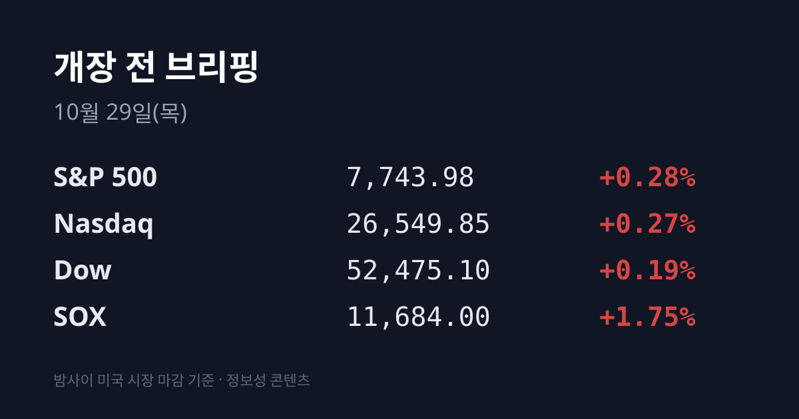
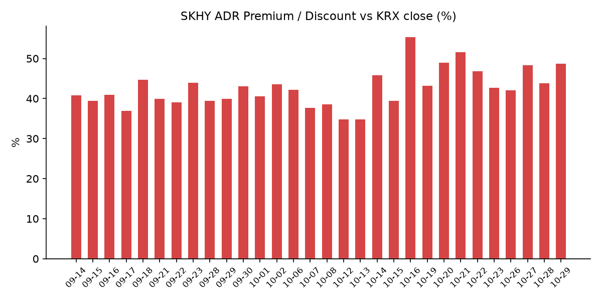
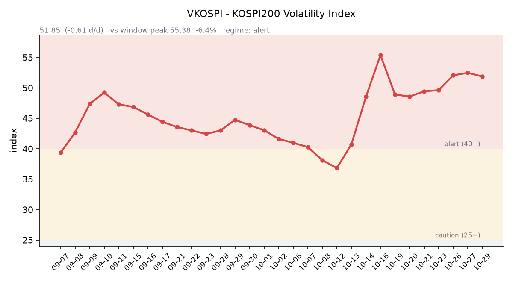

## ① 30초 요약

- 10/28 SK하이닉스가 영업이익 83조3,338억원의 사상 최대 실적과 약 100조원 규모 주주환원을 발표했고, <mark>코스피는 6,012.44(+6.63%)로 10거래일 만에 6,000선을 되찾았습니다.</mark> 이틀 연속 매수 사이드카가 걸렸습니다.
- 밤사이 미국은 3대 지수가 소폭 올랐고 **SOX +1.75%였습니다**. SKHY는 +13.30%, 마이크론은 +5.87%였습니다.
- FOMC는 기준금리를 3.75~4.00%로 동결했고, 위원 2명이 인상 소수의견을 냈습니다. 미 10년물은 5.05%로 다시 5%를 넘었습니다.
- 장 마감 뒤 마이크로소프트는 시간외 +3.8%, 알파벳은 분기 잉여현금흐름이 마이너스로 돌아서며 시간외 −10.4%입니다.
- 괴리율은 +48.66%로 4.86%포인트 커졌습니다. <mark>오늘(10/29) 10:00 삼성전자 3분기 확정실적</mark>, 21:30 미국 3분기 GDP·9월 PCE가 나옵니다.

## ② 밤사이 미국 시장

| 지수 | 10/28 종가 | 등락 |
| :--- | ---: | ---: |
| S&P 500 | 7,743.98 | +0.28% |
| 나스닥 종합 | 26,549.85 | +0.27% |
| 다우 | 52,475.10 | +0.19% |
| 필라델피아 반도체(SOX) | 11,684.00 | +1.75% |

10/28 뉴욕 증시는 FOMC 결과를 확인하며 3대 지수가 모두 소폭 올랐습니다. 반도체는 SK하이닉스 실적의 영향을 받아 강했습니다. **SKHY는 +13.30%**, 마이크론은 $983.23(+5.87%), AMD는 $578.44(+3.25%), 인텔은 $95.53(+1.91%)였고 엔비디아는 $215.38(−1.17%)였습니다. 오라클은 투자자의 날에서 2030 회계연도 매출 2,250억 달러, 2028 회계연도 하반기 잉여현금흐름 흑자 전환 계획을 내놓으며 $144.54(+10.73%)로 마감했습니다. 버티브는 +16.6%, 메타는 −1.24%, 테슬라는 −0.80%였습니다.

장 마감 뒤에는 빅테크 실적이 엇갈렸습니다. 마이크로소프트는 매출 922억8천만 달러, 조정 주당순이익 $4.89로 시장 예상(907억4천만 달러, $4.72)을 넘었고 애저 매출은 48% 늘었습니다. 시간외 가격은 $551.13(+3.79%)입니다. <mark>알파벳은 매출 1,276억 달러로 예상(1,282억 달러)에 조금 못 미쳤고, 분기 잉여현금흐름이 약 −91억 달러로 상장 후 처음 마이너스였습니다.</mark> 구글 클라우드 매출은 103% 늘었지만 검색 성장률은 12%로 전 분기 17%에서 낮아졌습니다. 2026년 설비투자 전망(1,950억~2,050억 달러)은 유지하면서 2027년에는 크게 늘리겠다고 밝혔고, 시간외 가격은 $290.99(−10.43%)입니다. 포티넷은 서비스 매출 전망을 낮춰 시간외 −25.7%, 마벨은 −8.5%, 루멘텀은 +11.7%, KLA는 +3.9%입니다.

한국 시각 07:17 기준 SKHY 시간외 가격은 $159.80(−2.98%), 마이크론은 $962.62(−2.10%)입니다. 07:07 기준 지수선물은 S&P500 12월물 7,753.50(−0.38%), 나스닥100 12월물 29,698.50(−0.94%)입니다.

FOMC는 기준금리를 3.75~4.00%로 동결했습니다. 표결은 10대 2였고, 리사 쿡 이사와 베스 해맥 클리블랜드 연은 총재가 0.25%포인트 인상을 주장했습니다. 워시 의장은 2% 물가 목표를 엄격하게 지키겠다고 말했고, 위기가 아니면 사전 신호(포워드 가이던스)를 주지 않겠다는 입장을 밝혔습니다. 2027년부터 회의 횟수를 줄인다는 발표도 있었습니다.

**미 국채 10년물은 4.99%에서 5.05%로**, 30년물은 5.30%에서 5.37%로 올랐습니다. 2년물은 4.70%에서 4.67%로 내려 10년물과의 차이는 0.38%p로 벌어졌습니다(미 재무부). 10년물 실질금리(TIPS)는 2.64%에서 2.67%로 올랐습니다. VIX는 17.52에서 16.91로 내렸습니다.

브렌트유 12월물은 $115.32(+1.3%), WTI 12월물은 $102.78(+2.9%)로 이틀 만에 반등했습니다(CNBC). 미국이 걸프 국가들에 11/3 중간선거 이후 이란을 상대로 짧고 강도 높은 군사작전이 있을 수 있다고 알렸다는 월스트리트저널 보도가 나왔습니다. 금 12월물은 한국 시각 07:07 기준 $4,079.10(+0.68%), 달러인덱스는 102.16(−0.16%)입니다. 실질금리가 오르고 달러가 내린 가운데 금이 올랐습니다.

## ③ 괴리율 트래커 — SK하이닉스 ADR

| 항목 | 수치 |
| :--- | ---: |
| SKHY 종가 (10/28) | $164.70 (+13.30%) |
| 본주 환산가 (×10×환율 1,342.16원) | 2,210,538원 |
| 본주 직전 종가 (10/28) | 1,487,000원 |
| **괴리율** | **+48.7%** |

10/28 한국 본주는 1,487,000원(+10.89%)으로 크게 올랐습니다. 그 뒤 미국 SKHY가 +13.30%로 본주보다 더 많이 올랐고, 원/달러 환율 상승도 환산가를 끌어올려 괴리율은 전일 +43.80%에서 **+48.66%로 4.86%포인트** 커졌습니다. SKHY 시간외 가격($159.80)으로 환산하면 괴리율은 약 +44.2%입니다.

괴리율은 미국에 상장된 예탁증서(ADR) 가격을 본주 1주 기준으로 환산한 값과 한국 본주 종가를 비교한 수치입니다. 환산가가 본주보다 높은 프리미엄 상태에서는 전환 차익거래 구조상 본주 쪽에 매수 유인이 생기고, 디스카운트면 반대입니다.

한국 시장 전체를 담는 EWY(iShares MSCI South Korea ETF)는 $165.91(+5.37%)였고 시간외 가격은 $163.63(−1.37%)입니다. 10/28 코스피 상승률(+6.63%)에 원화 약세(−1.0%)를 반영한 달러 기준 수익률은 약 +5.5%로, EWY 정규장 상승분과 거의 같은 크기입니다.

## ④ 변동성 트래커

**판정 한 줄**: <mark>'경보' 구간, 지수가 6.63% 뛴 날에도 VKOSPI는 소폭 올랐고 레버리지·인버스 거래가 함께 커졌습니다.</mark>

**기대 변동성**  VKOSPI **51.85**(10/28, 전일비 +0.52, +1.01%)로 '경보'(40~60) 구간입니다. 하루 만에 다시 올랐고, 장중 범위는 51.26~52.11로 좁았습니다. 6월 고점 96.94 대비 −46.5%, 평시 상단인 25의 2.07배입니다.

**실현 변동성**  최근 10거래일 코스피 일별 등락률은 10/15 −7.57%, 10/16 +2.05%, 10/19 +1.76%, 10/20 −3.73%, 10/21 +3.29%, 10/22 −3.52%, 10/23 +0.30%, 10/26 −1.46%, 10/27 +3.09%, 10/28 +6.63%입니다. 10/02 종가 7,003.74 대비 누적 −14.2%이고, 최근 10거래일 중 ±3% 이상 등락일은 엿새입니다.

**매매 정지**  10/28 09:54 유가증권시장 매수 사이드카가 발동했습니다. 10/27 10:13에 이어 이틀 연속이며, 10/21 10:51을 포함해 최근 열흘 사이 세 번째입니다(한국거래소 KIND 시장운영 공시).

**증폭 경로**  전체 ETF 거래대금 중 레버리지 ETF 비중은 **25.30%로** 직전 24.85%에서 올랐습니다. KODEX 200선물인버스2X 회전율은 118.68%에서 141.42%로 높아졌고(거래대금 1조236억원), TIGER 반도체TOP10레버리지 회전율은 46.46%에서 53.45%로 높아졌습니다(3,336억원). KODEX 레버리지 1조8,345억원(34.21%), KODEX 코스닥150레버리지 3,541억원(11.90%), KODEX 반도체레버리지 2,656억원(27.31%)입니다(네이버 ETF 목록, 10/29 07:17 스냅샷). 코스피200 선물 베이시스는 −0.60(선물 945.80 − 현물 946.40)으로 직전 +1.38에서 마이너스로 돌아섰습니다.

**청산 압력**  신용융자 잔고는 10/27 기준 29조6,372억원으로 약 2개월 반 만에 30조원 아래로 내려왔습니다. 같은 날 반대매매 금액은 193억원, 투자자예탁금은 90조1,030억원으로 90조원대를 회복했습니다(세계일보·연합뉴스).

**하방 포지션**  공매도 순잔고는 T+2~3 공시 지연이 있어 개장 전 시점에는 확정치를 알 수 없습니다.

*미확인: 공매도 순잔고 최신치, 10/28 신용융자·반대매매, 오늘 개장 직전 밤의 코스피200 야간선물(한국거래소가 다음 날 아침 공개), 코스피 프로그램 매매, DRAM·NAND 당일 현물가.*

## ⑤ 직전 거래일(10/28) 한국장 리뷰

| 지수 | 종가 | 등락 |
| :--- | ---: | ---: |
| 코스피 | 6,012.44 | +374.10 (+6.63%) |
| 코스닥 | 771.28 | +27.45 (+3.69%) |

코스피는 5,763.85(+2.23%)로 출발해 장중 6,032.28까지 올랐고, 종가 기준으로 10/14(6,008.81) 이후 10거래일 만에 6,000선을 회복했습니다. 이틀 상승률은 약 10%입니다. 외국인은 약 8,158억~8,229억원, 기관은 약 9,601억~9,608억원을 순매수했고, 개인은 약 1조8,016억~1조8,021억원을 순매도했습니다(매체별 집계 차이). 외국인은 이틀 연속 순매수였습니다.

SK하이닉스는 개장 전 3분기 매출 104조6,155억원, 영업이익 83조3,338억원을 공시했습니다. 분기 매출이 처음 100조원을 넘었고 영업이익률은 79.7%였으며, 영업이익은 증권가 전망(약 77조원)을 웃돌았습니다. 3분기 배당 주당 2만원(총 약 14조원)과 신규 자사주 20조원 매입(10조원 소각) 등 이번에 60조원을 더해, 8월 발표분과 합친 2026 회계연도 주주환원은 약 100조원입니다. 컨퍼런스콜에서는 2029년까지 D램·HBM 물량이 사실상 다 팔렸고, 고객이 요청한 HBM 물량이 공급의 두 배를 넘는다고 밝혔습니다. <mark>SK하이닉스는 1,487,000원(+10.89%), 삼성전자는 242,000원(+9.01%)이었습니다.</mark> 유안타증권 이재원 연구원은 이번 실적이 AI 투자 지속성 우려와 메모리 이익 고점론을 반박한다고 평가하면서, AI 고객사의 현금흐름과 자금조달 부담은 남은 변수로 꼽았습니다. 삼성전자는 오늘 확정실적 발표를 앞두고 있습니다.

시가총액 상위에서는 **SK스퀘어 +11.23%**, 삼성전자우 +11.10%, 삼성생명 +8.82%, 삼성전기 +8.74%, SK +8.54%, KB금융 +4.34%였습니다. SK스퀘어는 2026~2028년 경상배당수입의 30% 이상을 주주환원에 쓰겠다고 밝혔습니다.

코스닥은 기관이 약 2,239억원을 순매수했고 외국인은 약 1,835억원, 개인은 약 307억원을 순매도했습니다. 엔비디아 로봇 마케팅 책임자의 11월 방한 소식과 삼성전자의 로봇 사업 현장 점검 보도에 레인보우로보틱스가 +15.08% 올랐고, 로보티즈 +9.76%, 현대오토에버 +7.52%였습니다. 반도체 장비·부품주도 심텍 +8.79%, 주성엔지니어링 +6.12%, 원익IPS +6.08%, 이오테크닉스 +5.95%로 강했습니다. 지니언스는 상한가로 마감했습니다.

원/달러는 서울 외환시장 주간 마감 기준 1,337.7원으로 14.0원 올랐습니다. 5/12(17.5원) 이후 가장 큰 상승 폭이며, 장중에는 1,342.3원까지 올랐습니다. 유가 상승과 외국인의 달러 매수, 수입업체 결제와 해외주식 투자 환전 수요가 겹쳤다는 분석이 나왔습니다(뉴시스). 한국 시각 07:17 기준 환율은 1,342.16원, 달러/엔은 157.84입니다.

아시아 증시 10/28 종가는 닛케이225 63,954.19(+1.08%), 토픽스 3,991.71(−0.14%), 상하이종합 3,681.47(+0.91%), CSI300 4,083.87(+0.85%), 항셍 23,094.83(+0.23%), 대만 가권 47,035.58(+2.04%)입니다.

## ⑥ 오늘의 캘린더 & 관전 포인트

- **10/29(목):** <mark>10:00 삼성전자 3분기 확정실적·컨퍼런스콜</mark> — 10/8 잠정치는 매출 약 195조원, 영업이익 약 107조4천억원이며, 반도체(DS) 부문 이익과 약 30조원 현금배당 여부가 관심입니다. 엠비디 공모 청약 마감, ECB 통화정책회의. **21:30 미국 3분기 GDP 속보치·9월 PCE 물가.** 미국 장 시작 전 일라이릴리·캐터필러·머크·마스터카드 실적.
- **10/30(금):** 05:00 이후 아마존·인텔·스타벅스·코인베이스 실적, 일본은행 회의, 유로존 3분기 GDP. **10/31:** 중국 10월 국가통계국 PMI, CXMT 3분기 실적. **11/3:** 미국 중간선거. **11/9~10:** 엔비디아 AI 데이 서울.

시장 참가자들이 주시하는 레벨은 코스피 10/28 장중 고점 6,032.28과 5,830선, SK하이닉스 1,420,000원 선, VKOSPI 55 선, 원/달러 1,350원 선, 브렌트 $120 선, 미 10년물 5.10% 선입니다.

## ⑦ 정책 워치

월스트리트저널은 미국이 걸프 국가들에 11/3 중간선거 뒤 이란을 상대로 한 짧고 강도 높은 군사작전 가능성에 대비하라고 알렸고, 트럼프 대통령은 아직 최종 결정을 내리지 않았다고 보도했습니다. 백악관은 선거 전 공격은 없다고 밝혔습니다. 10/27 이스라엘 총선은 어느 진영도 과반(61석)에 이르지 못했습니다.

국내에서는 신용융자 잔고가 30조원 아래로 내려왔습니다. 현재 공매도는 전면 재개 상태이며 10월 제도 변경 사항은 없습니다.

## ⑧ 오늘의 질문

SK하이닉스의 '3년치 완판' 발표 다음 날, 삼성전자의 반도체 부문 실적과 주주환원은 메모리 업황에 대한 시장의 평가를 어떻게 보탤 것인가.

---
*본 글은 공개된 시장 데이터를 정리한 정보성 콘텐츠이며, 특정 종목·상품의 매매 권유가 아닙니다. 모든 투자 판단과 책임은 투자자 본인에게 있습니다. 수치는 작성 시점 기준이며 이후 변동될 수 있습니다.*
