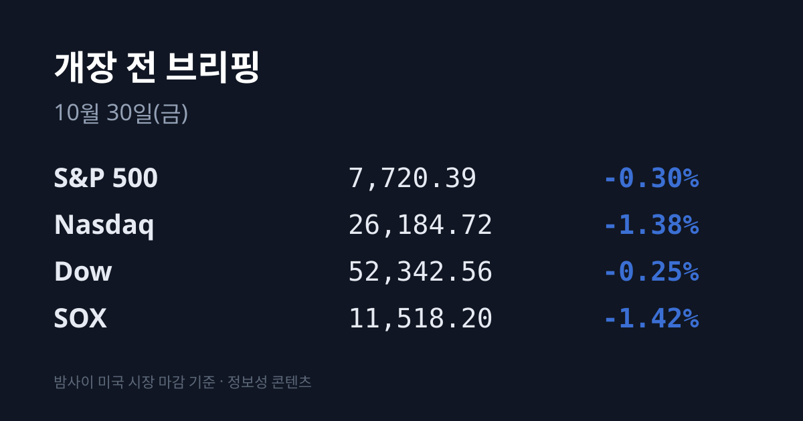
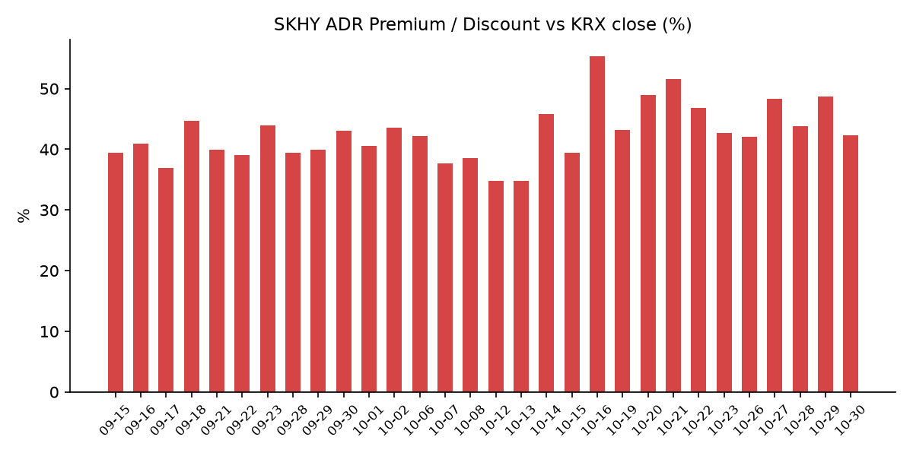
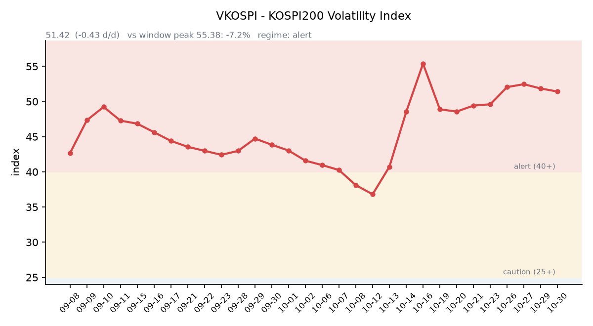

## ① 30초 요약

- 10/29 삼성전자가 영업이익 107조4,405억원의 3분기 확정실적을 냈지만 잔여 주주환원 재원의 사용처를 내년 1월로 미뤘고, <mark>삼성전자는 232,000원(−4.13%), 코스피는 5,937.66(−1.24%)으로 하루 만에 6,000선을 내줬습니다.</mark>
- 밤사이 미국은 알파벳이 −12.64% 급락하며 **나스닥 −1.38%, SOX −1.42%였습니다**.
- 장 마감 뒤 인텔은 4분기 매출 전망이 3분기보다 낮게 나오며 시간외 −21.1%, 아마존은 시간외 −6.2%입니다. SKHY 시간외 가격은 −5.1%입니다.
- 미 10년물은 4.98%로 7bp 내려 다시 5% 아래로 내려왔고, 브렌트유는 $114.88(−0.38%)였습니다.
- 괴리율은 +42.3%로 6.40%포인트 줄었습니다. <mark>오늘(10/30) 일본은행 통화정책회의 결과</mark>가 나옵니다.

## ② 밤사이 미국 시장

| 지수 | 10/29 종가 | 등락 |
| :--- | ---: | ---: |
| S&P 500 | 7,720.39 | −0.30% |
| 나스닥 종합 | 26,184.72 | −1.38% |
| 다우 | 52,342.56 | −0.25% |
| 필라델피아 반도체(SOX) | 11,518.20 | −1.42% |

10/29 뉴욕 증시는 3대 지수가 모두 내렸고 나스닥 낙폭이 컸습니다. <mark>알파벳은 분기 잉여현금흐름이 −91억 달러로 마이너스로 돌아선 실적이 반영되며 $283.82(−12.64%)로 마감했습니다.</mark> 캐터필러는 실적이 예상을 웃돌았지만 AI 관련 지출에 대한 경계 속에 약 −8%, 포티넷은 −20.09%였습니다. 마벨은 루멘텀 인수 협상 보도(양사 미확인)에 −13.24%였습니다. 반도체는 마이크론 $934.27(−4.98%), AMD $566.42(−2.08%), 브로드컴 $345.00(−1.94%), 엔비디아 $213.66(−0.80%), 인텔 $92.07(−3.62%)였습니다. 반면 일라이릴리는 매출 39% 증가와 연간 매출 전망 상향으로 6%대 올랐고, 메타 +1.96%, 애플 +1.48%, 도어대시는 인스타카트 인수 발표에 +5.61%였습니다.

장 마감 뒤에는 실적 발표가 이어졌습니다. **인텔은 3분기 매출 165억 달러로 예상(164억4천만 달러)을 넘었고** 데이터센터 매출이 78% 늘었지만, 4분기 매출 전망을 150억~160억 달러로 3분기보다 낮게 제시하고 PC 수요 둔화가 최소 2027년 상반기까지 이어진다고 밝혔습니다. 시간외 가격은 $72.66(−21.08%)입니다. 아마존은 매출 2,019억 달러, 주당순이익 $1.89로 예상(2,021억 달러, $1.96)에 조금 못 미쳤고, AWS 매출은 39% 늘었습니다. AI 설비투자 영향으로 최근 12개월 잉여현금흐름이 마이너스가 됐고, 시간외 가격은 $228.60(−6.23%)입니다. 샌디스크는 회계 1분기 매출 110억 달러와 8대1 액면분할을 발표해 시간외 +1.8%입니다.

한국 시각 07:17 기준 시간외 가격은 SKHY $153.78(−5.13%), 마이크론 $902.77(−3.37%), AMD $533.15(−5.87%), 엔비디아 $210.52(−1.47%)입니다. 07:07 기준 지수선물은 S&P500 12월물 7,709.00, 나스닥100 12월물 29,156.00으로 미국 정규장 마감 시점보다 각각 0.21%, 0.29% 낮습니다.

경제지표는 미국 3분기 GDP 속보치가 연율 3.4%로 예상(3.1~3.2%)을 웃돌았고, 9월 PCE 물가는 전년 대비 3.6%로 예상에 부합했습니다(근원 3.1%). ECB는 예금금리를 2.50%로 동결했고, 라가르드 총재는 2027년 2월 조기 퇴임 계획을 밝혔습니다.

**미 국채 10년물은 5.05%에서 4.98%로** 내려 다시 5% 아래가 됐습니다. 30년물은 5.37%에서 5.32%로, 2년물은 4.67%에서 4.61%로 내렸고 10년물과의 차이는 0.37%p입니다(미 재무부). 10년물 실질금리(TIPS)는 2.67%에서 2.63%로 내렸습니다. VIX는 16.91에서 17.20으로 올랐습니다.

브렌트유 12월물은 $114.88(−0.38%), WTI 12월물은 $102.00(−0.76%)로 마감했습니다(글로브앤메일). JD 밴스 미국 부통령이 이란 측에 평화협상 재개를 제안하는 서한을 보냈다는 보도가 나왔습니다. 금 12월물은 한국 시각 07:07 기준 $4,033.50(−0.45%), 달러인덱스는 101.85(−0.33%)입니다. 실질금리와 달러가 함께 내린 가운데 금도 내렸습니다.

## ③ 괴리율 트래커 — SK하이닉스 ADR

| 항목 | 수치 |
| :--- | ---: |
| SKHY 종가 (10/29) | $162.09 (−1.58%) |
| 본주 환산가 (×10×환율 1,339.28원) | 2,170,839원 |
| 본주 직전 종가 (10/29) | 1,526,000원 |
| **괴리율** | **+42.3%** |

10/29 한국 본주는 20조원 규모 자사주 매입을 시작한 가운데 1,526,000원(+2.62%)으로 올랐습니다. 그 뒤 미국 SKHY는 $162.09(−1.58%)로 내려 괴리율은 전일 +48.66%에서 **+42.26%로 6.40%포인트** 줄었습니다. SKHY 시간외 가격($153.78)으로 환산하면 괴리율은 약 +35.0%입니다.

괴리율은 미국에 상장된 예탁증서(ADR) 가격을 본주 1주 기준으로 환산한 값과 한국 본주 종가를 비교한 수치입니다. 환산가가 본주보다 높은 프리미엄 상태에서는 전환 차익거래 구조상 본주 쪽에 매수 유인이 생기고, 디스카운트면 반대입니다.

한국 시장 전체를 담는 EWY(iShares MSCI South Korea ETF)는 $161.83(−2.46%)였고 시간외 가격은 $156.24(−3.45%)입니다. 10/29 코스피 하락률(−1.24%)에 원/달러 변동이 거의 없었던 점을 반영한 달러 기준 수익률은 약 −1.2%입니다.

## ④ 변동성 트래커

**판정 한 줄**: <mark>'경보' 구간에서 VKOSPI는 6거래일째 51~52대 박스에 머물러 있고, 하락장에서 반도체 레버리지 회전율이 크게 높아졌습니다.</mark>

**기대 변동성**  VKOSPI **51.42**(10/29, 전일비 −0.43, −0.83%)로 '경보'(40~60) 구간입니다. 10/23 이후 6거래일 동안 51.33~52.46 범위에 있습니다. 6월 고점 96.94 대비 −47.0%, 평시 상단인 25의 2.06배입니다.

**실현 변동성**  최근 10거래일 코스피 일별 등락률은 10/16 +2.05%, 10/19 +1.76%, 10/20 −3.73%, 10/21 +3.29%, 10/22 −3.52%, 10/23 +0.30%, 10/26 −1.46%, 10/27 +3.09%, 10/28 +6.63%, 10/29 −1.24%입니다. 10/29 장중 고가 6,100.11과 저가 5,817.92의 차이는 약 4.8%였습니다. 10/02 종가 7,003.74 대비 누적 −15.2%이고, 최근 10거래일 중 ±3% 이상 등락일은 닷새입니다.

**매매 정지**  최근 열흘 사이 유가증권시장 매수 사이드카가 세 차례(10/21 10:51, 10/27 10:13, 10/28 09:54) 발동했습니다(한국거래소 KIND 시장운영 공시).

**증폭 경로**  전체 ETF 거래대금 중 레버리지 ETF 비중은 25.16%로 직전 25.30%와 비슷했습니다. **TIGER 반도체TOP10레버리지 회전율은 53.45%에서 79.03%로** 높아졌고(거래대금 4,893억원), KODEX 레버리지는 2조3,279억원(회전율 43.94%, 직전 34.21%)이었습니다. KODEX 200선물인버스2X는 9,839억원(127.76%, 직전 141.42%), KODEX 코스닥150레버리지 3,805억원(13.32%), KODEX 반도체레버리지 3,285억원(35.25%)입니다(네이버 ETF 목록, 10/30 07:17 스냅샷). 코스피200 선물 베이시스는 −0.87(선물 935.00 − 현물 935.87)로 이틀째 마이너스이며 폭이 커졌습니다.

**청산 압력**  가장 최근 공개치인 10/27 기준 신용융자 잔고는 29조6,372억원, 반대매매 금액은 193억원입니다(세계일보·연합뉴스).

**하방 포지션**  공매도 순잔고는 T+2~3 공시 지연이 있어 개장 전 시점에는 확정치를 알 수 없습니다.

*미확인: 공매도 순잔고 최신치, 10/28 이후 신용융자·반대매매, 오늘 개장 직전 밤의 코스피200 야간선물(한국거래소가 다음 날 아침 공개), 코스피 프로그램 매매, DRAM·NAND 당일 현물가.*

## ⑤ 직전 거래일(10/29) 한국장 리뷰

| 지수 | 종가 | 등락 |
| :--- | ---: | ---: |
| 코스피 | 5,937.66 | −74.78 (−1.24%) |
| 코스닥 | 753.23 | −18.05 (−2.34%) |

코스피는 6,017.22(+0.08%)로 출발해 09:48 무렵 6,100.11까지 올랐다가, 10:00 삼성전자 실적 발표 뒤 하락으로 돌아서 장중 5,817.92까지 내렸습니다. 잠정 집계로 기관이 약 4,446억원을 순매도했고, 외국인은 약 655억원, 개인은 약 343억원을 순매수했습니다(알파경제). 외국인은 사흘 연속 순매수였지만 규모는 전날(8천억원대)보다 크게 줄었습니다.

삼성전자 3분기 확정실적은 매출 195조2,500억원, 영업이익 107조4,405억원(전년 대비 +783.1%)이었습니다. 반도체(DS) 부문 영업이익은 106조5,000억원, 영업이익률 72%로 HBM4 판매 확대가 이끌었습니다. 3분기 현금배당은 총 30조원(보통주·우선주 주당 4,601원)이고, 올해 총 주주환원 90조~110조원 가운데 남은 55조~75조원의 구체적 집행 방안은 내년 1월 말 이사회에서 정하기로 했습니다. **삼성전자는 장중 6% 넘게 내린 뒤 232,000원(−4.13%)으로** 마감했고 우선주는 −3.26%였습니다. 추가 자사주 매입·소각 계획이 나오지 않은 데 대한 실망 매물이라는 분석이 나왔습니다(알파경제·한국일보). SK하이닉스는 20조원 자사주 매입을 시작한 날 1,526,000원(+2.62%), SK스퀘어는 +3.47%였습니다.

<mark>한국수력원자력이 대우건설·두산에너빌리티 컨소시엄과의 체코 두코바니 원전 시공계약 협상 결렬을 공식화했습니다.</mark> 공사비 정산 방식(물량 정산 대 총액 정산)에서 이견을 좁히지 못했고, 한수원은 새 시공사 입찰을 준비합니다. 대우건설은 11,620원(−18.57%), 두산에너빌리티는 56,500원(−7.98%)이었습니다. LG에너지솔루션은 최대주주 LG화학이 보유 주식 653만5,939주(약 2조5,000억원)를 처분하기로 결정한 영향으로 356,000원(−8.60%)이었습니다. 그 밖에 KB금융 +1.82%, 현대차 −1.18%, 삼성전기 −1.00%였습니다.

코스닥은 개인이 약 2,173억원을 순매수했고 외국인은 약 1,308억원, 기관은 약 759억원을 순매도했습니다. 시가총액 상위 10종목이 모두 내렸고, 레인보우로보틱스 −6.55%, 에코프로비엠 −5.64%, 주성엔지니어링 −4.58%, 에코프로 −4.43%, 원익IPS −3.62%, 심텍 −3.22%였습니다.

원/달러는 서울 외환시장 주간 마감 기준 1,336.8원으로 0.9원 내렸습니다. FOMC의 동결 결정이 예상보다 덜 매파적으로 받아들여진 영향이라는 분석이 나왔습니다(글로벌이코노믹). 한국 시각 07:17 기준 환율은 1,339.28원, 달러/엔은 157.60입니다.

아시아 증시 10/29 종가는 닛케이225 64,659.47(+1.10%), 토픽스 4,003.28(+0.29%), 상하이종합 3,651.43(−0.82%), CSI300 4,041.84(−1.03%), 항셍 22,958.65(−0.59%), 대만 가권 46,368.33(−1.42%)입니다.

## ⑥ 오늘의 캘린더 & 관전 포인트

- **10/30(금):** <mark>일본은행 통화정책회의 결과 발표</mark>(기준금리 1.25%), 유로존 3분기 GDP, 브렌트유 12월물 만기.
- **10/31(토) 10:30:** 중국 10월 국가통계국 PMI(9월 제조업 50.1), CXMT 3분기 실적. **11/1(일):** 한국 10월 수출입동향 — 10월 1~20일 수출은 616억1천만 달러(+105.4%), 반도체 275억 달러(+222.5%)였습니다. **11/2(월) 미국 장 마감 후:** 애플 회계 4분기 실적. **11/3:** 미국 중간선거. **11/9~10:** 엔비디아 AI 데이 서울.

시장 참가자들이 주시하는 레벨은 코스피 6,000선과 5,730선, 10/29 장중 저점 5,817.92, SK하이닉스 1,450,000원 선, VKOSPI 55 선, 원/달러 1,350원 선, 미 10년물 5.05% 선입니다.

## ⑦ 정책 워치

JD 밴스 미국 부통령이 이란 측에 평화협상 재개를 제안하는 서한을 보냈고 카타르가 중재에 나섰다는 보도가 나왔습니다. 앞서 월스트리트저널은 미국이 걸프 국가들에 11/3 중간선거 뒤 대이란 군사작전 가능성에 대비하라고 알렸다고 보도한 바 있습니다.

국내에서는 체코 원전 시공 협상이 결렬됐고, 한수원은 기존 컨소시엄과의 협약 종료 절차에 들어갔습니다. 현재 공매도는 전면 재개 상태이며 10월 제도 변경 사항은 없습니다.

## ⑧ 오늘의 질문

알파벳에 이어 아마존까지 AI 투자로 잉여현금흐름이 마이너스가 된 가운데, 메모리 업체의 실적과 주주환원은 시장에서 어떻게 따로 평가받고 있는가.

---
*본 글은 공개된 시장 데이터를 정리한 정보성 콘텐츠이며, 특정 종목·상품의 매매 권유가 아닙니다. 모든 투자 판단과 책임은 투자자 본인에게 있습니다. 수치는 작성 시점 기준이며 이후 변동될 수 있습니다.*
