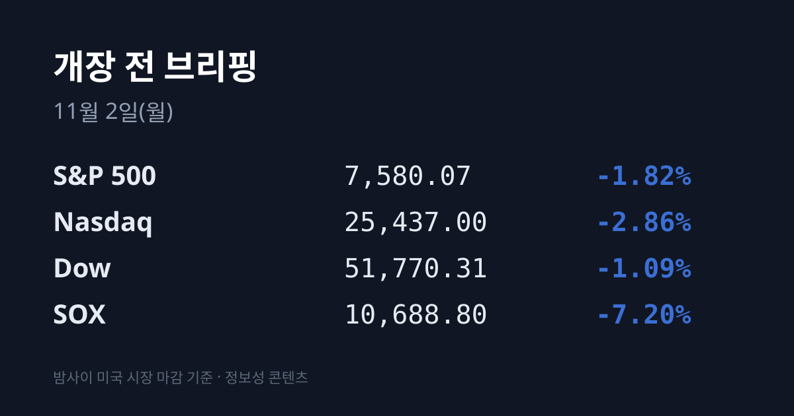
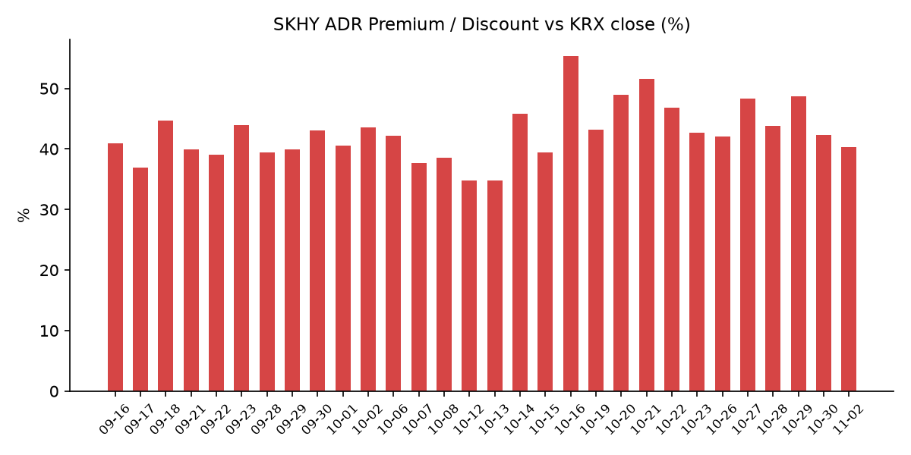
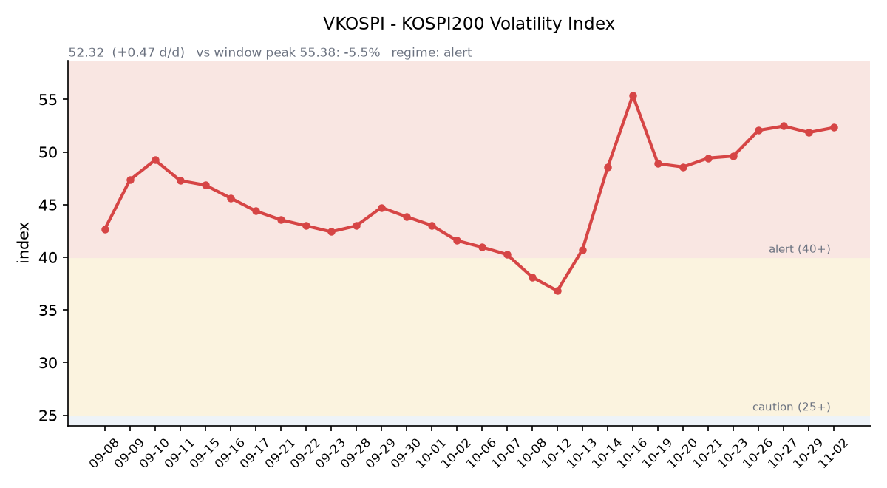

## ① 30초 요약

- 10/30 코스피는 외국인이 약 1조6천억원을 순매도한 가운데 장중 매도 사이드카가 발동했고, <mark>5,730.74(−3.48%)로 마감했습니다.</mark> SK하이닉스 −7.08%, 기아는 3분기 실적 발표 뒤 −11.73%였습니다.
- 한국장 마감 뒤 열린 미국 금요일 장에서 **SOX는 −7.20%, 나스닥은 −2.86%였습니다**. 인텔은 4분기 전망 실망에 −28.58%로 1974년 이후 가장 크게 내렸습니다.
- 주말(11/1) 발표된 <mark>10월 반도체 수출은 564억 달러로 전년 대비 259.4% 늘었습니다.</mark> 전체 수출은 1,153억 달러(+93.7%)입니다.
- 중국 10월 제조업 PMI는 49.3으로 한 달 만에 50 아래로 내려갔습니다. 미 10년물은 4.94%로 4bp 내렸습니다.
- 괴리율은 +40.3%로 1.94%포인트 줄었습니다. 미국은 내일(11/3) 중간선거입니다.

## ② 밤사이 미국 시장

| 지수 | 10/30 종가 | 등락 |
| :--- | ---: | ---: |
| S&P 500 | 7,580.07 | −1.82% |
| 나스닥 종합 | 25,437.00 | −2.86% |
| 다우 | 51,770.31 | −1.09% |
| 필라델피아 반도체(SOX) | 10,688.80 | −7.20% |

한국장이 쉰 주말 동안 미국은 10/30(금) 한 세션이 열렸습니다. 나스닥은 6/5 이후 가장 큰 하루 낙폭을 기록했고, 10/6 고점 대비 −7.8%입니다(로이터). 10월 한 달 동안 나스닥은 5%대, S&P500은 1.2% 안팎 내렸고 다우는 1.5% 안팎 올랐습니다.

<mark>인텔은 $65.76(−28.58%)로 1974년 이후 최악의 하루를 보냈습니다.</mark> 앞서 10/29 장 마감 뒤 4분기 매출 전망을 150억~160억 달러(시장 예상 171억 달러), 조정 주당순이익 전망을 $0.25(예상 $0.43)로 제시했고, 조정 총이익률 전망도 38.0%로 3분기(44.1%)보다 낮췄습니다. PC 수요 둔화가 최소 2027년 상반기까지 이어지고, 이스라엘 공장 폭발로 두 개 분기에 걸쳐 약 6억 달러의 매출 손실이 생긴다고 밝혔습니다. 아마존은 장 시작 전 −7%대까지 밀렸다가 $240.35(−1.41%)로 낙폭을 줄였습니다. 최근 12개월 잉여현금흐름은 −424억 달러입니다.

AI 투자의 현금 소진에 대한 우려가 반도체 전반으로 번지며 **AMD는 $504.80(−10.88%)로** 마감했고, 브로드컴 $326.08(−5.48%), 마이크론 $884.74(−5.30%), 엔비디아 $204.64(−4.22%)였습니다. 레딧은 실적 전망 실망에 −29.22%, 애플은 −1.23%였습니다. 금요일 장 마감 뒤에는 대형 기업의 실적 발표가 없었습니다.

지수선물은 금요일 정규 마감 기준 S&P500 12월물 7,614.00(10/29 대비 −1.81%), 나스닥100 12월물 28,534.00(−3.48%)입니다. 미국 서머타임이 11/1 끝나 선물 거래는 한국 시각 08:00에 다시 열립니다.

미국 3분기 고용비용지수(ECI)는 3개월간 0.8% 올랐습니다. **미 국채 10년물은 4.98%에서 4.94%로** 내렸고, 30년물은 5.31%(−1bp), 2년물은 4.56%(−5bp)로 10년물과의 차이는 0.38%p입니다(미 재무부). 10년물 실질금리(TIPS)는 2.63%에서 2.60%로 내렸습니다. VIX는 17.20에서 19.42로 12.9% 올랐습니다.

브렌트유는 10월 마지막 거래일을 $113.43에 마쳤고, WTI 12월물은 $104.12(+2.08%)였습니다. 금 12월물은 $3,898.90(−3.29%)로 $3,900 아래로 내려왔고, 달러인덱스는 101.88(−0.16%)입니다. 실질금리와 달러가 함께 내렸는데도 금이 크게 내린 하루였습니다.

## ③ 괴리율 트래커 — SK하이닉스 ADR

| 항목 | 수치 |
| :--- | ---: |
| SKHY 종가 (10/30) | $149.21 (−7.95%) |
| 본주 환산가 (×10×환율 1,333.47원) | 1,989,671원 |
| 본주 직전 종가 (10/30) | 1,418,000원 |
| **괴리율** | **+40.3%** |

10/30 한국 본주는 1,418,000원(−7.08%)으로 내렸고, 그 뒤 미국 SKHY는 $149.21(−7.95%)로 마감했습니다. SKHY 낙폭이 본주보다 조금 컸고 원화도 소폭 강해지면서 괴리율은 전일 +42.26%에서 **+40.32%로 1.94%포인트** 줄었습니다. SKHY 시간외 가격은 $149.79(+0.39%)입니다.

괴리율은 미국에 상장된 예탁증서(ADR) 가격을 본주 1주 기준으로 환산한 값과 한국 본주 종가를 비교한 수치입니다. 환산가가 본주보다 높은 프리미엄 상태에서는 전환 차익거래 구조상 본주 쪽에 매수 유인이 생기고, 디스카운트면 반대입니다.

한국 시장 전체를 담는 EWY(iShares MSCI South Korea ETF)는 $152.89(−5.52%)였습니다. 10/30 코스피 하락률(−3.48%)과 원화 강세(+0.19%)를 반영한 한국장 달러 기준 수익률은 약 −3.3%로, 한국장 마감 이후 미국 거래 시간에 약 2.2%포인트가 더 내린 셈입니다.

## ④ 변동성 트래커

**판정 한 줄**: <mark>'경보' 구간에서 코스피가 −3.48% 내리고 매도 사이드카가 발동했지만, VKOSPI는 +1.75% 오르는 데 그쳐 7거래일째 51~53대에 머물러 있습니다.</mark>

**기대 변동성**  VKOSPI **52.32**(10/30, 전일비 +0.90, +1.75%)로 '경보'(40~60) 구간입니다. 장중 53.30까지 올랐다가 내려왔습니다. 6월 고점 96.94 대비 −46.0%, 평시 상단인 25의 2.09배입니다.

**실현 변동성**  최근 10거래일 코스피 일별 등락률은 10/19 +1.76%, 10/20 −3.73%, 10/21 +3.29%, 10/22 −3.52%, 10/23 +0.30%, 10/26 −1.46%, 10/27 +3.09%, 10/28 +6.63%, 10/29 −1.24%, 10/30 −3.48%입니다. 10/30 장중 고가 5,784.98과 저가 5,599.42의 차이는 약 3.3%였습니다. 10/02 종가 7,003.74 대비 누적 −18.2%이고, 최근 10거래일 중 ±3% 이상 등락일은 엿새입니다.

**매매 정지**  **10/30 10:04 유가증권시장 매도 사이드카가** 발동했습니다. 미니 코스피200 선물이 기준가 대비 5.12% 내린 상태가 1분간 이어져 프로그램 매도 호가가 5분간 멈췄고, 올해 28번째 매도 사이드카입니다(이투데이). 앞서 10/27 10:13, 10/28 09:54에는 매수 사이드카가 발동했습니다(한국거래소 KIND 시장운영 공시).

**증폭 경로**  전체 ETF 거래대금 중 레버리지 ETF 비중은 23.83%로 직전 25.16%보다 낮아졌습니다. KODEX 레버리지는 1조6,601억원(회전율 33.93%, 직전 43.94%), TIGER 반도체TOP10레버리지는 3,576억원(66.36%, 직전 79.03%)으로 하락한 날에도 회전율이 내려갔습니다. KODEX 200선물인버스2X는 1조960억원(124.82%), KODEX 코스닥150레버리지 3,830억원(14.44%), KODEX 반도체레버리지 2,661억원(32.89%)입니다(네이버 ETF 목록, 11/2 07:16 스냅샷). 코스피200 선물 베이시스는 −0.33(선물 899.45 − 현물 899.78)으로 사흘째 마이너스지만 폭은 직전 −0.87보다 줄었습니다.

**청산 압력**  10/28 이후 신용융자 잔고와 반대매매 금액은 집계 시점 기준 미확인입니다. 가장 최근 확인치는 10/27 기준 잔고 29조6,372억원, 반대매매 193억원입니다.

**하방 포지션**  공매도 순잔고는 T+2~3 공시 지연이 있어 개장 전 시점에는 확정치를 알 수 없습니다.

*미확인: 공매도 순잔고 최신치, 10/28 이후 신용융자·반대매매, 오늘 개장 직전 밤의 코스피200 야간선물(한국거래소가 다음 날 아침 공개), 코스피 프로그램 매매, DRAM·NAND 당일 현물가.*

## ⑤ 직전 거래일(10/30) 한국장 리뷰

| 지수 | 종가 | 등락 |
| :--- | ---: | ---: |
| 코스피 | 5,730.74 | −206.92 (−3.48%) |
| 코스닥 | 724.38 | −28.85 (−3.83%) |

코스피는 5,760.35로 출발해 장중 5,599.42까지 내렸다가 5,700선 위에서 마감했습니다. 외국인이 약 1조6,149억원을 순매도했고, 기관은 약 7,540억원, 개인은 약 6,028억원을 순매수했습니다(네이버 금융 투자자별 매매동향, 기사별 외국인 1조6,170억~1조6,230억원). 하락 656종목, 상승 234종목이었습니다. 주간으로는 10/23 5,550.30에서 3.25% 올랐고, 한 주 동안 외국인 2,703억원 순매도, 기관 2조5,403억원 순매수, 개인 3조212억원 순매도였습니다(파이낸셜뉴스).

**SK하이닉스는 1,418,000원(−7.08%)**, 삼성전자는 225,000원(−3.02%)으로 마감했습니다. 장중에는 각각 −8.90%, −6.07%까지 밀렸습니다. 삼성증권은 알파벳·아마존의 핵심 사업 성장 둔화와 AI 인프라 투자에 따른 잉여현금흐름 악화가 "AI 투자 지속성에 대한 의구심"을 키웠다고 분석했습니다. 삼성전자 우선주 −5.33%, SK스퀘어 −5.88%, 삼성전기 −7.50%였습니다.

<mark>기아는 3분기 영업이익 1조8,183억원이 시장 예상(2조4,417억원, 에프앤가이드)보다 25.5% 낮게 나오며 95,600원(−11.73%)으로 마감했습니다.</mark> 영업이익률은 5.8%로, 중동 판매 차질과 원자재 가격 상승, 판매 인센티브 확대가 수익성을 눌렀다고 밝혔습니다. 현대차는 −3.59%, 한화에어로스페이스는 −8.42%였습니다. 반면 삼성바이오로직스는 1,487,000원(+8.86%), 셀트리온 +1.22%, 신한지주 +1.24%였고 의약품 업종은 +4.90%였습니다. 업종별로는 금속 −6.22%, 운송장비 −4.88%, 전기전자 −4.67%였습니다.

코스닥은 개인이 약 1,649억원을 순매수했고 기관은 약 1,391억원, 외국인은 약 211억원을 순매도했습니다. 반도체 장비·부품주 낙폭이 컸고 티에스이 −14.78%, 리노공업 −9.08%, 심텍 −8.02%, 원익IPS −7.72%, 주성엔지니어링 −6.78%, 이오테크닉스 −6.39%였습니다.

원/달러는 서울 외환시장 주간 마감 기준 1,334.3원으로 2.5원 내렸습니다. FOMC 동결 이후 달러 상승 압력이 줄고 월말 수출업체 달러 매도가 나온 영향이라는 분석이 나왔습니다(서울경제·조세일보). 주말 기준 환율은 1,333.47원, 달러/엔은 157.45입니다.

아시아 증시 10/30 종가는 닛케이225 63,290.11(−2.12%), 토픽스 3,965.07(−0.95%), 상하이종합 3,599.02(−1.44%), CSI300 3,985.50(−1.39%), 항셍 23,294.42(+1.46%), 대만 가권 45,211.83(−2.49%)입니다. 같은 날 일본은행은 기준금리를 1.25%로 동결했고(9명 중 8명 찬성), 기조적 물가상승률이 2% 목표에 대체로 부합한다고 처음 판단했습니다.

## ⑥ 오늘의 캘린더 & 관전 포인트

- **주말 발표:** <mark>10월 수출 1,153억 달러(+93.7%), 반도체 564억 달러(+259.4%)</mark>로 둘 다 9월에 이은 월간 역대 2위입니다. 반도체가 전체 수출의 49%이고, D램 고정가격은 6월 $40에서 10월 $50로 올랐습니다(산업통상부). 중국 10월 제조업 PMI는 49.3(9월 50.1, 시장 예상 50.0)이었고, 신규 수출주문은 48.7이었습니다(국가통계국).
- **11/2(월) 08:00:** 미국 지수선물 거래 재개. **11/3(화) 00:00:** 미국 10월 ISM 제조업 지수. **11/3(화) 새벽:** 애플 회계 4분기·팔란티어 3분기 실적(미국 11/2 장 마감 후).
- **11/3(화):** <mark>미국 중간선거</mark>, 9월 JOLTS(23:00). **11/4(수) 새벽:** AMD 3분기 실적. **11/6(금) 22:30:** 미국 10월 고용보고서. **11/9~10:** 엔비디아 AI 데이 서울.

시장 참가자들이 주시하는 레벨은 코스피 5,800선과 5,530선, 10/30 장중 저점 5,599.42, SK하이닉스 1,350,000원 선, VKOSPI 55 선, 원/달러 1,350원 선, 미 10년물 5.00% 선입니다.

## ⑦ 정책 워치

마코 루비오 미 국무장관은 트럼프 대통령이 대이란 군사행동 재개를 아직 결정하지 않았다고 말했고, 추가 공습은 중간선거 이후에 가능성이 있다는 보도가 나왔습니다(폭스뉴스). 이란은 호르무즈 해협 재개 방안을 제시하고 미국의 응답을 기다리고 있으며, 아락치 외무장관은 미국의 대화 제안을 "긍정적 진전"이라고 했습니다(알자지라). 트럼프 대통령은 협상이 잘 되고 있지만 서두르지 않는다고 말했습니다. 미 해군의 해상 봉쇄는 이어지고 있습니다.

국내에서는 한국거래소가 11/1 저PBR 기업 명단을 공개했습니다. 현재 공매도는 전면 재개 상태이며 최근 제도 변경 사항은 없습니다.

## ⑧ 오늘의 질문

미국이 'AI 투자 회수'를 의심하며 반도체를 팔던 같은 주말, 한국의 반도체 수출은 전년 대비 259% 늘었다 — 두 숫자 가운데 시장은 어느 쪽을 먼저 읽고 있는가.

---
*본 글은 공개된 시장 데이터를 정리한 정보성 콘텐츠이며, 특정 종목·상품의 매매 권유가 아닙니다. 모든 투자 판단과 책임은 투자자 본인에게 있습니다. 수치는 작성 시점 기준이며 이후 변동될 수 있습니다.*
