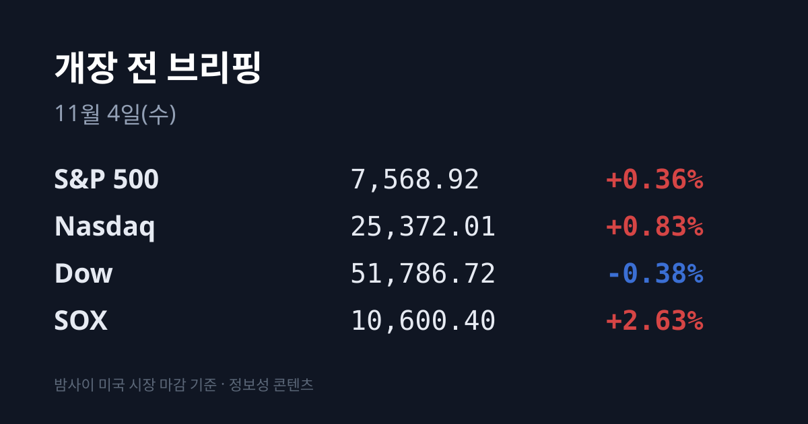
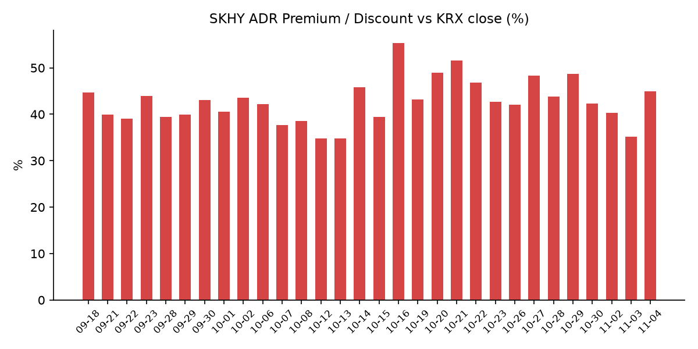
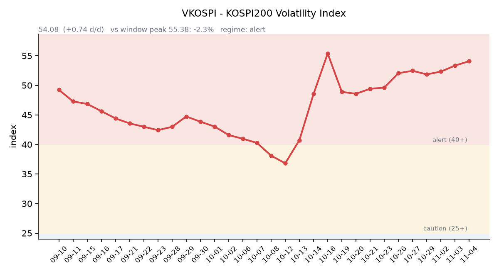

## ① 30초 요약

- 11/3 코스피는 외국인이 1조5,171억원, 기관이 5,091억원을 순매도하며 <mark>5,648.79(−3.59%)로 마감했습니다.</mark> SK하이닉스 −5.03%, 삼성전자 −4.15%, 삼성SDI −9.20%였습니다.
- 밤사이 미국은 나스닥 +0.83%, S&P500 +0.36%로 사흘 하락을 끊었고 **SOX는 +2.63%였습니다**. 다우는 −0.38%였습니다.
- 장 마감 뒤 AMD는 3분기 매출 133.8억 달러와 4분기 매출 전망 약 170억 달러를 내놨고, <mark>시간외 가격은 $518.32(+7.1%)입니다.</mark>
- SKHY는 +2.09%로 본주(−5.03%)와 반대로 움직였고, 괴리율은 +44.95%로 9.81%포인트 커졌습니다.
- 미국 중간선거 개표 결과가 한국 시각 오늘 오전부터 나옵니다.

## ② 밤사이 미국 시장

| 지수 | 11/3 종가 | 등락 |
| :--- | ---: | ---: |
| S&P 500 | 7,568.92 | +0.36% |
| 나스닥 종합 | 25,372.01 | +0.83% |
| 다우 | 51,786.72 | −0.38% |
| 필라델피아 반도체(SOX) | 10,600.40 | +2.63% |

미국 중간선거 투표일인 11/3, 전날까지 사흘 동안 내린 기술주로 매수가 돌아왔습니다. S&P500 11개 업종 가운데 정보기술이 +1.4%로 가장 많이 올랐지만, 종목 수로는 하락 291개·상승 211개로 내린 종목이 더 많았습니다(CNBC). 나스닥100은 28,180.26(+0.7%)으로 고점 대비 약 10% 낮은 조정 구간에 머물렀습니다.

반도체는 AMD $483.90(+3.65%), 마이크론 $855.10(+2.58%), 엔비디아 $206.69(+2.29%), 인텔 $60.55(+0.97%)였고 브로드컴도 3% 넘게 올랐습니다. 애플은 전날 발표한 총이익률 전망과 아이패드 매출이 기대에 못 미쳐 약 2% 내렸고, 이 여파로 다우가 하락했습니다(CNBC).

<mark>장 마감 뒤 AMD가 시장 예상을 넘는 실적을 발표했습니다.</mark> 3분기 매출은 133.8억 달러(전년 대비 +45%)로 예상(약 130.9억 달러)을 웃돌았고, 조정 주당순이익은 $2.09(예상 $1.95)였습니다. 데이터센터 매출이 85억 달러로 **전년 대비 +97%였고**, 클라이언트·게이밍은 37억 달러(−8%)였습니다. 4분기 매출 전망은 약 170억 달러(±3%)로 시장 예상(약 162억 달러)보다 높았고, 비GAAP 총이익률 전망은 약 55%로 예상(55.3%)보다 조금 낮았습니다. 리사 수 CEO는 헬리오스·베니스 양산 확대로 4분기 성장이 빨라진다고 밝혔습니다(CNBC·Benzinga). 시간외 가격은 AMD $518.32(+7.1%), 마이크론 $866.74(+1.4%), 엔비디아 $209.60(+1.4%)입니다(07:17 KST).

**미 국채 10년물은 4.91%에서 4.95%로** 올라 사흘 만에 상승했습니다. 30년물은 5.32%(+4bp), 2년물은 4.61%(+2bp)로 10년물과의 차이는 0.34%p입니다. 10년물 실질금리(TIPS)는 2.65%로 3bp 올랐습니다(미 재무부). VIX는 21.15에서 20.83으로 내렸습니다.

국제유가는 미국과 이란의 협상 진전 기대가 이어지며 브렌트유 $103.60(−1.12%), WTI $96.09(−0.38%)로 마감했습니다(CNBC). 금 12월물은 $3,940.20(−0.74%)로 실질금리 상승과 함께 내렸고, 달러인덱스는 101.87(+0.12%)입니다.

지수선물은 정규 마감(06:59 KST) 기준 S&P500 12월물 7,608.75(+0.45%), 나스닥100 12월물 28,416.00(+1.03%)입니다.

## ③ 괴리율 트래커 — SK하이닉스 ADR

| 항목 | 수치 |
| :--- | ---: |
| SKHY 종가 (11/3) | $150.79 (+2.09%) |
| 본주 환산가 (×10×환율 1,343.84원) | 2,026,376원 |
| 본주 직전 종가 (11/3) | 1,398,000원 |
| **괴리율** | **+44.95%** |

11/3 한국 본주는 1,398,000원(−5.03%)으로 내렸지만, 그 뒤 미국 SKHY는 $150.79(+2.09%)로 올랐습니다. 하루 전과 정반대 방향으로 엇갈리면서 괴리율은 전일 +35.14%에서 <mark>+44.95%로 9.81%포인트 커졌습니다.</mark> 10/30(+42.26%) 이후 다시 40%대입니다. SKHY 시간외 가격은 $153.50(+1.80%)입니다.

괴리율은 미국에 상장된 예탁증서(ADR) 가격을 본주 1주 기준으로 환산한 값과 한국 본주 종가를 비교한 수치입니다. 환산가가 본주보다 높은 프리미엄 상태에서는 전환 차익거래 구조상 본주 쪽에 매수 유인이 생기고, 디스카운트면 반대입니다.

한국 시장 전체를 담는 EWY(iShares MSCI South Korea ETF)는 $155.06(+2.27%)였고 시간외 가격은 $156.87입니다. 11/2 미국 마감 가격에는 한국장 마감 이후 몫(약 −2.3%포인트)이 이미 들어 있었으므로, 한국 11/2 마감부터 미국 11/3 마감까지 EWY 누적은 약 −0.1%입니다. 같은 기간 한국 시장은 달러 기준 약 −3.4%(코스피 −3.59%, 원화 +0.21%)여서, **한국 11/3 마감 이후 미국 시간에 약 3.4%포인트가** 더해진 셈입니다(시간외 가격 기준 약 4.6%포인트).

## ④ 변동성 트래커

**판정 한 줄**: <mark>'경보' 구간에서 VKOSPI가 54.08로 사흘째 올라 10/23 이후 박스(51~52) 위에서 고가 마감했지만, 선물 베이시스와 인버스 회전율은 하방 베팅이 식는 쪽을 가리킵니다.</mark>

**기대 변동성**  VKOSPI **54.08**(11/3, 전일비 +0.74, +1.39%)로 '경보'(40~60) 구간입니다. 시가 52.93에서 출발해 고가로 마감했습니다. 6월 고점 96.94 대비 −44.2%, 평시 상단인 25의 2.16배입니다.

**실현 변동성**  최근 10거래일 코스피 일별 등락률은 10/21 +3.29%, 10/22 −3.52%, 10/23 +0.30%, 10/26 −1.46%, 10/27 +3.09%, 10/28 +6.63%, 10/29 −1.24%, 10/30 −3.48%, 11/2 +2.24%, 11/3 −3.59%입니다. 이 중 ±3% 이상 등락일은 엿새입니다. 11/3은 시가부터 −2.46%로 출발해 장중 고가 5,735.92와 저가 5,615.80의 차이가 종가 대비 2.1%였고, 최근 5거래일 평균 일중 변동폭은 4.0%입니다. 10/02 종가 7,003.74 대비로는 −19.3%입니다.

**매매 정지**  최근 열흘 사이 10/27 10:13, 10/28 09:54에 유가증권시장 매수 사이드카가, 10/30 10:04에 매도 사이드카가 발동했습니다(한국거래소 KIND 시장운영 공시).

**증폭 경로**  전체 ETF 거래대금 중 레버리지 ETF 비중은 23.11%로 직전(23.78%)보다 낮아졌습니다. KODEX 레버리지는 1조5,214억원(회전율 33.42%), KODEX 200선물인버스2X는 8,857억원(92.62%, 직전 106.58%), TIGER 반도체TOP10레버리지는 2,396억원(45.76%, 직전 54.85%)이며, 인버스2X 회전율은 이틀 연속 낮아졌습니다. KODEX 코스닥150레버리지는 3,440억원(13.80%), KODEX 반도체레버리지 1,742억원(23.72%)입니다(네이버 ETF 목록, 11/4 07:17 스냅샷). 코스피200 선물 베이시스는 −0.52(선물 885.15 − 현물 885.67)로 닷새째 마이너스지만, 폭은 직전 −1.98에서 크게 줄었습니다.

**청산 압력**  10/28 이후 신용융자 잔고와 반대매매 금액은 집계 시점 기준 미확인입니다. 가장 최근 확인치는 10/27 기준 잔고 29조6,372억원, 반대매매 193억원입니다.

**하방 포지션**  공매도 순잔고는 T+2~3 공시 지연이 있어 개장 전 시점에는 확정치를 알 수 없습니다.

*미확인: 공매도 순잔고 최신치, 10/28 이후 신용융자·반대매매, 오늘 개장 직전 밤의 코스피200 야간선물(한국거래소가 다음 날 아침 공개), 코스피 프로그램 매매, DRAM·NAND 당일 현물가.*

## ⑤ 직전 거래일(11/3) 한국장 리뷰

| 지수 | 종가 | 등락 |
| :--- | ---: | ---: |
| 코스피 | 5,648.79 | −210.29 (−3.59%) |
| 코스닥 | 704.39 | −29.97 (−4.08%) |

코스피는 5,715.19(−2.46%)로 출발해 장중 5,615.80까지 내렸고, 전날 반등분을 모두 반납했습니다. <mark>외국인이 1조5,171억원, 기관이 5,091억원을 순매도했고</mark> 개인이 1조6,605억원을 순매수했습니다(미디어펜; 파이낸셜뉴스·이투데이는 외국인 1조5,284억원으로 집계). 연기금은 1,133억원을 순매수했습니다(파이낸셜뉴스). 외국인은 3거래일 연속 순매도로 누적 약 3조7천억원입니다. 코스피 하락 종목은 658개, 상승 종목은 221개였습니다.

**SK하이닉스는 1,398,000원(−5.03%)**, 삼성전자는 219,500원(−4.15%)으로 마감했습니다. 메타·오라클이 각각 약 200억 달러 규모의 자금 조달을 추진한다는 보도(11/2 오라클 −8.8%), 앤트로픽의 지출 약정 규모(8,954억 달러), 애플 총이익률 전망에서 드러난 메모리 원가 부담이 겹치며 AI 투자의 수익성에 대한 의문이 커졌다는 분석이 나왔습니다(파이낸셜뉴스·이투데이). 외국인 순매도 상위는 SK하이닉스 6,376억원, 삼성전자 2,064억원, 삼성전기 1,914억원이었고, 기관도 SK하이닉스를 2,724억원 순매도했습니다(이투데이).

2차전지는 **삼성SDI −9.20%, SK이노베이션 −9.36%로** 크게 내렸고 LG에너지솔루션은 −5.06%였습니다. 미국 중간선거 뒤 의회 구도가 바뀌면 보조금·세액공제가 줄어들 수 있다는 우려가 대미 투자 비중이 큰 업종을 눌렀다는 분석입니다(이투데이). 조선은 HD한국조선해양 +3.01%, 삼성중공업 +0.93%로 하락장에서 버텼고, 전날 미 해군 함정 수주로 +10.80% 올랐던 한화오션은 −2.00%였습니다. 시가총액 상위 10종목 가운데 오른 종목은 삼성바이오로직스(+1.13%)뿐이었고 삼성전기 −7.04%, SK스퀘어 −5.68%, 현대차 −3.48%였습니다(미디어펜).

코스닥은 외국인 743억원, 기관 2,344억원을 순매도했고 개인이 3,191억원을 순매수했습니다. 반도체 장비주는 이오테크닉스 −8.81%, 주성엔지니어링 −7.92%, 원익IPS −7.58%, 리노공업 −6.14%, 심텍 −5.65%였고 에코프로 −4.47%, 에코프로비엠 −4.78%였습니다(미디어펜).

원/달러는 서울 외환시장 주간 마감 기준 **1,341.0원으로 2.8원** 내렸습니다. 작성 시각(11/4 07:16) 현재 환율은 1,343.84원, 달러/엔은 158.66입니다.

아시아 증시 11/3 종가는 대만 가권 43,307.54(−3.59%), 상하이종합 3,608.10(−0.82%), CSI300 4,008.87(−0.20%), 항셍 23,525.97(+0.57%)입니다. 일본은 11/3 문화의 날로 휴장했고, 11/2 종가는 닛케이225 63,081.86(−0.33%), 토픽스 3,930.28(−0.88%)입니다.

## ⑥ 오늘의 캘린더 & 관전 포인트

- **11/4(수) 08:00:** 미국 지수선물 거래 재개. 일본 증시는 이틀 만에 거래를 재개합니다.
- **11/4(수) 오전:** <mark>미국 중간선거 개표 — 동부·주요 경합주 결과가 한국 시각 오전 9~11시에 나옵니다</mark>(이투데이). 예측시장은 민주당의 상원 장악 가능성을 약 75%로 봤습니다(CNBC).
- **11/6(금) 22:30:** 미국 10월 고용보고서. **11/9~10:** 엔비디아 AI 데이 서울. **11/10(화, 미국 현지):** 코어위브 실적. **11/11:** 한국 10월 고용동향. **11/16 주:** 앤트로픽 나스닥 상장 예정(WSJ).

시장 참가자들이 주시하는 레벨은 코스피 11/3 장중 저점 5,615.80과 5,600선, 11/3 고가 5,735.92, 5,850선, SK하이닉스 1,350,000원 선, VKOSPI 55 선, 미 10년물 5.00%, 원/달러 1,350원 선입니다.

## ⑦ 정책 워치

미국 중간선거 결과와 관련해, 민주당이 상·하원을 모두 가져가면 AI 규제 우려로 AI 관련주가 흔들릴 수 있고 공화당이 의회를 유지하면 단기 반등이 나올 수 있다는 분석이 나왔습니다. 결과와 관계없이 불확실성이 걷히는 것 자체를 반등 재료로 보는 시각도 있습니다(CNBC). 국내에서는 대미 투자 보조금·세액공제 변화가 2차전지 업종의 쟁점으로 거론되고 있습니다(이투데이).

국내에서는 현재 공매도가 전면 재개 상태이며 최근 제도 변경 사항은 없습니다.

## ⑧ 오늘의 질문

어제 한국 시장은 'AI 투자비는 회수되는가'라는 의문에 −3.6%로 반응했다 — 밤사이 AMD가 내놓은 데이터센터 +97%와 개표 결과 중 어느 쪽이 오늘 시장의 화두가 되는가.

---
*본 글은 공개된 시장 데이터를 정리한 정보성 콘텐츠이며, 특정 종목·상품의 매매 권유가 아닙니다. 모든 투자 판단과 책임은 투자자 본인에게 있습니다. 수치는 작성 시점 기준이며 이후 변동될 수 있습니다.*
