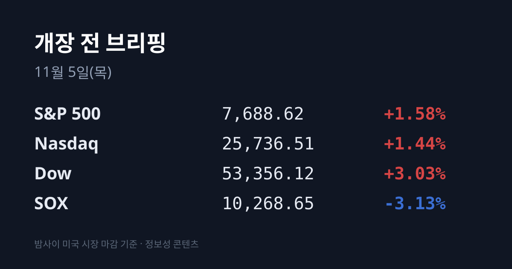
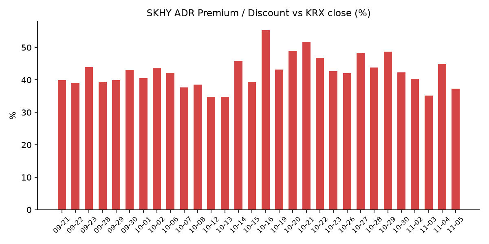
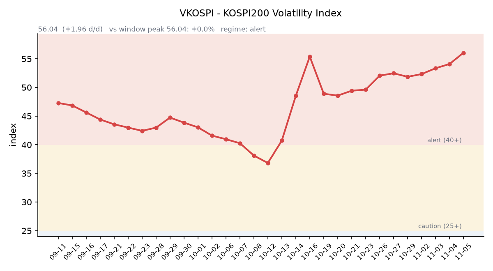

## ① 30초 요약

- 미국 중간선거에서 민주당이 상·하원 다수당을 확보했고, 11/4 미국은 <mark>다우 +3.03%로 2025년 4월 이후 최대 상승</mark>, S&P500 +1.58%, 나스닥 +1.44%였습니다.
- 반면 **SOX는 −3.13%, 마이크론은 −7.00%였습니다.** 민주당 의회가 AI·데이터센터 건설을 규제할 수 있다는 우려가 반도체·AI 인프라주를 눌렀습니다(CNBC).
- SKHY는 −5.12%로 본주(−0.14%)보다 크게 내렸고, 괴리율은 +44.95%에서 +37.36%로 7.59%포인트 줄었습니다.
- 11/4 코스피는 장중 5,421.72(−4.02%)까지 밀렸다가 5,683.80(+0.62%)으로 마감했습니다. 외국인은 2조5,020억원을 순매도했습니다.
- 국제유가는 WTI −8.38%, 브렌트 −8.66%로 급락했고, 장 마감 뒤 퀄컴은 시간외 −7.7%입니다.

## ② 밤사이 미국 시장

| 지수 | 11/4 종가 | 등락 |
| :--- | ---: | ---: |
| S&P 500 | 7,688.62 | +1.58% |
| 나스닥 종합 | 25,736.51 | +1.44% |
| 다우 | 53,356.12 | +3.03% |
| 필라델피아 반도체(SOX) | 10,268.65 | −3.13% |

민주당이 하원을 되찾고 상원 다수당도 확보하면서 정치 불확실성이 걷혔고, 트럼프 대통령은 선거 결과를 "전적으로 수용"한다고 밝혔습니다. 다우는 1,569.40포인트 올라 2025년 4월 9일 이후 하루 최대 상승을 기록했습니다. 분점정부에서는 통과되는 정책이 적어 증시에 우호적이라는 해석과 함께 월마트(+3%), 뱅크오브아메리카(약 +4%) 등 경기민감주가 상승을 이끌었습니다(CNBC).

<mark>반도체·AI 인프라주는 반대로 내렸습니다.</mark> 마이크론 $795.23(−7.00%), 엔비디아 $200.13(−3.17%), 코어위브 $48.42(−9.90%)였고 네오클라우드 ETF는 6% 하락했습니다. 민주당 의회가 AI와 데이터센터 건설을 심사·제한할 수 있다는 우려가 컸고, 텍사스에서 데이터센터 모라토리엄을 공약한 민주당 지나 히노조사 후보의 당선도 거론됐습니다(CNBC). AMD는 전날 실적 효과로 $488.78(+1.01%)였습니다.

애플은 $349.51(+5.31%)로 장중 사상 최고가 $354.33을 기록하며 시가총액 5.12조 달러를 넘었습니다. 데이터센터 건설이 늦어지고 메모리 원가 부담이 줄어드는 쪽에서 이익을 보는 '반(反)AI 주식'으로 해석됐습니다(CNBC). 마이크로소프트는 $555.80(+6.68%)였습니다.

장 마감 뒤 퀄컴과 Arm이 실적을 냈습니다. **퀄컴은 회계 4분기 매출 약 104억 달러**(예상 약 101억 달러), 조정 주당순이익 $2.17(예상 $2.16)로 예상을 웃돌았고 1분기 매출 전망 104억~112억 달러도 예상(약 105억 달러)보다 높았습니다. 다만 1분기 주당순이익 전망 $2.15~2.35가 예상에 조금 못 미쳤고 연간 설비투자가 약 25억 달러로 예상(약 19억 달러)보다 많았습니다(investinglive). 정규장 $173.19(+5.33%)였던 주가는 시간외 $159.90(−7.7%)입니다. Arm은 회계 2분기 매출 약 14.4억 달러(예상 약 13.8억 달러), 조정 주당순이익 $0.52(예상 $0.47)였고, 3분기 매출 전망 중간값은 15.4억 달러(예상 약 15.3억 달러)였습니다(investinglive). Arm은 정규장 $191.80(−5.28%), 시간외 $190.68입니다. 시간외 가격은 마이크론 $800.25, 엔비디아 $201.82, AMD $493.14입니다(07:18 KST).

**미 국채 10년물은 4.95%에서 4.90%로** 내렸습니다. 30년물은 5.28%(−4bp), 2년물은 4.58%(−3bp)로 10년물과의 차이는 0.32%p입니다. 10년물 실질금리(TIPS)는 2.64%로 1bp 내렸습니다(미 재무부). VIX는 20.83에서 16.61로 20.3% 낮아졌습니다.

국제유가는 WTI $88.04(−8.38%), 브렌트유 $94.63(−8.66%)로 급락했습니다. JD 밴스 부통령이 공화당 패배의 원인으로 이란 전쟁을 지목하자 시장은 이를 전쟁 종결 압력으로 받아들였습니다(CNBC). 한국 원유 수입의 기준인 두바이유는 11/4 $100.89로, 브렌트보다 $6.27 높은 역전이 이어지고 있습니다(한국석유공사 페트로넷). 금 12월물은 $4,072.20(+3.34%)으로 달러인덱스 하락(101.53, −0.33%)과 함께 올랐습니다.

지수선물은 정규 마감(06:59 KST) 기준 S&P500 12월물 7,734.50(+1.81%), 나스닥100 12월물 28,646.75(+1.20%)입니다.

## ③ 괴리율 트래커 — SK하이닉스 ADR

| 항목 | 수치 |
| :--- | ---: |
| SKHY 종가 (11/4) | $143.07 (−5.12%) |
| 본주 환산가 (×10×환율 1,340.26원) | 1,917,510원 |
| 본주 직전 종가 (11/4) | 1,396,000원 |
| **괴리율** | **+37.36%** |

11/4 한국 본주는 장중 1,303,000원까지 내렸다가 1,396,000원(−0.14%)으로 마감했고, 그 뒤 미국 SKHY는 $143.07(−5.12%)로 내렸습니다. 하루 전과 정반대로 미국 쪽이 더 크게 내리면서 괴리율은 전일 +44.95%에서 <mark>+37.36%로 7.59%포인트 줄었습니다.</mark> SKHY 시간외 가격은 $144.56(+1.04%)입니다.

괴리율은 미국에 상장된 예탁증서(ADR) 가격을 본주 1주 기준으로 환산한 값과 한국 본주 종가를 비교한 수치입니다. 환산가가 본주보다 높은 프리미엄 상태에서는 전환 차익거래 구조상 본주 쪽에 매수 유인이 생기고, 디스카운트면 반대입니다.

한국 시장 전체를 담는 EWY(iShares MSCI South Korea ETF)는 $152.12(−1.90%)였고 시간외 가격은 $153.10입니다. 같은 기간 한국 시장은 달러 기준 약 +0.58%(코스피 +0.62%, 원화 −0.04%)여서, **한국 11/4 마감 이후 미국 시간에 약 −2.5%포인트가** 더해진 셈입니다(시간외 가격 기준 약 −1.8%포인트).

## ④ 변동성 트래커

**판정 한 줄**: <mark>'경보' 구간에서 VKOSPI가 56.04로 나흘째 올라 55 선을 넘었고, 레버리지·인버스 ETF 거래대금이 하루 만에 1.5~2배로 불어났습니다.</mark>

**기대 변동성**  VKOSPI **56.04**(11/4, 전일비 +1.96, +3.62%)로 '경보'(40~60) 구간입니다. 장중 57.83까지 올랐고, 10/23 이후 51~52에 머물던 수준을 웃돌며 4거래일 연속 상승했습니다. 6월 고점 96.94 대비 −42.2%, 평시 상단인 25의 2.24배입니다. 같은 날 미국 VIX는 16.61로 내렸습니다.

**실현 변동성**  최근 10거래일 코스피 일별 등락률은 10/22 −3.52%, 10/23 +0.30%, 10/26 −1.46%, 10/27 +3.09%, 10/28 +6.63%, 10/29 −1.24%, 10/30 −3.48%, 11/2 +2.24%, 11/3 −3.59%, 11/4 +0.62%입니다. 이 중 ±3% 이상 등락일은 닷새입니다. 11/4는 장중 고가 5,828.13(+3.17%)과 저가 5,421.72(−4.02%)의 차이가 **종가 대비 7.15%였고**, 최근 5거래일 평균 일중 변동폭은 4.5%입니다. 10/02 종가 7,003.74 대비로는 −18.8%입니다.

**매매 정지**  최근 열흘 사이 10/27 10:13, 10/28 09:54에 유가증권시장 매수 사이드카가, 10/30 10:04에 매도 사이드카가 발동했습니다(한국거래소 KIND 시장운영 공시).

**증폭 경로**  전체 ETF 거래대금 중 레버리지 ETF 비중은 26.51%로 직전(23.11%)보다 높아졌습니다. KODEX 레버리지는 2조4,250억원(회전율 52.84%, 직전 33.42%), KODEX 200선물인버스2X는 1조2,984억원(142.16%, 직전 92.62%), TIGER 반도체TOP10레버리지는 4,859억원(90.13%, 직전 45.76%)입니다. KODEX 코스닥150레버리지는 6,603억원(25.12%), KODEX 반도체레버리지 3,392억원(44.21%)입니다(네이버 ETF 목록, 11/5 07:17 스냅샷). 코스피200 선물 베이시스는 +0.60(선물 889.85 − 현물 889.25)으로 6거래일 만에 플러스로 돌아섰습니다.

**청산 압력**  10/28 이후 신용융자 잔고와 반대매매 금액은 집계 시점 기준 미확인입니다. 가장 최근 확인치는 10/27 기준 잔고 29조6,372억원, 반대매매 193억원입니다.

**하방 포지션**  공매도 순잔고는 T+2~3 공시 지연이 있어 개장 전 시점에는 확정치를 알 수 없습니다. 11/4 공매도 거래대금은 2조2,779억원(+33.1%)이었고, SK하이닉스 4,487억원·삼성전자 3,038억원으로 두 종목이 코스피 공매도의 38.4%를 차지했습니다(톱스타뉴스).

*미확인: 공매도 순잔고 최신치, 10/28 이후 신용융자·반대매매, 오늘 개장 직전 밤의 코스피200 야간선물(한국거래소가 다음 날 아침 공개), 코스피 프로그램 매매, DRAM·NAND 당일 현물가.*

## ⑤ 직전 거래일(11/4) 한국장 리뷰

| 지수 | 종가 | 등락 |
| :--- | ---: | ---: |
| 코스피 | 5,683.80 | +35.01 (+0.62%) |
| 코스닥 | 714.95 | +10.56 (+1.50%) |

코스피는 5,786.13(+2.43%)으로 출발해 5,828.13까지 올랐다가, 개표에서 민주당의 양원 장악이 굳어지자 오후 5,421.72(−4.02%)까지 밀렸습니다. 연방정부 셧다운 가능성과 선거 결과 불복 우려도 하방 요인으로 거론됐고, 트럼프 대통령이 결과를 수용하고 민주당과 협력하겠다고 밝힌 뒤 낙폭을 만회했습니다(이투데이). <mark>외국인이 2조5,020억원을 순매도했고</mark> 기관이 1조136억원, 개인이 1조1,441억원을 순매수했습니다. 금융투자 5,718억원 순매수에는 SK하이닉스 추가 자사주 매입이 반영됐습니다(스페셜타임스). 외국인은 4거래일 연속 순매도로 누적 약 6조2천억원입니다.

**SK하이닉스는 1,396,000원(−0.14%)**, 삼성전자는 218,000원(−0.68%)으로 마감했습니다. 장 초반 AMD 실적 효과로 각각 5%대, 3%대 올랐지만, 민주당 의회에서 데이터센터 인허가 강화와 전력망 비용 전가가 추진되면 건설이 늦어지고 HBM 등 반도체 수요가 줄 수 있다는 우려가 나오며 하락 전환했습니다(한국경제). 장중 저가는 SK하이닉스 1,303,000원(−6.80%), 삼성전자 208,000원(−5.24%)이었습니다(이투데이). 증권가에서는 유안타증권이 "양원 장악은 선거 전부터 높은 확률로 반영된 시나리오"라고, 미래에셋증권이 "영향은 AI 투자 전체보다 신규 프로젝트의 비용 구조와 일정에 집중될 가능성"이라고 분석했습니다. KB증권은 두 회사의 4분기 합산 영업이익을 232조원으로 전망했습니다(한국경제).

2차전지·태양광은 하루 전 급락에서 크게 반등했습니다. **한화솔루션 +18.64%**, HD현대에너지솔루션 +12.47%, 삼성SDI +11.57%, LG에너지솔루션 +5.03%였고(세계일보), 코스닥의 에코프로 +9.54%, 에코프로비엠 +10.96%였습니다(톱스타뉴스). 삼성바이오로직스 +2.96%, 현대차 +2.16%였고 삼성전기는 +0.90%, SK스퀘어는 보합이었습니다.

코스닥은 외국인 7억원, 기관 626억원을 순매수했고 개인이 511억원을 순매도했습니다. 상승 종목은 958개, 하락 종목은 698개였습니다(위키트리).

원/달러는 서울 외환시장 주간 마감 기준 **1,341.5원으로 0.5원** 올랐습니다. 장중 1,347.2원과 1,336.1원 사이를 오갔고, 3거래일째 1,340원대 마감입니다(베타뉴스). 작성 시각(11/5 07:13) 현재 환율은 1,340.26원, 달러/엔은 158.35입니다.

아시아 증시 11/4 종가는 닛케이225 62,188.63(−1.42%), 토픽스 3,895.38(−0.89%), 대만 가권 42,948.91(−0.83%), 상하이종합 3,686.17(+2.16%), CSI300 4,101.34(+2.31%), 항셍 23,919.50(+1.67%)입니다. 닛케이225는 장중 −4.84%, 대만은 장중 3%대 약세까지 밀렸다가 낙폭을 줄였습니다(이투데이).

## ⑥ 오늘의 캘린더 & 관전 포인트

- **11/5(목) 08:00:** 미국 지수선물 거래 재개. 도쿄·대만 증시가 마이크론 −7%와 퀄컴 시간외 하락을 처음 반영합니다.
- **11/6(금) 22:30:** <mark>미국 10월 고용보고서.</mark>
- **11/9~10:** 엔비디아 AI 데이 서울. **11/10(화, 미국 현지):** 코어위브 실적. **11/11:** 한국 10월 고용동향. **11/16 주:** 앤트로픽 나스닥 상장 예정(WSJ). **11/18(수, 미국 현지):** 엔비디아 실적 예정(회사 미확정). **12/9:** FOMC.

시장 참가자들이 주시하는 레벨은 코스피 5,780선과 5,510선, 11/4 장중 저점 5,421.72, SK하이닉스 11/4 장중 저점 1,303,000원, VKOSPI 60 선, 미 10년물 5.00%, 원/달러 1,350원 선입니다.

## ⑦ 정책 워치

미국 중간선거에서 민주당이 하원을 되찾고 상원 다수당을 확보했습니다(CNBC). 데이터센터 인허가 강화와 전력망 비용 부담 전가가 반도체 업종의 쟁점으로 거론되고 있으며, 한국투자증권은 실제 규제가 일부 전력 관련 환경세 부과 수준에 그칠 것으로 봤습니다(스페셜타임스). 미 연방정부 셧다운 가능성도 거론되고 있습니다(이투데이).

국내에서는 현재 공매도가 전면 재개 상태이며 최근 제도 변경 사항은 없습니다.

## ⑧ 오늘의 질문

다우가 하루 3% 오르는 동안 마이크론은 7% 내렸다 — 어제 장중에 먼저 흔들렸던 한국 반도체가 미국의 이 재평가를 어떻게 받아들이는가.

---
*본 글은 공개된 시장 데이터를 정리한 정보성 콘텐츠이며, 특정 종목·상품의 매매 권유가 아닙니다. 모든 투자 판단과 책임은 투자자 본인에게 있습니다. 수치는 작성 시점 기준이며 이후 변동될 수 있습니다.*
