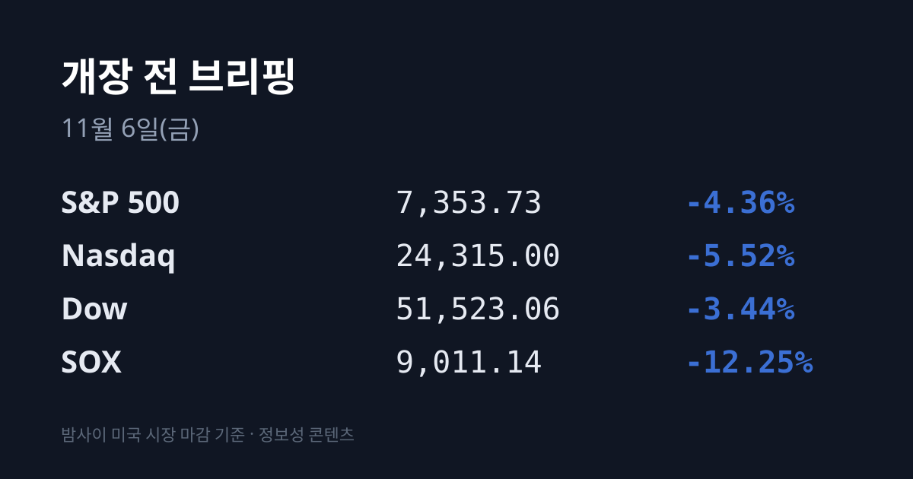
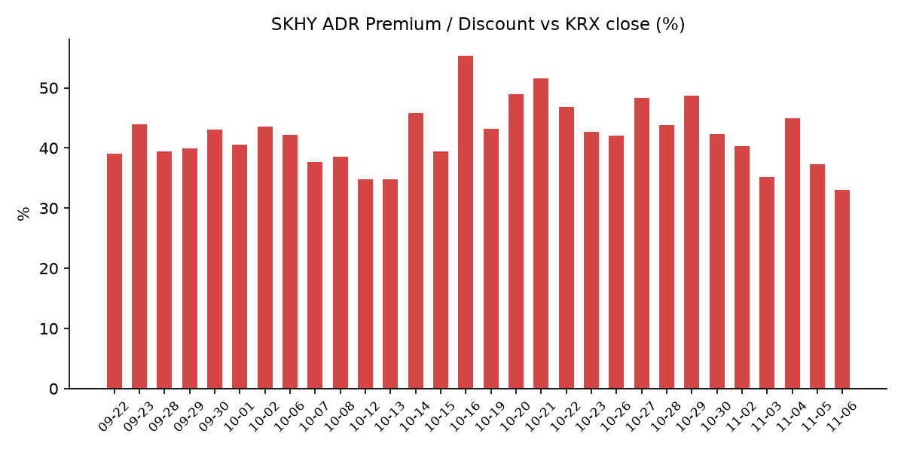
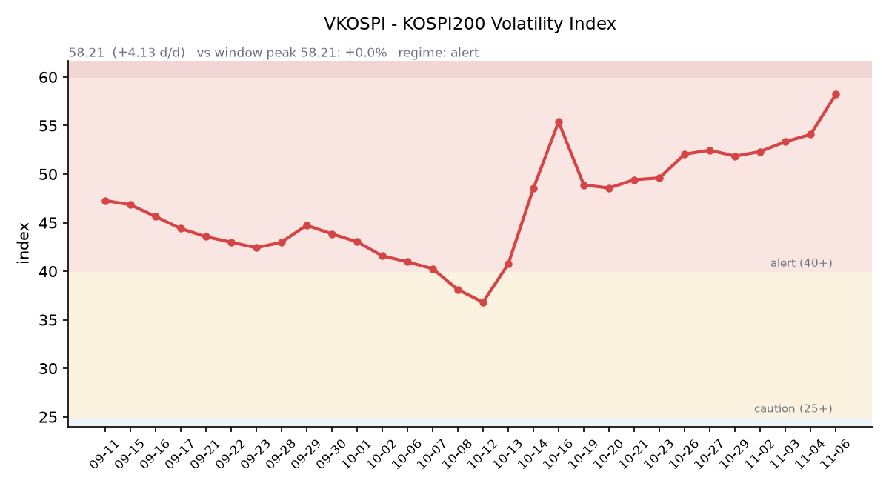

## ① 30초 요약

- 11/5 미국은 <mark>나스닥 −5.52%, S&P500 −4.36%, 다우 −3.44%로 세 지수 모두 2025년 4월 이후 최악의 하루</mark>였고, 나스닥은 조정 국면에 들어섰습니다(CNBC).
- **SOX는 −12.25%**, 마이크론 −17.46%, AMD −17.26%, 엔비디아 −9.26%였습니다. 민주당 의회 장악으로 AI 데이터센터 건설이 늦어질 수 있다는 우려가 미국 시장 전체로 번졌습니다.
- 같은 날 코스피는 5,383.80(−5.28%)으로 마감했고, 유가증권시장과 코스닥시장에 매도 사이드카가 발동했습니다. 외국인은 3조3,928억원을 순매도했습니다.
- 한국 시장 전체를 담는 EWY는 −13.46%였고, SKHY 괴리율은 +37.36%에서 +33.10%로 줄었습니다.
- VIX는 16.61에서 28.18로 올랐고, 원/달러는 작성 시각 현재 1,357.88원입니다.

## ② 밤사이 미국 시장

| 지수 | 11/5 종가 | 등락 |
| :--- | ---: | ---: |
| S&P 500 | 7,353.73 | −4.36% |
| 나스닥 종합 | 24,315.00 | −5.52% |
| 다우 | 51,523.06 | −3.44% |
| 필라델피아 반도체(SOX) | 9,011.14 | −12.25% |

하루 전 다우를 3% 끌어올렸던 선거 후 랠리가 하루 만에 모두 되돌려졌습니다. 다우는 1,833.06포인트 내렸고, 나스닥은 지난달 기록한 사상 최고치보다 10% 넘게 낮아져 조정 국면에 들어섰습니다. 러셀2000도 −4.45%로 조정 국면입니다. 오후 한때 S&P500 11개 업종이 모두 내렸고 정보기술 업종의 낙폭이 가장 컸습니다(CNBC).

<mark>반도체 하락폭이 가장 컸습니다.</mark> 마이크론 $656.39(−17.46%), AMD $404.40(−17.26%), Arm $166.72(−13.08%), 어플라이드머티어리얼즈 $319.25(−13.58%), TSMC ADR $353.10(−10.78%), 브로드컴 $291.53(−10.43%), 인텔 $52.25(−10.33%), 퀄컴 $156.75(−9.49%), 엔비디아 $181.60(−9.26%)입니다. 반도체 ETF인 SOXX는 2020년 3월 이후 가장 크게 내렸습니다. 오라클(−6.93%), 코어위브(−9.83%) 등 AI 인프라주도 내렸고, 하루 전 '반AI 수혜주'로 올랐던 애플(−1.53%), 마이크로소프트(−3.58%)도 하락했습니다. JP모건(−4.19%), 캐터필러(−6.37%) 등 금융·경기민감주도 함께 내렸습니다.

CNBC는 하락 배경으로 세 가지를 꼽았습니다. 민주당이 상·하원과 주지사 선거를 휩쓸면서 AI 데이터센터 건설이 늦어질 수 있다는 우려가 커졌고, 지역 데이터센터 관련 주민투표 41건 중 40건이 부결됐으며, 버니 샌더스 상원의원은 전국 데이터센터 모라토리엄을 주장하고 있습니다. 여기에 퀄컴의 이번 분기 전망이 실망스러웠고, 금리·대규모 설비투자·매출 대비 부채 증가로 AI 투자 자금 조달에 대한 의문도 제기됐습니다. 반면 리사 수 AMD 최고경영자는 "AI 칩 수요가 둔화할 조짐은 보이지 않는다"고 말했습니다(야후 파이낸스).

장 마감 뒤에는 루멘텀, 클라우드플레어, 에어비앤비, 아이온큐 등이 실적을 냈습니다. 시간외 가격은 **클라우드플레어 $280.80(+14.8%)**, 에어비앤비 $186.90(+9.9%), 루멘텀 $515.74(+1.2%, 정규장 −18.68%)입니다. 시간외 반도체는 마이크론 $665.10(+1.33%), 엔비디아 $181.90입니다(07:18 KST).

**미 국채 10년물은 4.90%에서 4.84%로** 내렸습니다. 2년물은 4.58%에서 4.46%로 12bp 내려 10년물과의 차이가 0.38%p로 벌어졌고, 30년물은 5.25%(−3bp), 10년물 실질금리(TIPS)는 2.60%(−4bp)입니다(미 재무부). CME 페드워치 기준 12/9 FOMC의 0.25%p 인상 확률은 82.7%에서 70.1%로 낮아졌습니다(CNBC). VIX는 16.61에서 28.18로 69.7% 올랐습니다.

국제유가는 WTI $91.20(+3.50%), 브렌트유 $99.25(+4.89%)로 하루 전 급락분 일부를 되돌렸습니다. 한국 원유 수입의 기준인 두바이유는 11/5 $92.85로 전일 대비 $8.04 내려, 브렌트보다 $6.40 낮아졌습니다(한국석유공사 페트로넷). 금 12월물은 $4,097.90(+0.61%)이고 달러인덱스는 101.59(+0.07%)입니다.

지수선물은 정규 마감(06:59 KST) 기준 S&P500 12월물 7,353.00(−4.76%), 나스닥100 12월물 26,604.00(−6.87%)입니다.

## ③ 괴리율 트래커 — SK하이닉스 ADR

| 항목 | 수치 |
| :--- | ---: |
| SKHY 종가 (11/5) | $123.90 (−13.40%) |
| 본주 환산가 (×10×환율 1,357.88원) | 1,682,413원 |
| 본주 직전 종가 (11/5) | 1,264,000원 |
| **괴리율** | **+33.10%** |

11/5 한국 본주는 1,264,000원(−9.46%)으로 마감했고, 그 뒤 미국 SKHY는 $123.90(−13.40%)로 더 크게 내렸습니다. 괴리율은 전일 +37.36%에서 <mark>+33.10%로 4.26%포인트 줄어</mark> 9월 초 이후 처음 33%대로 내려왔습니다. SKHY 시간외 가격은 $124.40(+0.40%)입니다.

괴리율은 미국에 상장된 예탁증서(ADR) 가격을 본주 1주 기준으로 환산한 값과 한국 본주 종가를 비교한 수치입니다. 환산가가 본주보다 높은 프리미엄 상태에서는 전환 차익거래 구조상 본주 쪽에 매수 유인이 생기고, 디스카운트면 반대입니다.

EWY(iShares MSCI South Korea ETF)는 $131.65(−13.46%)였고 시간외 가격은 $132.35입니다. 같은 날 한국 시장은 달러 기준 약 −5.3%(코스피 −5.28%, 원화 −0.04%)여서, **한국 11/5 마감 이후 미국 시간에 달러 기준 약 −8.6%포인트가** 더해진 셈입니다. 밤사이 원화 약세를 반영해 원화 기준으로 환산하면 약 −7.6%포인트입니다(시간외 가격 기준 약 −7.1%포인트).

## ④ 변동성 트래커

**판정 한 줄**: <mark>'경보' 구간에서 VKOSPI가 58.21로 닷새째 올라 '위기' 기준선 60에 1.79포인트 남았고, 11/5 유가증권·코스닥 두 시장에 매도 사이드카가 발동했습니다.</mark>

**기대 변동성**  VKOSPI **58.21**(11/5, 전일비 +2.17, +3.87%)로 '경보'(40~60) 구간 상단입니다. 6월 고점 96.94 대비 −40.0%, 평시 상단인 25의 2.33배입니다. 미국 VIX는 16.61에서 28.18로 올라, 하루 전 벌어졌던 한·미 변동성 차이가 좁혀졌습니다.

**실현 변동성**  최근 10거래일 코스피 일별 등락률은 10/23 +0.30%, 10/26 −1.46%, 10/27 +3.09%, 10/28 +6.63%, 10/29 −1.24%, 10/30 −3.48%, 11/2 +2.24%, 11/3 −3.59%, 11/4 +0.62%, 11/5 −5.28%입니다. 이 중 ±3% 이상 등락일은 닷새입니다. 11/5는 장중 5,336.88(−6.10%)까지 내려 일중 변동폭이 종가 대비 4.64%였고, 최근 5거래일 평균 일중 변동폭은 4.4%입니다. 10/02 종가 7,003.74 대비로는 **−23.1%입니다.**

**매매 정지**  11/5 10:16 유가증권시장 매도 사이드카, 14:27 코스닥시장 매도 사이드카가 발동했습니다. 최근 열흘 사이로는 10/27 10:13, 10/28 09:54 유가증권시장 매수 사이드카와 10/30 10:04 매도 사이드카를 포함해 다섯 차례입니다(한국거래소 KIND 시장운영 공시).

**증폭 경로**  전체 ETF 거래대금 중 레버리지 ETF 비중은 27.34%로 직전(26.51%)보다 높아졌습니다. KODEX 레버리지 1조8,918억원(회전율 46.46%), KODEX 200선물인버스2X 1조4,210억원(137.76%), KODEX 코스닥150레버리지 5,282억원(22.54%), KODEX 반도체레버리지 3,368억원(56.20%), TIGER 반도체TOP10레버리지 2,874억원(64.27%)입니다(네이버 ETF 목록, 11/6 07:16 스냅샷). 코스피200 선물 베이시스는 −0.53(선물 837.25 − 현물 837.78)으로 하루 만에 마이너스로 돌아섰습니다.

**청산 압력**  10/28 이후 신용융자 잔고와 반대매매 금액은 집계 시점 기준 미확인입니다. 가장 최근 확인치는 10/27 기준 잔고 29조6,372억원, 반대매매 193억원입니다. 11/5 개인은 코스피에서 2조2,722억원을 순매수했습니다.

**하방 포지션**  공매도 순잔고는 T+2~3 공시 지연이 있어 개장 전 시점에는 확정치를 알 수 없습니다. 11/5 삼성전자·SK하이닉스의 공매도 거래는 전일보다 크게 줄었다고 보도됐습니다(톱스타뉴스).

*미확인: 공매도 순잔고 최신치, 10/28 이후 신용융자·반대매매, 오늘 개장 직전 밤의 코스피200 야간선물(한국거래소가 다음 날 아침 공개), 코스피 프로그램 매매, DRAM·NAND 당일 현물가.*

## ⑤ 직전 거래일(11/5) 한국장 리뷰

| 지수 | 종가 | 등락 |
| :--- | ---: | ---: |
| 코스피 | 5,383.80 | −300.00 (−5.28%) |
| 코스닥 | 678.41 | −36.54 (−5.11%) |

코스피는 5,580.09(−1.82%)로 출발해 10:16 매도 사이드카 발동 뒤 낙폭을 키웠고, 장중 5,336.88(−6.10%)까지 내렸습니다. 종가 기준 4월 이후 처음 5,400선 아래로 내려왔습니다(머니투데이). <mark>외국인이 3조3,928억원을 순매도했고</mark> 기관 8,457억원, 개인 2조2,722억원을 순매수했습니다(톱스타뉴스·비즈니스코리아, 일부 매체는 외국인 3조4,242억원). 외국인은 5거래일 연속 순매도로 누적 약 10조3천억원이며, 이 중 11/5 전기·전자 업종에서만 약 3조1,377억원이 나왔습니다.

**SK하이닉스는 1,264,000원(−9.46%)**, 삼성전자는 201,500원(−7.57%)으로 마감했고 삼성전자는 장중 199,800원으로 20만원을 밑돌기도 했습니다. 민주당이 미 중간선거에서 상·하원을 장악하면서 AI 데이터센터의 전력 사용·지역 부담·환경 문제에 대한 규제가 강해질 수 있고, 데이터센터 핵심 지역인 텍사스·조지아에서 민주당이 승리해 신규 건설이 늦어질 수 있다는 우려가 반영됐습니다(머니투데이). SK스퀘어 −10.01%, 삼성전기 −15.34%였고, 코스닥 반도체 장비·부품주인 심텍 −17.97%, 이오테크닉스 −16.21%, 주성엔지니어링 −12.21%였습니다(비즈니스코리아).

반도체 밖에서는 오른 종목이 있었습니다. 셀트리온 +7.50%, KB금융 +3.63%, 현대차 +3.53%, 신한지주 +2.78%, 삼성바이오로직스 +1.67%였고 업종별로는 엔터·문화 +4.71%, IT서비스 +4.50%, 제약 +4.12%였습니다. 하루 전 급반등했던 2차전지는 에코프로비엠 −7.72%, 에코프로 −7.54%, LG에너지솔루션 −2.54%로 내렸습니다(톱스타뉴스).

증권가에서는 신한투자증권이 "금융투자·연기금 매수와 자사주 매입도 하락을 막지 못했다"고, 삼성증권이 "신규 데이터센터 건설 지연과 투자 둔화 가능성"을 지적했습니다. 코스피 5,300선이 12개월 선행 주가수익비율 약 4배 수준이라는 분석도 나왔습니다(머니투데이).

코스닥은 외국인 734억원, 기관 1,026억원을 순매도했고 개인이 1,720억원을 순매수했습니다. 프로그램 매매는 1,520억원 순매도였고, 하락 종목이 1,292개로 상승 종목 380개를 크게 웃돌았습니다(비즈니스코리아).

원/달러는 서울 외환시장 주간 마감 기준 1,342.1원으로 0.6원 올랐습니다(베타뉴스·뉴스1). 작성 시각(11/6 07:01) 현재 환율은 **1,357.88원으로 주간 종가보다 15.8원** 높고, 달러/엔은 157.61입니다.

아시아 증시 11/5 종가는 대만 가권 41,574.72(−3.20%), 닛케이225 61,077.90(−1.79%), 토픽스 3,940.39(+1.16%), 상하이종합 3,689.91(+0.10%), CSI300 4,113.41(+0.29%), 항셍 24,796.98(+3.67%)입니다.

## ⑥ 오늘의 캘린더 & 관전 포인트

- **11/6(금) 08:00:** 미국 지수선물 거래 재개. 대만·일본 증시가 SOX −12.25%와 TSMC ADR −10.78%를 처음 반영합니다.
- **11/6(금) 22:30:** <mark>미국 10월 고용보고서.</mark> 10/31 주간 실업수당 청구는 18만9천 건이었습니다(CNBC).
- **11/9~10:** 엔비디아 AI 데이 서울. **11/10(화, 미국 현지):** 코어위브 실적. **11/11:** 한국 10월 고용동향. **11/16 주:** 앤트로픽 나스닥 상장 예정(WSJ). **11/18(수, 미국 현지):** 엔비디아 실적 예정(회사 미확정). **12/9:** FOMC.

시장 참가자들이 주시하는 레벨은 코스피 5,300선과 5,200선, 11/5 장중 저점 5,336.88, VKOSPI 60 선, 원/달러 1,370원 선입니다.

## ⑦ 정책 워치

미국 중간선거에서 민주당이 상·하원과 주요 주지사 선거를 가져갔습니다. 버니 샌더스 상원의원이 전국 데이터센터 모라토리엄을 주장하고 있고, 지역 데이터센터 관련 주민투표 41건 중 40건이 부결됐습니다(CNBC). 국내 증권가에서는 규제 리스크가 한국·대만 반도체 이익에 부담이 될 수 있다는 의견(신영증권)과, 영향이 일부 지역의 인허가 지연이나 비용 증가에 그칠 수 있다는 의견이 함께 나옵니다.

국내에서는 현재 공매도가 전면 재개 상태이며 최근 제도 변경 사항은 없습니다.

## ⑧ 오늘의 질문

미국 반도체가 하루에 12% 빠진 다음 날, 한국 시장은 어제 먼저 맞은 −5%를 기준으로 남은 차이를 어떻게 메우는가.

---
*본 글은 공개된 시장 데이터를 정리한 정보성 콘텐츠이며, 특정 종목·상품의 매매 권유가 아닙니다. 모든 투자 판단과 책임은 투자자 본인에게 있습니다. 수치는 작성 시점 기준이며 이후 변동될 수 있습니다.*
