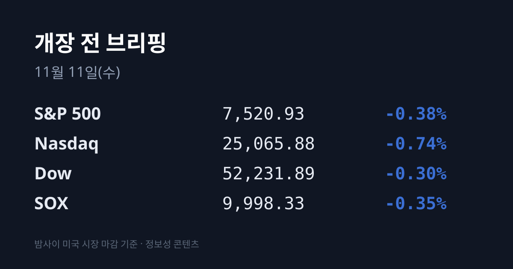
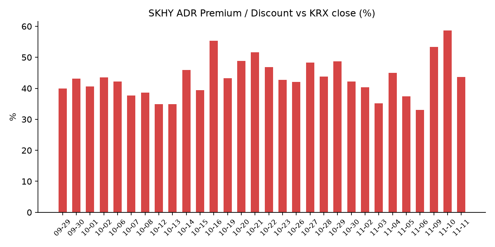
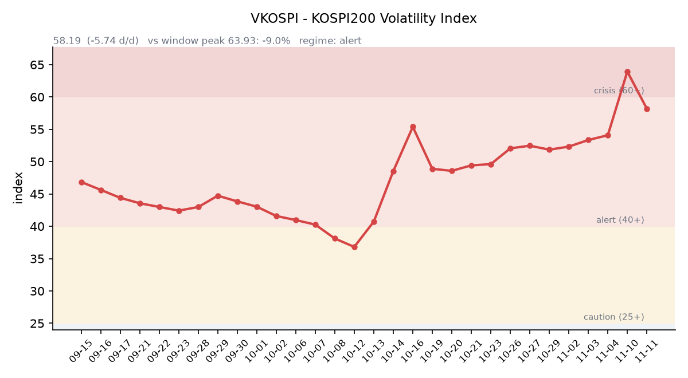

## ① 30초 요약

- 미국 10월 소비자물가지수(CPI)는 <mark>헤드라인 전월 대비 +0.4%, 근원 +0.3%로 예상(+0.3%, +0.2%)을 웃돌았습니다.</mark> 미 국채 2년물은 **4.56%에서 4.73%로** 17bp 올랐습니다.
- 11/10(화) 미국은 S&P500 −0.38%, 나스닥 −0.74%, 다우 −0.30%, SOX −0.35%로 소폭 내렸고, VIX는 19.46으로 내려왔습니다. 엔비디아는 −5.48%로 이틀째 크게 내렸습니다.
- 코어위브는 3분기 매출 36.6억 달러로 시장 예상을 넘고 연간 가이던스를 올렸지만, 시간외 주가는 장중 상승분을 내주고 07:21 KST 기준 정규장 종가보다 −2.6%입니다.
- 같은 날 코스피는 **5,239.13(+4.39%)** 으로 4거래일 만에 반등했고, 장 초반 코스피·코스닥 양 시장에 매수 사이드카가 걸렸습니다. 외국인은 8거래일 만에 순매수했습니다.
- SKHY가 $129.66(−3.51%)로 내리고 본주가 +6.69% 오르면서 SK하이닉스 ADR 괴리율은 +58.60%에서 +43.64%로 줄었습니다.

## ② 밤사이 미국 시장

| 지수 | 11/10 종가 | 등락 |
| :--- | ---: | ---: |
| S&P 500 | 7,520.93 | -0.38% |
| 나스닥 종합 | 25,065.88 | -0.74% |
| 다우 | 52,231.89 | -0.30% |
| 필라델피아 반도체(SOX) | 9,998.33 | -0.35% |

이날의 중심은 물가였습니다. 10월 CPI는 헤드라인 전월 대비 +0.4%(예상 +0.3%, 9월 +0.6%), 근원 +0.3%(예상 +0.2%, 9월 +0.3%)였습니다. 전년 대비 수치는 지난해 연방정부 셧다운 영향으로 발표되지 않았습니다. 월러 연준 이사는 12월 0.25%p 인상에 기울어 있지만 10월 물가가 뜨거우면 0.50%p 인상도 고려해야 한다고 말했습니다. CME FedWatch 기준 12/9 FOMC 0.25%p 인상 확률은 84%, **0.50%p 인상 확률은 0%에서 15%로** 올랐습니다(야후 파이낸스 장중 인용).

금리가 크게 움직였습니다. <mark>미 국채 2년물은 4.73%(+17bp)</mark>, 10년물은 4.98%(+10bp), 30년물은 5.35%(+9bp)로 올랐고, 10년물 실질금리(TIPS)는 2.78%(+12bp)입니다. 10년물과 2년물의 차이는 0.25%p로 더 좁혀졌습니다(미 재무부). 2년물의 하루 상승폭은 2025년 4월 이후 가장 크다는 보도가 나왔습니다.

반도체는 종목별로 갈렸습니다. 엔비디아는 $168.89(−5.48%)로 이틀째 크게 내렸습니다. 이사회의 젠슨 황 최고경영자 조사에 이어, 그와 연관된 인물과 연결된 네트워크를 통해 최소 75억 달러 규모의 엔비디아 하드웨어가 중국 기업에 들어갔다는 보도가 나왔습니다. 상대강도지수(RSI)는 23으로 2019년 6월 이후 가장 낮았습니다(야후 파이낸스). 마이크론 $725.11(−1.10%), 인텔 $58.13(−2.09%), ARM $181.49(−2.58%)도 내렸고, 브로드컴 $331.98(+3.91%), TSMC ADR $396.48(+2.02%), AMD $515.21(+1.30%)는 올랐습니다. 마이크로소프트(−2.20%), 오라클(−1.51%)도 약했습니다.

다른 특징주로는 힘스앤허스가 4분기 매출 가이던스 부진과 총마진 하락(74%→57%)에 −16.61%였고, D-Wave(−8.63%)·리게티(−6.39%) 등 양자컴퓨팅주와 코인베이스·스트래티지(약 −4%) 등 암호화폐 관련주도 내렸습니다.

장 마감 뒤에는 코어위브가 3분기 실적을 발표했습니다. 매출은 36.6억 달러(전년 대비 +168%)로 시장 예상(약 35.4억 달러)을 넘었고, 주당손실은 1.27달러로 예상(−1.55달러)보다 작았습니다. 2026년 연간 매출 가이던스는 130억~133억 달러로 올렸고(종전 124억~132억 달러), 수주잔고는 1,325억 달러로 6월(1,040억 달러)보다 늘었습니다(CNBC·Seeking Alpha). **주가는 시간외에서 한때 7~8% 올랐다가 반납해** 07:21 KST 기준 $47.44로 정규장 종가($48.73)보다 −2.6%입니다.

원자재는 금리와 달러 쪽 움직임이 반영됐습니다. 달러인덱스는 102.24(+0.58%)로 올랐고, 금 12월물은 $4,040.50(−1.80%)로 내렸습니다. 실질금리와 달러가 함께 오르는 가운데 금이 내린 조합입니다. WTI는 $86.44(−0.47%), 브렌트유는 $92.06(−0.55%)로 이틀째 내렸습니다.

지수선물은 11/10 정산 기준 S&P500 12월물 7,555.00(−0.25%), 나스닥100 12월물 27,900.75(−0.41%)이며, 거래는 08:00 KST에 재개됩니다.

## ③ 괴리율 트래커 — SK하이닉스 ADR

| 항목 | 수치 |
| :--- | ---: |
| SKHY 종가 (11/10) | $129.66 (-3.51%) |
| 본주 환산가 (×10×환율 1,342.67원) | 1,740,906원 |
| 본주 직전 종가 (11/10) | 1,212,000원 |
| **괴리율** | **+43.64%** |

11/10 한국 본주는 1,212,000원(+6.69%)으로 크게 올랐고, 그 뒤 미국 SKHY는 $129.66(−3.51%)로 내렸습니다. 원화가 다소 약해져 환산가를 받쳤지만, 괴리율은 전일 +58.60%에서 <mark>+43.64%로 14.96%포인트 줄었습니다.</mark> 이 값은 11/06(+33.1%) 이후 가장 낮고, 트래커 80거래일 중 20위 안팎입니다.

괴리율은 미국에 상장된 예탁증서(ADR) 가격을 본주 1주 기준으로 환산한 값과 한국 본주 종가를 비교한 수치입니다. 환산가가 본주보다 높은 프리미엄 상태에서는 전환 차익거래 구조상 본주 쪽에 매수 유인이 생기고, 디스카운트면 반대입니다. 이번 축소는 프리미엄이 해소된 것이 아니라, 본주가 하루에 크게 오르고 ADR이 내리면서 간격이 줄어든 것입니다.

한국 시장 전체를 담는 EWY(iShares MSCI South Korea ETF)는 $139.18(−2.05%)였고, 시간외에서는 $139.64(+0.33%)입니다. 11/10 EWY 종가는 한국 11/10 마감을 반영한 뒤 미국 시간 움직임이 더해진 값으로, 어림 계산하면 **한국 11/10 마감 이후 미국 시간에 더해진 몫은 달러 기준 약 −2%포인트**, 원화 약세를 감안한 원화 기준 약 −1.6%포인트입니다.

## ④ 변동성 트래커

**판정 한 줄**: <mark>VKOSPI가 58.19로 하루 −8.98% 내려 '위기'(60 이상)에서 '경보'(40~60) 구간으로 내려왔고, 이틀 연속 하락했습니다.</mark>

**기대 변동성**  VKOSPI **58.19**(11/10, 전일비 −5.74, −8.98%)로 '경보'(40~60) 구간입니다. 11/09(63.93)에 이어 이틀 연속 내렸고, 6월 고점 96.94 대비 −40.0%, 평시 상단인 25의 2.33배입니다. 미국 VIX는 19.46으로, VKOSPI가 VIX의 약 3.0배입니다.

**실현 변동성**  최근 10거래일 코스피 일별 등락률은 10/28 +6.63%, 10/29 −1.24%, 10/30 −3.48%, 11/2 +2.24%, 11/3 −3.59%, 11/4 +0.62%, 11/5 −5.28%, 11/6 −6.02%, 11/9 −0.81%, 11/10 +4.39%입니다. 이 중 ±3% 이상 등락일은 엿새입니다. 11/10 일중 변동폭은 종가 대비 2.41%로 최근 닷새 중 가장 좁았고, 최근 5거래일 평균은 5.0%입니다. 10/02 종가 7,003.74 대비로는 **−25.2%입니다.**

**매매 정지**  최근 열흘 사이 매매 정지 장치는 여덟 건 걸렸습니다. 11/5 10:16 유가증권시장·14:27 코스닥시장 매도 사이드카, 11/6 09:03 유가증권시장 1단계 서킷브레이커(파생상품시장 거래 중단 동반), 09:06 코스닥시장·09:34 유가증권시장 매도 사이드카, 그리고 11/10 09:06 유가증권시장·09:10 코스닥시장 매수 사이드카입니다(한국거래소 KIND 시장운영 공시). 11/10 사이드카는 코스피200 선물이 기준가 대비 5.76% 오르면서 걸렸고, 두 시장 동시 매수 사이드카는 7/31 이후 약 3개월 만입니다(파이낸셜뉴스·서울신문).

**증폭 경로**  전체 ETF 거래대금 중 레버리지 ETF 비중은 **26.94%로 직전(27.69%)보다** 내려왔습니다. KODEX 레버리지 1조4,632억원(회전율 36.16%), KODEX 200선물인버스2X 1조1,822억원(122.93%, 직전 2조55억원), KODEX 코스닥150레버리지 4,329억원(17.65%), KODEX 반도체레버리지 2,591억원(41.43%), TIGER 반도체TOP10레버리지 2,322억원(51.33%)입니다(네이버 ETF 목록, 11/11 07:20 스냅샷). 코스피200 선물 베이시스는 −2.21(선물 812.10 − 현물 814.31)로 나흘째 마이너스였고 폭은 직전 −2.50보다 조금 줄었습니다.

**청산 압력**  10/28 이후 신용융자 잔고와 반대매매 금액은 집계 시점 기준 미확인입니다. 가장 최근 확인치는 10/27 기준 잔고 29조6,372억원, 반대매매 193억원입니다.

**하방 포지션**  공매도 순잔고는 T+2~3 공시 지연이 있어 개장 전 시점에는 확정치를 알 수 없습니다.

*미확인: 공매도 순잔고 최신치, 10/28 이후 신용융자·반대매매, 오늘 개장 직전 밤의 코스피200 야간선물(한국거래소가 다음 날 아침 공개), DRAM·NAND 당일 현물가.*

## ⑤ 직전 거래일(11/10) 한국장 리뷰

| 지수 | 종가 | 등락 |
| :--- | ---: | ---: |
| 코스피 | 5,239.13 | +220.28 (+4.39%) |
| 코스닥 | 667.61 | +28.64 (+4.48%) |

코스피는 5,247.22(+4.55%)로 출발해 장중 5,300.92까지 올랐고, 저가는 5,174.55였습니다. 4거래일 만의 상승이며 상승폭은 10/28 이후 가장 컸습니다. 코스닥 상승률은 8/10(+6.97%) 이후 가장 컸습니다. 미국 CPI와 코어위브 실적을 앞둔 경계감에 장중 상승폭은 일부 줄었습니다(신한투자증권, 파이낸셜뉴스).

<mark>외국인은 유가증권시장에서 4,005억원을 순매수해 8거래일 만에 매수 우위로 돌아섰습니다</mark>(매체별 3,586억~4,005억원). 기관은 4,727억원, 기타법인은 4,887억원을 순매수했고 개인은 1조3,564억원을 순매도했습니다(파이낸셜뉴스). 상승 종목 비율은 두 시장 모두 70%대였습니다(KB증권). 코스닥에서는 기관이 2,149억원을 순매수했고 외국인(1,453억원)과 개인(580억원)은 순매도했습니다.

삼성전자는 198,900원(+4.74%), SK하이닉스는 1,212,000원(+6.69%)으로 마감했습니다. SK하이닉스는 장중 9% 넘게 올라 1,242,000원까지 갔습니다. 11/9 미국 SOX가 +6.85% 오르고 AMD·브로드컴·마이크론이 급등한 데다, 반도체 급락이 과도했다는 인식이 저가 매수로 이어졌다는 설명이 나왔습니다(서울신문·신한투자증권). SK스퀘어(+5.26%), 삼성전기(+4.63%)도 올랐습니다.

전날 크게 내렸던 업종이 함께 반등했습니다. 업종별로는 의료·정밀기기 **+8.53%**, 기계·장비 +7.65%, 건설 +7.15%, 전기·전자 +5.73%, 금속 +4.72%, 운송·창고 +4.15%, 증권 +3.06%였습니다(파이낸셜뉴스). 삼성SDI(+9.88%)와 LG에너지솔루션(+3.93%)은 11/9 급락 뒤 반등했고, KB증권은 기계장비·건설·2차전지·반도체 등 낙폭이 컸던 업종에 저가 매수가 들어왔다고 진단했습니다. 건설기계주에는 국내외 인프라 투자 확대와 우크라이나 재건 기대가 거론됐습니다(핀포인트뉴스). 바이오에서는 한올바이오파마가 파트너사의 류마티스관절염 임상 1차 평가지표 충족 소식에 +25.88% 올랐고, 시가총액 상위의 셀트리온(−3.33%)과 삼성바이오로직스(−2.78%)는 내렸습니다.

원/달러는 서울 외환시장 주간 마감 기준 1,337.5원으로 9.6원 내렸습니다. 주간 마감이 1,330원대인 것은 10/30 이후 10일 만입니다(서울파이낸스). 미·이란 긴장 완화 기대와 국제유가 하락이 배경으로 꼽혔습니다. 작성 시각(11/11 07:20) 현재 환율은 **1,342.67원으로 주간 종가보다 5.17원** 높고, 달러/엔은 158.69입니다.

아시아 증시 11/10 종가는 대만 가권 42,711.92(+2.52%), 닛케이225 60,459.58(+2.87%), 토픽스 3,893.71(+1.98%), 상하이종합 3,663.72(+0.08%), CSI300 4,059.11(+0.07%), 항셍 24,557.04(+0.44%)입니다. 닛케이225는 60,000선 위에서 마감했습니다.

## ⑥ 오늘의 캘린더 & 관전 포인트

- **11/11(수) 08:00:** 한국 10월 고용동향. 같은 시각 미국 지수선물 거래 재개, 일본(09:00)·대만(10:00) 개장.
- **11/12(목) 07:00경:** <mark>MSCI 11월 정기 리뷰 결과 발표</mark>(11/11 23:00 CET). 편입·편출은 11/24 장 마감 뒤 반영됩니다.
- **11/12(목):** 국내 옵션 만기, 인텔 AI 서밋 서울.
- **11/13(금) 오전(미국 11/12 장 마감 후):** 어플라이드머티어리얼즈(주당순이익 예상 4.13달러)·시스코(1.35달러) 실적. **11/13(금) 22:30:** 미국 10월 생산자물가지수(PPI).
- **11/16(미국):** PDD 실적(장 전). **11/17(미국):** 디즈니·홈디포 실적(장 전).
- **11/18(수) 오전(미국 11/17 장 마감 후):** 엔비디아 실적(주당순이익 예상 2.53달러). **11/19(미국):** 앤트로픽 나스닥 상장이 보도됐습니다(미확정). **12/9:** FOMC.

시장 참가자들이 주시하는 레벨은 코스피 5,290선과 5,080선, 11/10 장중 저점 5,174.55, SK하이닉스 1,150,000원, VKOSPI 60 선, 원/달러 1,350원 선입니다.

## ⑦ 정책 워치

미국 연준 내부에서 12월 인상 폭에 대한 언급이 나왔습니다. 월러 이사는 0.25%p 인상은 연준의 신뢰성에 위험이 될 수 있다며, 10월 물가가 뜨거우면 0.50%p 인상을 고려해야 한다고 말했습니다(야후 파이낸스).

국내에서는 현재 공매도가 전면 재개 상태이며 최근 제도 변경 사항은 없습니다.

## ⑧ 오늘의 질문

CPI가 예상을 웃돌아 미 2년물이 하루에 17bp 뛴 아침, 8거래일 만에 코스피를 산 외국인은 이틀째에도 매수를 이어갈 것인가.

---
*본 글은 공개된 시장 데이터를 정리한 정보성 콘텐츠이며, 특정 종목·상품의 매매 권유가 아닙니다. 모든 투자 판단과 책임은 투자자 본인에게 있습니다. 수치는 작성 시점 기준이며 이후 변동될 수 있습니다.*
