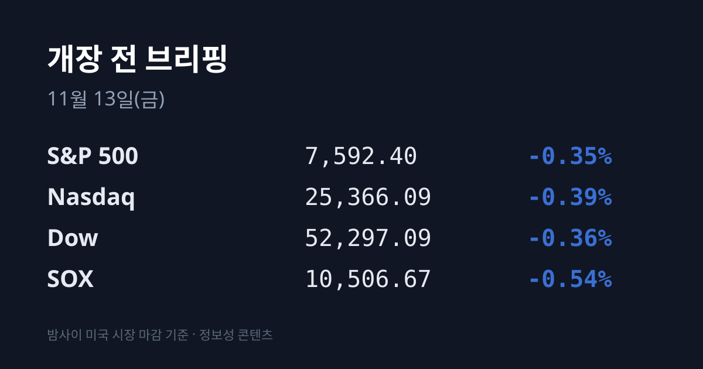
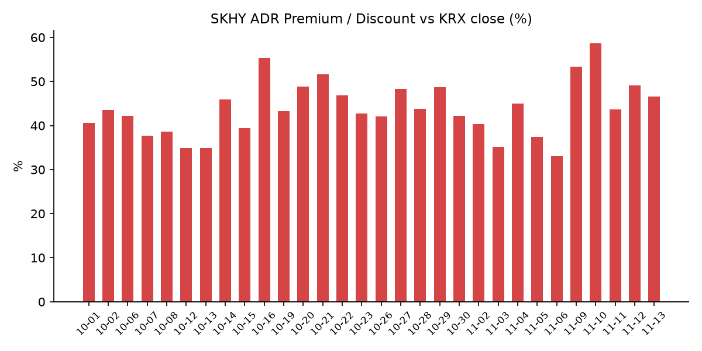
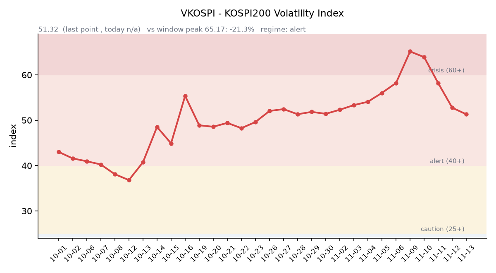

## ① 30초 요약

- <mark>젠슨 황 엔비디아 CEO가 CEO·이사직에서 즉시 물러났습니다.</mark> 엔비디아는 장중 최대 14% 넘게 밀렸다가 **$166.19(−4.34%)로** 마감했고, 콜레트 크레스 CFO가 임시 CEO를 맡았습니다.
- 11/12(목) 미국은 S&P500 −0.35%, 나스닥 −0.39%, 다우 −0.36%로 내렸습니다. 필라델피아 반도체지수(SOX)는 −0.54%에 그쳤는데, AMD(+5.86%)와 브로드컴(+5.54%)이 크게 올랐기 때문입니다.
- 미 국채 10년물은 5.10%, 2년물은 4.86%로 채권시장 휴장 전인 11/10보다 각각 0.12%p, 0.13%p 올랐습니다. 트럼프 대통령이 "이란과의 합의는 필요 없다"고 밝힌 뒤 브렌트유는 +3.24% 올랐습니다.
- 같은 날 코스피는 5,342.73(−0.61%)으로 사흘 만에 내렸고 코스닥은 696.53(−1.22%)으로 700선 아래로 돌아왔습니다. 외국인은 삼성전자를 사고 SK하이닉스를 팔았습니다.
- SKHY가 $137.71(−3.19%)로 내리면서 SK하이닉스 ADR 괴리율은 +49.06%에서 +46.60%로 줄었습니다.

## ② 밤사이 미국 시장

| 지수 | 11/12 종가 | 등락 |
| :--- | ---: | ---: |
| S&P 500 | 7,592.40 | −0.35% |
| 나스닥 종합 | 25,366.09 | −0.39% |
| 다우 | 52,297.09 | −0.36% |
| 필라델피아 반도체(SOX) | 10,506.67 | −0.54% |

이날의 중심은 엔비디아였습니다. 엔비디아는 젠슨 황 CEO가 CEO와 이사직에서 즉시 물러난다고 밝혔습니다. 사내외 인물과의 관계를 다룬 보도들이 잇따른 뒤였고, 그중 외부 인물은 미 정보당국이 중국 스파이로 의심한다는 파이낸셜타임스 보도가 있었습니다. 콜레트 크레스 최고재무책임자가 임시 CEO를, 하비 존스 전 시놉시스 CEO가 회사 첫 이사회 의장을 맡습니다. 공식 승계 계획은 없었습니다(CNBC). 주가는 장중 최대 14% 넘게 밀렸다가 $166.19(−4.34%)로 마감했고, 시가총액은 4조 달러를 가까스로 지켰습니다. 번스타인은 목표주가를 $400에서 $200으로 절반 낮췄습니다(CNBC).

반도체는 종목별로 엇갈렸습니다. <mark>AMD는 $585.30(+5.86%), 브로드컴은 $364.36(+5.54%)으로 올랐는데</mark>, 엔비디아의 혼란이 경쟁사로 수요를 돌릴 수 있다는 기대가 반영됐다는 설명이 나왔습니다(야후 파이낸스). AMD는 윌리엄블레어의 투자의견 상향도 있었습니다. 반면 마이크론 $798.44(−1.59%), TSMC ADR $405.49(−1.90%), 인텔(−2.08%), ARM(−1.76%), 램리서치(−0.89%), 샌디스크(−4.11%)는 내렸습니다. 슈퍼마이크로는 미 법무부가 밀수 연루 여부를 조사한다는 블룸버그 보도에 9% 넘게 하락했습니다(CNBC). 전날 급등한 코어위브는 $56.60(−6.86%)으로 되돌렸고, 설비투자 계획을 올린 네비우스는 약 17% 내렸습니다. 알파벳(+1.79%), 테슬라(+1.69%), 마이크로소프트(+0.36%)는 올랐습니다.

장 마감 뒤에는 어플라이드머티어리얼즈가 실적을 냈습니다. 조정 주당순이익 4.16달러, 매출 104.1억 달러로 시장 예상(4.06달러, 103.0억 달러)을 넘었고, 다음 분기 매출 가이던스로 106억~116억 달러를 제시했습니다. 시간외 주가는 07:17 KST 기준 $379.00으로 정규장 종가 대비 −0.51%입니다. 시스코도 실적과 가이던스가 예상을 웃돌았고, 시간외에서 약 2% 올랐다는 보도가 나왔습니다(CNBC).

앤트로픽은 상장을 그대로 진행한다고 확인했습니다. 11/18(미국) 공모가를 정하고 11/19 거래를 시작할 예정이며, 엔비디아는 260억 달러 규모 사전 배정 물량 중 100억 달러를 약정해 둔 상태입니다(야후 파이낸스).

금리가 다시 올랐습니다. 11/11 채권시장 휴장 뒤 재개된 11/12 미 국채 금리는 <mark>10년물 5.10%(11/10 대비 +0.12%p)</mark>, 2년물 4.86%(+0.13%p), 30년물 5.43%(+0.08%p), 10년물 실질금리(TIPS) 2.86%(+0.08%p), 10년물과 2년물 차이 0.24%p입니다(미 재무부). 트럼프 대통령이 이란과의 합의가 필요 없다고 밝히면서 인플레이션 우려가 커졌고, 12월 금리 인상 베팅도 늘었다는 설명입니다(야후 파이낸스). 굴스비 시카고 연은 총재는 지금을 "위태로운 순간"이라고 했고, 데일리 샌프란시스코 연은 총재는 추가 긴축이 필요할 것이라고 말했습니다. 신규 실업수당 청구는 20.0만 건으로 예상(19.5만 건)을 웃돌았습니다. CME FedWatch 기준 12/9 FOMC의 금리 인상 확률은 사실상 100%(25bp 90.8%, 50bp 9.2%)로 인용됐습니다.

VIX는 18.70(+6.92%)으로 올랐습니다. 달러인덱스는 103.18(+0.27%)로 사흘째 올랐고, 금 12월물은 $3,881.70(−2.97%)으로 크게 내렸습니다. 실질금리와 달러가 함께 오르는 가운데 금이 내린 조합입니다. 유가는 WTI $88.70(+2.51%), 브렌트유 $95.77(+3.24%)입니다. 트럼프 대통령의 발언과 함께, 경고를 무시한 유조선 4척이 폭발로 피해를 입었다는 이란군 발표가 나왔습니다. 한국 원유 수입의 기준인 두바이유는 11/11 기준 $89.00으로 같은 날 브렌트보다 3.76달러 낮습니다(페트로넷).

지수선물은 11/12 정산 기준 S&P500 12월물 7,621.75(−0.25%), 나스닥100 12월물 28,401.50(−0.25%)이며, 거래는 08:00 KST에 재개됩니다.

## ③ 괴리율 트래커 — SK하이닉스 ADR

| 항목 | 수치 |
| :--- | ---: |
| SKHY 종가 (11/12) | $137.71 (−3.19%) |
| 본주 환산가 (×10×환율 1,334.98원) | 1,838,401원 |
| 본주 직전 종가 (11/12) | 1,254,000원 |
| **괴리율** | **+46.60%** |

11/12 한국 본주는 1,254,000원(−1.80%)으로 내렸고, 그 뒤 미국 SKHY는 $137.71(−3.19%)로 더 크게 내렸습니다. 시간외에서는 $137.60(−0.08%)입니다. 그 결과 괴리율은 전일 +49.06%에서 <mark>+46.60%로 2.46%포인트 줄었습니다.</mark>

괴리율은 미국에 상장된 예탁증서(ADR) 가격을 본주 1주 기준으로 환산한 값과 한국 본주 종가를 비교한 수치입니다. 환산가가 본주보다 높은 프리미엄 상태에서는 전환 차익거래 구조상 본주 쪽에 매수 유인이 생기고, 디스카운트면 반대입니다. 이번 축소는 엔비디아 CEO 사임 소식이 나온 미국 시간에 ADR이 본주의 하루 하락폭보다 더 내린 결과입니다. 프리미엄 자체는 여전히 40%대입니다.

한국 시장 전체를 담는 EWY(iShares MSCI South Korea ETF)는 **$145.38(−1.64%)였고**, 시간외에서는 $145.70(+0.22%)입니다. 11/12 EWY 등락에는 한국 11/12 장중 움직임이 함께 들어 있어, 이를 빼고 어림 계산하면 **한국 11/12 마감 이후 미국 시간에 더해진 몫은** 달러 기준 약 −1.2%포인트, 원화 기준 약 −0.9%포인트입니다.

## ④ 변동성 트래커

**판정 한 줄**: <mark>VKOSPI가 51.32로 나흘 연속 내려 '경보'(40~60) 구간 안에서 진정 흐름을 이어 갔습니다.</mark>

**기대 변동성**  VKOSPI **51.32**(11/12, 전일비 −1.44, −2.73%)로 '경보'(40~60) 구간입니다. 11/09(63.93)·11/10(58.19)·11/11(52.76)에 이어 나흘 연속 내렸고, 6월 고점 96.94 대비 −47.1%, 평시 상단인 25의 2.05배입니다. 미국 VIX는 18.70으로, VKOSPI가 VIX의 약 2.7배입니다.

**실현 변동성**  최근 10거래일 코스피 일별 등락률은 10/30 −3.48%, 11/2 +2.24%, 11/3 −3.59%, 11/4 +0.62%, 11/5 −5.28%, 11/6 −6.02%, 11/9 −0.81%, 11/10 +4.39%, 11/11 +2.60%, 11/12 −0.61%입니다. 이 중 ±3% 이상 등락일은 닷새입니다. 11/12 일중 변동폭은 종가 대비 3.10%였고, 최근 5거래일 평균은 3.9%입니다. 10/02 종가 7,003.74 대비로는 **−23.7%입니다.**

**매매 정지**  최근 열흘 사이 매매 정지 장치는 여덟 건 걸렸습니다. 11/5 10:16 유가증권시장·14:27 코스닥시장 매도 사이드카, 11/6 09:03 유가증권시장 1단계 서킷브레이커, 09:06 코스닥시장·09:34 유가증권시장 매도 사이드카, 11/10 09:06 유가증권시장·09:10 코스닥시장 매수 사이드카, 11/11 11:28 코스닥시장 매수 사이드카입니다(한국거래소 KIND 시장운영 공시).

**증폭 경로**  전체 ETF 거래대금 중 레버리지 ETF 비중은 **24.34%로 직전(25.31%)보다** 내려왔습니다. KODEX 레버리지 1조5,201억원(회전율 34.23%), KODEX 200선물인버스2X 7,539억원(94.33%), KODEX 코스닥150레버리지 4,803억원(15.95%), TIGER 반도체TOP10레버리지 2,991억원(59.12%), KODEX 반도체레버리지 2,822억원(38.71%)입니다(네이버 ETF 목록, 11/13 07:16 스냅샷). 옵션 만기일이던 11/12 코스피200 선물 베이시스는 −6.07(선물 827.50 − 현물 833.57)로 엿새째 마이너스였고, 폭은 직전 −1.77보다 크게 벌어졌습니다.

**청산 압력**  신용융자 잔고는 **25조9,285억원(11/11 기준)으로** 하루 전보다 6,209억원 줄었습니다. 유가증권시장 20조1,743억원, 코스닥 5조7,541억원입니다. 같은 날 위탁매매 미수금은 1조762억원, 반대매매 금액은 116억원이었습니다(금융투자협회).

**하방 포지션**  공매도 순잔고는 T+2~3 공시 지연이 있어 개장 전 시점에는 확정치를 알 수 없습니다.

*당일 수집 실패: 11/12 원/달러 야간 마감, 11/12 프로그램 매매 순매수.*

## ⑤ 직전 거래일(11/12) 한국장 리뷰

| 지수 | 종가 | 등락 |
| :--- | ---: | ---: |
| 코스피 | 5,342.73 | −32.63 (−0.61%) |
| 코스닥 | 696.53 | −8.57 (−1.22%) |

코스피는 5,385.94로 소폭 올라 출발해 장중 5,458.84까지 올랐다가 상승분을 모두 반납하고 사흘 만에 내렸습니다. 이틀 급등 뒤 차익실현 물량과 옵션 만기일 수급 부담이 겹쳤다는 분석이 나왔고(키움증권, 글로벌이코노믹 인용), 엔비디아 이사회가 젠슨 황 CEO 해임을 준비하고 있다는 미국 월스트리트저널 보도도 장중 변수로 꼽혔습니다. 코스닥은 711.86까지 올랐다가 687.40까지 밀린 뒤 696.53에 마감했습니다.

외국인은 유가증권시장에서 3,708억원을 순매수해 사흘 연속 매수 우위였습니다(매체별 3,676억~4,121억원). 기관은 6,911억원, 개인은 2,040억원을 순매도했습니다(글로벌이코노믹). 코스닥에서는 외국인이 3,525억원을 순매도했고 개인(3,077억원)과 기관(435억원)은 순매수했습니다.

반도체 두 종목은 엇갈렸습니다. 삼성전자는 **208,000원(+0.97%)으로** 올랐고 SK하이닉스는 1,254,000원(−1.80%)으로 내렸습니다. <mark>외국인은 삼성전자를 7,449억원 순매수하고 SK하이닉스를 8,720억원 순매도했습니다</mark>(강원도민일보). 전날 두 종목이 3.57%, 5.36% 오른 데 따른 차익실현에 엔비디아 관련 보도가 겹쳤고, 엔비디아 AI 반도체 사업과 밀접한 SK하이닉스가 더 영향을 받았다는 분석이 나왔습니다(산경투데이). 삼성전기(−4.01%), 현대차(−2.20%), LG에너지솔루션(−1.79%), KB금융(−0.98%)은 내렸고 삼성전자우(+2.00%), 삼성바이오로직스(+1.33%)는 올랐습니다. 코스닥에서는 알테오젠(−3.32%), 주성엔지니어링(−3.59%), 에코프로비엠(−2.18%), HLB(−1.67%)가 내렸습니다. 이날 코스닥에 상장한 넥스아이는 공모가 8,000원보다 24.50% 낮은 6,040원에 거래됐습니다(뉴스핌).

원/달러는 서울 외환시장 주간 마감 기준 1,330.7원으로 2.9원 내렸습니다. 역내 달러 공급과 반도체 수출 호조가 배경으로 꼽혔습니다(뉴스1). 작성 시각(11/13 07:16) 현재 환율은 **1,334.98원으로 주간 종가보다 4.28원** 높고, 달러/엔은 159.84입니다.

아시아 증시 11/12 종가는 대만 가권 43,091.87(−2.63%), 닛케이225 60,819.36(−0.70%), 토픽스 3,937.33(+0.20%), 상하이종합 3,655.83(−0.67%), CSI300 4,043.93(−0.78%), 항셍 24,008.55(−1.26%)입니다. DRAM 현물가는 11/12 대만 세션 기준 DDR5 16Gb $60.23(보합), DDR4 16Gb $79.75(−0.15%), DDR4 8Gb $44.71(−0.40%)입니다(DRAMeXchange).

## ⑥ 오늘의 캘린더 & 관전 포인트

- **11/13(금):** 08:00 미국 지수선물 거래 재개, 일본(09:00)·대만(10:00) 개장. <mark>22:30 미국 10월 생산자물가지수(PPI)</mark>.
- **MSCI 11월 정기 리뷰 결과(11/11 발표):** MSCI 한국 지수(스탠더드)는 편입·편출 종목이 없었습니다. 스몰캡 지수에는 케이뱅크·삼현·성호전자·대한광통신·우리기술이 들어가고 한화기계서비스·오름테라퓨틱·SNT다이내믹스·STX엔진이 빠집니다(서울경제). 변경은 **11/30 장 마감 뒤** 반영됩니다.
- **11/16(미국):** PDD 실적(장 전). **11/17(미국):** 디즈니·홈디포 실적(장 전).
- **11/18(수) 오전(미국 11/17 장 마감 후):** 엔비디아 3분기 실적 — CEO 사임 뒤 첫 실적입니다. **11/18(미국):** 앤트로픽 공모가 결정, **11/19(미국):** 나스닥 거래 시작 예정. **12/9:** FOMC. **12/10:** 국내 선물·옵션 동시 만기.

시장 참가자들이 주시하는 레벨은 코스피 5,400선과 5,210선, 전일 종가 5,342선, SK하이닉스 1,200,000원, VKOSPI 55 선, 원/달러 1,345원 선, 미 10년물 5.15% 선입니다.

## ⑦ 정책 워치

미국 의회에서는 AI 칩의 대중국 수출 통제를 다룬 세 법안(AI Overwatch Act, Match Act, Chip Security Act)을 국방수권법(NDAA)에 넣는 방안이 거론되고 있습니다. 젠슨 황 관련 보도 이후 이런 입법 가능성이 커졌다는 분석이 나왔고, 중국은 공급망을 해친다며 반발했습니다. 통과 여부는 확인되지 않았습니다.

국내에서는 현재 공매도가 전면 재개 상태이며 최근 제도 변경 사항은 없습니다.

## ⑧ 오늘의 질문

엔비디아가 CEO를 잃은 밤 AMD와 브로드컴은 올랐습니다. 한국 반도체 두 종목 사이의 수급 차이는 이 구도를 따라 하루 더 이어질 것인가.

---
*본 글은 공개된 시장 데이터를 정리한 정보성 콘텐츠이며, 특정 종목·상품의 매매 권유가 아닙니다. 모든 투자 판단과 책임은 투자자 본인에게 있습니다. 수치는 작성 시점 기준이며 이후 변동될 수 있습니다.*
