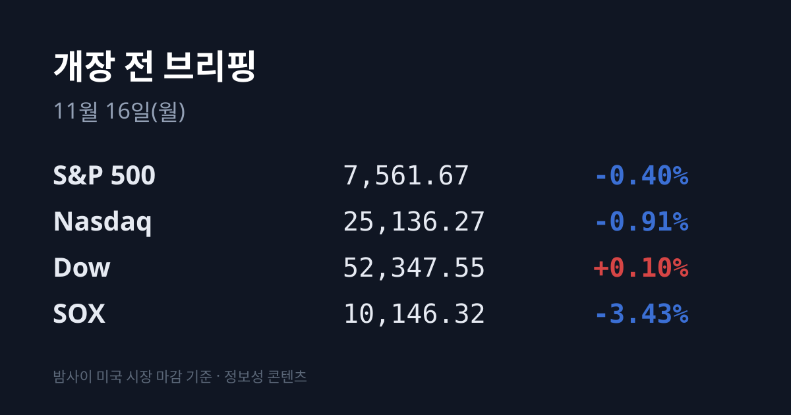
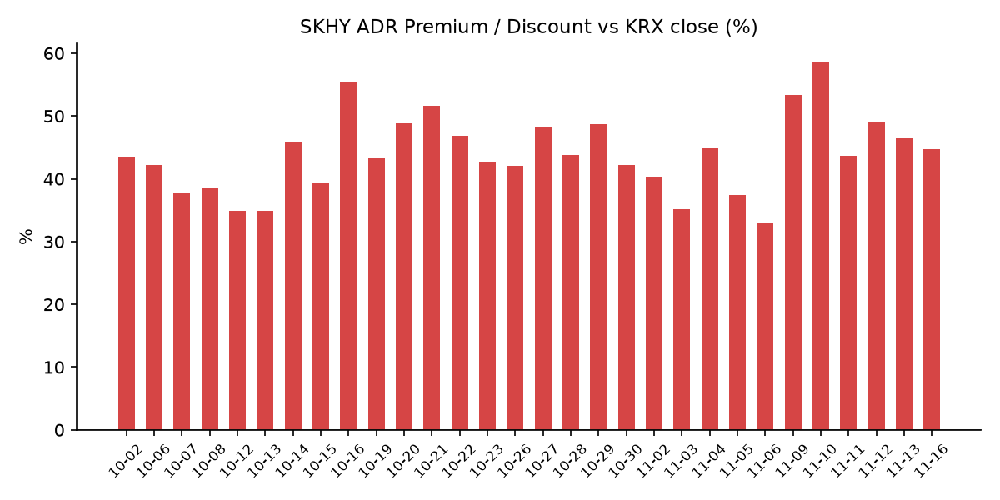
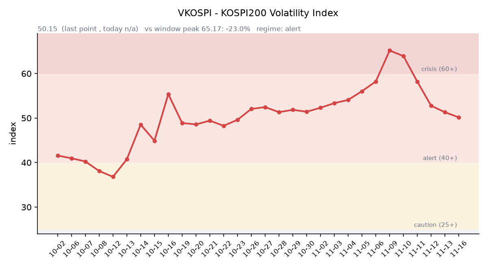

## ① 30초 요약

- 11/13(금) 미국은 S&P500 −0.40%, 나스닥 −0.91%, 다우 +0.10%로 마감했습니다. <mark>필라델피아 반도체지수(SOX)는 −3.43%</mark>였고, 전날 오른 AMD(−8.75%)와 브로드컴(−4.76%)이 상승분을 되돌렸습니다.
- 미국 10월 생산자물가(PPI)는 전월 대비 +0.3%로 예상(+0.4%)보다 낮았지만 전년 대비로는 **+6.5%로 2022년 11월 이후 최대였습니다.** 미 국채 10년물은 5.15%로 올랐습니다.
- 같은 날 코스피는 장중 5,504.44까지 올랐다가 외국인 매도로 돌아서 **5,290.53(−0.98%)에** 마감했습니다. 외국인은 나흘 만에 7,034억원을 순매도했고, SK하이닉스는 1,216,000원(−3.03%)이었습니다.
- SKHY가 $131.79(−4.30%)로 내리면서 SK하이닉스 ADR 괴리율은 +46.60%에서 +44.72%로 줄었습니다.
- 주말 동안 바레인이 이란 발사체를 요격했고, 걸프 해역에서 유조선이 공격받았습니다. 원유·미국 지수선물은 한국 시간 08:00에 거래를 재개합니다.

## ② 밤사이 미국 시장

한국장이 쉰 주말 사이 미국은 11/13(금) 한 세션이 열렸습니다.

| 지수 | 11/13 종가 | 등락 |
| :--- | ---: | ---: |
| S&P 500 | 7,561.67 | −0.40% |
| 나스닥 종합 | 25,136.27 | −0.91% |
| 다우 | 52,347.55 | +0.10% |
| 필라델피아 반도체(SOX) | 10,146.32 | −3.43% |

지수는 상승 출발했다가 반도체 주도로 밀려 마감했습니다. S&P500은 주간으로는 +2.51%로 4주 연속 하락을 끊었습니다. 젠슨 황 CEO가 사임한 다음 날, 엔비디아 수요가 경쟁사로 옮겨 갈 것이라는 기대에 올랐던 종목들이 되돌림을 받았습니다. <mark>AMD는 $534.06(−8.75%), 브로드컴은 $347.01(−4.76%)</mark>로 내렸고, 엔비디아는 $162.85(−2.01%)로 6주 연속 주간 하락을 기록했습니다. 엔비디아는 11/6 종가보다 약 13% 낮습니다. 마이크론 $778.31(−2.52%), TSMC ADR $398.73(−1.67%), 인텔(−2.52%), 샌디스크(−5.59%)도 내렸습니다. 전날 장 마감 뒤 시장 예상을 웃도는 실적을 낸 어플라이드머티어리얼즈는 $370.50(−2.74%)이었고, 시스코는 분기 매출이 사상 최대였지만 매출총이익률이 65.5%에서 63.7%로 내려 $95.64(−6.24%)로 마감했습니다(stocktitan). 삼성의 인수 협상설이 블룸버그에서 보도된 미국 열교환기 업체 모딘은 +27.86% 올랐습니다. 삼성은 확인해 줄 수 없다는 입장입니다.

장 마감 무렵인 15:54(미 동부시간) 미 연방항공청(FAA)이 통신 장애로 미국 전역 공항의 출발편을 멈춰 세웠고, 시간외에서 항공주가 2%대 내렸습니다. 같은 시간외에서 엔비디아는 $161.01(−1.13%), AMD는 $521.20(−2.41%)였습니다.

물가 지표는 엇갈렸습니다. 10월 PPI는 전월 대비 +0.3%(예상 +0.4%), 전년 대비 +6.5%(예상 +6.6%)였고, 식품·에너지·무역서비스를 뺀 지수는 +0.5%였습니다. 금리는 올랐습니다. <mark>미 국채 10년물 5.15%(+0.05%p)</mark>, 2년물 4.88%(+0.02%p), 30년물 5.47%(+0.04%p), 10년물 실질금리(TIPS) 2.91%(+0.05%p), 10년물과 2년물 차이 0.27%p입니다(미 재무부). CNBC는 CME FedWatch 기준 12월 FOMC 금리 인상이 사실상 확실하게 가격에 반영돼 있다고 전했습니다.

VIX는 19.30(+3.21%)으로 올랐습니다. 달러인덱스는 103.41(+0.23%)로 올랐고, 금 12월물은 $3,886.30(+0.03%)으로 보합이었습니다. 실질금리와 달러가 함께 올랐는데도 금이 내리지 않은 조합입니다. 유가는 WTI $88.56(−0.20%), 브렌트유 $95.84(+0.02%)로 보합이었습니다.

주말에는 중동이 다시 흔들렸습니다. 11/15 바레인군은 이란 발사체를 요격했다고 밝혔고, 이란 혁명수비대(IRGC)는 바레인의 미군 방공 레이더를 겨냥해 드론 6기를 쐈다고 주장했습니다. 영국 해사무역기구(UKMTO)는 호르무즈 해협 진입 직전 걸프 해역에서 유조선이 공격받았다고 알리고(선원 무사), 이 해역의 위협 수준을 '심각'으로 올렸습니다. 사우디 주도 연합군은 리야드 상공에서 후티 반군의 탄도미사일 2기를 요격했다고 발표했습니다. 미국의 군사 대응은 보도되지 않았고, 로이터는 미 당국자를 인용해 트럼프 대통령이 이란과 후티가 추가 도발을 피하면 새 공습을 미룰 수 있다는 신호를 보냈다고 전했습니다(폭스뉴스 라이브). 이 사건들은 원유 선물이 다시 열리기 전에 일어나, 작성 시점 가격에는 아직 반영되지 않았습니다.

11/13 정산 기준 지수선물은 S&P500 12월물 7,583.00(−0.42%), 나스닥100 12월물 28,034.75(−1.23%)이며, 거래는 08:00 KST에 재개됩니다.

## ③ 괴리율 트래커 — SK하이닉스 ADR

| 항목 | 수치 |
| :--- | ---: |
| SKHY 종가 (11/13) | $131.79 (−4.30%) |
| 본주 환산가 (×10×환율 1,335.28원) | 1,759,766원 |
| 본주 직전 종가 (11/13) | 1,216,000원 |
| **괴리율** | **+44.72%** |

11/13 한국 본주는 1,216,000원(−3.03%)으로 내렸고, 그 뒤 미국 SKHY는 $131.79(−4.30%)로 더 크게 내렸습니다. 시간외에서는 $130.37(−1.08%)입니다. 그 결과 괴리율은 전일 +46.60%에서 <mark>+44.72%로 1.88%포인트 줄어 사흘 연속 축소됐습니다.</mark>

괴리율은 미국에 상장된 예탁증서(ADR) 가격을 본주 1주 기준으로 환산한 값과 한국 본주 종가를 비교한 수치입니다. 환산가가 본주보다 높은 프리미엄 상태에서는 전환 차익거래 구조상 본주 쪽에 매수 유인이 생기고, 디스카운트면 반대입니다. 프리미엄은 여전히 40%대입니다.

한국 시장 전체를 담는 EWY(iShares MSCI South Korea ETF)는 **$142.78(−1.79%)였고**, 시간외에서는 $141.28(−1.05%)입니다. 11/13 EWY 등락에는 한국 11/13 장중 움직임이 함께 들어 있어, 이를 빼고 어림 계산하면 **한국 11/13 마감 이후 미국 시간에 더해진 몫은** 정규장 기준 달러로 약 −0.4%포인트, 시간외까지 넣어 원화로 약 −1.5%포인트입니다.

## ④ 변동성 트래커

**판정 한 줄**: <mark>VKOSPI가 50.15로 닷새 연속 내려 '경보'(40~60) 구간 안에서 진정 흐름을 이어 갔습니다.</mark>

**기대 변동성**  VKOSPI **50.15**(11/13, 전일비 −1.17, −2.28%)로 '경보'(40~60) 구간입니다. 장중에는 49.98까지 내려 50 아래를 찍었습니다. 11/09(63.93)부터 닷새 연속 내렸고, 6월 고점 96.94 대비 −48.3%, 평시 상단인 25의 2.01배입니다. 미국 VIX는 19.30으로, VKOSPI가 VIX의 약 2.6배입니다.

**실현 변동성**  최근 10거래일 코스피 일별 등락률은 11/2 +2.24%, 11/3 −3.59%, 11/4 +0.62%, 11/5 −5.28%, 11/6 −6.02%, 11/9 −0.81%, 11/10 +4.39%, 11/11 +2.60%, 11/12 −0.61%, 11/13 −0.98%입니다. 이 중 ±3% 이상 등락일은 나흘입니다. 11/13 일중 변동폭은 **종가 대비 4.64%로** 최근 5거래일 중 가장 컸고, 5거래일 평균은 3.4%입니다. 10/02 종가 7,003.74 대비로는 −24.5%입니다.

**증폭 경로**  전체 ETF 거래대금 중 레버리지 ETF 비중은 **26.90%로 직전(24.34%)보다** 올랐습니다. KODEX 레버리지 1조5,027억원(회전율 36.13%), KODEX 코스닥150레버리지 7,501억원(24.51%, 직전 4,803억원), KODEX 200선물인버스2X 7,380억원(91.48%), KODEX 반도체레버리지 3,076억원(43.06%), TIGER 반도체TOP10레버리지 2,321억원(48.17%)입니다(네이버 ETF 목록, 11/16 07:17 스냅샷). 11/13 코스피200 선물 베이시스는 −2.43(선물 822.35 − 현물 824.78)으로 이레째 마이너스였고, 폭은 직전 −6.07보다 줄었습니다.

**청산 압력**  신용융자 잔고는 **25조7,729억원(11/12 기준)으로** 하루 전보다 1,556억원 줄었습니다. 유가증권시장 20조178억원, 코스닥 5조7,551억원입니다. 같은 날 위탁매매 미수금은 9,487억원, 반대매매 금액은 149억원이었습니다(금융투자협회).

**하방 포지션**  공매도 순잔고는 T+2~3 공시 지연이 있어 개장 전 시점에는 확정치를 알 수 없습니다.

*당일 수집 실패: 11/13 원/달러 야간 마감, 11/13 프로그램 매매 순매수.*

## ⑤ 직전 거래일(11/13) 한국장 리뷰

| 지수 | 종가 | 등락 |
| :--- | ---: | ---: |
| 코스피 | 5,290.53 | −52.20 (−0.98%) |
| 코스닥 | 699.66 | +3.13 (+0.45%) |

코스피는 5,452.41(+2.05%)로 올라 출발해 장중 5,504.44까지 올랐다가 오후에 하락으로 돌아섰습니다. 주간으로는 +4.56%입니다. 코스닥은 725.81까지 올랐다가 700선 아래로 밀려 699.66에 마감했습니다.

<mark>외국인은 유가증권시장에서 7,034억원을 순매도해 나흘 연속 매수를 끝냈습니다</mark>(KB증권 15:30 집계, 매체별 5,475억~7,034억원). 기관은 221억원을 순매도했고 개인은 1,802억원을 순매수했습니다(시사저널e). 다만 주간으로는 외국인이 4,640억원을 순매수해 8월 둘째 주 이후 처음 주간 순매수를 기록했습니다(경향신문). 코스닥에서는 기관이 1,270억원을 순매수했습니다.

반도체 두 종목은 아침에 함께 올랐다가 오후에 밀렸습니다. 삼성전자는 장중 3.85%까지 올랐다가 **206,000원(−0.96%)으로** 마감했고, SK하이닉스는 약 5% 올랐다가 1,216,000원(−3.03%)으로 내렸습니다. 외국인은 SK하이닉스를 4,714억원어치 팔아 유가증권시장 순매도 1위였고, 삼성전자는 114억원 순매수했습니다(시사저널e). KB증권은 젠슨 황 사임 이후 AI 생태계 순환 금융의 지속 가능성과 자금 조달 안정성에 대한 우려를 꼽았습니다(파이낸셜뉴스).

업종별로는 전기가스가 −7.74%로 가장 많이 내렸습니다. 한국전력은 3분기 영업이익이 1조6,441억원으로 1년 전보다 70.9% 줄었다고 발표한 뒤 27,650원(−9.79%)으로 마감했습니다. 반면 은행이 +3.35%, 증권이 +2.34% 올랐고, KB금융(+4.74%)과 신한지주(+5.65%)가 강했습니다. 삼성전기(−3.50%), 삼성바이오로직스(−2.62%)는 내렸고 현대차(+1.13%)는 올랐습니다. 코스닥에서는 정부의 약 8,000억원 규모 온디바이스 AI 칩 개발 계획이 나온 뒤 가온칩스와 오픈엣지테크놀로지가 상한가를 기록했습니다. 이재명 대통령이 한국거래소에서 주재한 자본시장 정책회의에서 투자 회수 경로 다변화가 제안된 뒤 DSC인베스트먼트도 상한가였습니다. 금융위원회는 코스닥 신규 대책 루머를 부인했습니다(시사저널e).

원/달러는 서울 외환시장 주간 마감 기준 1,336.7원으로 6.0원 올랐습니다. 트럼프 행정부의 이란 관련 발언과 유가, 결제 수요가 배경으로 꼽혔습니다(시사저널e). 작성 시각(11/16 07:16) 현재 환율은 **1,335.28원으로 주간 종가보다 1.42원** 낮고, 달러/엔은 159.55입니다.

아시아 증시 11/13 종가는 대만 가권 43,675.12(+1.35%), 닛케이225 61,142.35(+0.53%), 토픽스 3,941.57(+0.11%), 상하이종합 3,634.35(−0.59%), CSI300 4,016.29(−0.68%), 항셍 23,637.60(−1.55%)입니다. 이들 시장은 금요일 밤 미국 반도체 하락 전에 문을 닫았습니다. DRAM 현물가는 11/13 대만 세션 기준 DDR5 16Gb $60.27(+0.06%), DDR4 16Gb $79.50(−0.31%), DDR4 8Gb $44.54(−0.40%)입니다(DRAMeXchange). 발틱운임지수(BDI)는 11/13 기준 2,980(−1.32%)입니다(인베스팅닷컴).

## ⑥ 이번 주 캘린더 & 관전 포인트

- **11/16(월):** 08:00 미국 지수선물·원유 선물 거래 재개(주말 중동 사건 이후 첫 거래). 일본(09:00)·대만(10:00) 개장. 미국 현지 16일 케빈 워시 연준 의장이 참석하는 콘퍼런스.
- **11/16~17(미국):** PDD 실적(16일 장 전), 디즈니·홈디포 실적(17일 장 전).
- **11/17(화):** 아락치 이란 외무장관 오만 방문 예정.
- **11/18(수) 오전(미국 11/17 장 마감 후):** <mark>엔비디아 3분기 실적</mark> — CEO 사임 뒤 첫 실적입니다. 월가 매출 예상치는 약 1,092억 달러(전년 대비 +91%)입니다(경향신문).
- **11/18(미국):** 앤트로픽 공모가 결정, **11/19(미국):** 나스닥 거래 시작 예정.
- 이번 주 ASEAN·APEC 정상회의를 계기로 한 미중 정상회담 여부도 주목받고 있습니다.
- **11/30:** MSCI 11월 정기 변경 반영. **12/9:** FOMC. **12/10:** 국내 선물·옵션 동시 만기.

주말 사이 일론 머스크는 X에 엔비디아의 공급 계약 상당수가 젠슨 황과의 '악수 계약'이었다며 황 없이는 핵심 계약 일부를 잃을 것이라고 적었습니다(11/14, 경향신문).

시장 참가자들이 주시하는 레벨은 코스피 5,340선과 5,130선, SK하이닉스 1,150,000원, VKOSPI 55 선, 브렌트유 $100 선, 원/달러 1,350원 선, 미 10년물 5.20% 선입니다.

## ⑦ 정책 워치

이재명 대통령은 11/13 한국거래소에서 자본시장 정책회의를 주재하고 코스닥 부실기업의 퇴출 속도를 높이라고 주문했습니다. 같은 날 금융위원회는 코스닥 신규 대책이 나온다는 루머를 부인했습니다(시사저널e).

국내에서는 현재 공매도가 전면 재개 상태이며 최근 제도 변경 사항은 없습니다.

## ⑧ 오늘의 질문

금요일 오후 외국인이 SK하이닉스를 판 뒤 미국에서 반도체가 한 번 더 밀렸습니다. 주말 중동 사건이 더해진 첫 거래일에, 수요일 아침 엔비디아 실적까지 반도체 수급은 어디에 기준을 둘 것인가.

---
*본 글은 공개된 시장 데이터를 정리한 정보성 콘텐츠이며, 특정 종목·상품의 매매 권유가 아닙니다. 모든 투자 판단과 책임은 투자자 본인에게 있습니다. 수치는 작성 시점 기준이며 이후 변동될 수 있습니다.*
