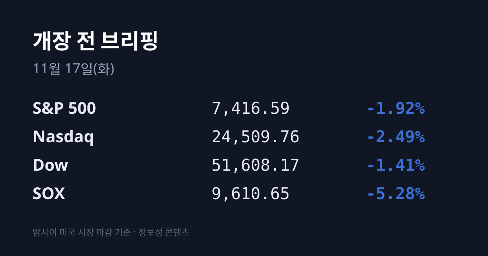
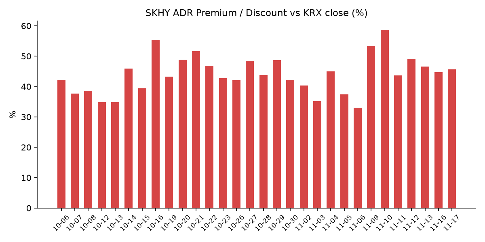
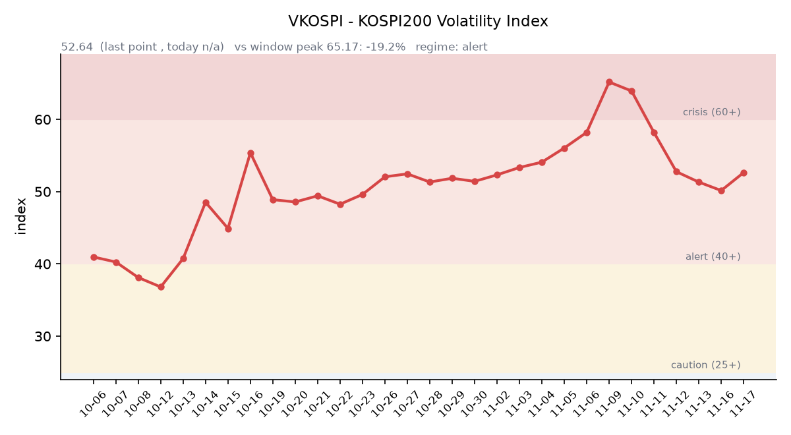

## ① 30초 요약

- 11/16(월) 미국은 S&P500 −1.92%, 나스닥 −2.49%, 다우 −1.41%로 마감했습니다. <mark>필라델피아 반도체지수(SOX)는 −5.28%</mark>였고 마이크론(−7.62%), TSMC ADR(−6.34%)이 크게 내렸습니다.
- 엔비디아 이사회가 젠슨 황 전 CEO의 복귀를 논의하지 않는다는 보도, 미 상무부의 AI 칩 원격 접근 제한 규제, 메모리 3사 D램 담합 집단소송 진행 허용이 같은 날 겹쳤습니다.
- 같은 날 코스피는 상승 출발했다가 **5,100.50(−3.59%)로** 마감했습니다. 외국인이 1조3,842억원을 순매도했고, 삼성전자는 196,800원, SK하이닉스는 1,120,000원으로 각각 20만원·120만원 아래로 내려갔습니다.
- SKHY가 $122.18(−7.29%)로 내렸지만 본주도 −7.89% 내려, SK하이닉스 ADR 괴리율은 +44.72%에서 +45.70%로 커졌습니다.
- 유가는 중동 원유 수출 회복 소식에 브렌트유 −4.17%로 내렸습니다. 엔비디아 실적은 한국 시간 11/18 오전, 앤트로픽 나스닥 상장은 11/19(미국)입니다.

## ② 밤사이 미국 시장

| 지수 | 11/16 종가 | 등락 |
| :--- | ---: | ---: |
| S&P 500 | 7,416.59 | −1.92% |
| 나스닥 종합 | 24,509.76 | −2.49% |
| 다우 | 51,608.17 | −1.41% |
| 필라델피아 반도체(SOX) | 9,610.65 | −5.28% |

반도체가 하락을 이끌었습니다. 마이크론 $719.02(−7.62%), 인텔 $55.47(−7.02%), TSMC ADR $373.45(−6.34%), AMD $504.28(−5.58%), 엔비디아 $156.14(−4.12%), 브로드컴 $333.40(−3.92%)였습니다. 빅테크도 아마존(−3.34%), 테슬라(−2.69%), 메타(−2.38%) 순으로 내렸습니다(이투데이).

배경으로는 여러 소식이 함께 거론됐습니다. CNBC는 엔비디아 이사회가 지난주 사임한 젠슨 황의 복귀를 논의하지 않고 있다고 보도했고, 트럼프 대통령은 복귀를 공개적으로 지지했습니다(야후 파이낸스). FT는 반대로 황이 복귀를 검토 중이라고 전해 보도가 엇갈립니다. 미 상무부는 해외 이용자가 미국의 첨단 AI 반도체에 원격으로 접근하는 것을 제한하는 새 규제를 발표했습니다(블록미디어). <mark>미 연방법원은 마이크론·삼성전자·SK하이닉스를 상대로 한 D램 공급 제한·가격 담합 집단소송의 진행을 허용했습니다</mark>(혐의는 입증되지 않았습니다). 반도체 리서치 업체 SemiAnalysis는 AI 가속기 지출 전망을 2028년 약 28%, 2030년 약 40% 낮췄고, 브로드컴은 로스차일드 레드번의 투자의견 하향을 받았습니다(ibtimes). 인텔은 투자자 집단소송이 제기된 뒤 6% 넘게 내렸고, 미국 대형 은행 4곳은 앱·거래 장애 보도에 각각 약 2% 내렸습니다(야후 파이낸스). 시장은 엔비디아 실적(미국 11/17 장 마감 후)과 앤트로픽 상장(11/19 거래 시작, 기업가치 약 1조4,000억 달러 목표 보도)을 앞두고 있습니다.

케빈 워시 연준 의장은 샌프란시스코 연은 행사에서 AI가 경제에 미칠 영향을 생산성 급증·일자리 감소·기대 미달의 세 가지 시나리오로 설명하며 "AI가 실망시킬 수도 있다"고 말했습니다. 금리 결정이나 물가 지표는 언급하지 않았습니다(CNBC). 미 국채 10년물은 장중 약 5.13%로 금요일 고점(5.174%)보다 내렸습니다. FRED 기준(11/13) 10년물 5.15%, 2년물 4.88%, 30년물 5.47%, 10년물 실질금리(TIPS) 2.91%이고, 11/16 기준 10년물과 2년물 차이는 0.29%p입니다.

<mark>VIX는 22.91로 18.70% 올라 20선을 넘었습니다.</mark> 달러인덱스는 103.57(+0.16%), 금 12월물은 $3,859.00(−0.70%)이었습니다. 달러가 오르고 실질금리는 보합인 가운데 금이 내린 조합입니다. 유가는 **WTI $85.06(−3.95%), 브렌트유 $91.84(−4.17%)로** 내렸습니다. 중동 원유 수출과 호르무즈 해협 선적 회복, 국제에너지기구(IEA)의 4분기 공급 과잉 전망, 골드만삭스의 내년 유가 하락 전망이 거론됐습니다(이투데이·야후 파이낸스).

장 마감 뒤 시간외에서는 엔비디아 $156.28, 마이크론 $721.25로 정규장 종가 부근이었습니다. 지수선물은 한국 시간 06:59 기준 S&P500 12월물 7,438.50(−1.91%), 나스닥100 12월물 27,285.25(−2.67%)이며 08:00 KST에 거래를 재개합니다.

## ③ 괴리율 트래커 — SK하이닉스 ADR

| 항목 | 수치 |
| :--- | ---: |
| SKHY 종가 (11/16) | $122.18 (−7.29%) |
| 본주 환산가 (×10×환율 1,335.61원) | 1,631,848원 |
| 본주 직전 종가 (11/16) | 1,120,000원 |
| **괴리율** | **+45.70%** |

11/16 한국 본주는 1,120,000원(−7.89%)으로 내렸고, 그 뒤 미국 SKHY는 $122.18(−7.29%)로 비슷한 폭으로 내렸습니다. 시간외에서는 $123.10(+0.75%)입니다. 그 결과 괴리율은 전일 +44.72%에서 <mark>+45.70%로 0.98%포인트 커져 나흘 만에 확대됐습니다.</mark>

괴리율은 미국에 상장된 예탁증서(ADR) 가격을 본주 1주 기준으로 환산한 값과 한국 본주 종가를 비교한 수치입니다. 환산가가 본주보다 높은 프리미엄 상태에서는 전환 차익거래 구조상 본주 쪽에 매수 유인이 생기고, 디스카운트면 반대입니다.

한국 시장 전체를 담는 EWY(iShares MSCI South Korea ETF)는 **$136.55(−4.36%)였고**, 시간외에서는 $137.50(+0.70%)입니다. 11/16 EWY 등락에는 한국 11/16 장중 움직임(코스피 −3.59%)이 함께 들어 있어, 이를 빼고 어림 계산하면 **한국 11/16 마감 이후 미국 시간에 더해진 몫은** 정규장 기준 달러로 약 −0.9%포인트, 시간외까지 넣으면 약 −0.2%포인트입니다.

## ④ 변동성 트래커

**판정 한 줄**: <mark>VKOSPI가 52.64로 엿새 만에 올라 '경보'(40~60) 구간에서 닷새간의 진정 흐름이 끊겼습니다.</mark>

**기대 변동성**  VKOSPI **52.64**(11/16, 전일비 +2.49, +4.97%)로 '경보'(40~60) 구간입니다. 장중 고가는 53.35였습니다. 11/10~11/13 이어진 하락이 멈췄고, 6월 고점 96.94 대비 −45.7%, 평시 상단인 25의 2.11배입니다. 미국 VIX는 22.91로, VKOSPI가 VIX의 약 2.3배입니다.

**실현 변동성**  최근 10거래일 코스피 일별 등락률은 11/3 −3.59%, 11/4 +0.62%, 11/5 −5.28%, 11/6 −6.02%, 11/9 −0.81%, 11/10 +4.39%, 11/11 +2.60%, 11/12 −0.61%, 11/13 −0.98%, 11/16 −3.59%입니다. 이 중 ±3% 이상 등락일은 닷새입니다. 11/16 일중 변동폭은 **종가 대비 5.06%로** 최근 5거래일 중 가장 컸고, 5거래일 평균은 3.68%입니다. 10/02 종가 7,003.74 대비로는 −27.2%입니다.

**증폭 경로**  전체 ETF 거래대금 중 레버리지 ETF 비중은 27.28%로 직전(26.90%)보다 올랐습니다. KODEX 200선물인버스2X 거래대금은 **1조1,963억원(회전율 131.40%)으로** 직전 7,380억원에서 늘어 KODEX 레버리지(1조2,031억원, 31.23%)와 비슷해졌습니다. KODEX 코스닥150레버리지 5,197억원(19.36%), KODEX 반도체레버리지 2,796억원(48.04%), TIGER 반도체TOP10레버리지 2,055억원(51.29%)입니다(네이버 ETF 목록, 11/17 07:16 스냅샷). 11/16 코스피200 선물 베이시스는 −2.21(선물 789.35 − 현물 791.56)로 여드레째 마이너스였습니다.

**청산 압력**  신용융자 잔고는 26조5억원(11/13 기준)으로 하루 전보다 2,276억원 늘었습니다. 유가증권시장 20조1,890억원, 코스닥 5조8,115억원입니다. 같은 날 위탁매매 미수금은 8,717억원, 반대매매 금액은 56억원이었습니다(금융투자협회).

**하방 포지션**  공매도 순잔고는 T+2~3 공시 지연이 있어 개장 전 시점에는 확정치를 알 수 없습니다.

*당일 수집 실패: 11/16 서울 외환시장 원/달러 종가 기사, 11/16 업종 지수별 등락률.*

## ⑤ 직전 거래일(11/16) 한국장 리뷰

| 지수 | 종가 | 등락 |
| :--- | ---: | ---: |
| 코스피 | 5,100.50 | −190.03 (−3.59%) |
| 코스닥 | 665.65 | −34.01 (−4.86%) |

코스피는 5,305.40으로 올라 출발해 5,327.99까지 올랐다가 밀려 장중 5,069.83까지 내렸습니다. 이틀 연속 상승 출발 뒤 하락 마감입니다. 코스닥은 708.34까지 올랐다가 665.65로 마감했습니다.

<mark>외국인은 유가증권시장에서 1조3,842억원을 순매도했고</mark>, 기관도 4,626억원을 순매도했습니다. 개인은 1조3,515억원을 순매수했습니다. 코스닥에서는 외국인 2,113억원, 기관 1,542억원 순매도, 개인 3,771억원 순매수였습니다(파이낸셜뉴스, 매체별 외국인 코스피 순매도 1조3,764억~1조3,842억원).

삼성전자는 **196,800원(−4.47%)으로** 20만원 아래로, SK하이닉스는 1,120,000원(−7.89%)으로 120만원 아래로 내렸습니다. 외국인은 삼성전자를 6,194억원, SK하이닉스를 2,242억원어치 순매도했습니다(SBS). 증권가는 젠슨 황 사임 이후 AI 생태계의 순환 금융과 자금 조달 불확실성(코어위브의 40억 달러 회사채 조달 계획, 네비우스의 추가 자금 조달 필요)을 꼽았고(파이낸셜뉴스), 외국인이 11/19 앤트로픽 상장에 투자할 현금을 마련하고 있다는 분석, 연준 금융안정보고서의 AI발 주식 고평가 지적, D램 담합 소송 진행도 거론됐습니다(SBS). SK스퀘어(−9.84%), 삼성전기(−8.07%), 한화에어로스페이스(−4%대)도 내렸고, 삼성바이오로직스는 +0.35%였습니다.

코스닥에서는 초소형 카메라를 이용한 'AI 커닝' 적발 소식에 나무가·지슨·세코닉스·카티스 등 보안·카메라주가 상한가였고, M83은 분기 최대 실적과 흑자 전환으로 상한가를 기록했습니다. 상한가는 8종목, 하한가는 HLB테라퓨틱스 1종목이었습니다(이투데이).

원/달러는 외국인 대량 매도에도 크게 움직이지 않았습니다. 하나은행 고시 기준 11/16 최종 1,336.50원으로 1.50원 내렸고, 작성 시각(11/17 07:11) 현재 **1,335.61원입니다.** 달러/엔은 159.41입니다.

아시아 증시 11/16 종가는 대만 가권 41,040.08(−6.03%), 닛케이225 59,662.02(−2.42%), 토픽스 3,901.37(−1.02%), 상하이종합 3,602.57(−0.87%), CSI300 3,979.80(−0.91%), 항셍 23,753.84(+0.49%)입니다. 대만 가권은 하루 약 2,635포인트 내려 올해 7/17(−2,953.71포인트) 다음으로 큰 포인트 하락을 기록했고, TSMC는 NT$2,215(−5.74%)였습니다. 골드만삭스가 아시아 전략에서 대만 시장 의견을 '중립'으로 낮췄다는 보도도 있었습니다. 이들 시장은 11/16 밤 미국 반도체 하락 전에 문을 닫았습니다. D램 현물가는 11/16 대만 세션 기준 DDR5 16Gb $60.33(+0.11%), DDR4 16Gb $79.38(−0.16%), DDR4 8Gb $44.36(−0.40%)입니다(DRAMeXchange).

## ⑥ 이번 주 캘린더 & 관전 포인트

- **11/17(화):** 08:00 미국 지수선물 거래 재개. 일본(09:00)·대만(10:00) 개장. 아락치 이란 외무장관 오만 방문 예정. 미국 현지 17일 홈디포·디즈니 실적(장 전).
- **11/18(수) 오전(미국 11/17 장 마감 후):** <mark>엔비디아 3분기 실적</mark> — 콜레트 크레스 임시 CEO 체제의 첫 실적입니다. 매출은 전년 대비 100% 가까이 늘었을 것으로 애널리스트들은 보고 있습니다(이투데이).
- **11/18(미국):** 앤트로픽 공모가 결정, **11/19(미국):** 나스닥 거래 시작 예정.
- 이번 주 ASEAN·APEC 정상회의를 계기로 한 미중 정상회담 여부도 주목받고 있습니다.
- **11/30:** MSCI 11월 정기 변경 반영. **12/9:** FOMC. **12/10:** 국내 선물·옵션 동시 만기.

시장 참가자들이 주시하는 레벨은 코스피 5,180선과 4,950선, SK하이닉스 1,060,000원, VKOSPI 55 선, 원/달러 1,350원 선, 대만 가권 추가 등락폭입니다.

## ⑦ 정책 워치

미 상무부는 11/16(현지) 해외 이용자가 미국 첨단 AI 반도체에 원격으로 접근하는 것을 제한하는 새 규제를 발표했습니다(블록미디어). 미 연방법원은 마이크론·삼성전자·SK하이닉스를 상대로 한 D램 가격 담합 집단소송이 진행되도록 허용했습니다(ibtimes, 혐의 미입증).

국내에서는 현재 공매도가 전면 재개 상태이며 최근 제도 변경 사항은 없습니다.

## ⑧ 오늘의 질문

미국 반도체 −5%의 상당 부분을 한국이 하루 먼저 반영한 상태에서, 메모리를 직접 겨냥한 소송·규제 소식과 이번 주 두 개의 AI 자금 이벤트(엔비디아 실적·앤트로픽 상장)는 외국인 매도의 강도를 어떻게 바꿀 것인가.

---
*본 글은 공개된 시장 데이터를 정리한 정보성 콘텐츠이며, 특정 종목·상품의 매매 권유가 아닙니다. 모든 투자 판단과 책임은 투자자 본인에게 있습니다. 수치는 작성 시점 기준이며 이후 변동될 수 있습니다.*
