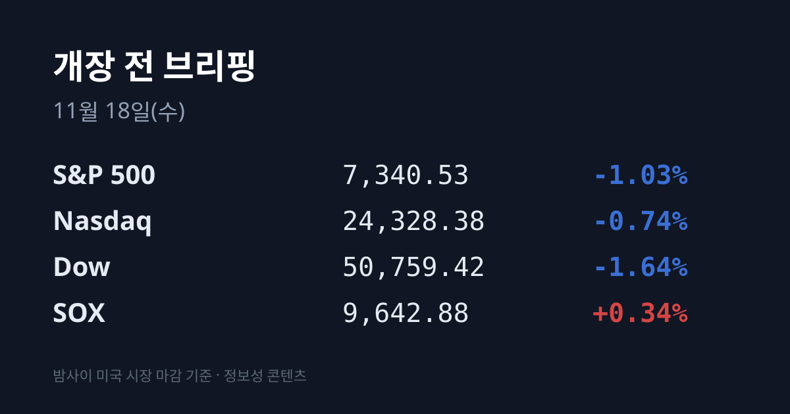
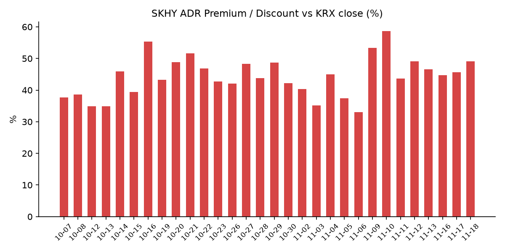
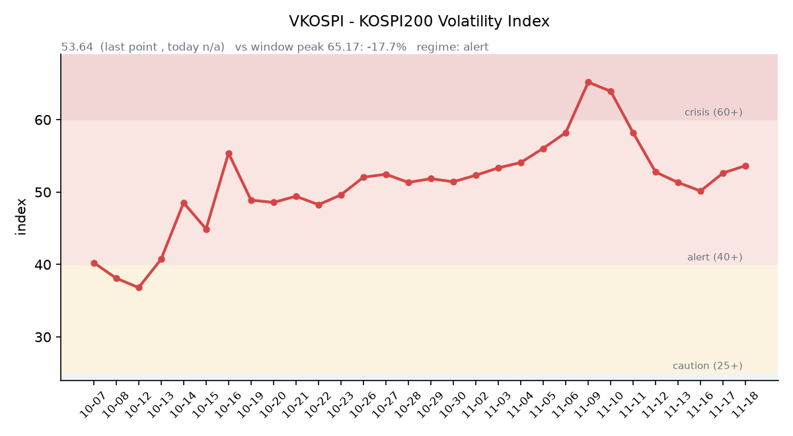

## ① 30초 요약

- 11/17(화) 미국은 S&P500 −1.03%, 나스닥 −0.74%, 다우 −1.64%로 마감했습니다. 하락은 소프트웨어주가 이끌었고, **필라델피아 반도체지수(SOX)는 +0.34%였습니다.**
- 장 마감 뒤 발표된 <mark>엔비디아 3분기 매출은 1,158억 달러로 시장 예상(약 1,091억 달러)을 웃돌았고</mark>, 4분기 매출 가이던스는 1,300억 달러였습니다. 주가는 시간외에서 $158.03(+1.65%)입니다.
- 같은 날 코스피는 4,968.48(−2.59%)로 마감해 2월 이후 9개월 만에 종가 기준 5,000선 아래로 내려갔습니다. 외국인은 1조4,459억원을 순매도했습니다.
- SKHY는 $122.61(+0.35%)로 올랐고 본주는 1,098,000원(−1.96%)으로 내려, SK하이닉스 ADR 괴리율은 +45.70%에서 +49.06%로 커졌습니다.
- 앤트로픽은 미국 시간 11/18 저녁 공모가를 정하고 11/19 나스닥에서 거래를 시작합니다.

## ② 밤사이 미국 시장

| 지수 | 11/17 종가 | 등락 |
| :--- | ---: | ---: |
| S&P 500 | 7,340.53 | −1.03% |
| 나스닥 종합 | 24,328.38 | −0.74% |
| 다우 | 50,759.42 | −1.64% |
| 필라델피아 반도체(SOX) | 9,642.88 | +0.34% |

정규장 하락은 소프트웨어주에서 나왔습니다. OpenAI의 신모델 발표 뒤 소프트웨어 ETF(IGV)가 약 3% 내렸고, 세일즈포스(−8% 이상), 서비스나우(−6%), 인튜이트(−5%), 마이크로소프트·팔란티어(각 −3%), 오라클·팔로알토네트웍스(각 −4%)가 약세였습니다(야후 파이낸스·CNBC). 앤트로픽 상장을 앞두고 다른 보유 종목에서 현금이 빠져나가고 있다는 시장 분석도 나왔습니다(야후 파이낸스·벤징가).

반도체는 엇갈렸습니다. 브로드컴 $341.60(+2.46%), AMD $503.41(−0.17%), 엔비디아 $155.46(−0.44%), 마이크론 $712.42(−0.92%), TSMC ADR $359.69(−3.68%)였습니다. 인텔($55.17, −0.54%)은 엔비디아가 인텔 지분을 25% 줄였다고 공시한 뒤 내렸습니다. 미 행정부가 중국산 데이터센터 장비 수입을 막을 계획이라는 보도에 코히런트(+11%), 어플라이드 옵토일렉트로닉스(+8.6%), 루멘텀(+5.6%) 등 광통신주가 올랐습니다(CNBC).

장 마감 뒤 엔비디아는 3분기(회계연도 2027) 매출 1,158억 달러(전년 대비 +103%), 조정 주당순이익 2.68달러(예상 약 2.47달러), 데이터센터 매출 1,076억 달러(+110%)를 발표했습니다. 4분기 매출 가이던스는 **1,300억 달러(±3%)로** 시장 예상(약 1,252억 달러)보다 높았고, 이 가이던스에는 중국 데이터센터용 매출이 반영되지 않았습니다. 1,500억 달러 규모의 자사주 매입도 발표했습니다(CBS·뉴스1·야후 파이낸스). 젠슨 황 사임 뒤 첫 실적으로, 콜레트 크레스 임시 CEO가 발표했고 하비 존스 이사회 의장은 황을 CEO로 복귀시킬 의사가 없다고 밝혔습니다(CBS). 한국 시간 07:17 기준 시간외에서 엔비디아 $158.03(+1.65%), TSMC ADR $371.50(+3.28%), 마이크론 $723.00(+1.49%), AMD $510.37(+1.38%)이고, 코어위브(+4%)·네비우스(+6%)도 올랐습니다(야후 파이낸스·CNBC).

연준에서는 알베르토 무살렘 세인트루이스 연은 총재가 추가 금리 인상이 곧 필요하며, 내년 봄까지 100~150bp를 더 올려 4.75~5.00%에 이르는 경로를 제시했습니다(야후 파이낸스). 10월 소매판매는 전월 대비 +0.2%(예상 +0.1%)였습니다. 미 국채 10년물은 11/17 5.103%, 30년물은 5.458%로 소폭 내렸습니다. FRED 기준(11/16) 10년물 5.12%, 2년물 4.83%, 30년물 5.46%, 10년물 실질금리(TIPS) 2.92%이고, 11/17 기준 10년물과 2년물 차이는 0.30%p입니다.

<mark>VIX는 25.46으로 11.13% 올랐습니다.</mark> 달러인덱스는 103.56으로 보합, 금 12월물은 $3,851.90(−0.03%)였습니다. 금·달러·실질금리가 모두 보합권이었습니다. 유가는 WTI $85.61(−0.13%), 브렌트유 $93.07(+0.68%)입니다. 지수선물은 한국 시간 06:59 기준 S&P500 12월물 7,366.50(−0.97%), 나스닥100 12월물 27,126.00(−0.58%)이며 08:00 KST에 거래를 재개합니다.

## ③ 괴리율 트래커 — SK하이닉스 ADR

| 항목 | 수치 |
| :--- | ---: |
| SKHY 종가 (11/17) | $122.61 (+0.35%) |
| 본주 환산가 (×10×환율 1,334.87원) | 1,636,684원 |
| 본주 직전 종가 (11/17) | 1,098,000원 |
| **괴리율** | **+49.06%** |

11/17 한국 본주는 1,098,000원(−1.96%)으로 내렸고, 그 뒤 미국 SKHY는 $122.61(+0.35%)로 올랐습니다. 엔비디아 실적 발표 뒤 시간외에서는 $125.00(+1.95%)입니다. 그 결과 괴리율은 전일 +45.70%에서 <mark>+49.06%로 3.36%포인트 커져 이틀째 확대됐습니다.</mark>

괴리율은 미국에 상장된 예탁증서(ADR) 가격을 본주 1주 기준으로 환산한 값과 한국 본주 종가를 비교한 수치입니다. 환산가가 본주보다 높은 프리미엄 상태에서는 전환 차익거래 구조상 본주 쪽에 매수 유인이 생기고, 디스카운트면 반대입니다.

한국 시장 전체를 담는 EWY(iShares MSCI South Korea ETF)는 $135.32(−0.90%)였고, 시간외에서는 **$136.72(+1.03%)입니다.** 11/17 EWY 등락에는 한국 11/17 장중 움직임(코스피 −2.59%)이 함께 들어 있어, 이를 빼고 어림 계산하면 한국 11/17 마감 이후 미국 시간에 더해진 몫은 정규장 기준 달러로 약 +1.7%포인트, 시간외까지 넣으면 약 +2.7%포인트입니다.

## ④ 변동성 트래커

**판정 한 줄**: <mark>VKOSPI가 53.64로 이틀째 올라 '경보'(40~60) 구간에 머물렀고, 인버스2X ETF 거래대금이 레버리지 ETF를 넘어섰습니다.</mark>

**기대 변동성**  VKOSPI **53.64**(11/17, 전일비 +1.00, +1.90%)로 '경보'(40~60) 구간입니다. 장중 고가는 54.36이었습니다. 6월 고점 96.94 대비 −44.7%, 평시 상단인 25의 2.15배입니다. 미국 VIX는 25.46으로, VKOSPI가 VIX의 약 2.1배입니다.

**실현 변동성**  최근 10거래일 코스피 일별 등락률은 11/4 +0.62%, 11/5 −5.28%, 11/6 −6.02%, 11/9 −0.81%, 11/10 +4.39%, 11/11 +2.60%, 11/12 −0.61%, 11/13 −0.98%, 11/16 −3.59%, 11/17 −2.59%입니다. 이 중 ±3% 이상 등락일은 나흘입니다. 11/17 일중 변동폭은 종가 대비 2.56%로 전날(5.06%)보다 줄었고, 최근 5거래일 평균은 3.71%입니다. 10/02 종가 7,003.74 대비로는 −29.1%입니다.

**증폭 경로**  전체 ETF 거래대금 중 레버리지 ETF 비중은 25.55%로 직전(27.28%)보다 내렸습니다. **KODEX 200선물인버스2X 거래대금은 1조3,339억원(회전율 134.08%)으로** KODEX 레버리지(1조2,332억원, 33.89%)를 웃돌았습니다. KODEX 코스닥150레버리지 5,119억원(20.08%), KODEX 반도체레버리지 2,708억원(49.39%), SOL SK하이닉스선물단일종목인버스2X 2,230억원(203.70%)입니다(네이버 ETF 목록, 11/18 07:17 스냅샷). 11/17 코스피200 선물 베이시스는 −3.54(선물 767.20 − 현물 770.74)로 아흐레째 마이너스였고, 폭은 전날(−2.21)보다 커졌습니다.

**청산 압력**  신용융자 잔고는 26조2,588억원(11/16 기준)으로 직전 거래일(11/13)보다 2,583억원 늘었습니다. 유가증권시장 20조3,337억원, 코스닥 5조9,252억원입니다. 같은 날 위탁매매 미수금은 8,850억원, 반대매매 금액은 32억원이었습니다(금융투자협회).

**하방 포지션**  공매도 순잔고는 T+2~3 공시 지연이 있어 개장 전 시점에는 확정치를 알 수 없습니다.

*당일 수집 실패: 11/17 업종 지수별 등락률.*

## ⑤ 직전 거래일(11/17) 한국장 리뷰

| 지수 | 종가 | 등락 |
| :--- | ---: | ---: |
| 코스피 | 4,968.48 | −132.02 (−2.59%) |
| 코스닥 | 650.06 | −15.59 (−2.34%) |

코스피는 5,008.09로 내려 출발해 오전 5,084.06까지 올랐다가 오후 들어 밀려 장중 4,957.00까지 내렸습니다. 종가 기준 5,000선 아래는 2/2(4,949.67) 이후 처음이며, 11/12부터 4거래일 연속 하락입니다. 코스닥은 650.06으로 마감했습니다.

<mark>외국인은 유가증권시장에서 1조4,459억원을 순매도했습니다</mark>(매체별 1조4,429억~1조4,460억원). 기관은 5,391억원, 개인은 4,263억원을 순매수했습니다. 코스닥에서는 외국인 883억원, 기관 251억원 순매도, 개인 1,155억원 순매수였습니다(미디어펜). 외국인의 이틀 합계 코스피 순매도는 약 2조8,000억원입니다.

삼성전자는 **190,300원(−3.30%), SK하이닉스는 1,098,000원(−1.96%)으로** 마감했습니다. SK하이닉스 종가가 110만원 아래로 내려간 것은 4/13 이후 약 7개월 만입니다. 증권가는 젠슨 황 사임을 둘러싼 불확실성이 엔비디아 중심의 AI 투자·순환 금융 생태계를 위축시킬 수 있다는 우려를 꼽았고(키움증권), 미 상무부 산업안보국(BIS)의 AI 칩 원격 접근 우회 차단 규제, 인쇄회로기판(PCB) 문제로 엔비디아 대량 출하가 늦어질 수 있다는 업계 관측(엔비디아는 확인하지 않음), D램 담합 집단소송 각하 신청 기각도 거론됐습니다(연합뉴스 인용 보도). 하락 상위에는 삼성전자우(−5.77%), LG에너지솔루션(−4.08%), 삼성전기(−3.95%), KB금융(−2.97%), 현대차(−2.45%)가 있었습니다. 코스닥에서는 레인보우로보틱스(−5.44%), 에코프로(−3.15%), 주성엔지니어링(−2.83%), 리노공업(−2.76%)이 내렸고 알테오젠(+0.76%)은 올랐습니다(미디어펜). 개별 종목으로는 시험 부정행위 보안 이슈로 지슨이 이틀 연속 상한가였고, 피스피스스튜디오는 자사주 100억원 소각 결정에 +12.65%였습니다.

원/달러는 11/17 서울 외환시장 주간 거래에서 1,338.20원으로 2.50원 올랐고, 작성 시각(11/18 07:14) 현재 **1,334.87원입니다.** 달러/엔은 159.34입니다.

아시아 증시 11/17 종가는 대만 가권 40,092.11(−2.31%), 닛케이225 58,860.43(−1.34%), 토픽스 3,840.02(−1.57%), 상하이종합 3,584.58(−0.50%), CSI300 3,976.46(−0.08%), 항셍 23,508.17(−1.03%)입니다. D램 현물가는 11/17 대만 세션 기준 DDR5 16Gb $60.33(보합), DDR4 16Gb $79.12(−0.32%), DDR4 8Gb $44.25(−0.24%)입니다(DRAMeXchange).

## ⑥ 이번 주 캘린더 & 관전 포인트

- **11/18(수):** 08:00 미국 지수선물 거래 재개. 일본(09:00)·대만(10:00) 개장.
- **11/19(목) 오전(미국 11/18 저녁):** <mark>앤트로픽 공모가 결정</mark> — 공모가 범위는 주당 70~78달러, 8억2,500만 주로 최대 643억 달러 규모입니다. 청약이 약 6배 몰려 범위 위에서 가격이 정해질 수 있다는 보도가 있습니다(확정 아님).
- **11/19(미국):** 앤트로픽 나스닥 거래 시작(티커 ANT).
- 이번 주 미국 월마트·타깃 실적 발표가 예정돼 있습니다.
- **11/23:** 홈디포 CEO 교체 발효. **11/30:** MSCI 11월 정기 변경 반영. **12/9:** FOMC. **12/10:** 국내 선물·옵션 동시 만기.

시장 참가자들이 주시하는 레벨은 코스피 4,900선과 5,120선, SK하이닉스 1,060,000원, VKOSPI 55 선, 원/달러 1,345원 선, 외국인 순매도 규모입니다.

## ⑦ 정책 워치

미 상무부 산업안보국(BIS)은 11/16(현지) 수출통제 대상국 기업이 제3국 데이터센터를 통해 미국산 첨단 AI 반도체를 원격으로 쓰는 경로를 막는 규제를 발표했습니다. 미 행정부가 중국산 데이터센터 장비 수입을 막을 계획이라는 보도도 나왔습니다(CNBC). 중동에서는 11/17 미군이 호르무즈 해협 케슘섬의 이란 혁명수비대 미사일 기지를 타격했다고 밝혔습니다. 바레인의 미군 레이더 기지를 겨냥한 이란 드론 공격(요격)에 대한 대응이라고 설명했습니다(CBS). 같은 날 이란·오만 외무장관이 무스카트에서 회담했으나 호르무즈 관련 합의는 보도되지 않았습니다.

국내에서는 현재 공매도가 전면 재개 상태이며 최근 제도 변경 사항은 없습니다.

## ⑧ 오늘의 질문

엔비디아가 실적과 가이던스로 AI 수요에 대한 의심에 답한 지금, 사흘째 반등을 매도로 받아 온 외국인은 앤트로픽 상장을 앞두고 어떤 선택을 할 것인가.

---
*본 글은 공개된 시장 데이터를 정리한 정보성 콘텐츠이며, 특정 종목·상품의 매매 권유가 아닙니다. 모든 투자 판단과 책임은 투자자 본인에게 있습니다. 수치는 작성 시점 기준이며 이후 변동될 수 있습니다.*
