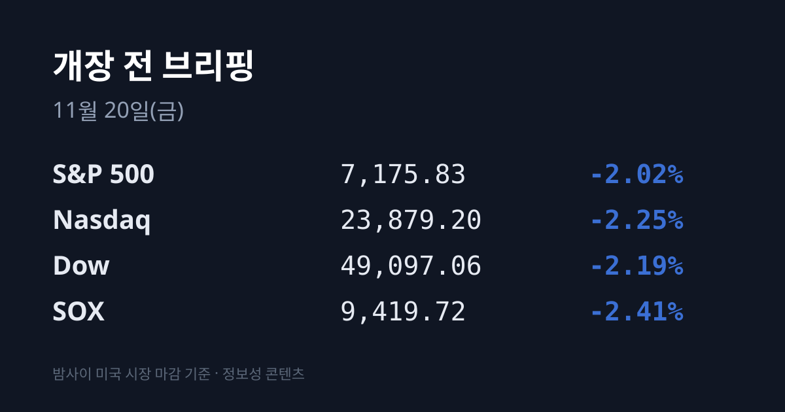
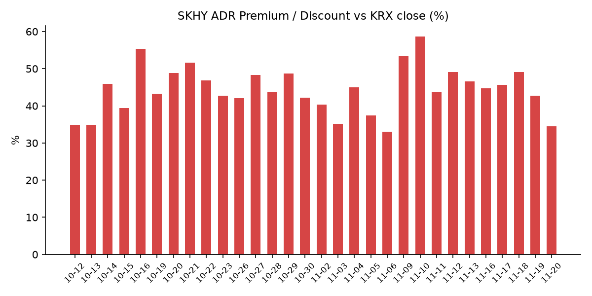
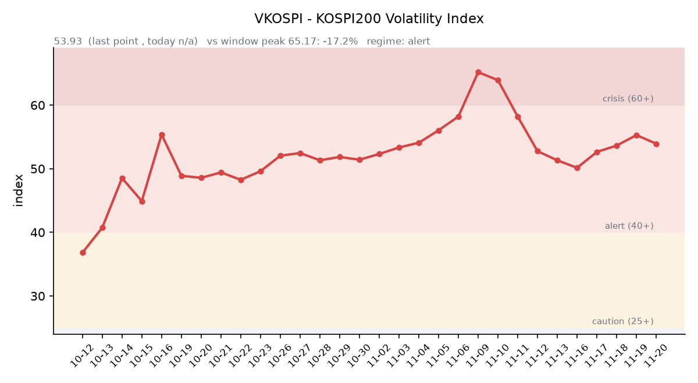

## ① 30초 요약

- <mark>11/19(목) 미국은 S&P500 −2.02%, 나스닥 −2.25%, 다우 −2.19%로 크게 내렸습니다.</mark> S&P500은 6거래일 연속 하락했고 다우는 6/10 이후 처음 50,000 아래로 마감했습니다.
- **필라델피아 반도체지수(SOX)는 −2.41%였습니다.** AMD는 공매도 보고서가 나오며 7.72% 내렸고 엔비디아는 3.30% 내렸습니다.
- 앤트로픽은 나스닥 첫 거래에서 공모가 83달러보다 34% 높은 111.50달러에 시작해 97.17달러(+17.07%)로 마감했습니다.
- 11/19 대만 가권은 −4.40%로 역대 7번째로 큰 포인트 낙폭을 기록했지만, 같은 날 코스피는 5,137.89(+1.39%)로 장중 최고가에 마감했습니다.
- 인튜이트는 장 마감 뒤 실적 발표에서 다음 분기 가이던스가 예상에 못 미쳐 시간외에서 약 10% 내렸습니다.

## ② 밤사이 미국 시장

| 지수 | 11/19 종가 | 등락 |
| :--- | ---: | ---: |
| S&P 500 | 7,175.83 | −2.02% |
| 나스닥 종합 | 23,879.20 | −2.25% |
| 다우 | 49,097.06 | −2.19% |
| 필라델피아 반도체(SOX) | 9,419.72 | −2.41% |

나스닥은 4/14 이후 가장 낮은 종가였고, 다우는 1,101.11포인트 내렸습니다. 러셀2000도 −2.18%였습니다. investing.com은 하락 배경으로 대형 기술기업의 AI 투자가 빚으로 조달되고 있다는 우려, 중간선거 뒤 민주당 주도 의회에서 AI 규제와 데이터센터 증설 둔화가 나올 수 있다는 우려, 12월 금리 인상 가능성을 꼽았습니다. 존스트레이딩의 마이클 오루크는 QQQ와 나스닥100 선물에 있던 돈이 앤트로픽 개장에 맞춰 옮겨 가면서 시장이 한 번 더 밀렸다고 설명했습니다. SOX는 11월 들어 10.6% 내렸습니다.

반도체는 대부분 내렸습니다. <mark>AMD는 $489.19(−7.72%)로 마감했습니다.</mark> 헌터브룩 캐피털이 미국 수출통제 대상 중국 기업과의 거래 의혹을 들어 공매도 포지션을 공개했습니다. 엔비디아 $145.98(−3.30%), TSMC ADR $352.09(−2.90%), 마이크론 $690.44(−2.10%), 브로드컴 $346.65(−2.09%)였고 인텔만 $55.72(+1.92%)로 올랐습니다. 알파벳은 $272.66(−3.46%)입니다. 월마트는 3분기 매출 1,888억 달러(예상 1,872억 달러)로 예상을 웃돌고 연간 가이던스를 올렸지만 주가는 1.04% 내렸습니다. 신규 실업수당 청구는 20.3만 건으로 예상(19.7만 건)보다 많았습니다.

앤트로픽(티커 ANT)은 공모가 83달러로 1,073억 달러를 조달해 사상 최대 규모 상장이 됐습니다. 첫날 111.50달러에 출발해 장중 115달러까지 올랐다가 **$97.17(공모가 대비 +17.07%)에** 마감했습니다. 완전희석 기준 기업가치는 약 1조5,000억 달러입니다.

장 마감 뒤에는 인튜이트가 1분기 매출 약 43억5,000만 달러, 조정 주당순이익 2.91달러로 예상을 웃돌았지만, 2분기 매출 가이던스(49억3,000만~49억5,000만 달러)가 예상(51억1,000만 달러)에 못 미치고 연간 매출 가이던스도 낮췄습니다. 메일침프를 36억8,000만 달러에 매각한다고도 밝혔습니다. 주가는 시간외에서 $279.12(약 −10.0%)입니다. 한국 시간 07:16 기준 시간외에서는 엔비디아 $146.35(+0.25%), AMD $480.94(−1.69%), 마이크론 $686.26(−0.61%), TSMC ADR $350.69(−0.40%), 앤트로픽 $95.10(−2.1%)입니다(야후 파이낸스).

CME FedWatch 기준 12월 회의에서 0.25%포인트 인상 확률은 94%, 0.5%포인트 인상은 6%로 집계됐습니다(investing.com 인용). 미 국채 10년물은 5.052%, 30년물은 5.401%로 전날(5.066%, 5.412%)보다 소폭 내렸습니다. FRED 기준(11/18) 10년물 5.07%, 2년물 4.80%, 30년물 5.41%, 10년물 실질금리(TIPS) 2.88%이고, 11/19 기준 10년물과 2년물 차이는 0.28%p입니다.

VIX는 **28.44로 15.80% 올랐습니다.** 달러인덱스는 103.93으로 강세를 이어갔고, 금 12월물은 $3,627.90(−3.05%)로 이틀째 크게 내렸습니다. 실질금리는 거의 그대로였고 달러는 올랐습니다. 브렌트유는 $90.05(−2.07%), WTI는 $83.16입니다. 지수선물은 한국 시간 06:59 기준 S&P500 12월물 7,182.50, 나스닥100 12월물 26,505.50으로 정규장 하락을 반영했고 08:00 KST에 거래를 재개합니다.

## ③ 괴리율 트래커 — SK하이닉스 ADR

| 항목 | 수치 |
| :--- | ---: |
| SKHY 종가 (11/19) | $119.20 (−2.67%) |
| 본주 환산가 (×10×환율 1,334.16원) | 1,590,319원 |
| 본주 직전 종가 (11/19) | 1,183,000원 |
| **괴리율** | **+34.43%** |

11/19 한국 본주는 1,183,000원(+3.41%)으로 올랐고, 그 뒤 미국 SKHY는 $119.20(−2.67%)로 내렸습니다. 시간외에서는 $119.23(+0.03%)입니다. 두 가격이 반대로 움직이면서 괴리율은 전일 +42.67%에서 <mark>+34.43%로 8.24%포인트 줄어 11/06(+33.10%) 이후 가장 낮아졌습니다.</mark>

괴리율은 미국에 상장된 예탁증서(ADR) 가격을 본주 1주 기준으로 환산한 값과 한국 본주 종가를 비교한 수치입니다. 환산가가 본주보다 높은 프리미엄 상태에서는 전환 차익거래 구조상 본주 쪽에 매수 유인이 생기고, 디스카운트면 반대입니다.

한국 시장 전체를 담는 EWY(iShares MSCI South Korea ETF)는 $134.59(−1.57%)였고, 시간외에서는 $134.40(−0.14%)입니다. 11/19 EWY 등락에는 한국 11/19 장중 움직임(코스피 +1.39%, 원화 강세 포함 달러 기준 약 +1.6%)이 함께 들어 있어, 이를 빼고 어림 계산하면 **한국 11/19 마감 이후 미국 시간에 더해진 몫은 약 −3.1%포인트**, 시간외까지 넣으면 약 −3.3%포인트입니다.

## ④ 변동성 트래커

**판정 한 줄**: <mark>VKOSPI는 53.93으로 나흘 만에 내려 '경보'(40~60) 구간 안에서 낮아졌지만, 이 값은 밤사이 미국 −2%와 VIX 28.44 이전에 확정된 것입니다.</mark>

**기대 변동성**  VKOSPI **53.93**(11/19, 전일비 −1.36, −2.46%)으로 '경보'(40~60) 구간입니다. 장중 범위는 52.76~54.79였습니다. 6월 고점 96.94 대비 −44.4%, 평시 상단인 25의 2.16배입니다. 미국 VIX는 28.44로, VKOSPI가 VIX의 약 1.9배입니다.

**실현 변동성**  최근 10거래일 코스피 일별 등락률은 11/6 −6.02%, 11/9 −0.81%, 11/10 +4.39%, 11/11 +2.60%, 11/12 −0.61%, 11/13 −0.98%, 11/16 −3.59%, 11/17 −2.59%, 11/18 +1.99%, 11/19 +1.39%입니다. 이 중 ±3% 이상 등락일은 사흘입니다. 11/19 코스피는 4,963.61까지 내렸다가 5,137.89로 마감해 일중 변동폭이 종가 대비 3.39%였고, 최근 5거래일 평균은 3.88%입니다.

**증폭 경로**  전체 ETF 거래대금 중 레버리지 ETF 비중은 29.72%로 직전(29.86%)과 비슷했습니다. KODEX 레버리지 거래대금이 1조2,253억원(회전율 31.81%)으로 KODEX 200선물인버스2X(1조1,289억원, 131.71%)를 사흘 만에 다시 앞섰습니다. KODEX 코스닥150레버리지 5,001억원(16.94%), KODEX 반도체레버리지 2,150억원(34.09%), TIGER 반도체TOP10레버리지 1,662억원(38.64%)입니다(네이버 ETF 목록, 11/20 07:16 스냅샷). 11/19 코스피200 선물 베이시스는 **−3.57(선물 796.00 − 현물 799.57)** 수준으로 11거래일째 마이너스였고, 폭은 전날(−1.26)보다 커졌습니다.

**청산 압력**  신용융자 잔고는 26조2,664억원(11/18 기준)으로 직전 거래일보다 675억원 줄었습니다. 유가증권시장 20조3,237억원, 코스닥 5조9,427억원입니다. 같은 날 위탁매매 미수금은 9,898억원, **반대매매 금액은 285억원으로** 전날(174억원)의 약 1.6배였습니다(금융투자협회).

**하방 포지션**  공매도 순잔고는 T+2~3 공시 지연이 있어 개장 전 시점에는 확정치를 알 수 없습니다.

## ⑤ 직전 거래일(11/19) 한국장 리뷰

| 지수 | 종가 | 등락 |
| :--- | ---: | ---: |
| 코스피 | 5,137.89 | +70.45 (+1.39%) |
| 코스닥 | 684.81 | +22.00 (+3.32%) |

수능일이라 정규장은 10:00에 열려 16:30에 닫혔습니다. 코스피는 5,090.04로 올라 출발했지만 미국 금리 인상 우려와 엔비디아 하락으로 장 초반 4,963.61까지 밀렸고, 오후 반도체를 중심으로 매수가 들어와 그날 최고가인 5,137.89로 마감했습니다. 코스닥도 684.81로 최고가에 마감했습니다.

유가증권시장에서 <mark>외국인은 4,055억원을 순매도해 5거래일째 매도했고</mark>, 개인은 652억원 순매도, 기관은 192억원 순매수였습니다. 기타법인이 4,514억원을 순매수했고 프로그램 매매는 2,424억원 순매도였습니다(디지털데일리·비즈니스코리아, 매체별 외국인 4,036억~4,580억원). 코스닥에서는 기관이 약 2,100억원을 순매수했고 외국인은 약 2,100억원을 순매도했습니다.

삼성전자는 **196,900원(+1.13%), SK하이닉스는 1,183,000원(+3.41%)으로** 마감했습니다. 장 초반 외국인 매도로 밀렸다가 앤트로픽 상장 기대와 AI 반도체 수요가 견조하다는 기대, 기관·기타법인 매수로 반등했다는 설명입니다. 외국인은 삼성전자를 1,078억원, SK하이닉스를 532억원 순매도했습니다. 삼성전기는 AI 서버용 MLCC와 반도체 기판 수요 기대로 885,000원(+9.26%), SK스퀘어는 +4.23%였습니다. KB금융(−2.24%), 신한지주(−1.61%), LG에너지솔루션(−0.98%)은 내렸습니다.

코스닥에서는 반도체 장비·부품주가 크게 올랐습니다. HPSP +11.76%, 리노공업 +10.56%, 원익IPS +8.33%, 주성엔지니어링 +6.31%, 이오테크닉스 +4.85%, 심텍 +4.83%였고 로봇주 로보티즈(+6.05%)와 레인보우로보틱스(+4.55%)도 올랐습니다. 한중 FTA 서비스·투자 후속협상이 실질적으로 타결돼 중국이 한국 영화·게임 등에 다른 나라보다 불리하지 않은 대우를 적용하기로 하면서, 한한령 완화 기대에 **오락·문화 업종이 9%대 올랐고** 화장품·백화점·호텔레저·엔터주도 함께 올랐습니다(디지털데일리·비즈니스코리아).

원/달러는 11/19 서울 외환시장 주간 거래에서 1,330.0원으로 3.0원 내려 나흘째 하락했고, 작성 시각(11/20 07:16) 현재 **1,334.16원입니다.** 달러/엔은 159.66입니다.

아시아 증시 11/19 종가는 대만 가권 38,426.89(−4.40%), 닛케이225 59,444.21(+0.71%), 토픽스 3,822.47(−0.04%), 상하이종합 3,577.62(−0.28%), CSI300 3,984.84(+0.03%), 항셍 22,841.62(−1.95%)입니다. 대만은 1,768.02포인트 내려 4만 선 아래로 마감했고 TSMC는 3.45% 내렸습니다. 포커스타이완은 미국 기술주 약세와 함께, 엔비디아 경영진 교체 뒤 원가 통제가 강해지면 대만 공급망의 마진이 눌릴 수 있다는 우려를 원인으로 전했습니다. D램 현물가는 11/19 대만 세션 기준 DDR5 16Gb $60.67(+0.28%), DDR4 16Gb $78.75(−0.25%), DDR4 8Gb $43.92(−0.25%)입니다(DRAMeXchange).

## ⑥ 오늘의 캘린더 & 관전 포인트

- **11/20(금):** 08:00 미국 지수선물 거래 재개. 한국·일본(09:00), 대만(10:00) 개장. 중국 대출우대금리(LPR) 발표(증권사 주간 일정 기준).
- **11/20(금) 밤(한국 시간):** <mark>앤트로픽 나스닥 이틀째 거래</mark> — 첫날 종가 $97.17, 시간외 $95.10.
- **11/30:** MSCI 정기 변경 반영. **12/2:** 미 하원 위원회의 엔비디아 브리핑 요구 시한.
- **12/8~9:** FOMC(결과는 한국 시간 12/10 새벽). **12/10:** 국내 선물·옵션 동시 만기. **12월:** 미국 플로리다 G20(미중 별도 회담). **1/10:** 미중 무역휴전 만료.

시장 참가자들이 주시하는 레벨은 코스피 5,000선과 5,165선, SK하이닉스 1,130,000원, VKOSPI 58 선, 원/달러 1,345원 선, 외국인 순매도 규모, 대만 가권의 추가 등락입니다.

## ⑦ 정책 워치

11/19 중국 선전에서 APEC을 계기로 열린 미중 정상회담 공동성명에는 반도체 수출통제 완화나 관세 인하가 담기지 않았습니다. 무역휴전 연장은 원칙적으로 합의했지만 1/10 만료 일정은 그대로이고, 쟁점은 12월 플로리다 G20 기간의 별도 회담으로 넘겼습니다(파이낸셜뉴스·이투데이). 시진핑 주석은 미국의 대중 AI 반도체 규제 강화에 반대 입장을 밝힌 것으로 전해졌습니다.

국내에서는 한중 FTA 서비스·투자 후속협상이 실질 타결됐습니다. 공매도는 현재 전면 재개 상태이며 최근 제도 변경 사항은 없습니다.

## ⑧ 오늘의 질문

대만이 4.4% 빠진 날 거꾸로 최고가로 마감한 한국 증시는, 밤사이 미국이 확인한 AI 매도를 어떻게 소화할 것인가.

---
*본 글은 공개된 시장 데이터를 정리한 정보성 콘텐츠이며, 특정 종목·상품의 매매 권유가 아닙니다. 모든 투자 판단과 책임은 투자자 본인에게 있습니다. 수치는 작성 시점 기준이며 이후 변동될 수 있습니다.*
