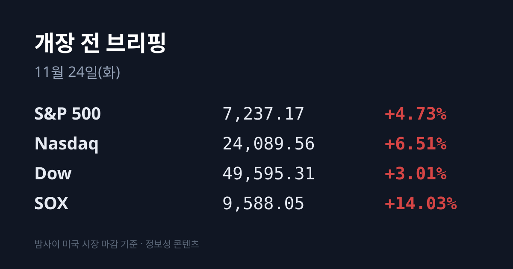
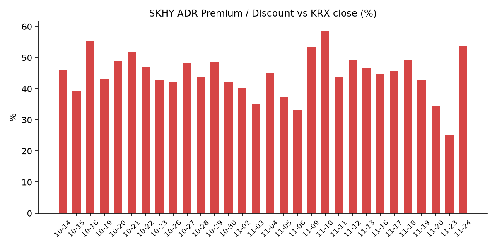
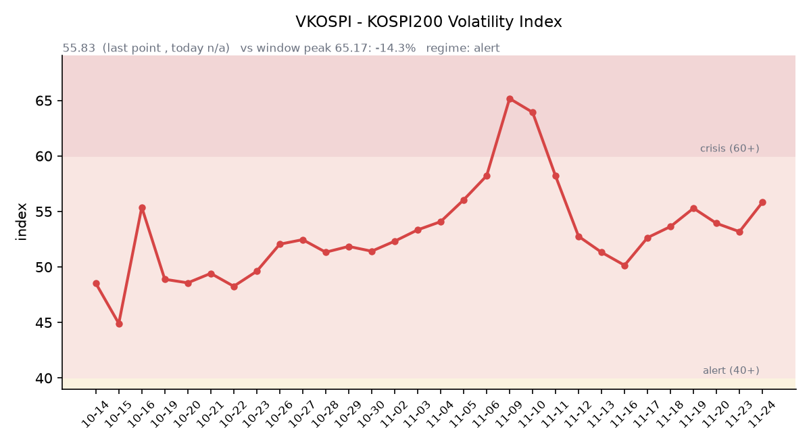

## ① 30초 요약

- <mark>11/23(월) 미국은 나스닥 +6.51%, 필라델피아 반도체지수(SOX) +14.03%로 반등했습니다.</mark> S&P500은 +4.73%로 7,237.17에 마감했습니다.
- 엔비디아 이사회가 젠슨 황을 CEO로 만장일치 복귀시켰고, 엔비디아는 **31.48% 오른 $165.05에** 마감했습니다. 마이크론 +19%, TSMC ADR +14%였습니다.
- 같은 날 한국은 미국 반등 전에 장을 마쳤습니다. 코스피는 4,708.54(−3.31%), 코스닥은 635.45(−1.58%)로 마감했고, 유가증권시장에서 이틀 연속 매도 사이드카가 발동됐습니다.
- 관세청 집계 11월 1~20일 수출은 774억 달러(+101.5%), 반도체 수출은 385억 달러(+294.4%)로 같은 기간 기준 역대 최대였습니다.
- SK하이닉스 ADR(SKHY)은 +20.00%였고, 괴리율은 +53.59%로 하루 새 28.34%포인트 커졌습니다.

## ② 밤사이 미국 시장

| 지수 | 11/23 종가 | 등락 |
| :--- | ---: | ---: |
| S&P 500 | 7,237.17 | +4.73% |
| 나스닥 종합 | 24,089.56 | +6.51% |
| 다우 | 49,595.31 | +3.01% |
| 필라델피아 반도체(SOX) | 9,588.05 | +14.03% |

SOX는 하루 만에 금요일 낙폭(−10.73%)보다 많이 올라 11/19 종가(9,419.72) 위로 돌아왔습니다. 다우는 1,448포인트 올랐습니다.

<mark>엔비디아 이사회는 젠슨 황을 사장 겸 CEO, 이사로 만장일치 복귀시켰습니다.</mark> 임시 CEO였던 콜레트 크레스는 CFO로 돌아갑니다(엔비디아 보도자료). 트럼프 대통령은 이사회를 직간접적으로 설득했다고 말했고, 백악관은 황의 복귀를 국가안보 위험으로 볼 이유가 없다고 밝혔습니다(CNBC·알자지라). 하원 3개 위원회는 12/1 황과의 비공개 면담 일정을 그대로 유지했습니다. 11/20 로이터가 보도한 SEC 회계 조사에 대해서는 새로운 내용이 나오지 않았습니다.

엔비디아는 $165.05(+31.48%)로 마감했습니다. 마이크론 $707.70(+19.04%), 인텔 $59.66(+16.34%), TSMC ADR $363.60(+14.08%), AMD $453.46(+6.85%), 브로드컴 $313.55(+3.00%)도 올랐고, 델은 +20.46%, HPE는 +17.38%였습니다. 숏커버링이 상승 폭을 키웠다는 분석이 나왔습니다. 앤트로픽은 $87.64(−1.43%)로 이날 내렸습니다.

HPE는 장 마감 뒤 실적을 발표했습니다. 조정 EPS $1.43(예상 $1.28), 매출 145억 달러로 예상을 넘었고 다음 분기와 2027 회계연도 가이던스도 시장 예상보다 높게 제시했습니다. 50억 달러 자사주 매입도 승인했습니다. 다만 네트워킹 부문 영업이익률이 23.4%에서 22.1%로 낮아졌고, 주가는 시간외에서 $45.00(−6.3%)였습니다. 시간외 마지막 체결가는 엔비디아 $165.15, 마이크론 $708.30, TSMC ADR $367.52입니다(야후 파이낸스, 07:17 KST).

VIX는 **26.62로 25.8% 내렸습니다.** 미 국채 10년물은 4.918%로 0.006%포인트 올라 거의 그대로였고, 30년물은 5.294%로 소폭 내렸습니다. 2년물은 장 초반 4.689%로 0.07%포인트 올랐습니다(CNBC). FRED 기준(11/20) 10년물 실질금리(TIPS)는 2.77%이고, 11/23 기준 10년물과 2년물 차이는 0.29%p입니다. CME FedWatch 기준 12/9 FOMC 0.25%포인트 인상 확률은 집계 시각에 따라 93~98%였고, 0.5%포인트 인상 확률은 0%로 집계됐습니다.

금 12월물은 $3,634.40(+3.39%)으로 나흘 만에 올랐습니다. 같은 날 달러인덱스는 104.34로 11/20보다 0.51% 높고, 실질금리는 거의 움직이지 않았습니다. 브렌트유는 $86.72(−6.32%), WTI는 $80.25(−4.44%)입니다. 리비아 송유관 재가동과 중동 물량 증가, 국제에너지기구(IEA)의 공급 과잉 전망이 겹쳤고, 주말 사이 후티 반군의 사우디 정유시설 공격과 호르무즈 해협 인근 선박 공격 보도에도 유가는 내렸습니다(CNBC). 한국 원유 수입 기준인 두바이유는 $87.41(페트로넷 11/20 기준)입니다. 지수선물은 11/23 마감 기준 S&P500 12월물 7,270.50(+4.84%), 나스닥100 12월물 26,845.00(+6.84%)입니다.

## ③ 괴리율 트래커 — SK하이닉스 ADR

| 항목 | 수치 |
| :--- | ---: |
| SKHY 종가 (11/23) | $124.28 (+20.00%) |
| 본주 환산가 (×10×환율 1,340.87원) | 1,666,433원 |
| 본주 직전 종가 (11/23) | 1,085,000원 |
| **괴리율** | **+53.59%** |

11/23 한국 본주는 1,085,000원(−2.52%)으로 내렸고, 그 뒤 미국 SKHY는 $124.28(+20.00%)로 크게 올랐습니다. 시간외에서는 $124.54(+0.21%)입니다. 본주와 ADR이 반대로 움직이면서 괴리율은 전일 +25.25%에서 <mark>+53.59%로 28.34%포인트 커졌습니다.</mark> 트래커 기록 89거래일 가운데 네 번째로 높은 값이며, 가장 높았던 값은 +62.0%입니다.

괴리율은 미국에 상장된 예탁증서(ADR) 가격을 본주 1주 기준으로 환산한 값과 한국 본주 종가를 비교한 수치입니다. 환산가가 본주보다 높은 프리미엄 상태에서는 전환 차익거래 구조상 본주 쪽에 매수 유인이 생기고, 디스카운트면 반대입니다.

한국 시장 전체를 담는 EWY(iShares MSCI South Korea ETF)는 $135.72(+10.11%)였고, 시간외에서는 $136.47(+0.55%)입니다. 11/23 EWY 등락에는 한국 11/23 장중 움직임(코스피 −3.31%, 원화 약세 포함 달러 기준 약 −4.0%)이 함께 들어 있어, 이를 빼고 어림 계산하면 **한국 마감 이후 미국 시간에 더해진 몫은 약 +14.7%포인트**, 시간외까지 넣으면 약 +15.3%포인트입니다. 금요일 미국 시간에 더해졌던 몫(약 −2.9%포인트)을 한국이 11/23에 이미 반영했다고 보면 +11%포인트대입니다. 같은 방식으로 SKHY를 보면 미국 시간 몫은 약 +24%포인트입니다.

## ④ 변동성 트래커

**판정 한 줄**: <mark>VKOSPI는 55.83으로 사흘 만에 올라 '경보'(40~60) 구간에 머물렀고, 이 값은 미국 11/23 반등과 VIX −25.8% 이전에 확정된 것입니다.</mark>

**기대 변동성**  VKOSPI **55.83**(11/23, 전일비 +2.65, +4.98%)으로 '경보'(40~60) 구간입니다. 장중 범위는 54.23~57.86이었습니다. 6월 고점 96.94 대비 −42.4%, 평시 상단인 25의 2.23배입니다. 미국 VIX는 26.62로, VKOSPI가 VIX의 약 2.1배입니다.

**실현 변동성**  최근 10거래일 코스피 일별 등락률은 11/10 +4.39%, 11/11 +2.60%, 11/12 −0.61%, 11/13 −0.98%, 11/16 −3.59%, 11/17 −2.59%, 11/18 +1.99%, 11/19 +1.39%, 11/20 −5.21%, 11/23 −3.31%입니다. 이 중 ±3% 이상 등락일은 나흘입니다. 11/23 일중 변동폭은 종가 대비 3.68%였고, 최근 5거래일 평균은 3.25%입니다.

**매매 정지**  11/23 유가증권시장에서 11:33에 매도 사이드카가 발동돼 프로그램 매도호가 효력이 5분간 정지됐습니다(EBN). 11/20에 이어 이틀 연속이며, 올해 유가증권시장 사이드카는 60회, 그중 매도 사이드카는 32회입니다(미디어워치).

**증폭 경로**  전체 ETF 거래대금 중 레버리지 ETF 비중은 28.05%로 직전(26.67%)보다 높아졌습니다. <mark>KODEX 200선물인버스2X 거래대금은 1조6,882억원(회전율 168.11%)으로 KODEX 레버리지(1조4,285억원, 44.86%)보다 많았습니다.</mark> KODEX 코스닥150레버리지 7,015억원(27.34%), KODEX 반도체레버리지 2,872억원(55.61%), TIGER 반도체TOP10레버리지 2,013억원(55.19%)입니다(네이버 ETF 목록, 11/24 07:17 스냅샷). 11/23 코스피200 선물 베이시스는 **−4.18(선물 726.65 − 현물 730.83)로** 13거래일째 마이너스였고, 폭은 전날(−2.59)보다 커졌습니다.

**청산 압력**  신용융자 잔고는 25조9,579억원(11/20 기준)으로 직전 거래일보다 1,254억원 줄었습니다. 유가증권시장 20조955억원, 코스닥 5조8,624억원입니다. 같은 날 위탁매매 미수금은 9,015억원, 반대매매 금액은 53억원으로 전날(120억원)보다 줄었습니다(금융투자협회).

**하방 포지션**  공매도 순잔고는 T+2~3 공시 지연이 있어 개장 전 시점에는 확정치를 알 수 없습니다.

## ⑤ 직전 거래일(11/23) 한국장 리뷰

| 지수 | 종가 | 등락 |
| :--- | ---: | ---: |
| 코스피 | 4,708.54 | −161.42 (−3.31%) |
| 코스닥 | 635.45 | −10.23 (−1.58%) |

코스피는 4,734.90으로 내려 출발했고 장중 4,586.80까지 밀렸다가 낙폭을 줄여 4,708.54로 마감했습니다. 금요일 미국 반도체 급락(SOX −10.73%)이 이날 반영됐고, 엔비디아 CEO 복귀 소식은 한국 장이 끝난 뒤에 나왔습니다.

유가증권시장에서 <mark>외국인은 2,469억~2,636억원을 순매도해 7거래일째 매도했습니다.</mark> 개인도 3,954억원을 순매도했고, 기관은 1,800억~2,322억원을 순매수했습니다(EBN·위키트리, 매체별 집계 차이). 코스닥에서는 개인이 약 1,740억~1,760억원, 외국인이 약 350억~390억원을 순매도했고 기관이 약 1,980억~2,040억원을 순매수했습니다.

삼성전자는 **177,500원(−3.06%), SK하이닉스는 1,085,000원(−2.52%)에** 마감했습니다. 두 종목 모두 장중 6%대까지 내렸다가 낙폭을 줄였습니다. 금요일 미국 반도체 급락과 함께 AI 투자의 지속성과 자금 조달 부담에 대한 우려, 미국의 대중 반도체 규제가 하락 배경으로 꼽혔고, 개별 악재 공시는 없었습니다.

업종별로는 은행(−4.79%), 제약(−4.63%), 조선(−4.47%)이 반도체(−2.58%)보다 많이 내렸습니다. 삼성SDS −15.42%, SK텔레콤 −7.32%, 네이버 −7.18%, 삼성생명 −5.86%, KB금융 −5.71%, 하나금융 −5.33%, 셀트리온 −5.16%였습니다. 반면 SFA반도체(+10.36%), RFHIC(+8.43%), 로보티즈(+5.35%)와 테스·PSK홀딩스 등 반도체 장비주는 올랐습니다. 로봇주는 연말 대기업 로봇 사업 확대 기대가 거론됐습니다.

관세청이 11/23 발표한 11월 1~20일 수출은 774억 달러로 101.5% 늘었습니다. 반도체 수출은 385억 달러(+294.4%)로 전체의 49.7%를 차지했고, 무역수지는 271억 달러 흑자입니다. 올해 누적 수출은 1조76억 달러로 처음 1조 달러를 넘었습니다.

원/달러는 11/23 서울 외환시장 주간 거래에서 1,345.9원으로 9.7원 올랐고, 작성 시각(11/24 07:03) 현재 **1,340.87원입니다.** 달러/엔은 158.94입니다.

아시아 증시 11/23 종가는 대만 가권 36,811.89(+2.16%), 상하이종합 3,538.95(+0.15%), CSI300 3,958.29(+0.09%), 항셍 22,383.74(−0.12%)입니다. 일본은 11/23 근로감사의 날로 휴장했고, 마지막 종가는 닛케이225 56,436.65(11/20, −5.06%)입니다. D램 현물가는 11/23 대만 세션 기준 DDR5 16Gb $60.70(+0.05%), DDR4 16Gb $78.50(−0.16%), DDR4 8Gb $43.54(−0.49%)로 보합권입니다(DRAMeXchange).

## ⑥ 오늘의 캘린더 & 관전 포인트

- **11/24(화):** 08:00 미국 지수선물 거래 재개. 한국·일본(09:00), 대만(10:00) 개장 — 일본은 휴장 뒤 첫 거래. <mark>상장사 1일 자기주식 매수 한도 완화 시행 첫날.</mark> 미국 장 마감 뒤 델 3분기 실적(한국 11/25 오전).
- **11/25(수):** 미국 3분기 GDP 잠정치, **10월 PCE 물가 22:30**(컨센서스 전년 대비 3.8%, 근원 3.2%).
- **11/26(목):** 한국은행 금융통화위원회(현재 기준금리 3.00%). 미국 추수감사절 휴장. **11/27(금):** 미국 조기 폐장.
- **11/30:** MSCI 정기 변경 반영. **12/1:** 미 하원 위원회 젠슨 황 비공개 면담. **12/8~9:** FOMC(결과는 한국 시간 12/10 새벽). **12/10:** 국내 선물·옵션 동시 만기.

시장 참가자들이 주시하는 레벨은 코스피 11/20 종가 4,869.96선과 11/23 저가 4,586선, SK하이닉스 1,150,000원 선, VKOSPI 60 선('위기' 구간 경계), 원/달러 1,350원 선, 외국인 순매도 8거래일째 여부입니다.

## ⑦ 정책 워치

11/22 F4 회의에서 발표된 상장기업 1일 자기주식 매수주문 수량 한도 완화가 오늘부터 3개월간 시행됩니다. 증권시장안정펀드는 가동 준비 단계이며 실제 가동 발표는 없었습니다. 공매도는 2025년 3월 전면 재개 이후 그대로이며, 11/23 이후 제도 변경 보도는 없었습니다.

## ⑧ 오늘의 질문

금요일 미국 반도체 −10.7%와 월요일 +14.0% 사이에 한국은 −3.3%를 더 냈다 — 오늘 시장은 미국의 반등과 외국인의 7거래일 매도 중 어느 쪽을 더 무겁게 반영할 것인가.

---
*본 글은 공개된 시장 데이터를 정리한 정보성 콘텐츠이며, 특정 종목·상품의 매매 권유가 아닙니다. 모든 투자 판단과 책임은 투자자 본인에게 있습니다. 수치는 작성 시점 기준이며 이후 변동될 수 있습니다.*
