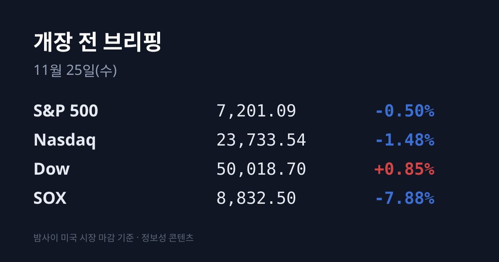
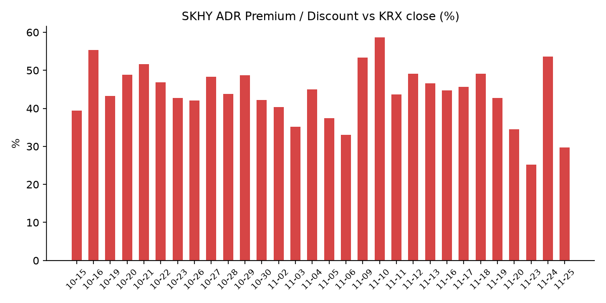
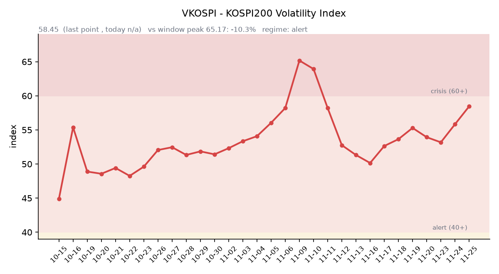

## ① 30초 요약

- <mark>11/24(화) 미국 필라델피아 반도체지수(SOX)는 −7.88%로 30개 종목이 모두 내렸습니다.</mark> 마이크론 −11.01%, 엔비디아 −5.86%, SK하이닉스 ADR(SKHY) −9.90%였습니다.
- 나스닥은 −1.48%, S&P500은 −0.50%였고, 다우는 +0.85%로 **50,018.70에** 마감해 처음 50,000선 위에서 끝났습니다.
- 같은 날 한국은 미국 반도체 하락 전에 장을 마쳤습니다. 코스피는 5,006.03(+6.32%), 코스닥은 665.88(+4.79%)이었고, 두 시장에서 매수 사이드카가 발동됐습니다.
- 외국인은 유가증권시장에서 7,392억원을 순매수해 8거래일 만에 매수로 돌아섰습니다.
- SKHY 괴리율은 +29.66%로 하루 새 23.93%포인트 줄었습니다. 델은 장 마감 뒤 예상을 넘는 실적을 내고 시간외에서 +2.89%였습니다.

## ② 밤사이 미국 시장

| 지수 | 11/24 종가 | 등락 |
| :--- | ---: | ---: |
| S&P 500 | 7,201.09 | −0.50% |
| 나스닥 종합 | 23,733.54 | −1.48% |
| 다우 | 50,018.70 | +0.85% |
| 필라델피아 반도체(SOX) | 8,832.50 | −7.88% |

SOX는 월요일 상승분(+14.03%)의 약 60%를 하루 만에 반납했습니다. 반면 다우는 암젠·나이키·세일즈포스가 오르며 처음 50,000선 위에서 마감했습니다. 기술주 밖에서는 오른 종목이 더 많았습니다.

반도체 하락 배경으로는 월요일 급등 뒤의 차익실현, <mark>엔비디아에 대한 SEC 조사 보도</mark>, 미국의 관세 인상 준비 보도, AI 데이터센터 투자 지속성에 대한 의문이 함께 거론됐습니다. 로이터는 SEC가 엔비디아의 회계 문제를, 월스트리트저널은 공시가 투자자를 오도했는지까지 들여다보고 있다고 보도했고, 엔비디아와 SEC는 논평하지 않았습니다. 미국이 무역대표부(USTR) 조사를 근거로 중국·베트남 등에 15% 이상의 관세 인상을 준비한다는 보도도 나왔으며 세율은 확정되지 않았습니다.

종목별로는 마이크론 $629.79(−11.01%), AMD $413.27(−8.86%), 인텔 $54.80(−8.15%), 엔비디아 $155.38(−5.86%), 브로드컴 $301.08(−3.98%), TSMC ADR $349.20(−3.96%)였습니다. 델은 실적 발표 전 정규장에서 $295.28(−11.83%)로 내렸습니다.

델은 장 마감 뒤 3분기(2027 회계연도) 실적을 발표했습니다. 매출은 549억 달러로 103% 늘어 예상(약 493억 달러)을 넘었고, 조정 EPS는 $9.45로 예상(약 $6.59)을 웃돌았습니다. 연간 가이던스도 올렸습니다. 주가는 **시간외에서 $303.81(+2.89%)였습니다.** 시간외 마지막 체결가는 엔비디아 $153.92, 마이크론 $633.04, TSMC ADR $352.00, AMD $417.81입니다(야후 파이낸스, 07:17 KST).

VIX는 26.36으로 1.0% 내렸습니다. 미 국채 10년물은 4.904%로 0.014%포인트 내렸고, 30년물은 5.292%로 거의 그대로였습니다. FRED 기준(11/23) 10년물 실질금리(TIPS)는 2.79%이고, 11/24 기준 10년물과 2년물 차이는 0.28%p입니다. CME FedWatch 기준 12/9 FOMC 0.25%포인트 인상 확률은 집계 시각에 따라 93~96%였습니다. 존 윌리엄스 뉴욕 연은 총재는 인플레이션이 여전히 너무 높다며 연속 회의 인상도 배제하지 않는다고 말했습니다.

금 12월물은 $3,555.10(−2.64%)으로 내렸습니다. 같은 날 달러인덱스도 103.83으로 0.47% 내렸습니다. WTI는 $81.69(+1.90%), 브렌트유는 $88.50(−0.97%)로 브렌트는 90달러 아래에 머물렀습니다. 카타르가 중재하는 미국·이란 협상은 교착 상태이고, 후티 반군은 사우디 라빅 정유소를 공격했다고 주장했습니다(피해 미확인). 한국 원유 수입 기준인 두바이유는 $87.04(페트로넷 11/23 기준)로, 같은 날 브렌트보다 $2.33 낮습니다. 지수선물은 06:59 KST 기준 S&P500 12월물 7,210.75(−0.60%), 나스닥100 12월물 26,266.00(−2.02%)입니다.

## ③ 괴리율 트래커 — SK하이닉스 ADR

| 항목 | 수치 |
| :--- | ---: |
| SKHY 종가 (11/24) | $111.98 (−9.90%) |
| 본주 환산가 (×10×환율 1,340.79원) | 1,501,417원 |
| 본주 직전 종가 (11/24) | 1,158,000원 |
| **괴리율** | **+29.66%** |

11/24 한국 본주는 1,158,000원(+6.73%)으로 올랐고, 그 뒤 미국 SKHY는 $111.98(−9.90%)로 내렸습니다. 시간외에서는 $112.98(+0.89%)입니다. 본주와 ADR이 반대로 움직이면서 괴리율은 전일 +53.59%에서 <mark>+29.66%로 23.93%포인트 줄었습니다.</mark> 11/10~11/19 구간(+42.67~+58.6%)보다 낮고, 11/23의 +25.25%에 가까운 수준입니다.

괴리율은 미국에 상장된 예탁증서(ADR) 가격을 본주 1주 기준으로 환산한 값과 한국 본주 종가를 비교한 수치입니다. 환산가가 본주보다 높은 프리미엄 상태에서는 전환 차익거래 구조상 본주 쪽에 매수 유인이 생기고, 디스카운트면 반대입니다. 프리미엄 폭이 줄면 그 유인도 함께 줄어듭니다.

한국 시장 전체를 담는 EWY(iShares MSCI South Korea ETF)는 $130.70(−3.70%)였고, 시간외에서는 $130.25(−0.34%)입니다. 11/24 EWY 등락에는 한국 11/24 장중 움직임(코스피 +6.32%, 원화 강세 포함 달러 기준 약 +6.6%)이 함께 들어 있어, 이를 빼고 어림 계산하면 **한국 마감 이후 미국 시간에 더해진 몫은 약 −9.7%포인트입니다.** 다만 전날 EWY에 먼저 실린 미국 시간 몫(+11~15%포인트, 어림) 가운데 한국이 11/24에 소화한 것은 +6.6%였기 때문에, 이를 함께 넣어 계산하면 EWY는 한국 11/24 종가 대비 약 0~+4% 위치에 있습니다(전일 추정치에 따라 달라지는 어림값). 같은 방식으로 SKHY를 보면 하루치 미국 시간 몫은 약 −16%포인트입니다.

## ④ 변동성 트래커

**판정 한 줄**: <mark>코스피가 +6.32% 오른 날에도 VKOSPI는 58.45로 사흘째 올랐고, 장중 61.44로 '위기' 경계(60)를 넘었다가 '경보' 구간에서 마감했습니다.</mark>

**기대 변동성**  VKOSPI **58.45**(11/24, 전일비 +2.62, +4.69%)로 '경보'(40~60) 구간입니다. 장중 범위는 57.06~61.44였습니다. 6월 고점 96.94 대비 −39.7%, 평시 상단인 25의 2.34배입니다. 미국 VIX는 26.36으로, VKOSPI가 VIX의 약 2.2배입니다.

**실현 변동성**  최근 10거래일 코스피 일별 등락률은 11/11 +2.60%, 11/12 −0.61%, 11/13 −0.98%, 11/16 −3.59%, 11/17 −2.59%, 11/18 +1.99%, 11/19 +1.39%, 11/20 −5.21%, 11/23 −3.31%, 11/24 +6.32%입니다. 이 중 ±3% 이상 등락일은 나흘입니다. 11/24 일중 변동폭은 종가 대비 3.71%였고, 최근 5거래일 평균은 3.48%입니다.

**매매 정지**  11/24 유가증권시장에서 09:06에, 코스닥시장에서 09:28에 매수 사이드카가 발동됐습니다(KIND). 유가증권시장은 11/20·11/23 매도 사이드카에 이어 사흘 연속 사이드카가 걸렸고, 11/20에는 코스닥 매도 사이드카(13:28)도 있었습니다.

**증폭 경로**  전체 ETF 거래대금 중 레버리지 ETF 비중은 **28.97%로 직전(28.05%)보다** 높아졌습니다. KODEX 레버리지 거래대금은 1조4,279억원(회전율 38.56%)으로, 하루 전 앞섰던 KODEX 200선물인버스2X(1조2,388억원, 138.86%)를 다시 웃돌았습니다. KODEX 코스닥150레버리지 5,956억원(20.41%), KODEX 반도체레버리지 2,693억원(46.37%), TIGER 반도체TOP10레버리지 2,338억원(57.28%)입니다(네이버 ETF 목록, 11/25 07:17 스냅샷). 11/24 코스피200 선물 베이시스는 −0.58(선물 778.10 − 현물 778.68)로 14거래일째 마이너스였지만, 폭은 전날(−4.18)보다 크게 줄었습니다.

**청산 압력**  신용융자 잔고는 25조9,427억원(11/23 기준)으로 직전 거래일보다 152억원 줄었습니다. 유가증권시장 20조553억원, 코스닥 5조8,874억원입니다. 같은 날 위탁매매 미수금은 8,761억원, 반대매매 금액은 111억원으로 11/20(53억원)의 두 배였습니다(금융투자협회).

**하방 포지션**  공매도 순잔고는 T+2~3 공시 지연이 있어 개장 전 시점에는 확정치를 알 수 없습니다.

## ⑤ 직전 거래일(11/24) 한국장 리뷰

| 지수 | 종가 | 등락 |
| :--- | ---: | ---: |
| 코스피 | 5,006.03 | +297.49 (+6.32%) |
| 코스닥 | 665.88 | +30.43 (+4.79%) |

코스피는 4,880.16으로 올라 출발했고 이 값이 장중 저가였습니다. 장중 5,065.74까지 오른 뒤 5,006.03으로 마감해 사흘 만에 5,000선을 되찾았습니다. 엔비디아 이사회가 젠슨 황을 CEO로 복귀시킨 뒤 미국 반도체가 크게 오른 것이 이날 반영됐습니다.

유가증권시장에서 <mark>외국인은 7,392억원, 기관은 8,682억원을 순매수했습니다.</mark> 외국인은 8거래일 만에 순매수로 돌아섰고, 기관 중 연기금은 3,024억원을 사들였습니다. 개인은 **2조430억원을 순매도했습니다.** 코스닥에서는 외국인 1,186억원, 기관 2,064억원 순매수, 개인 3,078억원 순매도였습니다(시사저널e).

삼성전자는 189,400원(+6.70%), SK하이닉스는 1,158,000원(+6.73%)에 마감했습니다. 젠슨 황 복귀로 AI 반도체 불확실성이 줄었다는 평가가 나왔고, 삼성전자는 반도체 성과를 반영한 임원 인사와 로봇·휴머노이드 사업 기대가, SK하이닉스는 윤풍영 사장의 자사주 매입이 함께 거론됐습니다. KB증권 집계로 삼성전자는 외국인이 4,213억원, 기관이 2,230억원 순매수했고, SK하이닉스는 외국인이 1,440억원 순매도했습니다. SK하이닉스는 장중 1,212,000원까지 올랐습니다.

매수세는 반도체에서 자동차·배터리·로봇으로 번졌습니다. 업종별로 운송장비 +9.41%, 기계·장비 +7.88%, 전기·전자 +7.14%, 의료·정밀 +6.16%였고, 상승 797개·하락 94개 종목이었습니다. 현대오토에버는 별도 공시 없이 **362,500원(+29.93%) 상한가였고,** 레인보우로보틱스 +17.41%, 로보티즈 +19.51%, LG전자 +15.86%, 현대모비스 +14.51%, 삼성SDI +13.64%, 에코프로비엠 +11.34%, 현대차 +11.11%, 에코프로 +10.44%였습니다. 엔터·화장품은 상대적으로 덜 올랐습니다.

원/달러는 11/24 서울 외환시장 주간 거래에서 1,342.4원으로 3.5원 내렸습니다. 외국인 순매수 전환이 하락 요인으로 꼽혔고, 환헤지와 배당금 역송금 수요로 낙폭 일부를 되돌렸습니다(뉴스1). 작성 시각(11/25 07:16) 현재는 1,340.79원이고, 달러/엔은 159.22입니다.

아시아 증시 11/24 종가는 <mark>대만 가권 40,122.35(+8.99%)</mark>, 닛케이225 58,644.63(+3.91%, 휴장 뒤 첫 거래), 토픽스 3,764.88(+2.47%), 상하이종합 3,548.37(+0.27%), CSI300 3,963.82(+0.14%), 항셍 22,219.65(−0.73%)입니다. D램 현물가는 11/24 대만 세션 기준 DDR5 16Gb $60.83(+0.22%), DDR4 16Gb $78.25(−0.32%), DDR4 8Gb $43.32(−0.49%)로 보합권입니다(DRAMeXchange).

## ⑥ 오늘의 캘린더 & 관전 포인트

- **11/25(수):** 08:00 미국 지수선물 거래 재개. 한국·일본(09:00), 대만(10:00) 개장. <mark>22:30 미국 3분기 GDP 잠정치와 10월 PCE 물가 발표</mark>(미 상무부 경제분석국).
- **11/26(목):** 한국은행 금융통화위원회(현재 기준금리 3.00%) — 머니투데이 조사에서 채권 전문가 10명 전원이 0.25%포인트 인상을 전망했고, 수정 경제전망과 점도표도 함께 공개됩니다. 미국 추수감사절 휴장.
- **11/27(금):** 미국 조기 폐장. **11/30:** MSCI 정기 변경 반영. **12/1:** 미 하원 위원회 젠슨 황 비공개 면담.
- **12/8~9:** FOMC(결과는 한국 시간 12/10 새벽). **12/10:** 국내 선물·옵션 동시 만기. **12/17:** 마이크론 실적.

시장 참가자들이 주시하는 레벨은 코스피 5,060선과 11/20 종가 4,869.96선, SK하이닉스 1,100,000원 선, VKOSPI 60 선('위기' 구간 경계), 원/달러 1,350원 선, 외국인 순매수가 이틀째 이어지는지 여부입니다.

## ⑦ 정책 워치

11/26 금통위를 앞두고 3분기 성장률(전 분기 대비 1.0%)과 10월 소비자물가 상승률(2.8%)이 모두 한은 전망과 목표를 웃돈 상태입니다(세계일보). 공매도는 2025년 3월 전면 재개 이후 그대로이며, 11/24 제도 변경 보도는 없었습니다.

## ⑧ 오늘의 질문

월요일 +14%, 화요일 −8%로 오간 미국 반도체 사이에서 한국은 +6.3%를 먼저 냈다 — 8거래일 만에 돌아온 외국인 매수는 미국 반도체 되돌림을 만난 둘째 날에도 이어질 것인가.

---
*본 글은 공개된 시장 데이터를 정리한 정보성 콘텐츠이며, 특정 종목·상품의 매매 권유가 아닙니다. 모든 투자 판단과 책임은 투자자 본인에게 있습니다. 수치는 작성 시점 기준이며 이후 변동될 수 있습니다.*
