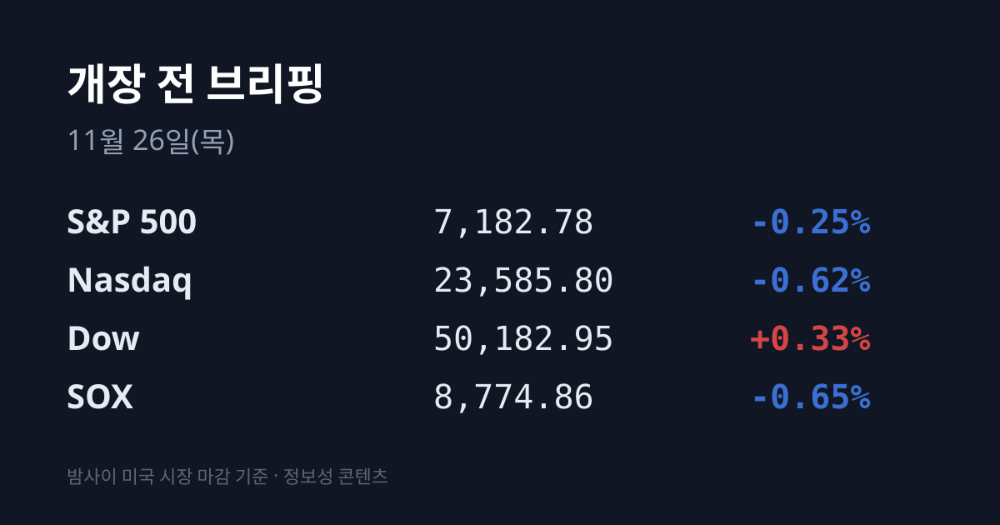
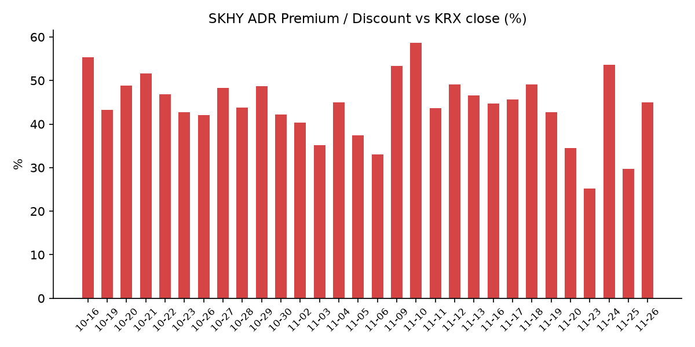
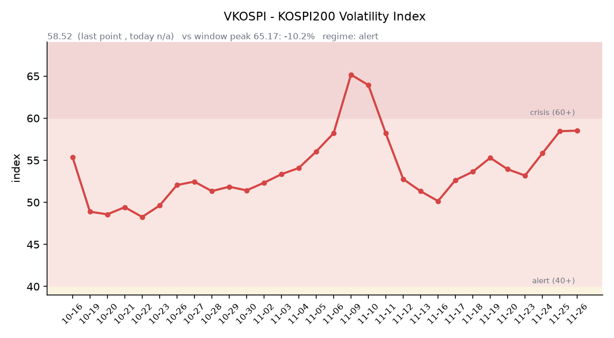

## ① 30초 요약

- <mark>11/25(수) 코스피는 4,697.51(−6.16%)로 마감했고, 삼성전자는 −9.87%, SK하이닉스는 −11.05%였습니다.</mark> 유가증권시장 외국인 순매도는 1조8,994억원이었습니다.
- 같은 날 BNP파리바가 마이크론 투자의견을 '중립'으로 낮추고 목표주가를 $1,700에서 $775로 내리며 2028년 메모리 공급과잉 위험을 경고했습니다.
- 그 뒤 열린 미국장에서 SKHY는 −0.75%에 그쳤습니다. 한국 본주가 더 크게 빠지면서 **ADR 괴리율은 +44.98%로** 하루 새 15.32%포인트 벌어졌습니다.
- 미국 증시는 장중 급락 뒤 대부분 회복했습니다. 다우는 장중 1,100포인트 넘는 하락을 지우고 +0.33%로 마감했고, 나스닥은 −0.62%, SOX는 −0.65%였습니다.
- 미국 무역대표부(USTR)는 301조 과잉생산 관세안을 발표하며 한국에 기존 한미 합의 수준인 15%를 제안했습니다. 오늘은 한국은행 금통위가 열리고, 미국 증시는 추수감사절로 휴장합니다.

## ② 밤사이 미국 시장

| 지수 | 11/25 종가 | 등락 |
| :--- | ---: | ---: |
| S&P 500 | 7,182.78 | −0.25% |
| 나스닥 종합 | 23,585.80 | −0.62% |
| 다우 | 50,182.95 | +0.33% |
| 필라델피아 반도체(SOX) | 8,774.86 | −0.65% |

장중에는 기술주 매도가 거셌습니다. 마이크론·AMD·인텔은 한때 9% 넘게 내렸고, 오라클·코어위브·네비우스도 크게 밀렸습니다. 배경으로는 <mark>BNP파리바의 마이크론 투자의견 하향</mark>, 예상보다 높게 나온 10월 근원 PCE 물가, 미국의 301조 관세안 발표, AI 투자 수익성에 대한 의문이 함께 거론됐습니다. 국채 금리가 내리면서 다우와 에너지·방어주가 먼저 회복했고, 다우는 장중 1,100포인트 넘는 하락을 지우고 플러스로 마감했습니다.

BNP파리바의 칼 애커먼 애널리스트는 마이크론 투자의견을 '아웃퍼폼'에서 '중립'으로 낮추고 목표주가를 $1,700에서 $775로 내렸습니다. 그는 D램·낸드 수급이 2027년 중반부터 균형에 가까워질 수 있다고 봤고, 2028년 하이퍼스케일러의 설비 계획에 위험이 커지고 있다고 지적했습니다. 그의 2028년 추정치는 시장 컨센서스보다 45% 낮습니다.

종목별 종가는 엔비디아 $149.30(−3.91%), 마이크론 $601.25(−4.53%), AMD $406.03(−1.75%), TSMC ADR $342.34(−1.96%), 인텔 $54.47(−0.60%), 브로드컴 $300.86(−0.07%)였습니다. 실적을 발표한 기업 중 HP는 예상을 웃돈 실적과 2027 회계연도 전망에 +11.49%로 올랐고, 앰바렐라(−19.77%)와 뉴타닉스(−15.19%)는 실적 발표 뒤 크게 내렸습니다. 11/25 장 마감 뒤 주요 기업 실적 발표는 확인되지 않았습니다. 시간외 마지막 체결가는 엔비디아 $148.49, 마이크론 $600.01, TSMC ADR $341.65, AMD $405.29입니다(야후 파이낸스, 07:17 KST).

10월 PCE 물가는 전년 대비 3.8%로 예상과 같았고, **근원 PCE는 3.3%로 예상(3.2%)보다** 높았습니다. 3분기 GDP 잠정치는 연율 4.3%로 상향됐고, 신규 실업수당 청구는 18.9만 건으로 예상(20만 건)보다 적었습니다. CME FedWatch 기준으로 12/9 FOMC 0.25%포인트 인상은 가격에 완전히 반영됐고, 2027년 세 번째 인상 확률은 전날 약 50%에서 약 3분의 1로 낮아졌습니다.

물가 지표가 높게 나왔지만 국채 금리는 내렸습니다. 10년물은 4.848%로 0.056%포인트, 30년물은 5.235%로 0.057%포인트 내렸습니다. FRED 기준(11/24) 10년물 실질금리(TIPS)는 2.79%로 그대로였고, 11/25 기준 10년물과 2년물 차이는 0.24%p입니다. VIX는 28.29로 7.3% 올랐습니다.

금 12월물은 $3,617.80(+1.57%)으로 올랐고, 달러인덱스는 103.70으로 0.10% 내렸습니다. 달러가 함께 오른 날이 아니라 금리가 내린 날의 금 상승이었습니다. WTI는 $84.15(+2.56%), 브렌트유는 $90.82(−0.63%)입니다. 한국 원유 수입 기준인 두바이유는 $82.60(페트로넷 11/24 기준)으로 같은 날 브렌트($91.40)보다 $8.80 낮습니다. 지수선물은 06:59 KST 기준 S&P500 12월물 7,187.50(−0.42%), 나스닥100 12월물 26,000.50(−1.05%)입니다.

## ③ 괴리율 트래커 — SK하이닉스 ADR

| 항목 | 수치 |
| :--- | ---: |
| SKHY 종가 (11/25) | $111.14 (−0.75%) |
| 본주 환산가 (×10×환율 1,343.64원) | 1,493,321원 |
| 본주 직전 종가 (11/25) | 1,030,000원 |
| **괴리율** | **+44.98%** |

11/25 한국 본주는 1,030,000원(−11.05%)으로 내렸고, 그 뒤 미국 SKHY는 $111.14(−0.75%)로 소폭 내리는 데 그쳤습니다. 시간외에서는 $110.43(−0.64%)입니다. 본주가 ADR보다 훨씬 크게 빠지면서 괴리율은 전일 +29.66%에서 <mark>+44.98%로 15.32%포인트 벌어졌습니다.</mark> 11/10~11/19 구간(+42.67~+58.6%) 안으로 돌아온 수준입니다.

괴리율은 미국에 상장된 예탁증서(ADR) 가격을 본주 1주 기준으로 환산한 값과 한국 본주 종가를 비교한 수치입니다. 환산가가 본주보다 높은 프리미엄 상태에서는 전환 차익거래 구조상 본주 쪽에 매수 유인이 생기고, 디스카운트면 반대입니다. 프리미엄 폭이 커지면 그 유인도 함께 커집니다.

한국 시장 전체를 담는 EWY(iShares MSCI South Korea ETF)는 $129.19(−1.16%)였고, 시간외에서는 $129.06(−0.10%)입니다. 11/25 EWY 등락에는 한국 11/25 장중 움직임(코스피 −6.16%, 원화 포함 달러 기준 약 −6.2%)이 함께 들어 있어, 이를 빼고 어림 계산하면 **한국 마감 이후 미국 시간에 더해진 몫은 약 +5.4%포인트입니다.** 같은 방식으로 SKHY를 보면 본주 달러 기준 약 −11.1%에 비해 ADR은 −0.75%여서, 미국 시간 몫은 약 +11.6%포인트입니다(모두 어림값).

## ④ 변동성 트래커

**판정 한 줄**: <mark>코스피가 −6.16% 내린 날 VKOSPI는 58.52로 0.07 오르는 데 그쳐, 지수가 오르든 내리든 '경보' 구간 58선에 머물러 있습니다.</mark>

**기대 변동성**  VKOSPI **58.52**(11/25, 전일비 +0.07, +0.12%)로 '경보'(40~60) 구간입니다. 장중 범위는 57.32~59.22였습니다. 코스피가 +6.32% 오른 11/24에는 +2.62, −6.16% 내린 11/25에는 +0.07이었습니다. 6월 고점 96.94 대비 −39.6%, 평시 상단인 25의 2.34배입니다.

**실현 변동성**  최근 10거래일 코스피 일별 등락률은 11/12 −0.61%, 11/13 −0.98%, 11/16 −3.59%, 11/17 −2.59%, 11/18 +1.99%, 11/19 +1.39%, 11/20 −5.21%, 11/23 −3.31%, 11/24 +6.32%, 11/25 −6.16%입니다. 이 중 **±3% 이상 등락일은 닷새**입니다. 11/25 일중 변동폭은 종가 대비 3.21%였고, 최근 5거래일 평균은 3.37%입니다.

**매매 정지**  11/25 09:08 유가증권시장에서 매도 사이드카가 발동됐습니다(KIND). 유가증권시장은 11/20·11/23 매도, 11/24 매수에 이어 4거래일 연속 사이드카가 걸렸습니다. 코스닥시장에서는 11/20 매도(13:28), 11/24 매수(09:28) 사이드카가 있었습니다.

**증폭 경로**  전체 ETF 거래대금 중 레버리지 ETF 비중은 26.30%로 직전(28.97%)보다 낮아졌습니다. KODEX 레버리지 1조2,302억원(회전율 38.25%), KODEX 200선물인버스2X 1조553억원(108.58%), KODEX 코스닥150레버리지 5,592억원(19.41%), KODEX 반도체레버리지 2,295억원(47.08%), TIGER 반도체TOP10레버리지 1,696억원(50.16%)입니다(네이버 ETF 목록, 11/26 07:17 스냅샷). 11/25 코스피200 선물 베이시스는 **+0.94(선물 724.75 − 현물 723.81)로** 14거래일 이어진 마이너스에서 플러스로 바뀌었습니다.

**청산 압력**  신용융자 잔고는 25조8,777억원(11/24 기준)으로 직전 거래일보다 650억원 줄었습니다. 유가증권시장 20조202억원, 코스닥 5조8,575억원입니다. 같은 날 위탁매매 미수금은 9,660억원으로 11/23(8,761억원)보다 899억원 늘었고, 반대매매 금액은 137억원(미수금 대비 1.6%)이었습니다(금융투자협회).

**하방 포지션**  공매도 순잔고는 T+2~3 공시 지연이 있어 개장 전 시점에는 확정치를 알 수 없습니다.

## ⑤ 직전 거래일(11/25) 한국장 리뷰

| 지수 | 종가 | 등락 |
| :--- | ---: | ---: |
| 코스피 | 4,697.51 | −308.52 (−6.16%) |
| 코스닥 | 650.64 | −15.24 (−2.29%) |

코스피는 4,809.00(−3.94%)으로 내려 출발했고, 장중 4,672.55까지 밀린 뒤 4,697.51로 마감했습니다. 전날 +6.32% 상승분을 하루 만에 거의 모두 반납했습니다. 전날 밤 SOX −7.88%에 더해 BNP파리바의 마이크론 하향과 메모리 공급과잉 우려, AI 투자 수익성 우려, 미국의 추가 관세 움직임이 하락 배경으로 거론됐습니다.

유가증권시장에서 <mark>외국인은 1조8,994억원을 순매도했고, 개인은 1조4,233억원을 순매수했습니다.</mark> 기관은 8억원 순매도였습니다. 외국인은 **삼성전자를 1조121억원,** SK하이닉스를 5,618억원 순매도했고, 개인은 삼성전자 1조1,414억원, SK하이닉스 1,919억원을 순매수했습니다(데일리안). 뉴스핌 집계로는 외국인 순매도가 2조3,203억원으로 매체 간 차이가 있습니다. 코스닥에서는 외국인 12억원, 기관 268억원 순매수, 개인 345억원 순매도였습니다(데일리안).

삼성전자는 170,700원(−9.87%)으로 시가총액 1,000조원 아래로 내려왔고, SK하이닉스는 1,030,000원(−11.05%)이었습니다. 삼성전자우 −10.19%, SK스퀘어 −11.19%, 삼성전기 −12.00%로 반도체 관련 대형주가 함께 내렸고, 코스닥에서도 주성엔지니어링 −11.42%, 심텍 −6.51%, 리노공업 −5.67%였습니다.

반면 바이오로는 매수가 들어왔습니다. 삼성바이오로직스 +5.66%, 셀트리온 +3.83%, 알테오젠 +6.20%, 삼천당제약 +5.05%, HLB +1.99%였습니다. 전날 크게 오른 종목들은 현대차 −2.00%, 에코프로 −5.01%, 에코프로비엠 −4.64%, 로보티즈 −1.87%, 레인보우로보틱스 −1.80%로 반도체보다 덜 내렸습니다. LG에너지솔루션은 −1.91%, KB금융은 −2.18%였습니다.

원/달러는 11/25 서울 외환시장 주간 거래에서 1,343.2원으로 0.8원 올랐습니다. 수입업체 달러 수요와 삼성전자 배당금 역송금 경계가 상승 요인으로, 수출기업의 달러 매도가 상단을 누른 요인으로 꼽혔습니다(뉴시스·서울파이낸스). 작성 시각(11/26 07:17) 현재는 1,343.64원이고, 달러/엔은 159.12입니다.

아시아 증시 11/25 종가는 <mark>대만 가권 38,195.43(−4.80%)</mark>, 닛케이225 57,011.62(−2.78%), 토픽스 3,746.20(−0.50%), 상하이종합 3,476.47(−2.03%), CSI300 3,898.24(−1.65%), 항셍 21,966.01(−1.14%)입니다. D램 현물가는 11/25 대만 세션 기준 DDR5 16Gb $60.77(−0.11%), DDR4 16Gb $77.75(−0.64%), DDR4 8Gb $43.21(−0.25%)로 소폭 내렸습니다(DRAMeXchange).

## ⑥ 오늘의 캘린더 & 관전 포인트

- **11/26(목):** 08:00 미국 지수선물 거래 재개(추수감사절 단축 거래). 한국·일본(09:00), 대만(10:00) 개장. <mark>오전 한국은행 금융통화위원회</mark>(현재 기준금리 3.00%) — 국내 증권사 10곳 전원과 로이터 조사 34명 중 32명이 0.25%포인트 인상을 예상했고, 수정 경제전망과 점도표도 함께 공개됩니다. 미국 증시·채권시장은 추수감사절로 휴장합니다.
- **11/27(금):** 미국 조기 폐장(주식 한국 시간 11/28 03:00). **11/30:** MSCI 정기 변경 반영. **12/1:** 미 하원 위원회 젠슨 황 비공개 면담.
- **12/8~9:** FOMC(결과는 한국 시간 12/10 새벽). **12/10:** 국내 선물·옵션 동시 만기. **12/17:** 마이크론 실적.
- **1/5:** 301조 관세안 서면 의견 마감. **1/10:** 미중 무역휴전 만료. **1/25:** 301조 공청회.

시장 참가자들이 주시하는 레벨은 코스피 4,862선과 4,627선, 11/25 장중 저가 4,672.55선, SK하이닉스 1,000,000원 선, VKOSPI 60 선('위기' 구간 경계), 원/달러 1,350원 선, 외국인 순매도가 1조원대로 이어지는지 여부입니다.

## ⑦ 정책 워치

미국 무역대표부는 11/25 무역법 301조 과잉생산 조사 결과를 발표하고 중국·EU 등 14개 경제주체에 관세안을 제시했습니다. 한국에는 최혜국(MFN) 관세와 기존 301조 관세를 합쳐 **15%로** 기존 한미 합의 수준을 제안했지만, 반도체·자동차 등에 대한 정부 지원을 문제 삼아 협의가 만족스럽지 않으면 25%로 올릴 수 있다고 명시했습니다. 중국과 베트남은 최대 20%, EU·일본은 15%입니다. 서면 의견은 1/5까지 받고 1/25 공청회를 거쳐 이르면 1월에 발효될 수 있습니다. 김정관 산업통상부 장관은 최종적으로 15%가 유지되면 선방이라고 말했습니다. 같은 날 한국·EU·호주의 디지털 규제에 대한 301조 조사 검토 보도도 나왔습니다.

공매도는 2025년 3월 전면 재개 이후 그대로이며, 11/25 제도 변경 보도는 없었습니다.

## ⑧ 오늘의 질문

하이닉스 −11.05%와 SKHY −0.75% 사이에 벌어진 괴리율 +44.98%는, '2028년 메모리 공급과잉' 논쟁이 시작된 뒤에도 차익거래의 힘으로 좁혀질 것인가.

---
*본 글은 공개된 시장 데이터를 정리한 정보성 콘텐츠이며, 특정 종목·상품의 매매 권유가 아닙니다. 모든 투자 판단과 책임은 투자자 본인에게 있습니다. 수치는 작성 시점 기준이며 이후 변동될 수 있습니다.*
