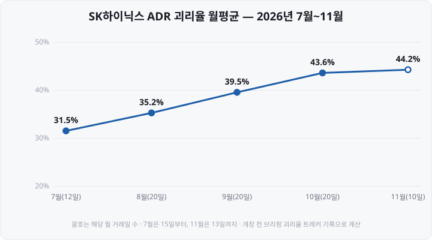

브리핑에 괴리율 40%대가 찍힐 때마다 "이 정도면 그날 한국 본주가 따라 오르지 않을까" 하는 생각이 들었습니다. 그런데 넉 달치 기록을 실제로 맞춰 보니 결과가 생각과 달랐습니다.

개장 전 브리핑의 괴리율 트래커는 2026년 11월 13일 SK하이닉스 ADR 괴리율을 <mark>+46.60%</mark>로 기록했습니다. 미국에서 거래되는 SK하이닉스 증서가 한국 본주 환산가보다 46.60% 비싸게 거래됐다는 뜻입니다.

이 글은 그 생각을 의견 대신 기록으로 확인합니다. 브리핑이 매 거래일 공개한 괴리율 **82거래일치**와 한국거래소 본주 시세를 날짜별로 맞춰, 괴리율이 높았던 날과 낮았던 날에 본주가 실제로 어떻게 움직였는지 집계했습니다.

괴리율의 정의는 [괴리율이란 무엇인가](https://blog.naver.com/hdglace/224351030720), 예탁비율(ADR 10주 = 본주 1주)과 환산식은 [ADR이란 무엇인가](https://blog.naver.com/hdglace/224360141124)에서 다뤘습니다. 이 글은 그 두 편을 전제로 합니다.

&nbsp;

【집계 기준 — 괴리율 하나에 두 시장의 종가가 들어갑니다】

**ADR**(American Depositary Receipt, 미국주식예탁증서) 괴리율은 서로 다른 시각에 끝나는 두 시장의 가격을 비교합니다. 그래서 '다음 날'이 언제인지부터 정해야 합니다.

| 항목 | 내용 |
| :-- | :-- |
| 괴리율 | (SKHY 종가 × 10 × 원/달러 환율 ÷ 본주 직전 종가 − 1) × 100 |
| 괴리율에 들어가는 본주 가격 | 브리핑 발행일 **직전 한국 거래일**의 종가 |
| 괴리율에 들어가는 ADR 가격 | 그 뒤에 끝난 **미국 정규장**의 SKHY 종가 |
| 다음 거래일 | 브리핑이 나온 날 아침 9시에 열리는 한국 장 |
| 시가 등락 | 그날 시가 ÷ 직전 종가 − 1 |
| 종가 등락 | 그날 종가 ÷ 직전 종가 − 1 (한국거래소 공표 등락률과 같음) |

예를 들어 11월 13일 괴리율 +46.60%는 11월 12일 서울 종가 1,254,000원과 그날 밤 열려 11월 13일 새벽(한국 시각)에 끝난 미국장의 SKHY 종가 $137.71로 계산한 값이고, 이 글에서 그 '다음 거래일'은 11월 13일 한국 장입니다. 그날 본주는 시가 +3.03%로 출발해 종가 −3.03%로 마감했습니다.

집계 기간은 트래커가 시작된 2026년 7월 15일부터 11월 13일까지입니다. 이 기간 한국 거래일 82일에 모두 브리핑과 괴리율이 있었습니다. 한국 휴장일이 낀 날(예: 9월 24~25일 추석 연휴 뒤의 9월 28일)은 미국 거래일 여러 날의 움직임이 괴리율 하나에 함께 반영됩니다.

【82거래일 동안 괴리율은 좁혀지지 않았습니다】

먼저 괴리율 자체의 흐름입니다. 82거래일 중 가장 낮았던 날은 7월 28일 +15.7%, 가장 높았던 날은 7월 31일 +62.0%였고, 중앙값(크기순으로 줄 세웠을 때 한가운데 값)은 +39.4%였습니다. **한 번도 디스카운트(−)로 내려간 날이 없었습니다.**

월평균은 7월 31.5%에서 11월(13일까지) 44.2%로 <mark>매달 높아졌습니다.</mark> 같은 기간 본주 종가는 7월 15일 2,082,000원에서 11월 13일 1,216,000원으로 내렸습니다. 본주 가격이 내리는 동안 프리미엄은 오히려 커졌습니다.

【프리미엄을 줄이는 방향의 전환은 한도가 있습니다】

프리미엄이 줄어들려면 누군가 싼 쪽(서울 본주)을 사서 ADR로 바꾼 뒤 비싼 쪽(미국)에서 팔아야 합니다. 2026년 7월 29일부터 본주와 ADR을 서로 바꾸는 신청이 열렸지만, SK하이닉스는 이 방향의 전환에 제약이 있습니다.

- **본주 → ADR**: 발행사가 정한 ADR 발행 한도 안에서만 가능합니다. 한국예탁결제원에 따르면 한도는 전체 주식의 2.5%입니다. 그런데 이 한도는 ADR 상장 때 유상증자로 이미 발행한 물량(1,779만 주)과 같아서, <mark>처음부터 남은 자리가 없었습니다.</mark> 머니투데이(2026년 7월 28일)는 SK하이닉스가 ADR 발행 물량을 늘리지 않는 한 서로 바꿀 물량이 없다고 보도했고, 본주를 ADR로 자유롭게 바꾸려면 규제 당국의 승인이 필요하다고도 전했습니다. 누군가 ADR을 본주로 바꿔 자리가 비어야 그만큼만 새로 바꿀 수 있습니다.
- **ADR → 본주**: 가능합니다. 다만 이 방향은 ADR이 본주보다 쌀 때(디스카운트) 차익이 나는 방향이라, 프리미엄을 직접 줄이지는 않습니다. 한도에 빈자리를 만드는 역할만 합니다.

2026년 7월 기사들은 본주를 ADR로 바꿀 물량이 사실상 없다는 점을 들어 가격 차이가 쉽게 좁혀지지 않을 것으로 봤습니다. 조선비즈(7월 16일)가 인용한 증권사 분석에 따르면, 비슷한 제약이 있는 대만 TSMC의 ADR 프리미엄도 2024년 이후 19.1%, 2026년 들어 평균 17.5% 수준이었습니다. 이후 넉 달의 기록은 이 전망과 어긋나지 않습니다. 다만 프리미엄이 유지된 원인이 이것 하나라고 이 글이 확인한 것은 아닙니다. 한도에 관한 내용은 2026년 7월 보도 기준입니다.

【괴리율 구간별 다음 거래일 본주 등락】

82거래일을 괴리율 수준에 따라 네 구간으로 나눴습니다. 기록상 최저가 +15.7%라 30% 미만은 한 구간으로 묶었습니다.

| 괴리율 구간 | 거래일 수 | 종가 상승 | 종가 하락 | 시가 상승 | 종가 등락률 중앙값 | 최저 | 최고 |
| :-- | --: | --: | --: | --: | --: | --: | --: |
| 30% 미만 | 12 | 5 | 7 | 5 | −4.34% | −14.65% | +4.86% |
| 30~40% | 34 | 11 | 23 | 13 | −1.28% | −11.53% | +8.83% |
| 40~50% | 31 | 20 | 11 | 19 | +1.20% | −7.08% | +12.73% |
| 50% 이상 | 5 | 5 | 0 | 4 | +5.81% | +0.35% | +29.95% |
| **전체** | **82** | **41** | **41** | **41** | **+0.11%** | −14.65% | +29.95% |

보합(0.00%)으로 마감한 날은 없었습니다. 평균 대신 **중앙값**을 쓴 것은 7월 31일 하루(+29.95%)가 평균을 크게 끌어올리기 때문입니다.

표만 보면 괴리율이 높은 구간일수록 다음 거래일 본주가 오른 날이 많았습니다. 40~50% 구간은 31일 중 20일, 50% 이상 구간은 5일 모두 종가가 올랐습니다. 반대로 30~40% 구간은 34일 중 23일이 내렸습니다.

그러나 이 표를 그대로 「괴리율이 높으면 다음 날 본주가 오른다」로 읽으면 안 되는 이유가 두 가지 있습니다. 하나는 표본 크기이고, 다른 하나는 괴리율이 높아지는 이유 자체입니다.

【50% 이상 5일 — 표본이 작고 한 날이 두드러집니다】

| 날짜 | 괴리율 | 시가 등락 | 종가 등락 | 다음 날 괴리율 |
| :-- | --: | --: | --: | --: |
| 7월 31일 | +62.0% | +28.37% | +29.95% | +19.1% |
| 10월 16일 | +55.3% | +2.22% | +0.79% | +43.2% |
| 10월 21일 | +51.6% | +3.03% | +5.81% | +46.9% |
| 11월 9일 | +53.4% | −0.18% | +0.35% | +58.6% |
| 11월 10일 | +58.6% | +6.87% | +6.69% | +43.6% |

5일 중 7월 31일은 성격이 다릅니다. 전날 밤 미국에서 **SOX**(Philadelphia Semiconductor Index, 필라델피아 반도체지수)가 8.19%, SKHY가 17.52% 올랐고, 서울 본주는 시가부터 +28.37%로 출발해 +29.95%로 마감했습니다. 가격제한폭(±30%)에 가까운 움직임입니다. 나머지 4일의 종가 등락은 +0.35%~+6.69%였습니다. 5일은 경향을 말하기에 너무 적은 수이고, 그중 하루가 이처럼 예외적인 날이었습니다.

【괴리율 '수준'보다 '하루 변화'가 시가와 더 잘 맞았습니다】

괴리율이 하루 사이에 크게 높아지는 경우는 두 가지입니다. 하나는 **밤사이 미국에서 ADR이 오른 경우**이고, 다른 하나는 **전날 서울에서 본주가 크게 내렸는데 ADR은 그만큼 내리지 않은 경우**입니다. 계산식에서 ADR 환산가는 밤사이 미국 종가로 바뀌고, 그 값을 나누는 본주 종가는 전날 서울 종가이기 때문입니다. 실제로 괴리율이 5%p 이상 높아진 22일 가운데 13일은 전날 본주가 내린 날이었습니다(예: 11월 9일의 직전 거래일인 11월 6일 본주 −10.44%). 어느 쪽이든 다음 날 본주가 오르는 것은 괴리율이 끌어올려서라기보다, 두 시장이 서로 다른 시각에 끝나면서 생긴 차이가 서울 장이 열릴 때 메워지는 것으로 볼 수 있습니다.

이를 확인하려고 괴리율의 **전일 대비 변화폭**으로 다시 나눴습니다(첫날 7월 15일은 전일 값이 없어 제외, 81거래일).

| 괴리율 전일 대비 변화 | 거래일 수 | 시가 상승 | 시가 등락률 중앙값 | 종가 상승 | 종가 등락률 중앙값 |
| :-- | --: | --: | --: | --: | --: |
| +5%p 이상 높아짐 | 22 | 18 | +2.20% | 12 | +0.50% |
| −5%p~+5%p | 44 | 20 | −0.20% | 23 | +0.39% |
| −5%p 이상 낮아짐 | 15 | 2 | −4.42% | 5 | −5.03% |

<mark>괴리율이 5%p 이상 높아진 22일 중 18일은 본주가 상승 출발했고</mark>, 5%p 이상 낮아진 15일 중 13일은 하락 출발했습니다. 변화폭으로 나누면 **시가 방향이** 구간 수준으로 나눌 때보다 뚜렷하게 갈립니다.

그런데 종가까지 보면 결과가 달라집니다. 이 22일 가운데 **종가가 오른 날은 12일**로, 상승 출발한 날(18일)보다 6일 적습니다. 22일 중 15일은 종가가 시가보다 낮았습니다. 밤사이 벌어진 차이의 방향은 <mark>서울 장 시작 가격에 먼저 나타났고</mark>, 그 뒤 장중에는 시가보다 밀린 날이 더 많았습니다.

【장중(시가→종가)만 따로 보면】

괴리율 구간별로 시가 대비 종가의 등락만 따로 집계하면 다음과 같습니다.

| 괴리율 구간 | 거래일 수 | 시가보다 종가가 높았던 날 | 시가→종가 등락률 중앙값 |
| :-- | --: | --: | --: |
| 30% 미만 | 12 | 5 | −2.79% |
| 30~40% | 34 | 10 | −1.50% |
| 40~50% | 31 | 14 | −0.37% |
| 50% 이상 | 5 | 3 | +0.53% |

40~50% 구간에서도 31일 중 17일은 시가보다 종가가 낮았습니다. 이 기간에는 모든 구간에서 시가보다 종가가 낮은 날이 더 많았습니다(82일 중 49일). 시가에 사서 종가까지 들고 간 경우를 따로 보면, 괴리율이 높았다고 유리했던 흔적은 보이지 않습니다. <mark>「괴리율이 40%를 넘었으니 장 시작에 본주를 사라」는 식으로 쓸 근거는 이 기록에 없었습니다.</mark>

【다음 날 괴리율은 어떻게 됐나】

괴리율이 높았던 날 다음에는 괴리율이 줄고, 낮았던 날 다음에는 늘어나는 경향이 있었습니다. 40~50% 구간 다음 날은 30번 중 21번 괴리율이 줄었고(다음 날 값이 있는 경우만), 30% 미만 구간 다음 날은 12번 중 9번 늘었습니다. 다만 앞의 월평균 그래프처럼 **되돌아간 수준 자체가 매달 높아졌기** 때문에, 이것을 '괴리율이 0으로 좁혀지는 과정'으로 볼 수는 없습니다. 하루 단위로는 40% 안팎을 오르내렸고, 월평균은 계속 높아졌습니다.

【이 기록으로 말할 수 없는 것】

- **한 종목, 한 국면입니다.** 이 기간 SK하이닉스 본주는 하루 등락폭(오르내린 방향은 빼고 크기만 본 값)의 중앙값이 3.75%였고, 82거래일 중 30일이 ±5% 이상 움직였습니다. 변동성이 매우 컸던 시기의 기록이며, 변동성이 낮은 시기에도 같은 분포가 나온다는 보장이 없습니다.
- **표본이 작습니다.** 가장 극단적인 구간(50% 이상)은 5일이고, 그중 하루가 가격제한폭에 가까운 날이었습니다.
- **괴리율과 다음 날 등락은 같은 원인을 공유합니다.** 미국 반도체 주가가 오르면 ADR과 다음 날 본주가 함께 오릅니다. 괴리율이 본주 등락을 '일으킨' 것으로 볼 근거는 이 집계에 없습니다.
- **전환 한도라는 조건이 바뀌면 기록의 의미도 바뀝니다.** ADR 발행 한도가 늘어나 본주→ADR 전환이 쉬워지면, 프리미엄의 수준과 움직임이 달라질 수 있습니다.

【정리】

- SK하이닉스 ADR 괴리율은 82거래일(2026년 7월 15일~11월 13일) 동안 **+15.7%~+62.0%에서** 움직였고, 디스카운트로 내려간 날은 없었습니다. 월평균은 31.5%에서 44.2%로 높아졌습니다.
- 프리미엄을 줄이는 본주→ADR 전환은 발행 한도(전체 주식의 2.5%) 안에서만 가능한데, 한도가 이미 발행된 물량과 같아 추가로 바꿀 여력이 사실상 없었습니다(2026년 7월 보도 기준).
- 괴리율 40% 이상인 날 다음 거래일 본주가 오른 날이 많았지만, 50% 이상은 5일뿐이고 그중 하루가 +29.95%였습니다.
- 괴리율이 하루에 5%p 이상 높아진 날은 22일 중 18일 **상승 출발**했지만, **종가 상승은** 12일이었습니다. 밤사이 움직임의 방향은 시가에 먼저 나타났고, 장중에는 밀린 날이 더 많았습니다.
- 이 집계는 한 종목·한 국면의 작은 표본이며, 괴리율을 매매 신호로 쓸 근거를 보여 주지 않습니다.

【함께 보면 좋은 글】

▶ [괴리율이란 무엇인가 — ETF·ADR 가격이 '진짜 값'과 다른 이유](https://blog.naver.com/hdglace/224351030720)
▶ [ADR이란 무엇인가 — 한국 주식이 미국에서 거래되는 법](https://blog.naver.com/hdglace/224360141124)
▶ [가격제한폭 30% — 상한가·하한가는 매일 어떻게 계산되나](https://blog.naver.com/hdglace/224401345295)
▶ [VKOSPI·VIX 뜻과 읽는 법 — 공포지수 40은 하루 몇 % 움직임인가](https://blog.naver.com/hdglace/224422310544)

&nbsp;

【다음 편에서는】

다음 편은 **코스피200 정기변경**입니다. 매년 6월과 12월 지수 구성 종목이 바뀔 때 편입·편출 종목이 어떤 기준으로 정해지는지 정리합니다.

&nbsp;

📊 **데이터 출처 및 기준일**

| 내용 | 출처·확인 방법 |
| :-- | :-- |
| SK하이닉스 ADR 괴리율 82거래일(2026-07-15~11-13) | 본 블로그 개장 전 브리핑 괴리율 트래커가 매 거래일 공개한 값. 계산식: SKHY 종가 × 10 × 원/달러 환율 ÷ 본주 직전 종가 − 1 |
| SK하이닉스 본주 일별 시가·종가·등락률(2026-07-10~11-13) | 한국거래소 Open API 유가증권 일별매매정보, 2026년 11월 15일 조회 |
| 구간별·변화폭별 거래일 수, 상승·하락 일수, 중앙값, 월평균 | 위 두 자료를 날짜별로 맞춰 본 공부방이 직접 계산 |
| 11월 13일 괴리율 계산 내역(SKHY $137.71, 본주 1,254,000원) | 11월 13일 브리핑 |
| 7월 31일 SOX +8.19%, SKHY +17.52% | 7월 31일 브리핑 |
| ADR 발행 한도 2.5%(한국예탁결제원 인용), 발행 물량을 늘리지 않으면 서로 바꿀 물량이 없다는 점, 본주→ADR 전환에 규제 당국 승인 필요 | 머니투데이 「SK하이닉스 본주·ADR 전환 시작…"괴리, 쉽게 안 좁혀진다"」(2026년 7월 28일) |
| 본주→ADR 전환은 발행 한도 안에서만 가능, ADR→본주는 한도 제한 없음, TSMC ADR 프리미엄 수치(신한투자증권 분석 인용) | 조선비즈 「SK하이닉스 ADR 교환 열린다지만…개인 차익거래는 사실상 '제한적'」(2026년 7월 16일) |
| ADR 유상증자 1,779만 주 | SK하이닉스 투자설명서(2026년 7월 10일 공시), 「ADR이란 무엇인가」 편 참조 |

*이 글은 공개된 시장 데이터를 집계한 정보성 콘텐츠이며, 특정 종목·상품의 매매를 권유하지 않습니다. 본문의 수치는 지나간 기록을 계산한 것이고 앞으로의 주가 방향을 알려 주지 않습니다. 괴리율을 매매 신호로 쓰는 어떤 판단도 이 글은 지지하지 않습니다. 모든 투자 판단과 책임은 투자자 본인에게 있습니다.*

&nbsp;

#SK하이닉스ADR #ADR괴리율 #SKHY #괴리율 #SK하이닉스 #본주ADR전환 #ADR프리미엄 #반도체주 #시장읽기 #주식데이터 #주식초보 #투자공부 #재테크
