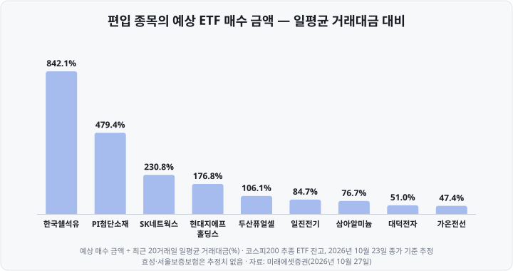

정기변경 철이 되면 '코스피200 편입 예상 종목' 기사가 많이 나오는데, 처음에는 시가총액 순서대로 200개를 자르는 줄로만 알았습니다. 이번 글을 준비하며 한국거래소 지수 방법론을 읽어 보니, 종목을 산업군별로 나눠 고르고 들어오는 기준과 나가는 기준이 서로 달랐습니다. 이번 12월에는 산업분류 자체가 바뀌어, 순위를 매기는 섹터가 달라지면서 반년 만에 빠지는 종목까지 나왔습니다.

한국거래소는 11월 18일 코스피200 구성종목 정기변경 결과를 발표했습니다. **효성·대덕전자·두산퓨얼셀 등 11종목이 새로 편입되고, OCI·영풍·SK아이이테크놀로지 등 12종목이 편출됩니다.** 편입은 지수 구성종목에 새로 들어가는 것, 편출은 빠지는 것을 말합니다. 변경된 구성종목은 12월 선물·옵션 동시만기일(12월 10일) 다음 거래일인 **12월 11일(금)부터** 지수에 반영됩니다. 직전 6월 정기변경에서는 4종목씩 교체됐습니다. <mark>이번 정기변경에는 한국거래소가 새로 만든 산업분류체계 KRICS가 처음 적용됐고, 미래에셋증권은 이 때문에 교체 종목이 늘 것으로 전망했습니다.</mark>

정기변경 시기에는 "편입 종목에 패시브 자금 유입", "편출 종목 매도 물량" 같은 기사가 자주 나옵니다. 패시브 자금은 지수를 그대로 따라가도록 운용하는 자금입니다. 코스피200을 따라가는 ETF(Exchange Traded Fund, 상장지수펀드)와 인덱스펀드는 지수 구성이 바뀌면 보유 종목과 비중을 지수에 맞춰야 합니다. 그래서 정기변경 종목에는 정기변경일 전 거래일의 장 마감 무렵에 매매 주문이 집중됩니다.

이 글은 ① 코스피200 정기변경의 일정, ② 편입·편출 종목을 고르는 심사 기준, ③ 2026년 12월 정기변경 결과, ④ 지수 추종 자금의 매매가 동시만기일 종가에 집중되는 이유, ⑤ 편입·편출 전후 주가에 관한 분석을 다룹니다. 기준 시점은 **2026년 11월 19일**입니다.

&nbsp;

【코스피200은 어떤 지수인가】

**코스피200**은 한국거래소가 1994년 6월 발표한 유가증권시장 대표지수입니다. 유가증권시장 상장종목 가운데 200종목으로 구성되며, 1990년 1월 3일을 100으로 해 산출합니다. 종목별 비중은 최대주주 지분 등 시장에서 거래되지 않는 주식을 뺀 **유동주식수**를 기준으로 계산합니다.

코스피200은 코스피200 선물·옵션과 국내 대표 ETF의 기초지수입니다. 한국거래소에 따르면 이번 정기변경 후 코스피200 구성종목의 시가총액은 유가증권시장 전체 시가총액의 **96.9%를** 차지합니다. 6월 정기변경 직후에는 94.9%였습니다. 코스피200 ETF의 구조는 [코스피200·S&P500·나스닥100 ETF 비교](https://blog.naver.com/hdglace/224358137869) 편에서, 코스피와 코스닥 지수의 차이는 [코스피와 코스닥 차이](https://blog.naver.com/hdglace/224428005766) 편에서 다뤘습니다.

&nbsp;

【정기변경은 6월과 12월, 연 2회입니다】

코스피200 구성종목은 매년 6월과 12월 두 차례 정기적으로 바뀝니다. 2019년까지는 6월 한 차례였고, 한국거래소가 2019년 12월 방법론을 개선해 2020년부터 연 2회로 늘렸습니다.

| 구분 | 6월 정기변경 | 12월 정기변경 |
| :-- | :-- | :-- |
| 심사기준일 | 4월 마지막 매매거래일 | 10월 마지막 매매거래일 |
| 심사대상기간 | 심사기준일부터 소급한 최근 6개월 | 같음 |
| 심사 기준 | 심사대상기간의 일평균 시가총액·일평균 거래대금 | 같음 |
| 확정·발표 | 5월 중 주가지수운영위원회 심의 후 공표 | 11월 중 같은 절차 |
| 적용일(정기변경일) | 코스피200 선물 6월물 최종거래일의 다음 매매거래일 | 12월물 최종거래일의 다음 매매거래일 |

*한국거래소 「KOSPI 200 지수 방법론」(2020년 12월) 기준. 심사기준일은 방법론상 '정기변경일이 속한 월의 전전월 최종 매매거래일'입니다.*

<mark>정기변경일은 코스피200 선물의 6월·12월물 최종거래일, 즉 분기 동시만기일의 다음 거래일입니다.</mark> 2026년 12월 정기변경의 일정은 다음과 같습니다.

| 날짜 | 내용 |
| :-- | :-- |
| 5월 1일 ~ 10월 30일 | 심사대상기간(일평균 시가총액·거래대금 산정) |
| 10월 30일(금) | 심사기준일 |
| 11월 17일(화) | 주가지수운영위원회 심의 |
| 11월 18일(수) | 결과 발표 |
| **12월 10일(목)** | 코스피200 선물·옵션 **동시만기일** |
| **12월 11일(금)** | **정기변경일**(새 구성종목으로 지수 산출 시작) |

심사기준일 이후의 주가는 원칙적으로 심사에 반영되지 않습니다. 10월 30일까지 6개월간의 평균값으로 편입·편출이 정해지고, 발표 후 적용일까지 3주 남짓의 간격이 있습니다.

&nbsp;

【편입·편출 종목을 고르는 기준】

&nbsp;

【심사대상에서 먼저 빠지는 종목】

심사대상은 심사기준일 현재 유가증권시장에 상장된 보통주입니다. 우선주는 대상이 아니며, 다음 종목도 제외됩니다.

- 관리종목, 정리매매종목
- ETF 등 집합투자기구, 외국 주권, 외국주식예탁증권(DR, Depositary Receipt)
- 부동산투자회사(리츠), 선박투자회사, 사회기반시설투융자회사, 기업인수목적회사(SPAC, Special Purpose Acquisition Company)
- **유동주식비율이 10% 미만인 종목**
- 신규상장 후 **6개월이 지나지 않은 종목**(코스닥에서 이전 상장한 경우 두 시장의 상장기간을 합산). 다만 기존 구성종목의 기업분할로 생긴 신설법인처럼 이미 구성종목에 들어와 있는 종목은 6개월이 지나지 않아도 심사대상입니다

&nbsp;

【산업군별로 나눠 선정합니다】

코스피200은 시가총액 순으로 상위 200종목을 고르는 방식이 아닙니다. <mark>심사대상 종목을 산업군으로 나눈 뒤, 산업군마다 시가총액이 큰 종목부터 선정합니다.</mark> 상장기업의 산업 분포를 지수에 반영하기 위한 방식입니다.

산업군 분류는 이번 12월 정기변경부터 바뀌었습니다. 종전에는 S&P와 MSCI가 관리하는 GICS(Global Industry Classification Standard, 글로벌 산업분류기준)를 참고한 10개 산업군을 썼습니다. 한국거래소는 2026년 9월 22일 자체 산업분류체계 **KRICS**(KRX Industry Classification Standard, 한국거래소 산업분류기준)를 발표했고, 2026년 하반기부터 코스피200과 코스닥150에 우선 적용한다고 밝혔습니다.

| 구분 | 종전(GICS 참고) | 2026년 12월부터(KRICS) |
| :-- | :-- | :-- |
| 산업군 수 | 10개 | 9개 섹터 |
| 산업군 | 에너지, 소재, 산업재, 자유소비재, 필수소비재, 헬스케어, 금융 및 부동산, 정보기술, 커뮤니케이션서비스, 유틸리티 | 에너지화학, 소재, 산업재, 모빌리티, 정보기술, 금융 및 부동산, 소비재, 헬스케어, 미디어 및 콘텐츠 |

KRICS는 섹터 9개, 산업그룹 24개, 산업 60개, 하위산업 129개의 4단계로 구성됩니다. 코스피200 심사에서는 이 가운데 섹터가 종전 산업군의 자리를 대신합니다. 자동차·부품과 여객운송을 묶은 **모빌리티** 섹터가 새로 생겼고, 조선·배터리(산업재), 반도체·디스플레이(정보기술), 게임(미디어 및 콘텐츠)은 별도 산업으로 분류됩니다. 상장종목별 분류 결과는 10월 26일 KRX 인덱스 홈페이지에 공개됐습니다. 미래에셋증권 보고서에 따르면 현대차·기아는 자유소비재에서 모빌리티로, SK·LG는 산업재에서 정보기술로, 한국전력은 유틸리티에서 에너지화학으로 옮겨졌습니다.

&nbsp;

【1차 선정 — 누적시가총액 85%와 거래대금 순위】

산업군마다 종목을 일평균 시가총액이 큰 순서로 세운 뒤, 누적 시가총액이 **처음으로 그 산업군 전체 시가총액의 85%에 이르는 종목까지** 선정합니다. 다만 일평균 거래대금 순위가 산업군 전체 심사대상 종목 수의 85% 안에 들지 못하는 종목은 제외합니다(유동성 기준). 예를 들어 심사대상이 100종목인 산업군이면 거래대금 순위가 85위 안이어야 합니다.

누적시가총액 기준은 2017년 5월까지 비제조업 산업군에만 70%로 적용했습니다. 2017년 6월부터 모든 산업군에 80%를 적용했고, 2020년 6월 정기변경부터 85%로 높였습니다.

&nbsp;

【2차 선정 — 기존 종목은 110%, 신규 종목은 90%】

1차 선정만으로 정하면 경계선 부근 종목이 정기변경 때마다 편입과 편출을 반복할 수 있습니다. 그래서 2차 선정에서는 기존 구성종목과 신규 종목에 다른 기준을 적용합니다. 시장에서는 이를 **버퍼룰**이라고 부릅니다.

| 단계 | 기준 |
| :-- | :-- |
| 기존 구성종목 유지 | 유동성 기준을 충족하고, 산업군 내 일평균 시가총액 순위가 **그 산업군 기존 구성종목 수의 110% 이내**이면 제외하지 않음 |
| 신규 편입 | 산업군 내 일평균 시가총액 순위가 **그 산업군 기존 구성종목 수의 90% 이내**여야 편입 |
| 종목 수 조정 | 위 기준 적용 후 200종목에 못 미치면 산업군과 관계없이 선정되지 않은 기존 구성종목 중 유동성 기준을 충족하고 시가총액이 큰 순으로 추가, 200종목을 넘으면 산업군과 관계없이 시가총액이 작은 순으로 제외 |
| 대형주 특례 | 기준을 충족하지 못했더라도 유가증권시장 전체 보통주 가운데 시가총액(심사일 기준 최근 15매매거래일 평균) **상위 50위 이내**이면 편입할 수 있음 |

예를 들어 어떤 산업군의 기존 구성종목이 20종목이면, 기존 종목은 산업군 내 시가총액 22위(110%)까지 유지되고, 새로 들어오려는 종목은 18위(90%) 안에 들어야 합니다. <mark>들어오는 기준이 나가는 기준보다 까다롭게 설정돼 있어, 순위가 조금 바뀌는 정도로는 종목이 교체되지 않습니다.</mark> 산업군별 선정을 마친 뒤에는 합계가 200종목이 되도록 종목 수를 조정합니다. 시가총액 상위 50위 안의 대형주는 위 기준에 미치지 못해도 특례로 편입할 수 있습니다.

순위를 매기는 기준은 일평균 시가총액과 거래대금뿐입니다. 이익이나 자기자본이익률(ROE, Return On Equity) 같은 수익성 지표는 보지 않습니다. 산업군별로 선정하기 때문에 시가총액이 큰데도 편입되지 않는 종목이 생깁니다. 한국경제 보도(2026년 4월 27일)에 따르면 당시 시가총액 상위 200위권 종목(ETF·우선주 제외) 가운데 30여 곳이 코스피200에 들어 있지 않았습니다. 한국거래소는 산업군 상황에 따라 시가총액 상위 종목도 편입되지 않을 수 있다고 설명했습니다.

&nbsp;

【정기변경이 아닌 때에도 바뀝니다】

정기변경 사이에도 구성종목이 바뀌는 경우가 있습니다. 이를 **수시변경**이라고 합니다. 구성종목이 상장폐지·관리종목 지정으로 빠지면 그 산업군의 예비종목 1순위가 편입됩니다. 예비종목은 정기변경 때 산업군별로 미리 정해 두는 대기 종목입니다. 시가총액 상위 50위 안에 드는 대형 신규상장 종목은 정기변경을 기다리지 않고 특례로 편입될 수 있습니다. 구성종목인 회사가 분할하면, 신설법인의 시가총액이 구성종목을 시가총액 순으로 세웠을 때 80% 순위에 있는 종목보다 클 경우 **제외 종목 없이** 편입됩니다. 이때는 구성종목 수가 일시적으로 200종목을 넘습니다.

&nbsp;

【2026년 12월 정기변경 결과】

한국거래소가 발표한 12월 정기변경 결과는 다음과 같습니다.

| 구분 | 종목 |
| :-- | :-- |
| **편입(11종목)** | 두산퓨얼셀, 삼아알미늄, 한국쉘석유, PI첨단소재, 가온전선, 일진전기, 대덕전자, 효성, 서울보증보험, 현대지에프홀딩스, SK네트웍스 |
| **편출(12종목)** | 지역난방공사, OCI, 대한유화, TKG휴켐스, 코스모화학, 아세아, 율촌화학, SK아이이테크놀로지, 한화머시너리앤서비스홀딩스, 영풍, 한샘, 대상 |

*적용일 12월 11일. 같은 날 코스닥150은 16종목 편입·16종목 편출(변경 후 코스닥 시가총액 대비 62.8%), KRX300은 28종목 편입·29종목 편출(변경 후 유가증권·코스닥 시가총액 대비 97.5%).*

편입보다 편출이 한 종목 많은 이유는 현재 구성종목이 201종목이기 때문입니다. 한화가 2026년 8월 인적분할(기존 주주가 신설회사 주식을 지분대로 나눠 받는 분할)을 하면서 신설된 **한화머시너리앤서비스홀딩스**가 앞에서 설명한 기업분할 규정에 따라 제외 종목 없이 편입됐습니다. 상장한 지 6개월이 지나지 않았지만 이미 구성종목이어서 이번 심사대상에 포함됐습니다. 이번에 이 종목이 편출되면서 구성종목은 다시 200종목이 됩니다.

산업분류 변경의 영향은 편출 종목에서 확인할 수 있습니다. 미래에셋증권의 정기변경 전망 보고서(2026년 10월 27일)가 산업분류 변경 때문에 편출될 것으로 예상한 종목은 다음 두 곳입니다.

| 종목 | 새 섹터 | 새 섹터 안의 시가총액 순위 |
| :-- | :-- | :-- |
| OCI | 에너지화학(종전 소재 산업군) | 19위(기존 구성종목 16종목의 119%) |
| 영풍 | 정보기술 | 23위(기존 구성종목 15종목의 153%) |

*미래에셋증권 「12월 정기변경: 신규 산업분류체계 도입으로 변경 종목 수 증가 전망」(2026년 10월 27일). 유지 기준은 기존 구성종목 수의 110% 이내이며, 순위는 보고서 작성 시점의 추정치입니다.*

OCI는 지난 6월 정기변경에서 소재 산업군으로 편입됐는데 반년 만에 다시 빠지게 됐습니다. 미래에셋증권 추정으로는, 6월에는 소재 산업군 안에서 순위를 매겼지만 이번에는 에너지화학 섹터 안에서 순위를 매기면서 유지 기준(110%)을 벗어났습니다. <mark>같은 시가총액이라도 어느 산업군으로 분류되느냐에 따라 편입 여부가 달라질 수 있습니다.</mark>

증권사 예상과 실제 결과가 모두 일치하지는 않았습니다. 미래에셋증권은 10월 27일 보고서에서 편입 10종목·편출 11종목을 예상했습니다. 실제 결과에서는 예상 편입 종목이던 SK가스는 편입되지 않았고 효성·서울보증보험이 편입됐으며, 예상 편출 종목이던 세아제강지주 대신 지역난방공사·한샘이 편출됐습니다. 정기변경 전 '편입 예상 종목' 기사는 증권사의 추정이며, 확정 목록은 한국거래소 발표로 확인해야 합니다.

&nbsp;

【지수 추종 자금의 매매가 동시만기일 종가에 집중되는 이유】

&nbsp;

【추종 자금 규모】

미래에셋증권은 코스피200을 직·간접적으로 추종하는 국내 ETF 자산을 약 **62조 5,000억원**으로 집계했습니다(2026년 10월 23일 기준). 인덱스펀드와 코스피200을 성과 평가 기준으로 쓰는 연기금 자금까지 더하면 140조~160조원으로 추정했습니다. 이 가운데 ETF와 인덱스펀드는 지수 구성이 바뀌면 편입 종목을 사고 편출 종목을 팔아야 합니다.

&nbsp;

【12월 10일 종가에 매매하는 이유】

새 구성종목으로 지수를 산출하는 첫날은 12월 11일입니다. 추종 펀드가 지수와 같은 수익률을 내려면 12월 11일 장이 시작될 때 이미 새 구성종목을 보유하고 있어야 합니다. 그래서 <mark>추종 펀드는 정기변경일 전 거래일인 12월 10일 종가로 편입 종목을 사고 편출 종목을 파는 것이 원칙입니다.</mark> 종가보다 먼저 사거나 늦게 사면 그 사이의 가격 차이만큼 지수와 수익률이 벌어집니다. 이 차이를 **추적오차**라고 합니다. 미래에셋증권 보고서도 12월 10일에 정기변경에 따른 매매(리밸런싱)가 발생할 예정이며, 당일 매매가 원칙이지만 달라질 수도 있다고 설명했습니다.

12월 10일은 코스피200 선물·옵션의 분기 동시만기일입니다. 같은 날 종가에 차익거래 청산 주문(만기에 맞춰 보유 주식을 정리하는 주문)과 정기변경 매매 주문이 함께 들어올 수 있습니다. 종가는 15시 20분부터 15시 30분까지의 장 마감 단일가매매에서 정해집니다. 만기일 종가가 흔들리는 이유는 [선물·옵션 만기일이란](https://blog.naver.com/hdglace/224465575112) 편에서, 단일가매매의 체결 방식은 [동시호가 뜻과 시간](https://blog.naver.com/hdglace/224387372100) 편에서 다뤘습니다.

&nbsp;

【거래가 적은 종목일수록 주문이 상대적으로 큽니다】

추종 자금의 매수 금액은 종목의 지수 내 비중에 비례합니다. 유동주식 기준 시가총액이 큰 종목일수록 매수 금액이 크지만, 그 종목의 평소 거래대금과 비교하면 결과가 달라집니다.

*코스피200 추종 ETF(현물을 보유한 레버리지 ETF 포함) 잔고 기준 추정입니다. 효성·서울보증보험은 보고서 예상 목록에 없어 추정치가 없습니다.*

같은 보고서에서 예상 매수 금액이 가장 큰 종목은 대덕전자(891억 5,000만원)였고, 한국쉘석유는 65억 4,000만원이었습니다. 금액은 대덕전자가 14배 가까이 크지만, 평소 거래대금과 비교하면 <mark>한국쉘석유의 예상 매수 금액은 하루 평균 거래대금의 8배를 넘고, 대덕전자는 절반 수준입니다.</mark> 거래가 적은 종목일수록 정기변경일 전 거래일 하루의 매매 주문이 평소 거래대금에 비해 커집니다. 다만 이 수치는 ETF 잔고만 반영한 추정치이고, 인덱스펀드·연기금의 매매와 그 사이의 주가 변동은 포함하지 않았습니다.

&nbsp;

【편입·편출 전후 주가에 관한 분석】

정기변경 종목의 주가에 관해 공개된 분석으로는 미래에셋증권의 2026년 4월 28일 보고서가 있습니다. 2025년 6월·12월 정기변경에서 코스피200과 코스닥150에 편입·편출된 종목을 대상으로 심사기준일 전후의 주가 흐름을 분석했습니다.

| 구분 | 보고서 분석 결과 |
| :-- | :-- |
| 편입 종목 | 심사기준일 전 20거래일부터 후 60거래일까지 편입 종목 평균 +25%, 그중 ETF 유입 금액이 유동주식 기준 시가총액의 1% 이상인 종목군은 평균 +53% |
| 편입일 전후 | 편입일 직후에는 차익 실현으로 일시적으로 약세를 보이기도 함 |
| 편출 종목 | ETF 유출 금액이 유동주식 기준 시가총액의 1% 이상인 종목은 심사기준일과 실제 편출 시점에 부진했으나, 이후 회복 수준은 다른 편출 종목과 비슷 |
| 시장별 | 유동성이 낮은 코스닥 종목에서 편입·편출의 영향이 더 크게 나타남 |

*미래에셋증권 「지수 정기 변경 전략: 유입 강도 +1%의 의미」(2026년 4월 28일). 코스피200·코스닥150 편입·편출 종목을 합친 분석이며, 심사기준일 전 20거래일~후 60거래일 구간의 수익률 추이입니다.*

이 결과를 그대로 일반화하기는 어렵습니다. 분석 대상은 2025년 한 해의 정기변경 두 차례이고, 이 기간 국내 증시는 큰 폭으로 상승했습니다. 편입 종목의 성과에는 정기변경 외의 실적·업황 요인도 함께 반영돼 있습니다. **편입이 발표됐다는 사실만으로 주가가 오른다고 단정할 근거는 없습니다.**

&nbsp;

【개인 투자자가 확인할 것】

| 확인할 것 | 내용 |
| :-- | :-- |
| 일정 | 심사기준일 4월·10월 마지막 거래일, 발표 5월·11월, 적용일 6월·12월 동시만기일 다음 거래일 |
| 확정 목록 | 증권사 예상 목록은 추정치. 확정 목록은 한국거래소 발표(KRX 인덱스 홈페이지·보도자료)로 확인 |
| 보유 종목의 편입·편출 여부 | 정기변경일 전 거래일 종가에 추종 자금의 매매가 집중될 수 있음 |
| 종가 주문 | 동시만기일 15:20~15:30 장 마감 단일가매매에서 정기변경 매매와 차익거래 청산이 겹침 |
| 거래대금 대비 매매 규모 | 거래가 적은 종목일수록 정기변경 매매가 평소 거래대금에 비해 큼 |
| 산업분류 | 2026년 12월부터 KRICS 9개 섹터 기준. 종목의 섹터는 KRX 인덱스 홈페이지에서 확인 |

&nbsp;

【정리】

- **코스피200 구성종목은 매년 6월과 12월에 바뀝니다.** 심사기준일(4월·10월 마지막 거래일)까지 6개월간의 일평균 시가총액과 거래대금으로 심사하고, 동시만기일 다음 거래일에 적용합니다.
- **종목은 산업군별로 고릅니다.** 산업군마다 누적 시가총액 85%까지 선정하고, 거래대금 순위가 85% 밖인 종목은 제외합니다. 기존 종목은 산업군 내 순위 110%까지 유지되고, 신규 종목은 90% 안에 들어야 편입됩니다.
- **2026년 12월 정기변경에서는 11종목이 편입되고 12종목이 편출됩니다.** 6월(4종목씩)보다 교체 폭이 커졌고, 한국거래소 자체 산업분류 KRICS가 이번에 처음 적용됐습니다. 적용일은 12월 11일입니다.
- **지수 추종 자금은 정기변경일 전 거래일 종가에 매매하는 것이 원칙입니다.** 2026년 12월에는 동시만기일인 12월 10일 종가에 정기변경 매매와 차익거래 청산이 함께 집중될 수 있습니다.
- **편입 종목의 주가에 관한 분석은 한정된 기간의 결과입니다.** 편입 발표만으로 주가 방향을 단정할 근거는 없습니다.

&nbsp;

【다음 편에서는】

다음 공부방 글에서는 **금융투자협회 API(KOFIA FreeSIS) — 신청 방법과 받을 수 있는 데이터**를 다룹니다. 금융투자협회 종합통계 포털(FreeSIS)에서 받을 수 있는 투자자예탁금·신용공여 잔고·펀드·채권 데이터와, Open API·공공데이터포털 API로 이 데이터를 받는 방법을 확인된 범위에서 정리하겠습니다.

&nbsp;

📌 **함께 보면 좋은 글**

- [선물·옵션 만기일이란 — 만기일에 종가가 흔들리는 이유](https://blog.naver.com/hdglace/224465575112) — 정기변경 매매가 겹치는 동시만기일의 종가 결정 방식
- [동시호가 뜻과 시간 — 장 시작·마감 단일가에 주문이 체결되는 방식](https://blog.naver.com/hdglace/224387372100) — 추종 자금의 매매가 체결되는 장 마감 단일가매매
- [코스피200·S&P500·나스닥100 ETF 비교 — 지수를 통째로 산다는 것](https://blog.naver.com/hdglace/224358137869) — 코스피200을 추종하는 ETF의 구조
- [코스피와 코스닥 차이 — 상장 요건부터 지수 성격까지](https://blog.naver.com/hdglace/224428005766) — 코스피200과 코스닥150의 차이
- [ETF란 무엇인가 — 주식도 펀드도 아닌, 초보에게 가장 쉬운 시작](https://blog.naver.com/hdglace/224350308437) — 지수를 그대로 따라가는 ETF의 기본 구조

---

&nbsp;

【📊 데이터 출처 및 기준일】

| 항목 | 내용 | 출처·기준일 |
| :-- | :-- | :-- |
| 코스피200 선정 방법 | 심사대상 제외 종목, 심사기준일(정기변경일이 속한 월의 전전월 최종 매매거래일), 심사대상기간 6개월, 1차 선정(누적시가총액 85%·거래대금 순위 85%), 2차 선정(기존 110%·신규 90%, 200종목 조정), 대형주 특례(시총 상위 50위, 최근 15매매거래일 평균), 예비종목, 정기변경일(선물 6·12월물 최종거래일 다음 매매거래일), 5·11월 확정·공표, 수시변경(상장폐지·관리종목·신규상장 특례·기업분할 신설법인 80% 기준), 유동주식수 가중, 기준시점 1990년 1월 3일=100, 1994년 6월 15일 발표 | 한국거래소 「KOSPI 200 지수 방법론」(2020년 12월판, 미래에셋증권 게시본). 2020년 12월 이후의 세부 개정 여부는 원문으로 확인하지 못했고, 산업군 분류는 아래 KRICS로 바뀜 |
| 누적시가총액 기준 연혁 | 비제조업만 70% → 전 산업군 80%(2017년 6월) → 85%(2020년 6월 정기변경부터), 정기변경 연 1회 → 연 2회(6·12월), 최소 상장기간 1년 → 6개월 | 한국거래소 「KOSPI 200 방법론 개선 설명회」(2017년 3월 15일), 한국거래소 보도자료 「코스피 200 및 코스닥 150 지수산출방법론 개선」(2019년 12월 12일) |
| KRICS | 2026년 9월 22일 발표, 방법론 9월 23일 시행, 분류 결과 10월 26일 KRX 인덱스 홈페이지 공개, 섹터 9·산업그룹 24·산업 60·하위산업 129, 9개 섹터 명칭, 2026년 하반기 코스피200·코스닥150 우선 적용 | 파이낸셜뉴스·이투데이(2026년 9월 22일) |
| 섹터 이동 사례 | 현대차·기아 자유소비재→모빌리티, SK·LG 산업재→정보기술, 한국전력 유틸리티→에너지화학 | 미래에셋증권 「12월 정기변경: 신규 산업분류체계 도입으로 변경 종목 수 증가 전망」(2026년 10월 27일, 한국거래소 분류 자료 인용) |
| 2026년 12월 정기변경 결과 | 11월 17일 주가지수운영위원회 심의, 18일 발표, 12월 11일 적용 / 코스피200 편입 11·편출 12, 변경 후 시가총액 비중 96.9% / 코스닥150 16·16(62.8%), KRX300 28·29(97.5%) / 직전 6월 4종목씩 | 데일리안·토요경제·뉴스1(2026년 11월 18일). 한국경제는 심의일을 18일로 표기 |
| 6월 정기변경 후 비중 | 94.9% | 머니투데이 등(2026년 5월 22일) |
| OCI 6월 편입 | 6월 신규 편입 후 반년 만에 편출 | 토요경제(2026년 11월 18일) |
| 201종목 사유 | 한화 인적분할(분할 효력 8월 1일, 8월 25일 재상장)로 신설된 한화머시너리앤서비스홀딩스 편입, 전망 시점 구성종목 201종목 | MTN(2026년 8월 25일), 미래에셋증권(2026년 10월 27일), 방법론 기업분할 규정 |
| 예상 편입·편출과 섹터 내 순위 | 편입 10·편출 11 예상, OCI 에너지화학 19위/16종목(119%), 영풍 23위/15종목(153%), 예상 매수 금액·거래대금 대비 비율(10월 23일 종가, 20거래일 일평균 거래대금 기준) | 미래에셋증권(2026년 10월 27일) |
| 추종 자금 규모 | 코스피200 직·간접 추종 국내 ETF 62조 5,000억원, 인덱스펀드·연기금 포함 140조~160조원(추정), 12월 10일 리밸런싱 매매 예정(당일 원칙, 변동 가능) | 미래에셋증권(2026년 10월 27일) |
| 편입·편출 전후 주가 | 2025년 6·12월 정기변경 편입 종목(코스피200·코스닥150 합산) 평균 +25%, 유입 강도 1% 이상 종목군 +53%, 편출 종목 회복 양상, 코스닥 영향 확대 | 미래에셋증권 「지수 정기 변경 전략: 유입 강도 +1%의 의미」(2026년 4월 28일) |
| 시총 상위 미편입 | 시총 상위 200위권 중 30여 곳 미편입, 수익성 기준 없음, 거래소 설명 | 한국경제(2026년 4월 27일) |
| 동시만기일 | 2026년 12월 10일(목), 장 마감 단일가 15:20~15:30 | 한국거래소 상품명세(본 공부방 선물·옵션 만기일 편, 2026년 11월 5일 확인) |

⚠️ **면책 안내** — 이 글은 한국거래소 지수 방법론과 증권사 보고서, 언론 보도를 정리한 정보성 콘텐츠이며, 특정 종목의 매수·매도를 권유하지 않고 편입·편출 종목의 주가 방향을 예측하지 않습니다. 증권사의 예상 매매 금액과 주가 분석은 작성 시점의 추정이며 실제와 다를 수 있습니다. 지수 방법론과 정기변경 일정은 한국거래소 사정에 따라 바뀔 수 있으므로 실제 매매 전에는 한국거래소 공지를 확인하시기 바랍니다. 모든 투자 판단과 그 결과에 대한 책임은 투자자 본인에게 있습니다.

&nbsp;

#코스피200정기변경 #코스피200편입 #코스피200편출 #코스피200 #지수리밸런싱 #패시브자금 #KRICS #산업분류 #동시만기 #네마녀의날 #인덱스펀드 #주식초보 #투자공부 #재테크
