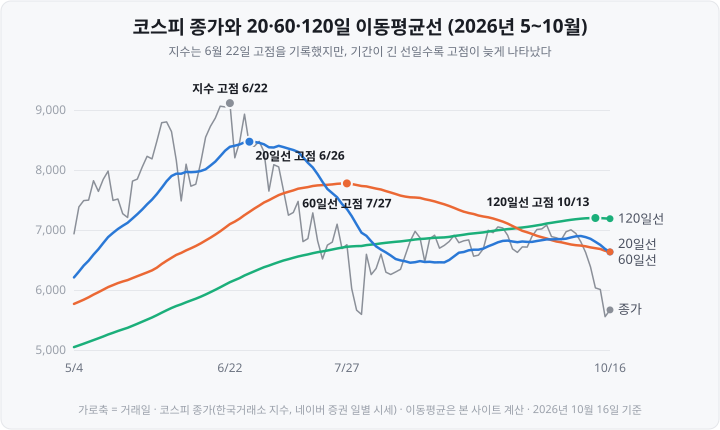

제가 차트를 처음 볼 때 가장 헷갈렸던 것은 '주가가 크게 내린 날에 왜 20일선은 올라가 있지?'라는 점이었습니다. 선이 그날의 등락을 따라 움직인다고 생각했기 때문입니다. <mark>이동평균이 '오늘 들어온 값과 빠져나간 값'으로 움직인다는 것을 알고 나서야 선이 꺾이는 시점이 이해되기 시작했습니다.</mark>

2026년 6월 23일 코스피는 전날보다 **9.99% 내린** 8,203.84에 마감했습니다. 그런데 같은 날 코스피의 20일 이동평균은 8,387.13에서 8,404.94로 **17.81포인트 올랐습니다.** 반대로 10월 16일에는 지수가 2.05% 올랐는데 5일 이동평균은 191.58포인트 내렸습니다. <mark>이동평균은 그날의 등락이 아니라 '새로 들어온 값과 빠져나간 값의 차이'로 움직이기 때문</mark>입니다.

이 글은 차트 위에 겹쳐 그리는 **이동평균선**을 다룹니다. ① 이동평균을 실제 종가로 하루씩 계산하는 과정, ② 5·20·60·120일이라는 기간의 의미, ③ 정배열과 역배열, ④ 골든크로스와 데드크로스, ⑤ 이동평균선이 주가보다 늦게 반응하는 이유, ⑥ 단순이동평균과 지수이동평균의 차이를 차례로 정리합니다. 예시는 모두 코스피 지수의 실제 일별 종가이며 기준 시점은 **2026년 10월 16일**입니다. 차트의 기본 단위인 봉(캔들)은 [캔들차트 보는 법](https://blog.naver.com/hdglace/224441041356)에서 먼저 다뤘습니다.

&nbsp;

【이동평균은 최근 N거래일 종가의 평균입니다】

**N일 이동평균**은 오늘을 포함한 최근 N거래일 종가의 평균입니다. 다음 날이 되면 가장 오래된 하루를 빼고 새 하루를 더해 다시 평균을 냅니다. 계산 구간이 하루씩 옮겨 가기 때문에 '이동'평균이라고 부르고, 매일의 값을 이은 선이 **이동평균선**(이평선)입니다.

기간은 달력의 날짜가 아니라 **거래일** 기준입니다. 2026년 10월에는 5일(개천절 대체공휴일)과 9일(한글날)에 시장이 열리지 않았으므로, 10월 12일의 5일 이동평균은 10월 2일부터 12일까지 다섯 거래일의 평균입니다.

**표 1. 코스피 5일 이동평균을 하루씩 계산하기 — 2026년 10월**

| 날짜 | 그날 종가 | 계산에 새로 들어온 값 | 계산에서 빠진 값 | 5일 이동평균 | 전일 대비 |
| :-- | --: | --: | --: | --: | --: |
| 10월 12일 | 6,384.24 | 6,384.24(10/12) | 6,971.35(10/1) | 6,751.84 | −117.42 |
| 10월 13일 | 6,035.35 | 6,035.35(10/13) | 7,003.74(10/2) | 6,558.16 | −193.68 |
| 10월 14일 | 6,008.81 | 6,008.81(10/14) | 6,941.39(10/6) | 6,371.65 | −186.51 |
| 10월 15일 | 5,554.22 | 5,554.22(10/15) | 6,803.90(10/7) | 6,121.71 | −249.94 |
| 10월 16일 | 5,668.05 | 5,668.05(10/16) | 6,625.93(10/8) | **5,930.13** | **−191.58** |

(단위: 포인트. 5일 이동평균은 소수점 셋째 자리에서 반올림)

10월 16일의 5일 이동평균은 10월 12~16일 종가 다섯 개를 더해 5로 나눈 값입니다.

> (6,384.24 + 6,035.35 + 6,008.81 + 5,554.22 + 5,668.05) ÷ 5 = 29,650.67 ÷ 5 = **5,930.13**

매일 다섯 개를 다시 더하지 않아도 같은 결과가 나옵니다. 하루 사이에 바뀌는 것은 새로 들어온 값과 빠진 값 하나씩뿐이기 때문입니다.

> 오늘 이동평균 = 어제 이동평균 + (오늘 종가 − N거래일 전 종가) ÷ N
> 10월 16일: 6,121.71 + (5,668.05 − 6,625.93) ÷ 5 = 6,121.71 − 191.58 = **5,930.13**

이 식이 도입부의 두 사례를 설명합니다. 10월 16일 코스피는 전날보다 113.83포인트 올랐지만, 계산에서 빠진 10월 8일 종가(6,625.93)가 새로 들어온 값(5,668.05)보다 컸기 때문에 <mark>지수가 오른 날에도 5일 이동평균은 내렸습니다.</mark> 6월 23일의 20일 이동평균도 같은 원리입니다. 이날 들어온 종가 8,203.84가 빠진 5월 22일 종가 7,847.71보다 높았으므로, 지수가 9.99% 내렸는데도 20일 이동평균은 (8,203.84 − 7,847.71) ÷ 20 = 17.81포인트 올랐습니다.

정리하면 <mark>이동평균의 방향은 '오늘 종가가 N거래일 전 종가보다 높은가 낮은가'로 정해집니다.</mark> 전날 대비 등락과는 관계가 없습니다.

&nbsp;

【5·20·60·120일 — 기간이 뜻하는 것】

국내 주식 차트에서 많이 쓰는 기간은 5·20·60·120거래일입니다. 한 주에 거래일이 5일이므로 각 기간은 대략 1주·1개월·3개월·6개월에 해당합니다. 기획재정부 시사경제용어사전도 "5일선은 일주일(5거래일 기준)간의 평균 주가를 이은 것이고, 120일선은 6개월간의 평균 주가를 이은 선"이라고 설명합니다.

**표 2. 2026년 10월 16일 기준 코스피 이동평균의 실제 계산 구간**

| 이동평균 | 대략의 기간 | 실제 계산 구간 | 값 | 종가(5,668.05)와 비교 |
| :-- | :-- | :-- | --: | :-- |
| **5일선** | 1주 | 10월 12일 ~ 10월 16일 | 5,930.13 | 종가가 아래 |
| **20일선** | 1개월 | 9월 15일 ~ 10월 16일 | 6,632.85 | 종가가 아래 |
| **60일선** | 3개월 | 7월 20일 ~ 10월 16일 | 6,634.90 | 종가가 아래 |
| **120일선** | 6개월 | 4월 20일 ~ 10월 16일 | 7,189.03 | 종가가 아래 |

기간이 짧은 선은 최근 며칠의 가격만 반영하므로 주가와 가깝게 움직이고, 기간이 긴 선은 몇 달치 가격이 평균에 들어가 있어 완만하게 움직입니다. 표 2에서 120일선(7,189.03)은 4월 20일부터의 종가를 모두 포함하고 있어, 6월의 9,000대 지수가 아직 평균을 끌어올리고 있습니다.

미국 언론과 해외 자료는 **50일선과 200일선**을 기준으로 삼는 경우가 많습니다. 같은 날 같은 지수라도 어느 기간을 쓰느냐에 따라 결론이 달라질 수 있다는 점은 아래 골든크로스 절에서 다시 확인합니다.

&nbsp;

【정배열과 역배열】

이동평균선 여러 개를 함께 그리면 선의 위아래 순서가 생깁니다.

- **정배열**: 위에서부터 5일선 > 20일선 > 60일선 > 120일선 순서로 놓인 상태입니다. 최근 가격의 평균이 과거 가격의 평균보다 높다는 뜻이므로, 일정 기간 가격이 올라온 결과로 나타납니다.
- **역배열**: 위에서부터 120일선 > 60일선 > 20일선 > 5일선 순서입니다. 최근 가격의 평균이 과거 가격의 평균보다 낮다는 뜻이고, 가격이 일정 기간 내려온 결과입니다.

2026년 코스피의 배열 상태는 다음과 같이 바뀌었습니다.

**표 3. 2026년 코스피 이동평균선 배열 — 5·20·60·120일선 기준**

| 구간 | 상태 | 구간 첫날 종가 |
| :-- | :-- | --: |
| 4월 9일 ~ 6월 10일 | 정배열 | 5,778.01 |
| 6월 15일 ~ 7월 1일 | 정배열 | 8,545.98 |
| 7월 2일 ~ 9월 15일 | 정배열도 역배열도 아님 | 7,648.09 |
| 9월 16일 ~ 9월 21일 | 역배열 | 6,717.97 |
| 9월 22일 ~ 10월 15일 | 정배열도 역배열도 아님 | 7,017.91 |
| 10월 16일 | 역배열 | 5,668.05 |

6월 22일 지수가 사상 최고 종가(9,114.55)를 기록한 날은 정배열 구간 안에 있었습니다. 이날 종가 9,114.55 위에 선은 없었고, 그 아래로 5일선 8,964.33, 20일선 8,387.13, 60일선 7,097.88, 120일선 6,130.37이 순서대로 놓였습니다. 10월 16일에는 순서가 정반대가 됐습니다. 다만 20일선(6,632.85)과 60일선(6,634.90)의 차이는 2.05포인트에 불과합니다.

표 3에서 보듯 <mark>배열은 이미 진행된 가격 흐름을 요약한 것</mark>입니다. 9월 16일의 역배열은 4거래일 만에 풀렸고, 그 뒤 지수는 9월 23일 7,080.92까지 올랐다가 10월에 다시 큰 폭으로 내렸습니다.

&nbsp;

【골든크로스와 데드크로스】

기획재정부 시사경제용어사전은 **골든크로스**를 "주가나 거래량의 단기 이동평균선이 중장기 이동평균선을 아래에서 위로 돌파해 올라가는 현상"으로, **데드크로스**를 단기 이동평균선이 장기 이동평균선을 "뚫고 아래로 향하는 상황"으로 정의합니다. 같은 사전은 골든크로스를 기간에 따라 다시 나눕니다.

| 구분 | 교차하는 두 선 |
| :-- | :-- |
| 단기 골든크로스 | 5일선이 20일선을 상향 돌파 |
| 중기 골든크로스 | 20일선이 60일선을 상향 돌파 |
| 장기 골든크로스 | 60일선이 100일선을 상향 돌파 |

데드크로스는 같은 조합에서 방향이 반대인 경우입니다. 교차는 **두 이동평균의 차이가 양수에서 음수로, 또는 음수에서 양수로 바뀐 날**로 판정합니다. 이 글의 날짜도 그 기준으로 계산했습니다.

**표 4. 코스피 5일선·20일선 교차 — 2026년 9~10월**

| 날짜 | 교차 | 종가 | 5일선 | 20일선 |
| :-- | :-- | --: | --: | --: |
| 9월 8일 | 데드크로스 | 6,954.52 | 6,755.86 | 6,760.33 |
| 9월 9일 | 골든크로스 | 7,051.64 | 6,853.65 | 6,795.64 |
| 9월 16일 | 데드크로스 | 6,717.97 | 6,794.69 | 6,808.74 |
| 9월 22일 | 골든크로스 | 7,017.91 | 6,870.65 | 6,830.25 |
| 10월 8일 | 데드크로스 | 6,625.93 | 6,869.26 | 6,882.03 |

(단위: 포인트)

9월 8일 데드크로스는 다음 날 골든크로스로 바뀌었습니다. 9월 8일부터 10월 8일까지 한 달 사이에 5일선과 20일선은 다섯 차례 교차했고, 2026년 1월 2일부터 10월 16일까지 192거래일 동안으로 넓히면 **13차례** 교차했습니다. <mark>기간이 짧은 두 선은 가까이 붙어 움직이기 때문에 지수가 방향을 정하지 못하는 구간에서는 교차가 짧은 간격으로 반복됩니다.</mark>

기간이 긴 조합은 교차가 드물지만 그만큼 늦습니다. 20일선과 60일선은 7월 21일 데드크로스, 9월 28일 골든크로스, 10월 16일 데드크로스가 있었습니다. 9월 28일 골든크로스 당일 종가는 6,889.74였고, 그 뒤 12거래일 만인 10월 16일 종가는 5,668.05였습니다.

같은 10월 16일을 미국식 기준인 50일선·200일선으로 보면 결론이 반대입니다. 이날 50일선은 6,672.26, 200일선은 6,410.86으로 50일선이 여전히 위에 있었고, 두 선의 마지막 교차는 2025년 6월 4일의 골든크로스였습니다. <mark>'데드크로스가 났다'는 말은 어느 두 선을 비교했는지를 함께 밝혀야 의미가 있습니다.</mark>

&nbsp;

【이동평균선은 구조적으로 늦게 반응합니다】

이동평균은 지나간 N거래일의 가격을 똑같은 비중으로 평균한 값입니다. 가격이 방향을 바꿔도 평균 안에는 바뀌기 전의 가격이 N거래일 동안 남아 있습니다. 그래서 이동평균선은 가격보다 늦게 꺾이고, **기간이 길수록 더 늦게** 꺾입니다. 이 성질을 **후행성**이라고 합니다. 이동평균선의 결함이 아니라 계산 방식에서 나오는 성질입니다.

2026년 6월 코스피 고점 전후의 기록이 이를 보여 줍니다.

**표 5. 2026년 6월 코스피 고점 이후 이동평균선이 고점을 기록한 날**

| 기록 | 날짜 | 값 | 그날 코스피 종가 | 지수 고점 대비 |
| :-- | :-- | --: | --: | --: |
| 코스피 종가 고점 | 6월 22일 | 9,114.55 | 9,114.55 | 0.0% |
| 5일선 고점 | 6월 22일 | 8,964.33 | 9,114.55 | 0.0% |
| 20일선 고점 | 6월 26일 | 8,472.49 | 8,411.21 | −7.7% |
| 60일선 고점 | 7월 27일 | 7,776.71 | 6,755.75 | −25.9% |
| 120일선 고점 | 8월 28일 | 6,910.69 | 6,788.88 | −25.5% |

(단위: 포인트. '지수 고점 대비'는 그날 종가를 9,114.55와 비교한 값)

60일선은 지수가 고점에서 25.9% 내린 7월 27일까지 오르고 있었고, 120일선은 8월 28일에야 고점을 기록했습니다. 교차 신호도 같은 정도로 늦었습니다. 5일선이 20일선 아래로 내려간 데드크로스는 7월 2일(종가 7,648.09, 고점 대비 −16.1%), 20일선이 60일선 아래로 내려간 데드크로스는 7월 21일(종가 6,747.95, 고점 대비 −26.0%)이었습니다. 오를 때도 마찬가지로, 5일선·20일선 골든크로스는 6월 15일(종가 8,545.98)로 고점 5거래일 전이었습니다.

<mark>이동평균선의 교차는 가격이 이미 상당 폭 움직인 뒤에 나타나는 확인 신호</mark>입니다. 기간이 길수록 잦은 교차는 줄어들지만 지연은 커집니다. 기간을 정하는 것은 이 두 가지 사이에서 하나를 고르는 일입니다.

&nbsp;

【단순이동평균과 지수이동평균】

지금까지 계산한 값은 모든 날에 같은 비중을 주는 **SMA**(Simple Moving Average, 단순이동평균)입니다. 후행성을 줄이기 위해 최근 가격에 더 큰 비중을 주는 방식이 **EMA**(Exponential Moving Average, 지수이동평균)입니다.

> 오늘 EMA = 어제 EMA + α × (오늘 종가 − 어제 EMA), α = 2 ÷ (N + 1)

20일 EMA의 α는 2 ÷ 21 ≈ 0.0952입니다. 오늘 종가가 어제 EMA와 다른 만큼의 약 9.5%를 반영한다는 뜻입니다. 과거 가격의 비중은 하루 지날 때마다 일정 비율로 줄어들 뿐 0이 되지 않으므로, 단순이동평균처럼 N거래일 전 값이 한꺼번에 빠지는 일이 없습니다. 10월 16일 값으로 계산하면 다음과 같습니다.

> 6,560.59 + 0.0952 × (5,668.05 − 6,560.59) = 6,560.59 − 85.00 = **6,475.58**

(α를 소수점 넷째 자리까지만 적어 계산하면 마지막 자리가 0.01 다를 수 있습니다)

**표 6. 코스피 20일 SMA와 20일 EMA — 2026년 10월**

| 날짜 | 종가 | 20일 SMA | 20일 EMA |
| :-- | --: | --: | --: |
| 10월 7일 | 6,803.90 | 6,900.51 | 6,878.28 |
| 10월 8일 | 6,625.93 | 6,882.03 | 6,854.24 |
| 10월 12일 | 6,384.24 | 6,853.52 | 6,809.48 |
| 10월 13일 | 6,035.35 | 6,802.71 | 6,735.75 |
| 10월 14일 | 6,008.81 | 6,751.45 | 6,666.52 |
| 10월 15일 | 5,554.22 | 6,683.67 | 6,560.59 |
| 10월 16일 | 5,668.05 | 6,632.85 | 6,475.58 |
| **10월 7일 대비** | **−1,135.85** | **−267.66** | **−402.70** |

(단위: 포인트)

같은 7거래일 동안 20일 SMA는 267.66포인트, 20일 EMA는 402.70포인트 내렸습니다. 급락 구간에서 <mark>EMA가 SMA보다 최근 가격에 더 가깝게 따라갑니다.</mark>

다만 EMA가 항상 먼저 방향을 바꾸는 것은 아닙니다. 6월 고점 때 20일 SMA는 6월 26일에 고점을 기록했지만, 20일 EMA는 6월 30일(8,414.74)에 고점을 기록했습니다. 두 평균이 오르는 조건이 다르기 때문입니다. SMA는 오늘 종가가 N거래일 전 종가보다 높을 때 오르고, EMA는 오늘 종가가 어제 EMA보다 높을 때 오릅니다. 6월 30일 종가 8,476.48은 SMA 계산에서 빠진 6월 1일 종가 8,788.38보다 낮아 SMA를 끌어내렸지만, 전날 EMA 8,408.24보다는 높아 EMA를 끌어올렸습니다. 최근 가격에 민감하다는 것은 하락뿐 아니라 반등에도 민감하다는 뜻입니다.

EMA는 첫날의 값을 무엇으로 시작하느냐에 따라 초기 값이 달라집니다. 이 글은 2024년 1월부터의 종가로 계산을 시작해 시작점의 영향이 사실상 남아 있지 않습니다. 차트 서비스마다 시작점이나 계산식이 달라 같은 날의 EMA 값이 조금씩 다를 수 있으므로, 차트 설정에서 단순·지수 중 무엇을 쓰는지 확인하는 것이 좋습니다.

&nbsp;

【매매 신호로서의 효과 — 연구 결과】

이동평균선을 이용한 매매 규칙은 학계에서 오랫동안 검증 대상이었습니다.

- **Brock·Lakonishok·LeBaron(1992)**: 미국 다우존스산업평균지수의 1897~1986년 일별 데이터에 짧은 이동평균(1·2·5일)과 긴 이동평균(50·150·200일)의 교차 규칙을 적용했습니다. 매수 신호 뒤의 수익률이 매도 신호 뒤보다 일관되게 높았고, 이 결과는 주가가 무작위로 움직인다는 모형 등으로 설명되지 않았다고 보고했습니다.
- **Sullivan·Timmermann·White(1999)**: 위 연구의 규칙을 수천 개로 넓히고, 많은 규칙을 시험하다 우연히 좋은 결과를 고르는 문제(데이터 스누핑)를 통계적으로 보정했습니다. 1897~1986년 표본에서 가장 좋았던 규칙은 그 뒤 1987~1996년 데이터에서는 **거래비용을 빼기 전에도** 통계적으로 유의한 초과 성과를 내지 못했습니다.
- **Park·Irwin(2007)**: 기술적 분석의 수익성을 다룬 연구들을 종합한 논문입니다. 기술적 매매 규칙이 여러 시장에서 적어도 1990년대 초반까지는 수익을 냈다는 결과가 많았지만, 상당수 연구에 데이터 스누핑, 사후적인 규칙 선택, 위험과 거래비용 추정의 어려움 같은 검증상의 문제가 있다고 지적했습니다.

<mark>과거 특정 기간에 효과가 있었다는 결과와, 그 효과가 이후에도 이어진다는 근거는 다릅니다.</mark> 표 4와 표 5의 코스피 사례도 한 지수의 한 시기 기록일 뿐 신호의 효과를 검증한 자료가 아닙니다. 이 글에서 다룬 범위에서는 이동평균선을 가격 흐름을 요약해 보여 주는 도구로 이해하는 것이 정확합니다.

이동평균은 다른 지표의 계산에도 쓰입니다. 시장 전체의 상승·하락 종목 수를 비교하는 등락비율도 이동평균으로 계산하는 방식이 있으며, [코스피 ADR 읽는 법](https://blog.naver.com/hdglace/224419630335)에서 계산 방식에 따라 값이 달라지는 사례를 다뤘습니다.

&nbsp;

【정리】

- **N일 이동평균은 오늘을 포함한 최근 N거래일 종가의 평균입니다.** 기간은 달력이 아니라 거래일로 계산합니다.
- **이동평균의 방향은 오늘 종가와 N거래일 전 종가의 비교로 정해집니다.** 2026년 6월 23일 코스피는 9.99% 내렸지만 20일 이동평균은 올랐습니다.
- **5·20·60·120일선은 대략 1주·1개월·3개월·6개월의 평균입니다.** 미국에서는 50·200일선을 많이 씁니다.
- **정배열·역배열과 골든크로스·데드크로스는 이미 진행된 가격 흐름을 요약한 결과입니다.** 5일선·20일선은 2026년 192거래일 동안 13차례 교차했고, 같은 날이라도 비교하는 두 선에 따라 결론이 갈립니다.
- **이동평균선은 기간이 길수록 늦게 반응합니다.** 2026년 6월 22일 지수 고점 뒤 60일선은 7월 27일, 120일선은 8월 28일에 고점을 기록했습니다.
- **EMA는 최근 가격에 더 큰 비중을 둡니다.** 하락에 빨리 반응하는 만큼 반등에도 크게 반응합니다.
- **매매 신호로서의 효과는 연구마다 결론이 다르고, 1990년대 이후 데이터에서는 초과 성과가 유지되지 않았다는 연구가 있습니다.**

&nbsp;

【다음 편에서는】

다음 공부방 글에서는 **반도체 사이클 기초**를 다룹니다. 메모리 반도체의 공급·수요 사이클, D램(DRAM)·낸드(NAND) 현물가와 고정거래가의 차이, HBM이 별도로 움직이는 이유, 설비투자와 가격 사이의 시차, 그리고 한국 증시에서 반도체 비중이 큰 이유를 정리하겠습니다.

&nbsp;

【🔗 함께 보면 좋은 글】

- [캔들차트 보는 법 — 시가·고가·저가·종가와 양봉·음봉](https://blog.naver.com/hdglace/224441041356)
- [코스피 ADR(등락비율) 읽는 법 — 계산식이 두 가지라 값도 다릅니다](https://blog.naver.com/hdglace/224419630335)
- [과거 주가 데이터 받는 법 — KRX 엑셀·CSV 다운로드와 Open API](https://blog.naver.com/hdglace/224404481437)
- [52주 신고가·신저가 종목 찾는 법 — 종가 기준과 장중 기준은 다르다](https://blog.naver.com/hdglace/224414554438)
- [공매도·사이드카·서킷브레이커 차이 — 급락장에 켜지는 장치들](https://blog.naver.com/hdglace/224381139813)

&nbsp;

【📊 데이터 출처 및 기준일】

- **코스피 일별 종가(2024년 1월 2일 ~ 2026년 10월 16일)**: 네이버 증권 일별 시세(지수), **2026년 10월 17일 수집**. 2026년 6월 16일(8,726.60)·6월 22일(9,114.55)·6월 23일(8,203.84)·7월 2일(7,648.09)·9월 15일(6,627.26)·10월 16일(5,668.05) 종가를 한국거래소 집계를 인용한 언론 보도와 대조해 모두 일치함을 확인했습니다. 한국거래소 애프터마켓 개설(9월 14일) 이후의 날짜도 일치했습니다. 개별 종목의 포털 일봉은 애프터마켓 체결이 반영돼 공식 종가와 다를 수 있으므로([캔들차트 보는 법](https://blog.naver.com/hdglace/224441041356) 참고), 이 글은 지수만 사용했습니다.
- **5·20·60·120·50·200일 단순이동평균, 20일 지수이동평균, 배열 구간, 교차일, 고점 대비 등락률**: 위 종가로 본 사이트가 계산했습니다. 교차일은 두 이동평균의 차이가 부호를 바꾼 날, 배열은 5·20·60·120일선의 대소 순서로 판정했습니다. EMA는 2024년 1월 2일부터 20거래일 SMA를 시작값으로 계산했습니다. 차트 서비스의 표시값과는 반올림·계산 시작점 차이로 조금 다를 수 있습니다.
- **골든크로스·데드크로스 정의, 단기·중기·장기 구분, 5일선·120일선의 기간 설명**: 기획재정부 시사경제용어사전(KDI 경제정보센터 제공) 「골든크로스」·「데드크로스」 항목, 2026년 10월 17일 확인.
- **2026년 10월 5일·9일 휴장**: 개천절(10월 3일, 토요일) 대체공휴일과 한글날. 위 일별 시세에 두 날의 거래 기록이 없는 것으로도 확인했습니다.
- **미국의 50일선·200일선 관행**: 해외 투자 교육 자료의 골든크로스 설명. 기관이 정한 공식 기준은 아닙니다.
- **이동평균 매매 규칙 연구**: William Brock, Josef Lakonishok, Blake LeBaron, 「Simple Technical Trading Rules and the Stochastic Properties of Stock Returns」, Journal of Finance 47(5), 1992 / Ryan Sullivan, Allan Timmermann, Halbert White, 「Data-Snooping, Technical Trading Rule Performance, and the Bootstrap」, Journal of Finance 54(5), 1999 / Cheol-Ho Park, Scott H. Irwin, 「What Do We Know About the Profitability of Technical Analysis?」, Journal of Economic Surveys 21(4), 2007. 논문 원문 전체가 아니라 초록과 이를 인용한 후속 연구의 요약을 바탕으로 정리했습니다.

*이 글은 이동평균선을 읽는 방법을 정리한 정보성 콘텐츠이며, 특정 이동평균 기간이나 교차 신호를 매매 판단의 근거로 권유하지 않습니다. 특정 종목이나 상품의 매수·매도를 권유하지 않으며, 지수의 향후 움직임을 예측하지 않습니다. 본문의 수치는 위 기준일 시점의 값이며, 최신 시세는 한국거래소 등 원 출처에서 확인하시기 바랍니다. 모든 투자 판단과 책임은 투자자 본인에게 있습니다.*

&nbsp;

#이동평균선 #이동평균선보는법 #골든크로스 #데드크로스 #골든크로스데드크로스 #정배열 #역배열 #20일선 #60일선 #120일선 #지수이동평균 #주식차트기초 #코스피 #주식초보 #투자공부 #재테크
