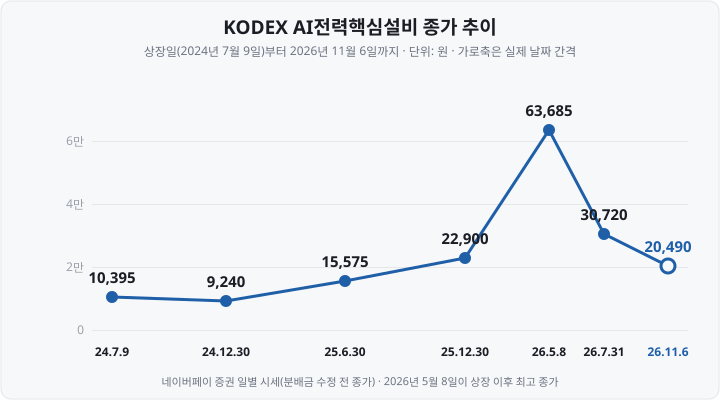

전력 ETF를 처음 살펴볼 때는 '전력'이라는 이름 때문에 발전소나 전력회사가 편입돼 있을 것이라고 생각했습니다. 그런데 구성 종목을 열어 보니 <mark>12종목이 모두 변압기와 전선을 만드는 기업</mark>이었고, 그중 다섯 종목이 같은 LS그룹 계열이었습니다.

오늘은 국내 전력 ETF 가운데 순자산이 가장 큰 상품 하나를 골라 **구성 종목, 지수 규칙, 상장 이후의 변화, 비용과 위험**을 공시 수치로 정리하겠습니다. 특정 상품의 매수·매도를 권하지 않으며, 상품 간 우열도 판단하지 않습니다.

&nbsp;

【어떤 상품을 골랐나】

선정 기준은 **작성일 기준으로 국내에 상장된 전력기기·전력 인프라 ETF 가운데 순자산이 가장 큰 상품**이고, 레버리지·인버스·커버드콜 상품은 제외했습니다. 네이버페이 증권 ETF 목록(2026년 11월 6일 종가 기준 1,184종목)에서 이름에 '전력'이 들어간 상품을 비교했습니다.

| 항목 | 내용 |
| :-- | :-- |
| 상품명 | KODEX AI전력핵심설비(487240) |
| 운용사 | 삼성자산운용 |
| 상장일 | 2024년 7월 9일 |
| 기초지수 | iSelect AI전력핵심설비 지수(Price Return), NH투자증권 산출 |
| 순자산총액 | **2조 625억원**(2026년 11월 5일) |
| 총보수 | 연 0.39% |
| 구성 종목 수 | 주식 12종목 + 원화예금 |

기초지수 이름 끝의 **Price Return**(가격 수익률)은 지수가 편입 종목의 배당금을 반영하지 않는다는 뜻입니다.

&nbsp;

【전력 산업에서 이 ETF가 편입하는 범위】

| 단계 | 주요 설비 | 편입 여부 |
| :-- | :-- | :-- |
| 발전 | 원자로·가스터빈·태양광 모듈 | 편입하지 않음 |
| 송전·변전 | **초고압 변압기**, 차단기, 초고압·해저 케이블 | 편입(핵심) |
| 배전·수요처 | 배전용 변압기, 배전반, 전력 케이블 | 편입 |
| 전력 판매 | 전력회사(한국전력 등) | 편입하지 않음 |

**변압기**는 전압을 높이거나 낮추는 설비이고, **차단기**는 사고 전류를 끊어 설비를 보호하는 장치입니다. 이런 설비를 묶어 **중전기기**(重電機器, 발전·송배전에 쓰는 대형 전기기기)라고 부릅니다.

즉 이 ETF는 <mark>전기를 만드는 기업이나 판매하는 기업이 아니라, 전기를 보내는 설비를 만드는 기업</mark>으로 구성돼 있습니다. 투자설명서의 지수 정의에는 ESS(Energy Storage System, 에너지저장장치)와 고효율발전설비도 포함되지만, 2026년 11월 현재 편입된 12종목은 모두 중전기기와 전선 기업입니다. 한국전력 같은 공기업은 지수 방법론의 제외 조항에 따라 편입 대상이 아닙니다.

&nbsp;

【수요를 움직이는 요인】

**① 미국 데이터센터의 전력 소비.** 미국 에너지부가 2024년 12월 공개한 로런스버클리국립연구소(LBNL) 보고서에 따르면, 미국 데이터센터의 전력 소비량은 2023년 **176TWh**(전체의 약 4.4%)였고 2028년에는 **325~580TWh**(6.7~12%)로 전망됩니다.

**② 노후 전력망 교체.** 미국과 유럽에서는 오래된 송배전 설비의 교체 수요가 함께 발생하고 있습니다.

**③ 공급 부족.** 우드매켄지(Wood Mackenzie)는 2024년 4월 변압기 납기가 2021년 약 50주에서 2024년 평균 **120주**로 늘었고, 대형 변압기는 80~210주라고 밝혔습니다. <mark>주문 후 납품까지 2년 이상 걸리므로, 수주잔고가 매출보다 먼저 늘어납니다.</mark>

| 기업 | 2026년 3분기 말 수주잔고 | 전년 대비 |
| :-- | --: | --: |
| 효성중공업(중공업 부문) | 18조 8,988억원 | +71% |
| HD현대일렉트릭(연결) | 88억 4,300만달러 | +26.6% |
| LS ELECTRIC(연결) | 7조 430억원 | +73% |

다만 수주잔고 증가가 주가 상승으로 이어진다는 보장은 없습니다. 이 점은 뒤의 '최근 1년의 주요 사건'에서 확인할 수 있습니다.

&nbsp;

【구성 종목 — 12종목, 상위 3종목이 55%】

| 순위 | 종목 | 비중 | 주요 사업 |
| --: | :-- | --: | :-- |
| 1 | LS ELECTRIC | 20.82% | 배전반·차단기·변압기 |
| 2 | 효성중공업 | 19.93% | 초고압 변압기·차단기, 건설 |
| 3 | HD현대일렉트릭 | 14.55% | 초고압 변압기·배전기기 |
| 4 | LS | 12.93% | LS전선·LS ELECTRIC 지주회사 |
| 5 | 대한전선 | 8.57% | 초고압·해저 케이블 |
| 6 | 산일전기 | 6.85% | 특수변압기 |
| 7 | 일진전기 | 4.61% | 변압기·차단기, 전선 |
| 8 | 가온전선 | 4.57% | 전력·통신 케이블 |
| 9 | 대원전선 | 1.89% | 전선 |
| 10 | LS에코에너지 | 1.87% | 전력 케이블 |
| 11 | LS마린솔루션 | 1.73% | 해저 케이블 시공 |
| 12 | 제룡전기 | 1.68% | 배전용 변압기 |

(삼성자산운용 PDF, 2026년 11월 9일 적용분)

- **상위 3종목이 55.30%, 상위 5종목이 76.80%입니다.**
- **LS그룹 계열 5종목의 합계가 41.92%입니다.** LS ELECTRIC과 LS전선은 지주회사 LS의 자회사이고, 가온전선·LS에코에너지·LS마린솔루션은 LS전선이 최대주주입니다. <mark>종목은 다섯 개지만 같은 기업집단 하나에 40% 이상이 집중돼 있습니다.</mark>

&nbsp;

【기초지수 규칙 — 종목을 키워드로 선정합니다】

| 단계 | 내용 |
| :-- | :-- |
| 기초 유니버스 | 20영업일 평균 시가총액 1,500억원 이상, 평균 거래대금 10억원 이상 |
| 키워드 점수 | 사업보고서·뉴스 기사를 **NLP**(Natural Language Processing, 자연어처리) 모델로 점수화 |
| 편입 조건 | 최상위 종목 점수의 10%보다 높은 종목 |
| 비중 | 유동시가총액 가중, 종목당 상한 20% |
| 정기변경 | 연 2회(6월·12월) |
| 수시변경 | 한 종목 비중이 30% 초과 시 등 지수위원회 검토 |

**유동시가총액**은 최대주주 지분처럼 시장에서 거래되지 않는 주식을 뺀 시가총액입니다. 투자설명서는 키워드 방식이 매출 같은 정량 지표로 선정하는 방식보다 기업의 실제 산업 내 지위와 괴리가 생길 수 있다고 명시합니다.

**상한 20%는 정기변경일에만 적용됩니다.** 2025년 11월 말 효성중공업 비중은 **28.87**%였고, 2026년 4월 29일 LS ELECTRIC 비중은 25.94%로 보도됐습니다. <mark>정기변경 사이에는 한 종목 비중이 30% 가까이까지 커질 수 있습니다.</mark>

&nbsp;

【상장 이후 무엇이 바뀌었나】

| 시점 | 고른 이유 | 종가 | 순자산 | 비중 상위 3종목 |
| :-- | :-- | --: | --: | :-- |
| 2024.8.30 | 상장 후 첫 월말 자료 | 8,455원 | 1,136억원 | HD현대일렉트릭 24.01%, LS ELECTRIC 19.53%, 효성중공업 15.72% |
| 2025.11.28 | 순자산 1조원 첫 돌파 직후 월말 | 22,985원 | 1조 78억원 | 효성중공업 28.87%, HD현대일렉트릭 20.52%, LS ELECTRIC 19.86% |
| 2026.5.8 | 상장 이후 최고 종가 | 63,685원 | — | LS ELECTRIC 25.94%, 효성중공업 19.80%, HD현대일렉트릭 14.43%(4월 29일 보도) |
| 2026.11.6 | 작성일 직전 거래일 | 20,490원 | 2조 625억원(11월 5일) | LS ELECTRIC 20.82%, 효성중공업 19.93%, HD현대일렉트릭 14.55% |

(고점 시점의 순자산은 운용사 월말 자료를 확인하지 못해 비워 두었습니다. 상장일 종가는 10,395원입니다.)

상장일 종가 10,395원에서 최고 종가 63,685원까지 **512.6%** 올랐고, 최고 종가에서 11월 6일까지 **67.8%** 내렸습니다. 상장일 대비로는 97.1% 높은 수준입니다(분배금 미포함).

비중 1위 종목은 HD현대일렉트릭(2024년 8월) → 효성중공업(2025년 11월) → LS ELECTRIC(2026년 4월·11월)으로 두 번 바뀌었습니다. 규칙이 유동시가총액 가중이므로 <mark>최근 주가가 많이 오른 기업이 비중 1위가 됩니다.</mark>

가격이 내리는 동안 순자산은 늘었습니다. 2025년 11월 말 대비 종가는 **10.9%** 내렸는데 순자산총액은 1조 78억원에서 2조 625억원으로 약 2배가 됐습니다. 네이버페이 증권 집계로 최근 6개월 순유입액은 **1조 1,450억원**입니다(11월 5일 기준). 순자산 규모가 크다는 사실이 기존 투자자들의 수익을 뜻하지는 않습니다.

&nbsp;

【최근 1년의 주요 사건】

| 시기 | 사건 | ETF 종가 변화 |
| :-- | :-- | :-- |
| 2025.11.19 | 순자산 1조원 첫 돌파(1조 96억원) | — |
| 2026.4 | 빅테크 데이터센터 투자 계획 상향, 1분기 실적 발표 | 3월 31일 29,400원 → 4월 30일 52,820원(+79.7%) |
| 2026.5.7~8 | 전력기기 3사와 ETF 고점 | 5월 8일 63,685원 |
| 2026.8~9 | AI 개발 속도 조절론, 데이터센터 투자 둔화 우려. 9월 16일 3사 주가 고점 대비 37~50% 하락 | 9월 30일 36,210원 |
| 2026.10 말 | 효성중공업 중공업 부문 수주잔고 역대 최대 | 10월 30일 24,540원 |
| 2026.11.5~6 | 미국 중간선거 후 데이터센터 규제 강화 우려로 급락 | 11월 4일 25,810원 → 11월 6일 20,490원(이틀 −20.6%) |

수주잔고가 역대 최대를 기록하는 동안에도 주가는 내렸습니다. 이미 확보한 수주보다 앞으로의 데이터센터 투자 속도와 미국 정책 변화가 주가에 더 크게 반영된 것입니다. 원인 해석은 당시 보도를 옮긴 것이며, 같은 사건이 같은 결과를 낳는다는 뜻은 아닙니다.

&nbsp;

【비용·분배·괴리율·추적오차】

| 항목 | 연 비율 |
| :-- | --: |
| 총보수 | 0.39% |
| 기타비용 | 0.0686% |
| **총보수·비용** | **0.4586%** |
| 매매·중개수수료(별도, 2025년 회계연도) | 0.0713% |

| 지급기준일 | 1좌당 분배금 |
| :-- | --: |
| 2025년 4월 30일 | 119원 |
| 2026년 4월 30일 | 39원 |
| 2026년 7월 31일 | 5원 |

2026년 분배금 합계 44원은 11월 6일 종가의 약 0.2%입니다. <mark>이 상품의 수익은 거의 전부 가격 변동에서 나옵니다.</mark>

**괴리율**은 11월 6일 종가 20,490원, NAV 20,596.59원으로 **−0.52**%였습니다. 운용사가 표시한 **추적오차**는 0.52%입니다. 상장 이후 NAV 수익률은 +100.75%, 기초지수는 +97.66%로 ETF가 3.09%p 높았습니다. 기초지수는 배당을 반영하지 않지만 펀드는 배당금을 실제로 받기 때문입니다(NAV 수익률은 분배금 재투자 가정, 앞의 종가 수익률과 계산 방식이 다릅니다).

&nbsp;

【이 ETF가 맞지 않는 경우와 위험】

- **분산투자를 기대하는 경우** — 상위 3종목 55%, LS그룹 계열 42%입니다.
- **큰 가격 변동을 감당하기 어려운 경우** — 투자설명서상 최근 1년 수익률 변동성은 **60.52**%이고, 최고 종가에서 6개월 만에 67.8% 내렸습니다.
- **미국 정책·투자 계획에 따른 변동** — 편입 기업은 국내 상장사지만 주가는 미국 데이터센터 투자와 전력 정책에 크게 반응했습니다.
- **정기 분배금을 기대하는 경우** — 지금까지의 분배금은 연 0.2% 수준이었습니다.
- **키워드 방식의 한계와 비중 상한 적용 시점** — 정기변경 사이에는 한 종목 비중이 20%를 넘을 수 있습니다.

&nbsp;

【정리】

- 2026년 11월 6일 기준 국내 상장 전력 ETF 순자산 1위(레버리지·인버스·커버드콜 제외) KODEX AI전력핵심설비, 순자산 2조 625억원
- **변압기·차단기·전선** 기업 12종목. 상위 3종목 55.30%, LS그룹 계열 41.92%
- 키워드 점수로 종목 선정, 유동시가총액 가중, 종목당 상한 20%, 6월·12월 정기변경
- 상장일 10,395원 → 최고 63,685원(+512.6%) → 20,490원(최고 대비 −67.8%)
- 총보수 0.39%, 기타비용 포함 0.4586%, 분배금은 지금까지 세 차례

&nbsp;

【함께 보면 좋은 글】

- [섹터·테마 ETF 고르는 기준](https://blog.naver.com/hdglace/224377126808)
- [ETF 총보수와 세금 — 실제로 내 수익에서 얼마가 빠지나](https://blog.naver.com/hdglace/224367512124)
- [ETF 투자설명서 읽는 법 — 기초지수·PDF·보수·괴리율·분배금 확인하기](https://blog.naver.com/hdglace/224421632113)

다음 글에서는 **RSI·MACD·볼린저밴드**가 실제로 무엇을 계산하는지 계산식을 숫자로 펼쳐 보겠습니다.

&nbsp;

【📊 데이터 출처 및 기준일】

| 항목 | 수치 | 출처·기준일 |
| :-- | :-- | :-- |
| 상품 기본정보·총보수·분배 이력 | 상장 2024-07-09, 총보수 0.39%, 분배 119·39·5원 | 삼성자산운용 KODEX 상품 페이지, 2026-11-08 확인 |
| 구성 종목·비중 | 12종목, LS ELECTRIC 20.82% 등 | 삼성자산운용 PDF, 2026-11-09 적용분 |
| 종가·NAV·추적오차·기간 수익률 | 20,490원 / 20,596.59원 / 0.52% | 삼성자산운용 상품 페이지, 2026-11-06 기준 |
| 지수 규칙·비용·변동성 | 상한 20%, 6·12월 정기변경, 총보수·비용 0.4586%, 변동성 60.52% | 투자설명서(작성기준일 2026-07-09) |
| 과거 월말 자료 | 2024-08-30 순자산 1,136.30억원 / 2025-11-28 10,077.61억원과 비중 | 삼성자산운용 월간 자료 |
| 2026-04-29 비중 | LS일렉트릭 25.94% 등 | 시대 보도 2026-04-29 |
| 순자산·순유입 | 2조 625억원, 6개월 1조 1,450억원 | 네이버페이 증권, 2026-11-05 기준 |
| 일별 종가 | 상장일 10,395원 ~ 11월 6일 20,490원 | 네이버페이 증권 일별 시세(수정 전), 수익률은 자체 계산 |
| 데이터센터 전력 | 2023년 176TWh → 2028년 325~580TWh | 미국 에너지부·LBNL, 2024-12-20 |
| 변압기 납기 | 2021년 약 50주 → 2024년 120주 | 우드매켄지, 2024-04-02 |
| 3사 수주잔고 | 18조 8,988억원 / 88억 4,300만달러 / 7조 430억원 | 토요경제 2026-11-05, 서울신문 2026-10-30 |
| 주요 사건 | 4월 급등, 9월 하락, 11월 5~6일 급락 | 이투데이·머니투데이·파이낸셜뉴스·한국경제 보도 |

&nbsp;

⚠️ **면책 안내** — 이 글은 공개된 상품 공시·투자설명서·보도를 정리한 **교육·정보 제공 목적**의 자료이며, 특정 종목·산업·상품의 매수·매도를 권유하거나 상품 간 우열을 판단하지 않습니다. 대상 상품은 본문의 선정 기준(작성일 기준 순자산 1위)에 따라 골랐고, 유사한 상품이 여럿 있습니다. 이 글은 작성일 기준 데이터로 작성했으며 이후 갱신하지 않습니다. 과거 수익률이 미래 수익을 보장하지 않으며, 투자 판단과 그 결과에 대한 책임은 투자자 본인에게 있습니다.

&nbsp;

#전력ETF #전력기기ETF #KODEXAI전력핵심설비 #ETF해부 #변압기 #전선주 #데이터센터전력 #효성중공업 #HD현대일렉트릭 #LSELECTRIC #ETF구성종목 #주식초보 #투자공부 #재테크
