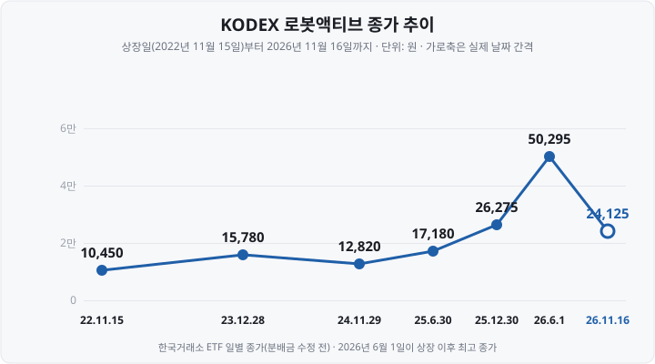

로봇 ETF의 구성 종목을 처음 열어 봤을 때, 비중 1위가 로봇 기업이 아니라 삼성전자라는 점이 의외였습니다. 상위 10종목에는 NAVER와 삼성에스디에스 같은 IT 기업도 있었고, 세금도 일반적인 국내 주식 ETF와 달랐습니다.

오늘은 국내 로봇 ETF 가운데 순자산이 가장 큰 상품 하나를 골라 **운용 방식, 구성 종목, 상장 이후의 변화, 1년 실측 데이터, 비용·과세와 위험**을 정리하겠습니다. 특정 상품의 매수·매도를 권하지 않으며, 상품 간 우열도 판단하지 않습니다.

&nbsp;

【어떤 상품을 골랐나】

선정 기준은 **작성일 기준으로 국내에 상장된 로봇 ETF(Exchange Traded Fund, 상장지수펀드) 가운데 순자산이 가장 큰 상품**이고, 레버리지·인버스·커버드콜 상품은 제외했습니다. 한국거래소(KRX, Korea Exchange) 2026년 11월 16일 자료에서 이름에 '로봇'·'로보'·'휴머노이드'가 들어간 19개 상품을 비교했습니다.

| 항목 | 내용 |
| :-- | :-- |
| 상품명 | KODEX 로봇액티브(445290) |
| 운용사 | 삼성자산운용(국내 주식 운용은 삼성액티브자산운용에 위탁) |
| 상장일 | 2022년 11월 15일 |
| 운용 방식 | **액티브 ETF** — 비교지수 대비 초과성과 목표 |
| 비교지수 | iSelect K-로봇테마 지수, NH투자증권 산출 |
| 순자산총액 | **8,440억원**(2026년 11월 16일) |
| 총보수 | 연 0.50% |
| 구성 종목 수 | 주식 32종목 + 원화예금(11월 17일 적용 PDF) |

&nbsp;

【액티브 ETF는 지수를 그대로 따르지 않습니다】

일반적인 ETF는 기초지수의 종목과 비중을 그대로 따라갑니다. 이 상품은 **액티브 ETF**로, 비교지수는 성과를 비교하는 기준이고 실제 종목과 비중은 운용역이 정합니다.

| 항목 | 비교지수 | 이 ETF |
| :-- | :-- | :-- |
| 종목 수 | 30종목 | 투자설명서상 "20종목 내외" 예정, 실제 32종목 |
| 종목당 상한 | 8% | 자산총액의 10% |
| 비중 결정 | 키워드 점수를 가중한 유동시가총액 | 운용역 재량 |
| 정기변경 | 매년 6월·12월 | 수시 |

11월 17일 PDF에서 삼성전자(9.30%)와 로보티즈(9.23%)는 비교지수가 정기변경 때 적용하는 상한 8%를 넘고, **원화예금이 5.04%** 포함돼 있습니다.

다만 상장 1년이 지난 ETF는 1좌당 순자산가치(NAV, Net Asset Value)와 비교지수의 일간 변동률 **상관계수**가 0.7 미만인 상태가 3개월간 이어지면 상장폐지 대상이 됩니다. KRX 자료로 계산한 2025년 12월 29일~2026년 11월 16일(214거래일) 상관계수는 **0.980**이었습니다. <mark>종목 비중은 지수와 다르지만 하루하루의 움직임은 비교지수와 거의 같았습니다.</mark>

【비교지수는 '로봇'과 'AI' 키워드로 종목을 고릅니다】

비교지수는 공시·애널리스트 보고서 등에서 키워드가 얼마나 나오는지 점수를 매겨 상위 30종목을 고릅니다. 투자설명서의 키워드 예시에는 로봇·휴머노이드 외에 **인공지능, 클라우드, 빅데이터, 데이터 보안** 등이 포함돼 있습니다. NAVER·삼성에스디에스·KT 같은 IT·통신 기업이 로봇 ETF에 편입되는 이유입니다.

&nbsp;

【로봇 산업에서 이 ETF가 편입하는 범위】

32종목을 주력 사업 기준으로 나누면 다음과 같습니다(본 사이트 분류).

| 분류 | 종목 수 | 비중 합계 | 주요 종목 |
| :-- | --: | --: | :-- |
| 로봇 부품 | 5 | 18.10% | 로보티즈, 에스피지, 삼현 등 |
| 로봇 완제품 | 9 | 20.46% | 레인보우로보틱스, 두산로보틱스, 뉴로메카 등 |
| 로봇 자회사·사업을 둔 대기업 | 6 | 32.01% | 삼성전자, 현대모비스, LG전자, 현대차 등 |
| AI·IT·통신·전자부품 등 | 12 | 29.40% | NAVER, 현대오토에버, 삼성에스디에스 등 |

<mark>로봇 완제품·부품 기업의 비중은 주식 평가액의 38.56%이고, 나머지는 대기업과 AI·IT 기업입니다.</mark>

**감속기**는 모터의 회전 속도를 줄이는 대신 회전하는 힘을 키우는 장치이고, **액추에이터**는 모터·감속기·제어기를 결합해 로봇 관절을 움직이는 구동 장치입니다. 에스피지·에스비비테크가 감속기를, 로보티즈가 액추에이터를 생산합니다.

삼성전자는 2024년 12월 31일 레인보우로보틱스 지분을 35.0%로 늘려 최대주주가 된다고 공시했고, 현대차그룹은 현대차·기아·현대모비스가 출자한 법인을 통해 보스턴다이내믹스를 지배하고 있습니다. 다만 이들 대기업은 매출 대부분이 본업에서 나오므로, 주가는 로봇 사업 소식과 본업 실적의 영향을 함께 받습니다.

&nbsp;

【수요를 움직이는 요인】

**① 산업용 로봇 설치.** IFR(International Federation of Robotics, 국제로봇연맹)에 따르면 2025년 세계 산업용 로봇 신규 설치는 60만 대 이상(+11%)으로 사상 최대였고, 한국은 3만 대(−1%)로 세계 4위였습니다.

**② 한국의 높은 로봇 밀도.** IFR의 2026년 11월 발표에서 한국 제조업의 로봇 밀도(근로자 1만 명당 로봇 대수)는 **1,066대**로 세계 1위였습니다.

**③ 휴머노이드 양산 계획.** 현대차그룹은 2026년 1월 CES(Consumer Electronics Show, 국제전자제품박람회)에서 아틀라스 개발형 모델을 공개하고 2028년까지 연 3만 대 생산 체계를 구축하겠다고 밝혔습니다. 휴머노이드는 아직 대량 생산 전이라, 주가는 실제 매출보다 이런 계획 발표에 크게 반응했습니다.

&nbsp;

【구성 종목 — 상위 10종목이 67.6%】

| 순위 | 종목 | 비중 | 분류 |
| --: | :-- | --: | :-- |
| 1 | 삼성전자 | 9.30% | 대기업 |
| 2 | 로보티즈 | 9.23% | 로봇 부품 |
| 3 | 레인보우로보틱스 | 7.32% | 로봇 완제품 |
| 4 | 현대모비스 | 7.23% | 대기업 |
| 5 | NAVER | 7.16% | AI·IT |
| 6 | LG전자 | 6.80% | 대기업 |
| 7 | 현대오토에버 | 5.51% | AI·IT |
| 8 | 삼성에스디에스 | 5.29% | AI·IT |
| 9 | 에스피지 | 5.01% | 로봇 부품 |
| 10 | 두산로보틱스 | 4.75% | 로봇 완제품 |

(2026년 11월 17일 적용 PDF, 원화예금 제외 주식 비중)

기업집단 단위로 보면 삼성 계열 21.91%, 현대차그룹 계열 16.45%, LG 계열 8.47%입니다. <mark>세 그룹의 계열사 비중을 합하면 46.83%입니다.</mark>

&nbsp;

【상장 이후 무엇이 바뀌었나】

| 시점 | 고른 이유 | 종가 | 순자산 | 비중 상위 3종목 |
| :-- | :-- | --: | --: | :-- |
| 2023-06-30 | 상장 후 첫 반기 말 | 13,040원 | 502억원 | 삼성전자, LG전자, NAVER |
| 2025-11-28 | 작성일 1년 전 월말 | 22,990원 | 3,649억원 | 삼성전자, 레인보우로보틱스, 로보티즈 |
| 2026-05-29 | 최고 종가 직전 월말 | 44,675원 | 1조 5,332억원 | 삼성전자, 현대오토에버, 현대모비스 |
| 2026-11-16 | 작성일 직전 거래일 | 24,125원 | 8,440억원 | 삼성전자, 로보티즈, 레인보우로보틱스 |

상장일 종가 10,450원에서 최고 종가 50,295원까지 **381.3%** 올랐고, 최고 종가에서 11월 16일까지 **52.0%** 내렸습니다(분배금 미포함).

구성도 크게 바뀌었습니다. NAVER·카카오·KT·삼성에스디에스의 비중 합계는 2025년 6월 말 27.98%에서 현재 15.55%로 줄었고, 현대차그룹 3종목은 2026년 5월 말 23.20%까지 늘었다가 현재 16.07%입니다. <mark>지수를 따르는 ETF라면 정기변경 때만 바뀔 구성이, 이 상품에서는 매달 달라집니다.</mark>

상장좌수는 1년 동안 1,540만 좌에서 3,495만 좌로 늘었고, 2026년 1월 한 달에만 1,065만 좌가 늘었습니다. 2026년 1월 이후 늘어난 1,570만 좌는 현재 좌수의 약 45%이고, 이 기간 종가는 대부분 현재 종가보다 높았습니다.

&nbsp;

【최근 1년의 주요 사건】

| 시기 | 사건 | ETF 종가 변화 |
| :-- | :-- | :-- |
| 2026년 1월 | CES에서 아틀라스 개발형 모델 공개 | 12/30 26,275원 → 1/30 36,300원(+38.2%) |
| 2026년 3월 | 3·4일 이틀 급락(4일은 코스피 −12.06%), 18일 레인보우로보틱스 등 압수수색 | 2/27 38,485원 → 3/31 28,520원(−25.9%) |
| 2026년 4~5월 | LG전자 액추에이터 양산 계획, 레인보우로보틱스 장중 최고가 | 3/31 → 5/29 44,675원(+56.6%) |
| 2026년 6월 1일 | 엔비디아 최고경영자 방한 기대감으로 급등 | 최고 종가 50,295원(+12.58%) |
| 2026년 6~7월 | 로봇주 하락, 로보틱스 시가총액 약 49조 → 23조원 | 6/1 → 7/30 25,000원(−50.3%) |
| 2026년 7월 말 | 미국 FCC(Federal Communications Commission, 연방통신위원회)가 외국산 로봇의 신규 장비 인증 제한 | 7/28 26,500원 → 7/30 25,000원(−5.7%) |
| 2026년 8월 | 중국 유니트리 공모가 확정(7일) 뒤 국내 로봇주 하락, 19일 커촹반 상장 | 7/31 28,500원 → 11/16 24,125원(−15.4%) |

3월 4일(코스피 −12.06%)과 ETF가 14.00% 오른 7월 31일(코스피 +17.91%)은 증시 전체가 크게 움직인 날이었습니다.

&nbsp;

【1년 실측 — 괴리율·거래대금 회전율】

KRX 일별 자료로 2025년 11월 17일~2026년 11월 16일(244거래일)을 직접 계산했습니다.

| 항목 | 값 |
| :-- | --: |
| 괴리율 평균 | +0.08% |
| 괴리율 평균 절댓값 | 0.22% |
| 괴리율 최대 / 최소 | +3.38%(6/1) / −0.73%(3/4) |
| ±1%를 벗어난 날 | 3일(1/19, 1/20, 6/1) |
| 1년 수익률 종가 / NAV | +8.67% / +8.82% |
| 일평균 거래대금 | 477.7억원 |
| 거래대금 회전율 | 연 11.82배 |

(괴리율 = (종가 − NAV) ÷ NAV, 회전율 = 기간 거래대금 합계 ÷ 기간 평균 순자산총액)

괴리율이 ±1%를 벗어난 3일은 모두 종가가 NAV보다 높았고, 그중 이틀(1월 19일·6월 1일)은 하루 10% 넘게 오른 날입니다. <mark>최고 종가를 기록한 6월 1일의 종가는 NAV보다 3.38% 높았습니다.</mark>

운용사 공시 기준 연도별 성과는 2023년 7월~2024년 7월 +13.66%(비교지수 +3.46%), 2024년 7월~2025년 7월 +17.76%(+19.90%), 2025년 7월~2026년 7월 +78.39%(+67.85%)였습니다. 비교지수를 앞선 해도 있고 뒤처진 해도 있습니다.

&nbsp;

【비용·분배·과세】

| 항목 | 연 비율 |
| :-- | --: |
| 총보수 | 0.50% |
| 기타비용 | 0.0689% |
| **총보수·비용** | **0.5689%** |
| 증권거래비용(별도) | 0.0282% |

분배금은 2023년 100원, 2024년 130원, 2025년 152원, 2026년 80원(60·12·8원)이었고, 2026년 합계는 종가의 약 0.33%입니다.

과세는 꼭 확인해야 합니다. 이 상품은 국내 주식에 투자하지만 지수를 추적하지 않는 액티브 ETF여서, 매매차익이 비과세인 '국내주식형 ETF'에 해당하지 않습니다. 매도할 때 **매매차익과 과표기준가격 증가분 중 적은 금액**에 15.4%가 원천징수됩니다(보유기간과세). 과표기준가격은 국내 주식의 매매·평가 손익을 빼고 계산하므로(11월 16일 NAV 24,149.09원, 과표기준가격 10,170.66원), 실제 과세 금액은 매매차익보다 훨씬 작을 수 있습니다. <mark>같은 국내 주식 ETF라도 액티브 ETF는 과세 방식이 다릅니다.</mark>

&nbsp;

【이 ETF가 맞지 않는 경우와 위험】

- **로봇 전문 기업에만 투자하기를 기대하는 경우** — 로봇 완제품·부품 비중은 38.56%입니다.
- **구성이 고정되기를 기대하는 경우** — 편입 종목과 비중이 운용역 판단으로 수시로 바뀝니다.
- **큰 가격 변동을 감당하기 어려운 경우** — 최근 1년 수익률 변동성 48.01%, 하루 −15.93%(3/4, 코스피 −12.06%)와 +14.00%(7/31, 코스피 +17.91%)가 모두 있었습니다.
- **매매차익 비과세를 전제한 경우** — 보유기간과세가 적용됩니다.
- **급등한 날 매수하는 경우** — 괴리율이 ±1%를 벗어난 3일은 모두 종가가 NAV보다 높았습니다.

&nbsp;

【함께 보면 좋은 글】

- [전력 ETF 해부 — KODEX AI전력핵심설비 구성 종목과 상장 이후 변화](https://blog.naver.com/hdglace/224469444724)
- [섹터·테마 ETF 고르는 기준](https://blog.naver.com/hdglace/224377126808)
- [ETF 투자설명서 읽는 법 — 기초지수·PDF·보수·괴리율·분배금 확인하기](https://blog.naver.com/hdglace/224421632113)
- [ETF 분배금 세금 — 국내형·해외형·연금계좌가 다 다른 이유](https://blog.naver.com/hdglace/224463142232)

다음 글에서는 **코스피200 정기변경** — 편입·편출 종목이 어떻게 정해지고, 지수를 따르는 자금의 매매가 왜 특정일에 집중되는지 정리하겠습니다.

&nbsp;

【📊 데이터 출처 및 기준일】

| 항목 | 수치 | 출처·기준일 |
| :-- | :-- | :-- |
| 상품 기본정보·분배·과세 유형 | 상장 2022-11-15, 총보수 0.50% | 삼성자산운용 KODEX 상품 페이지, 2026-11-17 확인 |
| 구성 종목·비중 | 32종목, 삼성전자 9.30% 등 | 삼성자산운용 PDF, 2026-11-17 적용분 |
| NAV·과표기준가격·추적오차 | 24,149.09원 / 10,170.66원 / 12.49% | 삼성자산운용 상품 페이지, 2026-11-16 |
| 운용 방식·지수 규칙·비용·과세·성과 | 상한 8%, 총보수·비용 0.5689%, 변동성 48.01% | 투자설명서(작성기준일 2026-07-09) |
| 과거 비중·순자산 | 2023-06 ~ 2026-10 월말 | 삼성자산운용 월간 자료 |
| 종가·NAV·거래대금·좌수 | 2025-11-14 ~ 2026-11-16 일별 | KRX Open API ETF 일별 매매정보, 실측치는 자체 계산 |
| 순유입 | 1년 6,290억원 | 네이버페이 증권, 2026-11-16 |
| 산업용 로봇 설치·밀도 | 60만 대 이상, 한국 1,066대 | IFR, 2026-09-24 / 2026-11-12 |
| 주요 사건 | 아틀라스 공개, 압수수색, FCC 조치 등 | 한국경제·뉴시스·매일신문·세계일보·SBS Biz·파이낸셜뉴스·데일리안 보도, 코스피 등락률은 네이버페이 증권 시세로 자체 계산 |

&nbsp;

⚠️ **면책 안내** — 이 글은 공개된 상품 공시·투자설명서·거래소 자료·보도를 정리한 **교육·정보 제공 목적**의 자료이며, 특정 종목·산업·상품의 매수·매도를 권유하거나 상품 간 우열을 판단하지 않습니다. 대상 상품은 본문의 선정 기준(작성일 기준 순자산 1위)에 따라 골랐고, 유사한 상품이 여럿 있습니다. 구성 종목 분류는 본 사이트의 판단입니다. 이 글은 작성일 기준 데이터로 작성했으며 이후 갱신하지 않습니다. 과거 수익률이 미래 수익을 보장하지 않으며, 투자 판단과 그 결과에 대한 책임은 투자자 본인에게 있습니다.

&nbsp;

#로봇ETF #휴머노이드ETF #KODEX로봇액티브 #ETF해부 #액티브ETF #로봇주 #레인보우로보틱스 #로보티즈 #두산로보틱스 #ETF구성종목 #ETF과세 #주식초보 #투자공부 #재테크
