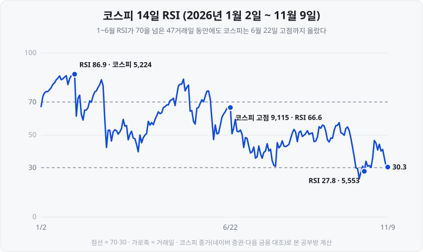

RSI 창을 처음 띄웠을 때는 70을 넘으면 팔고 30 아래면 사는 지표라고만 알았습니다. 같은 날 같은 지수의 RSI가 계산 방식에 따라 30과 38로 다르게 나오고, 70을 넘은 뒤에도 지수가 두 배 넘게 오른 기록을 직접 계산해 보고 나서야 이 숫자를 어떻게 읽어야 하는지 다시 생각하게 됐습니다.

2026년 1월 30일 코스피의 14일 **RSI**는 86.9였습니다. 일반적으로 70을 넘으면 '과매수'로 해석하는데, 이날 코스피 종가 5,224.36은 그 뒤 6월 22일 9,114.55까지 **74.5% 올랐습니다.** 반대로 10월 13일 RSI가 29.9로 30 아래에 내려가 '과매도'가 됐을 때, 코스피 종가 6,035.35는 11월 9일 5,018.85로 16.8% 더 내렸습니다. <mark>보조지표는 지나간 가격으로 계산한 숫자이고, 그 숫자를 매매 신호로 읽는 것은 별개의 해석입니다.</mark>

이 글은 차트 기초 연속 기획의 마지막 편으로, 가장 많이 쓰이는 보조지표 세 가지를 다룹니다. ① **RSI**의 계산식과 과매수·과매도 기준, ② **MACD**의 계산식과 시그널선 교차, ③ **볼린저밴드**의 계산식과 밴드 폭, ④ 2000년 이후 코스피에서 이 지표들의 '신호' 뒤에 지수가 어떻게 움직였는지를 차례로 정리합니다. 예시는 모두 코스피 지수의 실제 일별 종가이며 기준 시점은 **2026년 11월 9일**입니다. 앞선 네 편에서는 [캔들차트](https://blog.naver.com/hdglace/224441041356), [이동평균선](https://blog.naver.com/hdglace/224444441596), [거래량·거래대금](https://blog.naver.com/hdglace/224457486754), [지지선·저항선](https://blog.naver.com/hdglace/224461855004)을 다뤘습니다.

&nbsp;

【보조지표는 가격을 다시 계산한 값입니다】

**보조지표**는 주가·거래량 같은 원자료를 정해진 식으로 다시 계산해 차트 아래나 위에 함께 그리는 값입니다. 새로운 정보를 더하는 것이 아니라, 이미 차트에 있는 종가를 다른 형태로 요약합니다. 이 글의 세 지표는 모두 **종가만으로** 계산합니다.

| 지표 | 만든 사람 | 계산하는 것 | 기본 설정 |
| :-- | :-- | :-- | :-- |
| **RSI** | J. 웰스 와일더(1978년) | 일정 기간 상승폭과 하락폭의 비율 | 14일 |
| **MACD** | 제럴드 아펠(1970년대 후반) | 단기·장기 지수이동평균의 차이 | 12일·26일, 시그널 9일 |
| **볼린저밴드** | 존 볼린저(1980년대) | 이동평균과 그 주변의 표준편차 범위 | 20일, 표준편차 2배 |

세 지표의 기간은 만든 사람이 정한 기본값이며, 대부분의 차트 프로그램에서 바꿀 수 있습니다. 기간을 바꾸면 값도 달라집니다.

&nbsp;

【RSI — 상승폭이 전체 변동폭에서 차지하는 비율】

**RSI**(Relative Strength Index, 상대강도지수)는 일정 기간 종가의 상승폭과 하락폭을 비교한 지표입니다. 0에서 100 사이의 값을 가지며, 그 기간에 오르기만 했으면 100, 내리기만 했으면 0입니다. 같은 이름이지만 종목끼리 비교하는 '상대 강도'가 아니라, 한 종목의 상승폭과 하락폭을 비교한 값입니다.

> RSI = 100 − 100 ÷ (1 + RS), RS = 평균 상승폭 ÷ 평균 하락폭

날마다 종가가 전날보다 오른 만큼을 상승폭, 내린 만큼을 하락폭으로 기록합니다. 오른 날의 하락폭과 내린 날의 상승폭은 0입니다. 2026년 11월 9일까지 14거래일의 기록은 다음과 같습니다.

**표 1. 코스피 일별 상승폭·하락폭 — 2026년 10월 21일 ~ 11월 9일**

| 날짜 | 종가 | 상승폭 | 하락폭 |
| :-- | --: | --: | --: |
| 10월 21일 | 5,735.66 | 182.92 | 0 |
| 10월 22일 | 5,533.77 | 0 | 201.89 |
| 10월 23일 | 5,550.30 | 16.53 | 0 |
| 10월 26일 | 5,469.47 | 0 | 80.83 |
| 10월 27일 | 5,638.34 | 168.87 | 0 |
| 10월 28일 | 6,012.44 | 374.10 | 0 |
| 10월 29일 | 5,937.66 | 0 | 74.78 |
| 10월 30일 | 5,730.74 | 0 | 206.92 |
| 11월 2일 | 5,859.08 | 128.34 | 0 |
| 11월 3일 | 5,648.79 | 0 | 210.29 |
| 11월 4일 | 5,683.80 | 35.01 | 0 |
| 11월 5일 | 5,383.80 | 0 | 300.00 |
| 11월 6일 | 5,059.69 | 0 | 324.11 |
| 11월 9일 | 5,018.85 | 0 | 40.84 |
| **합계** | | **905.77** | **1,439.66** |

(단위: 포인트. 10월 21일 상승폭은 10월 20일 종가 5,552.74와 비교한 값)

14일 동안의 상승폭 합계 905.77과 하락폭 합계 1,439.66을 각각 14로 나눠 평균을 내면 RSI는 다음과 같습니다.

> 평균 상승폭 64.70, 평균 하락폭 102.83 → RSI = 905.77 ÷ (905.77 + 1,439.66) × 100 = **38.62**

그런데 RSI를 만든 와일더의 원래 계산법으로는 같은 날 값이 **30.33**입니다. 와일더 방식은 첫날만 14일 단순평균을 내고, 그다음부터는 전날 평균에 13의 비중을, 오늘 값에 1의 비중을 주어 평균을 갱신합니다.

> 오늘 평균 상승폭 = (전날 평균 상승폭 × 13 + 오늘 상승폭) ÷ 14
> 11월 9일: 평균 상승폭 (53.60 × 13 + 0) ÷ 14 = 49.77, 평균 하락폭 (120.00 × 13 + 40.84) ÷ 14 = 114.34
> RS = 49.77 ÷ 114.34 = 0.435 → RSI = 100 − 100 ÷ 1.435 = **30.33**

이 방식은 [이동평균선 편](https://blog.naver.com/hdglace/224444441596)에서 다룬 **지수이동평균**과 같은 구조여서, 14일보다 오래된 상승·하락도 비중이 점점 줄어들 뿐 계산에서 빠지지 않습니다. 그래서 10월 중순 급락의 하락폭이 11월 9일 평균에도 남아 있고, 단순평균 방식보다 값이 낮게 나옵니다. <mark>같은 날, 같은 14일 기간이라도 평균을 내는 방식에 따라 RSI가 30.33과 38.62로 달라집니다.</mark>

**표 2. 계산 방식별 코스피 14일 RSI — 2026년 10월**

| 날짜 | 종가 | 와일더 방식 | 단순평균 방식 |
| :-- | --: | --: | --: |
| 10월 13일 | 6,035.35 | 29.87 | 30.49 |
| 10월 14일 | 6,008.81 | 29.44 | 22.16 |
| 10월 15일 | 5,554.22 | 23.22 | 12.37 |
| 10월 16일 | 5,668.05 | 27.36 | 16.83 |
| 10월 19일 | 5,768.01 | 30.88 | 18.32 |
| 11월 9일 | 5,018.85 | 30.33 | 38.62 |

10월 19일은 와일더 방식으로는 30을 넘어 과매도 구간을 벗어났지만, 단순평균 방식으로는 18.32로 여전히 과매도 구간에 있습니다. 와일더 방식은 계산을 시작한 날짜에 따라서도 값이 조금씩 달라집니다. 같은 와일더 방식이라도 2026년 9월 1일부터 계산을 시작하면 10월 13일 RSI는 28.23, 8월 3일부터 시작하면 30.25가 나옵니다(이 글의 값은 1996년부터 계산한 것입니다). 계산에 쓴 과거 자료가 짧으면 '30 아래로 내려갔는지'의 판정이 바뀔 수 있다는 뜻입니다. 차트 프로그램의 RSI가 어떤 방식인지는 지표 설정 화면이나 도움말에서 확인합니다.

&nbsp;

【70과 30 — 과매수·과매도의 기준】

와일더는 RSI 70 이상을 **과매수**, 30 이하를 **과매도**로 보았습니다. 짧은 기간에 많이 올라 되돌림이 나올 수 있고, 많이 내려 반등이 나올 수 있다는 해석입니다. 그러나 이 기준은 RSI가 높다는 것, 즉 최근에 오른 날의 상승폭이 컸다는 사실을 다시 말한 것입니다. 상승이 계속되면 RSI는 70 위에 오래 머뭅니다.

(점선 = 70·30 · 가로축 = 거래일 · 와일더 방식 · 코스피 종가(네이버 증권 일별 시세로 수집, 다음 금융과 대조)로 본 공부방 계산)

2026년 코스피 RSI가 70을 넘은 날은 47거래일이었고 모두 1월 5일부터 6월 22일 사이였습니다. 처음 70을 넘은 1월 5일 종가는 4,457.52였고, 지수는 그 뒤 6월 22일 9,114.55로 **104.5% 올랐습니다.** 6월 22일 고점 당일의 RSI는 66.6으로 오히려 70 아래였습니다. <mark>'70을 넘었으니 곧 내린다'는 해석은 2026년 상반기에 맞지 않았습니다.</mark>

과매도도 마찬가지입니다. RSI는 10월 13일 29.87로 30 아래에 내려갔고, 10월 13일부터 20일까지 6거래일 가운데 5거래일이 30 아래였습니다. 그사이 지수는 6,035.35에서 5,552.74로 8.0% 더 내렸습니다. 11월 9일 RSI는 30.33으로 다시 30 부근에 있습니다.

&nbsp;

【MACD — 두 지수이동평균의 차이】

**MACD**(Moving Average Convergence Divergence, 이동평균 수렴·확산 지수)는 12일 **EMA**(Exponential Moving Average, 지수이동평균)에서 26일 EMA를 뺀 값입니다. 단기 평균이 장기 평균보다 위에 있으면 양수, 아래에 있으면 음수입니다. 두 평균이 가까워지는 것을 수렴, 멀어지는 것을 확산이라고 부르는 데서 이름이 나왔습니다.

> MACD = 12일 EMA − 26일 EMA
> 시그널선 = MACD의 9일 EMA
> 히스토그램 = MACD − 시그널선

2026년 11월 9일 코스피로 계산하면 다음과 같습니다. EMA의 계산식은 [이동평균선 편](https://blog.naver.com/hdglace/224444441596)에서 정리했으며, 기간이 N일이면 오늘 값의 비중이 2 ÷ (N + 1)입니다.

**표 3. 코스피 MACD 계산 — 2026년 11월 9일**

| 항목 | 11월 6일 | 11월 9일 | 계산 |
| :-- | --: | --: | :-- |
| 12일 EMA | 5,625.84 | 5,532.45 | 5,625.84 + (5,018.85 − 5,625.84) × 2/13 |
| 26일 EMA | 5,906.06 | 5,840.34 | 5,906.06 + (5,018.85 − 5,906.06) × 2/27 |
| **MACD** | −280.22 | **−307.88** | 12일 EMA − 26일 EMA |
| 시그널선 | −259.92 | −269.51 | −259.92 + (−307.88 + 259.92) × 2/10 |
| 히스토그램 | −20.30 | −38.37 | MACD − 시그널선 |

(단위: 포인트. 반올림으로 끝자리가 맞지 않을 수 있음)

MACD를 해석할 때는 주로 두 가지 교차를 봅니다. MACD가 시그널선을 아래에서 위로 넘으면(히스토그램이 음수에서 양수로) 상승 신호, 위에서 아래로 내려가면 하락 신호로 해석합니다. MACD가 0선을 넘는 것은 12일 EMA와 26일 EMA가 교차했다는 뜻으로, [이동평균선 편](https://blog.naver.com/hdglace/224444441596)의 골든크로스·데드크로스와 같은 내용입니다.

**표 4. 코스피 MACD·시그널선 교차 — 2026년 9~11월**

| 날짜 | 교차 | 종가 | MACD | 시그널선 |
| :-- | :-- | --: | --: | --: |
| 9월 15일 | 시그널선 아래로 | 6,627.26 | 8.06 | 8.61 |
| 9월 21일 | 시그널선 위로 | 7,007.72 | 20.39 | 7.57 |
| 10월 7일 | 시그널선 아래로 | 6,803.90 | 30.65 | 34.35 |
| 10월 29일 | 시그널선 위로 | 5,937.66 | −270.29 | −283.76 |
| 11월 6일 | 시그널선 아래로 | 5,059.69 | −280.22 | −259.92 |

(단위: 포인트)

10월 29일 MACD가 시그널선을 위로 넘은 날 종가는 5,937.66이었고, 6거래일 뒤인 11월 6일 다시 아래로 내려간 날 종가는 5,059.69로 **14.8% 낮았습니다.** 2026년 1월 2일부터 11월 9일까지 MACD와 시그널선은 15차례 교차했습니다. MACD는 이동평균에서 나온 값이므로 [이동평균선 편](https://blog.naver.com/hdglace/224444441596)에서 확인한 후행성도 그대로 갖고 있습니다. <mark>시그널선은 MACD를 한 번 더 평균한 값이어서, 교차는 MACD 자체보다도 늦게 나타납니다.</mark>

MACD 값은 두 평균의 차이를 **포인트(주식이면 원)** 단위로 나타냅니다. 그래서 가격 수준이 다르면 값의 크기도 달라집니다. 코스피 MACD는 2월 12일 220.88(지수 5,522.27의 4.0%), 5월 27일 439.08(지수 8,228.70의 5.3%)이었습니다. 숫자는 두 배 가까이 차이 나지만 지수 대비 비율의 차이는 훨씬 작습니다. <mark>주가가 다른 종목끼리, 또는 같은 종목이라도 가격 수준이 크게 다른 시기끼리 MACD 값을 직접 비교하지 않는 이유입니다.</mark>

&nbsp;

【볼린저밴드 — 이동평균 위아래의 표준편차 범위】

**볼린저밴드**는 20일 이동평균(중심선)과 그 위아래로 20일 종가의 **표준편차** 2배만큼 떨어진 상단선·하단선으로 구성됩니다. 표준편차는 값들이 평균에서 얼마나 흩어져 있는지를 나타내는 통계량입니다. 가격 변동이 크면 표준편차가 커져 밴드가 넓어지고, 변동이 작으면 밴드가 좁아집니다.

> 중심선 = 최근 20거래일 종가의 단순평균
> 상단선 = 중심선 + 2 × 표준편차, 하단선 = 중심선 − 2 × 표준편차

**표 5. 코스피 볼린저밴드 계산 — 2026년 11월 9일**

| 항목 | 값 | 계산 |
| :-- | --: | :-- |
| 계산 구간 | 10월 13일 ~ 11월 9일 | 20거래일 |
| 중심선 | 5,642.48 | 종가 합계 112,849.57 ÷ 20 |
| 표준편차 | 269.78 | 20개 종가와 중심선의 차이로 계산 |
| 상단선 | 6,182.05 | 5,642.48 + 2 × 269.78 |
| 하단선 | **5,102.91** | 5,642.48 − 2 × 269.78 |
| 11월 9일 종가 | 5,018.85 | 하단선보다 84.06 낮음 |

(단위: 포인트. 표준편차는 20으로 나눈 모표준편차 기준. 19로 나누는 표본표준편차를 쓰면 276.79, 하단선은 5,088.89)

&nbsp;

【밴드 밖의 종가는 드물지 않습니다】

통계에서는 값이 정규분포를 따를 때 평균 ±2 표준편차 안에 약 95%가 들어갑니다. 이 때문에 볼린저밴드를 '주가의 95%가 들어가는 범위'로 설명하는 경우가 있습니다. 그러나 존 볼린저는 자신이 정리한 볼린저밴드 규칙에서 "표준편차를 썼다고 해서 통계적 가정을 하지 말라"고 적었습니다. 주가는 정규분포를 따르지 않고 20개라는 표본은 통계적으로 의미를 갖기에 작다는 이유입니다. 같은 규칙은 기본 설정에서 실제로는 자료의 "95%가 아니라 90%"가 밴드 안에 있다고 설명합니다.

코스피로 계산해도 비슷합니다. 2000년 1월 4일부터 2026년 11월 9일까지 6,618거래일 가운데 종가가 상단선 위에 있었던 날은 374일, 하단선 아래에 있었던 날은 393일로, <mark>밴드 밖에 있었던 날이 전체의 11.6%였습니다.</mark> 밴드 안에 있었던 날은 88.4%입니다.

&nbsp;

【밴드를 따라 움직이는 구간】

볼린저는 같은 규칙에서 "밴드에 닿는 것은 신호가 아니다", "추세가 있는 시장에서는 가격이 상단선을 따라 오르고 하단선을 따라 내려갈 수 있다"고 적었습니다. <mark>하단선에 닿았다는 사실만으로 매수 신호가 되지 않는다는 뜻입니다.</mark> 2026년 10월 코스피가 그 예입니다.

**표 6. 코스피 종가와 볼린저밴드 — 2026년 10월**

| 날짜 | 종가 | 하단선 | 종가와 하단선 | 밴드 폭 |
| :-- | --: | --: | :-- | --: |
| 10월 7일 | 6,803.90 | 6,643.19 | 위 | 7.5% |
| 10월 12일 | 6,384.24 | 6,502.26 | **아래** | 10.3% |
| 10월 13일 | 6,035.35 | 6,313.75 | **아래** | 14.4% |
| 10월 14일 | 6,008.81 | 6,164.99 | **아래** | 17.4% |
| 10월 15일 | 5,554.22 | 5,904.43 | **아래** | 23.3% |
| 10월 16일 | 5,668.05 | 5,736.65 | **아래** | 27.0% |
| 10월 26일 | 5,469.47 | 5,049.31 | 위 | 38.8% |

(단위: 포인트. 밴드 폭 = (상단선 − 하단선) ÷ 중심선)

10월 12일부터 16일까지 5거래일 연속 종가가 하단선 아래에 있었습니다. 그사이 하단선도 6,502.26에서 5,736.65로 함께 내려갔습니다. 큰 하락이 표준편차를 키워 밴드가 넓어졌기 때문입니다. 11월 9일 종가 5,018.85는 하단선 아래 첫날인 10월 12일 종가 6,384.24보다 21.4% 낮습니다.

**밴드 폭**(BandWidth, 상단선과 하단선의 차이를 중심선으로 나눈 값)은 변동성의 크기를 비율로 나타냅니다. 10월 7일 7.5%였던 밴드 폭은 10월 26일 38.8%로 5배 넘게 넓어졌습니다. 밴드 폭이 좁아진 상태를 '스퀴즈'라고 부르고 그 뒤 큰 변동이 나올 수 있다고 해석하지만, 밴드 폭은 변동의 크기를 나타낼 뿐 방향은 알려 주지 않습니다. 변동성을 나타내는 다른 지표로는 [VKOSPI 편](https://blog.naver.com/hdglace/224422310544)에서 다룬 변동성지수가 있습니다.

종가가 밴드 안에서 어디쯤 있는지를 하단선 0, 상단선 1 기준으로 나타낸 **%b**도 함께 쓰입니다. 하단선이면 0, 상단선이면 1이고, 11월 9일처럼 하단선 아래에 있으면 −0.08처럼 음수가 됩니다.

&nbsp;

【2000년 이후 코스피에서 '신호' 뒤에 일어난 일】

과매수·과매도와 교차를 매매 신호로 읽는 해석이 코스피에서 어떻게 나타났는지 확인하기 위해, 2000년 1월 4일부터 2026년 10월 12일까지 6,598거래일에 대해 각 조건이 성립한 날부터 20거래일 뒤의 지수 변화를 계산했습니다. 10월 12일은 20거래일 뒤의 종가(11월 9일)가 있는 마지막 날입니다.

**표 7. 조건별 코스피 20거래일 뒤 등락률 — 2000년 1월 ~ 2026년 10월**

| 조건 | 해당일 수 | 평균 등락률 | 20거래일 뒤 지수가 오른 비율 |
| :-- | --: | --: | --: |
| 전체 거래일 | 6,598일 | +0.77% | 56.5% |
| RSI 70 초과(과매수) | 597일 | +2.33% | 60.0% |
| RSI 30 미만(과매도) | 217일 | +2.59% | 69.1% |
| 종가가 볼린저밴드 상단선 위 | 374일 | +1.56% | 59.4% |
| 종가가 볼린저밴드 하단선 아래 | 387일 | +0.96% | 56.8% |
| MACD가 시그널선을 위로 넘은 날 | 248일 | +0.92% | 59.7% |
| MACD가 시그널선을 아래로 내려간 날 | 249일 | +0.55% | 55.0% |

(RSI는 와일더 방식 14일. 등락률은 코스피 종가 기준이며 배당·거래비용 미반영)

표 7에서 확인되는 것은 다음과 같습니다.

- **과매수(RSI 70 초과) 뒤에도 지수는 평균적으로 올랐습니다.** 20거래일 뒤 평균 등락률 +2.33%는 전체 거래일 평균 +0.77%보다 높았습니다. <mark>'과매수 뒤에는 하락한다'는 해석을 뒷받침하는 결과는 이 기록에 없었습니다.</mark>
- **상단선 위로 올라간 날도 마찬가지였습니다.** +1.56%로 전체 평균보다 높았습니다. 볼린저의 규칙대로 밴드 밖의 종가는 반전보다 지속에 가까웠습니다.
- **과매도(RSI 30 미만) 뒤의 평균 +2.59%, 상승 비율 69.1%는 전체보다 높았습니다.** 다만 해당일 217일은 서로 붙어 있는 날이 많고(30 아래로 새로 내려간 날은 82일), 20거래일 구간이 겹치므로 독립된 217번의 결과가 아닙니다. 또 2008년(31일)처럼 특정 해에 몰려 있어 그 시기의 반등이 평균에 크게 반영됩니다.
- **MACD 교차는 위·아래 어느 방향이든 전체 평균과의 차이가 작았습니다.**

이 계산은 코스피 지수 하나에 대해 지나간 기간을 집계한 것이며, 통계적 유의성 검증이나 거래비용을 반영한 수익률 계산이 아닙니다. 개별 종목이나 다른 기간에 같은 결과가 나온다는 근거도 아닙니다. 그래서 <mark>「RSI가 30 아래이니 사고, 70을 넘었으니 팔라」는 식으로 보조지표를 매매 신호로 쓸 근거는 이 기록에서 찾을 수 없었습니다.</mark>

&nbsp;

【보조지표를 볼 때 확인할 것】

- **설정값**: 기간(14일·12·26·9일·20일)과 배수(2배)는 기본값이며 바꿀 수 있습니다. 다른 사람이 말하는 지표 값과 내 차트의 값을 비교할 때는 설정부터 맞춥니다.
- **계산 방식**: RSI는 평균 방식에 따라, 볼린저밴드는 표준편차 계산 방식에 따라 값이 다릅니다. 11월 9일 코스피 RSI는 30.33과 38.62로 달랐습니다.
- **원자료**: 개별 종목은 차트가 정규장 기준인지 애프터마켓 체결분까지 포함하는지에 따라 종가가 달라질 수 있습니다. 이 차이는 [지지선·저항선 편](https://blog.naver.com/hdglace/224461855004)에서 확인했습니다. 종가가 다르면 세 지표의 값도 모두 달라집니다.
- **서로 겹치는 정보**: 세 지표는 모두 같은 종가에서 계산합니다. 볼린저는 규칙에서 "모멘텀 지표 두 개가 하나보다 낫지 않다"고 적었습니다. 지표의 수를 늘려도 새 정보가 늘어나는 것은 아닙니다.

&nbsp;

【정리】

- **보조지표는 이미 차트에 있는 종가를 다시 계산한 값입니다.** RSI·MACD·볼린저밴드는 모두 종가만으로 계산합니다.
- **RSI는 일정 기간 상승폭이 전체 변동폭에서 차지하는 비율입니다.** 2026년 11월 9일 코스피 14일 RSI는 와일더 방식 30.33, 단순평균 방식 38.62였습니다.
- **70·30 기준과 실제 움직임은 달랐습니다.** 2026년 1~6월 RSI가 70을 넘은 47거래일 동안 코스피는 1월 5일 4,457.52에서 6월 22일 9,114.55까지 올랐습니다.
- **MACD는 12일 EMA와 26일 EMA의 차이입니다.** 시그널선 교차는 이동평균을 두 번 거친 값이라 늦게 나타나고, 10월 29일 교차 뒤 6거래일 만에 반대 교차가 나왔습니다.
- **볼린저밴드는 20일 이동평균 ±2 표준편차입니다.** 2000년 이후 코스피 종가의 11.6%가 밴드 밖에 있었고, 10월 12~16일에는 5거래일 연속 하단선 아래에 있었습니다.
- **2000년 이후 코스피에서 과매수 뒤의 20거래일 평균 등락률은 +2.33%로 전체 평균보다 높았습니다.** 과매수를 하락 신호로 읽을 근거는 확인되지 않았습니다.

&nbsp;

【다음 편에서는】

다음 공부방 글에서는 **엑셀·구글 시트로 주가 불러오는 법 — 현재가·일별 시세 자동으로 가져오기**를 다룹니다. 엑셀의 웹 데이터 가져오기, 구글 시트의 GOOGLEFINANCE·IMPORTXML 함수로 국내 종목 시세를 실제로 불러와 보고, 무엇이 되고 무엇이 안 되는지를 정리하겠습니다.

&nbsp;

【🔗 함께 보면 좋은 글】

- [캔들차트 보는 법 — 시가·고가·저가·종가와 양봉·음봉](https://blog.naver.com/hdglace/224441041356)
- [이동평균선 보는 법 — 5·20·60·120일선과 골든크로스](https://blog.naver.com/hdglace/224444441596)
- [거래량·거래대금 보는 법 — 주가와 함께 읽어야 하는 이유](https://blog.naver.com/hdglace/224457486754)
- [지지선·저항선 보는 법 — 전고점·박스권과 추세선](https://blog.naver.com/hdglace/224461855004)
- [VKOSPI·VIX 뜻과 읽는 법 — 공포지수 40은 하루 몇 % 움직임인가](https://blog.naver.com/hdglace/224422310544)
- [과거 주가 데이터 받는 법 — KRX 엑셀·CSV 다운로드와 Open API](https://blog.naver.com/hdglace/224404481437)

&nbsp;

【📊 데이터 출처 및 기준일】

- **코스피 일별 종가(1996년 1월 3일 ~ 2026년 11월 9일)**: 네이버 증권 일별 시세(코스피 지수), **2026년 11월 10일 수집**. 2025년 8월 이후 300거래일의 종가를 다음 금융 일별 지수 시세와 대조해 모두 일치함을 확인했습니다. 표 1~7과 그래프의 RSI·MACD·볼린저밴드 값은 이 자료로 본 공부방이 계산했습니다. 와일더 방식 RSI와 EMA는 1996년 자료부터 계산을 시작했습니다.
- **RSI 정의·계산식·70/30 기준**: J. Welles Wilder Jr., *New Concepts in Technical Trading Systems*(1978). 계산식과 기준은 StockCharts ChartSchool 「Relative Strength Index (RSI)」 항목(2026년 11월 10일 확인)의 설명을 따랐습니다.
- **MACD 정의·계산식·가격 수준에 따른 값 차이**: StockCharts ChartSchool 「MACD (Moving Average Convergence/Divergence Oscillator)」 항목, 2026년 11월 10일 확인. 개발자 제럴드 아펠(Gerald Appel), 1970년대 후반 개발.
- **볼린저밴드 규칙**: John Bollinger, 「Bollinger Band Rules」(bollingerbands.com), 2026년 11월 10일 확인. 기본 설정(20일·2배), 밴드 접촉은 신호가 아니라는 규칙(6번), 밴드를 따라 움직이는 추세(7번), 통계적 가정을 하지 말라는 규칙과 "95%가 아니라 90%"(14번), 밴드 폭(18·19번), 모멘텀 지표 중복(4번)을 인용했습니다. 이 글의 표준편차는 모표준편차(20으로 나눔)로 계산했으며, 규칙 원문은 모표준편차·표본표준편차 중 무엇을 쓰는지 밝히지 않습니다.
- **조건별 20거래일 뒤 등락률(표 7)**: 위 코스피 일별 종가로 본 공부방이 계산. 조건이 성립한 날의 종가와 20거래일 뒤 종가를 비교했고, 배당과 거래비용은 반영하지 않았습니다.

*이 글은 RSI·MACD·볼린저밴드의 계산 방법과 해석의 한계를 정리한 정보성 콘텐츠이며, 보조지표를 매매 판단의 근거로 권유하지 않습니다. 본문의 코스피 수치는 계산 과정을 설명하기 위한 실제 시세 예시이며, 향후 지수 전망이 아닙니다. 과거 기간의 집계 결과는 미래의 결과를 보장하지 않습니다. 특정 종목이나 상품의 매수·매도를 권유하지 않습니다. 본문의 수치는 위 기준일 시점의 값이며, 최신 시세는 한국거래소 등 원 출처에서 확인하시기 바랍니다. 모든 투자 판단과 책임은 투자자 본인에게 있습니다.*

&nbsp;

#RSI #RSI뜻 #MACD #MACD뜻 #볼린저밴드 #보조지표 #과매수 #과매도 #시그널선 #기술적분석 #주식차트기초 #코스피 #주식초보 #투자공부 #재테크
