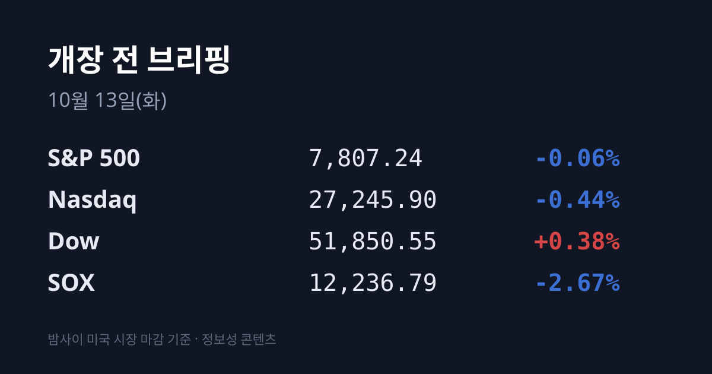
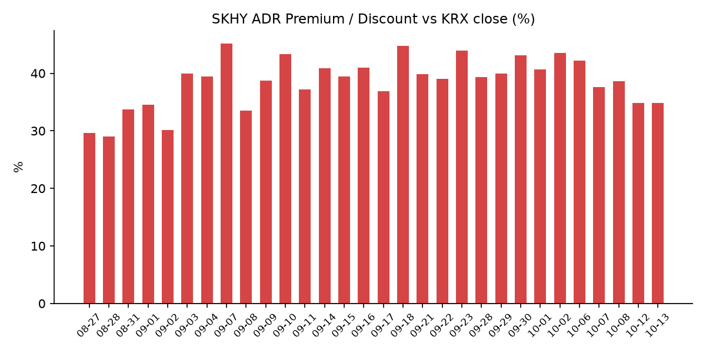
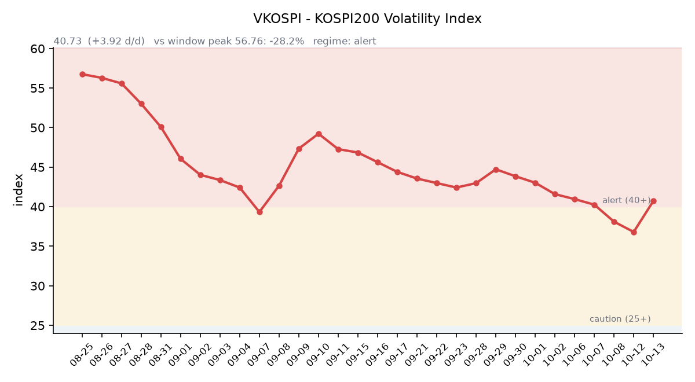

&nbsp;

【① 30초 요약 📈】

<mark>필라델피아 반도체 지수(SOX)는 −2.67%로 4거래일 연속 내렸습니다.</mark> 중국 창신메모리(CXMT)가 차세대 D램 설계 기술에 진전을 이뤘고 연내 서버용 메모리 제품을 선보일 계획이라는 보도가 나왔고, 마이크론은 −3.88%였습니다.

미국 지수는 엇갈렸습니다. 다우는 +0.38%로 3일 연속 올랐고, S&P500은 −0.06%, 나스닥은 −0.44%였습니다. 10/12는 콜럼버스데이로 미국 채권시장이 쉬었습니다.

SK하이닉스 ADR(SKHY)은 $162.23(−4.02%)이었고, 괴리율은 **+34.85%로 전일과 같았습니다.**

10/12 코스피는 외국인 2조182억원 순매도 속에 6,384.24(−3.65%)로 마감해 4거래일 동안 −8.85% 내렸습니다. 코스닥은 849.19(−4.83%)였습니다.

VKOSPI는 40.73(+10.65%)으로 7거래일 연속 하락이 끊기며 '경보'(40~60) 구간으로 돌아왔습니다.

&nbsp;

【② 밤사이 미국 시장 🌙】

| 지수 | 10/12 종가 | 등락 |
| :--- | ---: | ---: |
| S&P 500 | 7,807.24 | −0.06% |
| 나스닥 종합 | 27,245.90 | −0.44% |
| 다우 | 51,850.55 | +0.38% |
| 필라델피아 반도체(SOX) | 12,236.79 | −2.67% |

반도체 지수는 4거래일 연속 내려 3주 만의 최저로 마감했고, 지수 구성 30종목이 모두 내렸습니다. 국내외 매체들은 중국 CXMT가 메모리 셀 면적을 줄여 집적도를 높이는 차세대 D램 설계 기술에 진전을 이뤘고, 관련 서버용 메모리 제품을 연내 선보일 계획이라는 보도를 하락 배경으로 꼽았습니다. 다만 이 보도가 곧 HBM 경쟁력을 대체한다는 뜻은 아니며 양산 능력·수율·고객사 확보는 따로 검증이 필요하다는 지적도 함께 나왔습니다. 카운터포인트리서치 집계로 CXMT의 2분기 D램 매출 점유율은 10%로, 분기 기준 처음 두 자릿수에 올랐습니다(파이낸셜뉴스 인용).

<mark>메모리 종목이 가장 크게 내렸습니다.</mark> 마이크론은 **$989.04(−3.88%)**, SKHY는 −4.02%, 인텔은 −3.20%, 브로드컴은 −1.91%, 엔비디아는 $226.32(−1.29%), TSMC ADR은 $444.35(−1.98%)였습니다. 지난주 OpenAI 매출 추정치 보도 이후의 AI 투자 회수 논란도 이어졌고, 미국 투자 매체 모틀리풀은 엔비디아 칩을 대규모로 쓰는 호주 AI 데이터센터 업체 Firmus가 약 50억 달러 규모의 기업공개를 철회한 일을 짚었습니다. 반면 메타는 새 AI 모델 공개에 +3.38%, 세일즈포스는 뱅크오브아메리카의 투자의견 상향에 +2.09%, 마이크로소프트는 자체 AI 칩 계획 발표에 +1.1% 올라 시가총액 4조 달러를 넘었습니다.

10/12 장 마감 뒤 주요 기업 실적 발표는 없었습니다. 마이크론 시간외 가격은 $983.36(−0.57%)입니다. 한국 시각 10/13 07:07 기준 미국 지수선물은 S&P500 +0.03%, 나스닥100 −0.01%입니다.

미국 채권시장은 10/12 휴장해 국채 금리는 10/09 값이 최신입니다. 미 재무부 기준 10년물 5.24%, 30년물 5.60%, 2년물 4.80%, 10년물 실질금리(TIPS) 2.91%이고, 10년물과 2년물의 차이는 0.44%p입니다. 클리블랜드 연은 베스 해맥 총재는 인플레이션 대응을 위해 "비교적 빨리" 긴축 쪽으로 움직여야 한다고 말했고, CME 페드워치 기준 10월 회의 금리 인상 확률은 약 22%로 직전 17.7%보다 올라갔습니다. VIX는 15.21(+2.49%), 달러인덱스는 한국 시각 07:05 기준 102.57(+0.35%)입니다.

후티 반군의 사우디 공격이 이어지면서 브렌트유는 **$106.65(+1.84%)**, WTI는 $93.74(+2.06%)로 3일 연속 올랐습니다. 같은 날 트럼프 대통령은 러시아 디젤 수출 확대와 러시아·우크라이나 간 에너지 시설 공격 중단 합의를 발표했습니다. 한국석유공사 최신치(10/09 기준) 두바이유는 $108.50입니다. 금 12월물은 $4,190.6(−0.61%)으로 내렸고, 같은 날 달러인덱스는 올랐습니다.

&nbsp;

【③ 괴리율 트래커 — SK하이닉스 ADR】

| 항목 | 수치 |
| :--- | ---: |
| SKHY 종가 (10/12) | $162.23 (−4.02%) |
| 본주 환산가 (×10×환율 1,334.13원) | 2,164,359원 |
| 본주 직전 종가 (10/12) | 1,605,000원 |
| **괴리율** | **+34.8%** |

10/12 한국 본주는 −4.52%, 미국 SKHY는 −4.02%로 같은 날 비슷한 폭으로 내렸고, 그사이 원/달러가 1,341원대에서 1,334원대로 내려와 환산가를 낮췄습니다. 그 결과 괴리율은 전일 +34.85%에서 **+34.85%로** 변화가 없었습니다. SKHY 시간외 가격은 $161.84(−0.24%)입니다.

괴리율은 미국에 상장된 예탁증서(ADR) 가격을 본주 1주 기준으로 환산한 값과 한국 본주 종가를 비교한 수치입니다. 환산가가 본주보다 높은 프리미엄 상태에서는 전환 차익거래 구조상 본주 쪽에 매수 유인이 생기고, 디스카운트면 반대입니다. 오늘 값은 이 트래커 59거래일 기록에서 36위로 중하위권이며, 전 구간 1위는 07/31의 +62.0%입니다.

한국 시장 전체를 담는 EWY(iShares MSCI South Korea ETF)는 $170.11(−4.02%)로, 같은 날 코스피(−3.65%)보다 약 0.4%포인트 더 내렸습니다. 시간외 가격은 $170.12입니다.

&nbsp;

【④ 변동성 트래커 🌡️】

**판정 한 줄**: <mark>'주의'에서 하루 만에 '경보'로 — VKOSPI가 +10.65% 뛰어 40.73이 됐고, 인버스 레버리지 ETF 회전율도 70%대로 올라섰습니다.</mark>

**기대 변동성**  VKOSPI **40.73**(10/12, 전일비 +3.92, +10.65%)으로 '경보'(40~60) 구간입니다. 직전까지 7거래일 연속 내렸던 흐름이 끊겼으며, 6월 고점 96.94 대비 −58.0%, 평시 상단인 25의 1.63배입니다.

**실현 변동성**  최근 5거래일 코스피 일별 등락률은 10/02 +0.46%, 10/06 −0.89%, 10/07 −1.98%, 10/08 −2.62%, 10/12 −3.65%로 4거래일 연속 하락했고 낙폭이 날마다 커졌습니다. 최근 10거래일 중 ±3% 이상 등락일은 10/12 하루입니다. 10/12 코스피는 6,578.17로 내려 출발해 장중 6,368.49까지 밀렸습니다. 코스닥 −4.83%는 7/29(−6.12%) 이후 가장 큰 하락률입니다.

**증폭 경로**  전체 ETF 거래대금 중 레버리지 ETF 비중은 **20.67%로** 직전(19.33%)보다 올라갔습니다. KODEX 레버리지 1조8,523억원(회전율 37.72%), KODEX 200선물인버스2X 6,354억원(70.80%), KODEX 코스닥150레버리지 5,458억원(16.90%), KODEX 반도체레버리지 3,550억원(31.31%), TIGER 반도체TOP10레버리지 1,861억원(32.09%) 순입니다(네이버 ETF 목록, 10/13 07:17 스냅샷). 인버스2X 회전율은 직전 50.27%에서 70.80%로 높아졌습니다. 선물 베이시스는 +3.33(선물 1,008.25 − 현물 1,004.92)으로 직전 +3.73보다 좁혀졌습니다.

**청산 압력**  신용융자 잔고와 10월 반대매매 일별 금액은 이번에 최신치를 확인하지 못했습니다.

**하방 포지션**  공매도 순잔고는 T+2~3 공시 지연이 있어 개장 전 시점에는 확정치를 알 수 없습니다.

*미확인: 신용융자 잔고 최신치, 10월 반대매매 일별 금액, 공매도 순잔고 최신치, 오늘 개장 직전 밤의 코스피200 야간선물(한국거래소가 다음 날 아침 공개), DRAM·NAND 당일 현물가.*

&nbsp;

【⑤ 직전 거래일(10/12) 한국장 리뷰 📊】

| 지수 | 종가 | 등락 |
| :--- | ---: | ---: |
| 코스피 | 6,384.24 | −241.69 (−3.65%) |
| 코스닥 | 849.19 | −43.08 (−4.83%) |

코스피에서 <mark>외국인은 2조182억원을 순매도해 10거래일 연속 매도</mark>했고, 기관은 1,338억원 순매도, 개인은 1조4,857억원 순매수였습니다(핀포인트뉴스, 한국거래소 기준). 외국인 순매도 상위는 SK하이닉스 1조38억원, 삼성전자 5,552억원, SK스퀘어 2,219억원, LG이노텍 869억원입니다. 코스닥에서는 기관 2,196억원, 외국인 145억원 순매도, 개인 2,325억원 순매수였습니다. 코스피는 종가 기준 8월 11일 이후 처음으로 6,400선 아래에서 마감했습니다(뉴스핌).

삼성전자는 **250,500원(−4.39%)**, SK하이닉스는 1,605,000원(−4.52%)으로 마감했습니다. 매체들은 삼성전자의 3분기 역대급 실적과 반도체 수출 호조에도 OpenAI 매출 추정치를 둘러싼 논란, 중국 메모리 업체의 점유율 확대 전망, 미국 장기 금리 부담, 이어지는 외국인 매도를 하락 이유로 꼽았습니다. 신한투자증권은 옵션 만기와 ETF 리밸런싱 영향으로 코스피가 8월 이후 상승 추세의 하단을 벗어났다고 분석했습니다(이투데이).

같은 날 관세청이 발표한 10월 1~10일 수출은 261억 달러로 1년 전보다 102.0% 늘어 같은 기간 기준 가장 많았습니다. 반도체 수출은 122억 달러(+170.9%)로 전체의 46.7%였고, 조업일수 차이를 뺀 일평균 수출은 47억5천만 달러(+28.5%)였습니다. 수입은 223억 달러(+65.5%), 무역수지는 38억 달러 흑자입니다.

그 밖에 SK스퀘어 −6.29%, 삼성전기 −3.82%, 삼성SDI −1.41%, 현대차 −1.39%, LG에너지솔루션 −0.75%였습니다. 코스닥에서는 리노공업 −11.15%, 심텍 −10.36%, 에코프로비엠 −10.25%, 레인보우로보틱스 −8.86%, 에코프로 −8.49%, 주성엔지니어링 −5.42% 등 반도체 부품·장비, 2차전지, 로봇 종목이 함께 크게 내렸습니다(비즈니스코리아). 오후 1시 장중 업종 기준으로는 기계·장비(−6.06%), 통신(−4.42%), 건설(−4.18%)이 약했고 운송·창고(+2.58%)와 음식료·담배(+0.72%)는 올랐습니다(이투데이).

원/달러는 서울 외환시장 주간 마감 기준 1,335.1원으로, 장중 1,333.2원까지 내려 2024년 10월 4일 이후 가장 낮았습니다(비즈니스코리아). 한국 시각 10/13 07:15 기준 환율은 1,334.13원, 달러/엔은 158.60입니다.

아시아 증시 10/12 종가는 상하이종합 3,797.24(−0.43%), CSI300 4,287.98(−0.68%), 항셍 24,271.20(+0.25%), 대만 가권 49,301.96(−0.02%)입니다. 일본은 10/12 휴장했고, 오늘(10/13) 다시 열립니다.

&nbsp;

【⑥ 오늘의 캘린더 & 관전 포인트 📅】

**오늘(10/13 화)** — 엘리스그룹 납입(공모가 90,500원). 래블업·엠에스바이오 공모 청약 마감. 일본 증시 연휴 뒤 개장. 미국 9월 NFIB 소기업 낙관지수. <mark>미국 대형 은행 3분기 실적(JP모건·골드만삭스·씨티·웰스파고)</mark>. 미국 채권시장 재개장.

**10/14(수)** — 모건스탠리·뱅크오브아메리카 실적. **21:30 미국 9월 CPI.** 중국 9월 물가·무역 지표. ASML 3분기 실적(10/14~15, 공식 일정 미확인). 10/15 03:00 연준 베이지북.

**10/15(목)** — 21:30 미국 9월 PPI·소매판매. **10/16 03:00 TSMC 3분기 실적**(회사 가이던스 매출 446억~458억 달러).

**10/16(금)** — 한국 9월 수출입물가지수. 미국 9월 산업생산.

**10/20~21** 티앤이코리아·크리에이츠 공모 청약, **10/22** 한국은행 금통위, **10/27** SK하이닉스 3분기 실적, **10/27~28** FOMC, **10/30** 일본은행 회의.

시장 참가자들이 주시하는 레벨은 코스피 6,300선, SK하이닉스 1,550,000원 선, 원/달러 1,350원 선, VKOSPI 45 선, 브렌트유 110달러 선입니다.

&nbsp;

【⑦ 정책 워치 ⚡】

후티 반군의 사우디아라비아 공격이 이어졌고, 미국 매체들은 이를 10/12 유가 상승의 배경으로 전했습니다. 같은 날 트럼프 대통령은 러시아의 디젤 수출 확대와 러시아·우크라이나 간 에너지 시설 공격 중단 합의를 발표했습니다. 미·중, 북한 관련으로는 새 동향이 없었습니다.

공매도는 전면 재개 상태이며 10월 제도 변경 사항은 없었습니다.

&nbsp;

【⑧ 오늘의 질문 ❓】

수출이 역대 최대를 기록한 날 반도체 대형주가 4% 넘게 내린 가운데, 중국 CXMT의 D램 기술 진전 보도는 메모리 경쟁 구도를 바라보는 시각을 얼마나 바꾸는가.

&nbsp;

#개장전브리핑 #미국증시마감 #하이닉스ADR #괴리율 #반도체 #마이크론 #창신메모리 #VKOSPI #코스피 #외국인순매도

&nbsp;

*본 글은 공개된 시장 데이터를 정리한 정보성 콘텐츠이며, 특정 종목·상품의 매매 권유가 아닙니다. 모든 투자 판단과 책임은 투자자 본인에게 있습니다. 수치는 작성 시점 기준이며 이후 변동될 수 있습니다.*