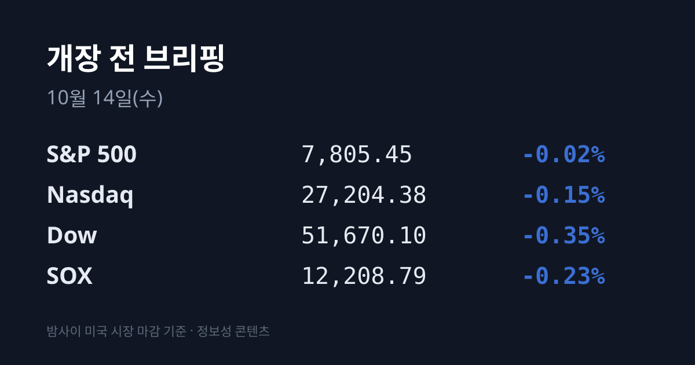
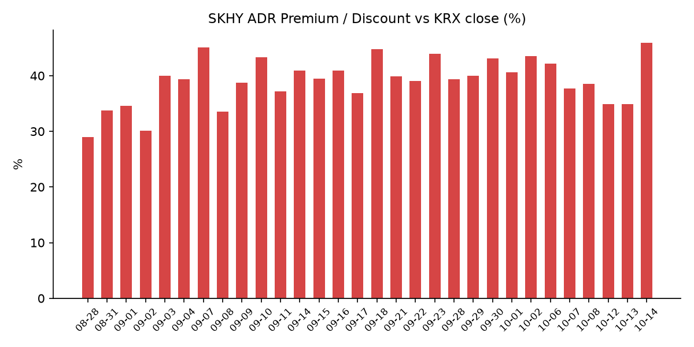
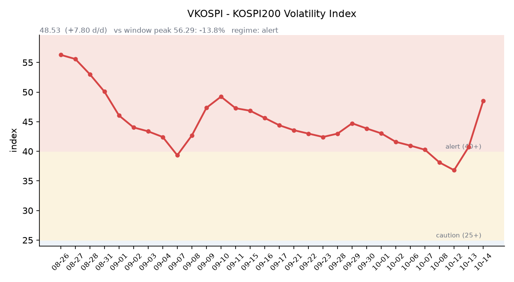

&nbsp;

【① 30초 요약 📈】

<mark>10/13 코스피는 6,035.35(−5.46%)로 5거래일 연속 내렸고, 09:47 매도 사이드카가 발동했습니다.</mark> 외국인은 4조5,259억원을 순매도했고, 그중 82%가 삼성전자·SK하이닉스에 몰렸습니다.

SK하이닉스는 1,443,000원(−10.09%), 삼성전자는 232,000원(−7.39%)이었습니다. 중국 CXMT의 차세대 서버용 D램 출시 계획 보도와 자사주 매입 종료가 배경으로 꼽혔습니다.

밤사이 미국 지수는 보합권이었고(S&P500 −0.02%, 나스닥 −0.15%), 반도체 지수(SOX)는 −0.23%였습니다. 마이크론은 −3.62%로 이틀째 내렸고 엔비디아는 +0.97%였습니다.

SKHY는 **−3.19%에 그쳐** 괴리율이 전일 +34.85%에서 +45.86%로 벌어졌습니다. 08/18 이후 가장 높은 값입니다.

VKOSPI는 48.53(+19.15%)으로 이틀 연속 급등했습니다. 오늘 밤 21:30 미국 9월 소비자물가(CPI)가 발표됩니다.

&nbsp;

【② 밤사이 미국 시장 🌙】

| 지수 | 10/13 종가 | 등락 |
| :--- | ---: | ---: |
| S&P 500 | 7,805.45 | −0.02% |
| 나스닥 종합 | 27,204.38 | −0.15% |
| 다우 | 51,670.10 | −0.35% |
| 필라델피아 반도체(SOX) | 12,208.79 | −0.23% |

미국 3대 지수는 모두 소폭 내렸습니다. 다우는 장중 약 729포인트 범위를 오갔습니다. 반도체 지수는 5거래일 연속 내렸지만 장중 저점 11,861.28에서 상당 부분 회복해 −0.23%로 마감했습니다.

<mark>메모리 종목은 이틀째 약했습니다.</mark> 마이크론은 **$953.19(−3.62%)로** S&P500 하락에 가장 크게 기여한 종목이었고(AP), 장중에는 −5%대까지 밀렸습니다. 샌디스크·씨게이트·웨스턴디지털도 장중 내렸습니다. 매체들은 한국 증시 급락과 함께, 중국 CXMT가 업계 선두를 위협할 수 있다는 보도를 배경으로 전했습니다. 반면 엔비디아는 $228.52(+0.97%), TSMC ADR은 $445.12(+0.17%)로 올랐습니다.

대형 은행 3분기 실적은 엇갈렸습니다. JP모건은 주당순이익 $5.57로 예상치($5.90)에 못 미쳤지만 이번 분기 순이자이익 전망은 예상을 웃돌았고, 주가는 −0.9%였습니다. 골드만삭스는 이익이 예상을 넘어 장 초반 4% 넘게 올랐다가 −0.2%로 마감했고, 웰스파고는 순이자이익이 예상에 못 미쳐 −3.1%였습니다. 유나이티드헬스는 연간 이익 전망을 올려 +3%, 범블은 13억 달러 규모 인수 합의에 +56.6%였습니다.

10/13 장 마감 뒤 주요 기업 실적 발표는 확인되지 않았습니다. 시간외 가격은 마이크론 $955.00(+0.19%), 엔비디아 $228.90(+0.17%)입니다. 한국 시각 10/14 07:07 기준 미국 지수선물은 S&P500 −0.01%, 나스닥100 −0.03%입니다.

미국 채권시장은 연휴 뒤 다시 열렸고, 미 재무부 기준 10/13 10년물은 5.21%(−3bp), 30년물 5.56%(−4bp), 2년물 4.79%(−1bp), 10년물 실질금리(TIPS)는 2.88%(−3bp)입니다. 10년물과 2년물의 차이는 0.42%p입니다. 연방기금 선물 기준 10월 회의 금리 인상 확률은 약 19.5%로 1주 전(24.1%)보다 낮아졌습니다(investing.com). VIX는 15.27(+0.39%), 달러인덱스는 한국 시각 07:05 기준 **102.22(−0.36%)입니다.**

브렌트유는 $105.69(−0.90%)로 내렸고 WTI는 $94.14(+0.43%)로 올랐습니다. 한국석유공사 10/13 기준 두바이유는 $108.75로 브렌트보다 3.06달러 높습니다. 금 12월물은 10/13 약 $4,177로 소폭 내렸고, 같은 날 실질금리와 달러인덱스도 함께 내렸습니다.

&nbsp;

【③ 괴리율 트래커 — SK하이닉스 ADR】

| 항목 | 수치 |
| :--- | ---: |
| SKHY 종가 (10/13) | $157.06 (−3.19%) |
| 본주 환산가 (×10×환율 1,340.13원) | 2,104,808원 |
| 본주 직전 종가 (10/13) | 1,443,000원 |
| **괴리율** | **+45.9%** |

10/13 한국 본주는 −10.09% 내린 반면 미국 SKHY는 −3.19%에 그쳤습니다. 두 시장의 하락폭 차이가 그대로 반영돼 괴리율은 전일 +34.85%에서 **+45.86%로** 11%포인트 벌어졌습니다. SKHY 시간외 가격은 $157.56(+0.32%)입니다.

괴리율은 미국에 상장된 예탁증서(ADR) 가격을 본주 1주 기준으로 환산한 값과 한국 본주 종가를 비교한 수치입니다. 환산가가 본주보다 높은 프리미엄 상태에서는 전환 차익거래 구조상 본주 쪽에 매수 유인이 생기고, 디스카운트면 반대입니다. 오늘 값은 이 트래커 60거래일 기록에서 4위로, 08/18(+47.7%) 이후 가장 높습니다. 전 구간 1위는 07/31의 +62.0%입니다.

한국 시장 전체를 담는 EWY(iShares MSCI South Korea ETF)는 $166.56(−2.09%)였고, 시간외 가격은 $166.91입니다. 10/13 코스피가 시가 6,186.08에서 종가 6,035.35까지 밀린 폭(약 −2.4%)과 비슷한 크기입니다.

&nbsp;

【④ 변동성 트래커 🌡️】

**판정 한 줄**: <mark>'경보' 구간 안에서 악화 — VKOSPI가 이틀 새 40.73에서 48.53으로 뛰었고, 인버스 2배 ETF 회전율은 97%까지 올라갔습니다.</mark>

**기대 변동성**  VKOSPI **48.53**(10/13, 전일비 +7.80, +19.15%)으로 '경보'(40~60) 구간입니다. 장중에는 51.57까지 올랐습니다. 이틀 동안 36.81에서 48.53으로 높아졌으며, 6월 고점 96.94 대비 −49.9%, 평시 상단인 25의 1.94배입니다.

**실현 변동성**  최근 6거래일 코스피 일별 등락률은 10/02 +0.46%, 10/06 −0.89%, 10/07 −1.98%, 10/08 −2.62%, 10/12 −3.65%, 10/13 −5.46%로 5거래일 연속 하락했고 낙폭이 날마다 커졌습니다. 10/02 종가 7,003.74 대비 5거래일 누적 −13.83%입니다. 최근 10거래일 중 ±3.5% 이상 등락일은 10/12·10/13 이틀입니다. 10/13 코스피는 6,186.08로 내려 출발해 장중 5,911.11까지 밀렸고, 6,000선을 장중에 밑돈 것은 7/31 이후 처음입니다. −5.46%는 8/19(−5.80%) 이후 가장 큰 하락률입니다.

**매매 정지**  10/13 09:47 유가증권시장에 **매도 사이드카**가 발동했습니다(한국거래소 KIND 시장운영 공시). 8/19 이후 약 두 달 만입니다.

**증폭 경로**  전체 ETF 거래대금 중 레버리지 ETF 비중은 **22.64%로** 직전(20.67%)보다 올라갔습니다. KODEX 레버리지 2조3,385억원(회전율 53.23%), KODEX 200선물인버스2X 9,941억원(97.35%), KODEX 코스닥150레버리지 8,007억원(25.28%), KODEX 반도체레버리지 5,671억원(54.52%), KODEX SK하이닉스단일종목레버리지 4,304억원(30.54%) 순입니다(네이버 ETF 목록, 10/14 07:17 스냅샷). 인버스2X 회전율은 직전 70.80%에서 97.35%로 높아졌습니다. 선물 베이시스는 +2.73(선물 944.80 − 현물 942.07)으로 직전 +3.33보다 좁혀졌습니다.

**청산 압력**  신용융자 잔고와 10월 반대매매 일별 금액은 이번에 최신치를 확인하지 못했습니다. 파이낸셜뉴스 집계로 개인은 최근 5거래일 동안 KODEX 레버리지를 8,489억원 순매수했습니다.

**하방 포지션**  공매도 순잔고는 T+2~3 공시 지연이 있어 개장 전 시점에는 확정치를 알 수 없습니다.

*미확인: 신용융자 잔고 최신치, 10월 반대매매 일별 금액, 공매도 순잔고 최신치, 오늘 개장 직전 밤의 코스피200 야간선물(한국거래소가 다음 날 아침 공개), DRAM·NAND 당일 현물가.*

&nbsp;

【⑤ 직전 거래일(10/13) 한국장 리뷰 📊】

| 지수 | 종가 | 등락 |
| :--- | ---: | ---: |
| 코스피 | 6,035.35 | −348.89 (−5.46%) |
| 코스닥 | 837.03 | −12.16 (−1.43%) |

코스피에서 <mark>외국인은 4조5,259억원을 순매도</mark>했습니다. 7/28(4조5,261억원) 이후 가장 큰 규모이며 6거래일 연속 매도입니다. 개인은 2조2,271억원, 기관은 1조6,903억원을 순매수했습니다(파이낸셜뉴스·서울신문, 매체에 따라 외국인 4조5,128억~4조5,462억원으로 집계). 외국인은 SK하이닉스 2조3,601억원, 삼성전자 1조3,599억원을 팔아 두 종목이 순매도의 약 82%를 차지했습니다(뉴스스페이스). 프로그램 매매는 차익 1,441억원 순매수, 비차익 2조1,867억원 순매도였습니다. 코스피 200 선물에서는 외국인이 1,670계약 순매수했습니다(인포스탁데일리).

삼성전자는 **232,000원(−7.39%)**, SK하이닉스는 1,443,000원(−10.09%)으로 마감했습니다. 매체들은 중국 CXMT가 4F² 구조 D램을 적용한 차세대 서버용 DDR5 모듈을 연말 출시할 계획이라는 소식, 삼성전자 자사주 매입이 10/06 끝났고 SK하이닉스도 이번 주 전후 종료가 예상된다는 점, AI 인프라 투자 수익성 논란을 하락 배경으로 꼽았습니다. 키움증권은 CXMT가 아직 양산 전이고 수율·성능·고객 인증이 검증되지 않았다며 중국발 공급 과잉을 지금 가격에 반영하는 것은 적절하지 않다고 분석했습니다(뉴스핌).

그 밖에 SK스퀘어 −12.91%, 삼성전기 −8.34%, SK −7.41%, 삼성물산 −4.61%, 삼성생명 −4.30%였고 LG에너지솔루션은 +3.02%, 삼성바이오로직스는 +0.42%였습니다. 업종별로는 전기·전자(−7.61%), 제조(−6.28%), 금융(−3.66%)이 약했고 오락·문화(+2.11%), 의료정밀(+1.74%), 전기가스(+1.52%)는 올랐습니다(인포스탁데일리). 유가증권시장 시가총액은 4,978조원으로 5,000조원 아래로 내려왔습니다.

코스닥은 장중 802.91까지 밀렸다가 낙폭을 줄였습니다. 외국인이 1,392억원, 기관이 438억원을 순매수했고 개인은 1,912억원을 순매도했습니다. 피에스케이홀딩스(+7.20%), 티에스이(+6.98%), 피에스케이(+6.50%), 주성엔지니어링(+3.56%) 등 반도체 장비 종목이 올랐고, 올릭스는 황반변성 치료제의 뉴질랜드 임상 2a상 반려 소식에 −14.31%였습니다.

원/달러는 서울 외환시장 주간 마감 기준 **1,345.1원으로** 하루 만에 10.0원 올랐습니다(뉴시스). 한국 시각 10/14 06:24 기준 환율은 1,340.13원, 달러/엔은 158.35입니다. 국고채 3년물은 3.857%(−6.4bp), 10년물은 4.229%(−7.7bp)로 내렸습니다.

아시아 증시 10/13 종가는 닛케이225 67,777.52(−1.82%), 토픽스 4,110.67(+0.14%), 대만 가권 48,341.31(−1.95%), 상하이종합 3,800.86(+0.10%), CSI300 4,275.68(−0.29%), 항셍 24,345.22(+0.30%)입니다.

&nbsp;

【⑥ 오늘의 캘린더 & 관전 포인트 📅】

**오늘(10/14 수)** — 모건스탠리·뱅크오브아메리카 3분기 실적. <mark>21:30 미국 9월 CPI</mark>(시장 예상 헤드라인 3.6~3.7%). 중국 9월 물가·무역 지표. ASML 3분기 실적(10/14~15, 공식 일정 미확인). 10/15 03:00 연준 베이지북.

**10/15(목)** — 21:30 미국 9월 PPI·소매판매. **10/16 03:00 TSMC 3분기 실적**(회사 가이던스 매출 446억~458억 달러).

**10/16(금)** — 한국 9월 수출입물가지수. 미국 9월 산업생산.

SK하이닉스 자사주 매입(40조원 규모)은 이번 주 전후 종료가 예상된다는 보도가 있습니다.

**10/20~21** 티앤이코리아·크리에이츠 공모 청약, **10/22** 한국은행 금통위, **10/27** SK하이닉스 3분기 실적, **10/27~28** FOMC, **10/30** 일본은행 회의.

시장 참가자들이 주시하는 레벨은 코스피 6,000선, SK하이닉스 1,400,000원 선, 원/달러 1,350원 선, VKOSPI 55 선입니다.

&nbsp;

【⑦ 정책 워치 ⚡】

10/13 급락과 관련한 금융당국의 별도 대책 발표는 확인되지 않았습니다. 트럼프 대통령은 초당적 비판이 나온 러시아 디젤 수입 거래에 대해 "미국의 거래가 아니다"라고 선을 그었습니다. 중동 관련 새 격화 소식은 없었고, 미·중과 북한 관련으로도 새 동향이 없었습니다.

공매도는 전면 재개 상태이며 10월 제도 변경 사항은 없었습니다.

&nbsp;

【⑧ 오늘의 질문 ❓】

미국 시장이 SK하이닉스를 3% 내리는 동안 한국 시장은 10%를 내렸는데, 이 차이는 CXMT 소식의 무게인가 자사주 매입이 끝난 뒤의 수급 공백인가.

&nbsp;

#개장전브리핑 #미국증시마감 #하이닉스ADR #괴리율 #반도체 #마이크론 #창신메모리 #VKOSPI #사이드카 #코스피 #외국인순매도 #미국CPI

&nbsp;

*본 글은 공개된 시장 데이터를 정리한 정보성 콘텐츠이며, 특정 종목·상품의 매매 권유가 아닙니다. 모든 투자 판단과 책임은 투자자 본인에게 있습니다. 수치는 작성 시점 기준이며 이후 변동될 수 있습니다.*