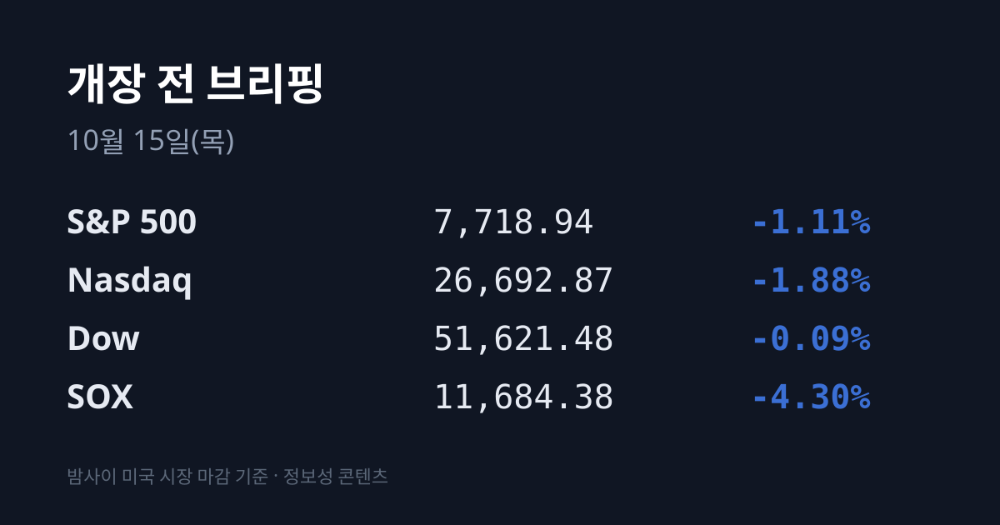
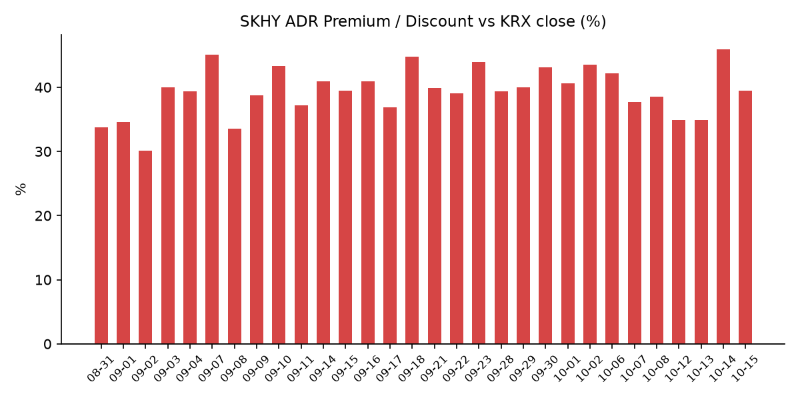
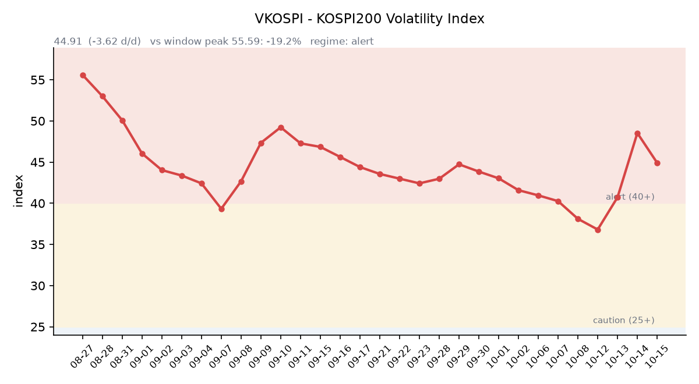

&nbsp;

【① 30초 요약 📈】

<mark>미국 9월 소비자물가(CPI)가 전년비 3.7%로 예상(3.6%)을 웃돌았습니다.</mark> 근원 CPI도 전월비 0.3%로 예상(0.2%)보다 높았고, 10월 FOMC 금리 인상 확률은 약 20%에서 약 35%로 올랐습니다.

나스닥은 −1.88%, S&P500은 −1.11%였고 다우는 −0.09%로 보합권이었습니다. 반도체 지수(SOX)는 **−4.30%로** 크게 내렸고 엔비디아(−3.16%)·TSMC ADR(−3.40%)까지 함께 내렸습니다.

SKHY는 −6.06%로 본주(−1.66%)보다 더 내려, 괴리율이 전일 +45.86%에서 +39.42%로 줄었습니다. 한국 시장 전체를 담는 EWY는 −4.04%였습니다.

10/14 코스피는 장중 +2%대까지 올랐다가 6,008.81(−0.44%)로 마감해 6거래일 연속 내렸습니다. 외국인은 1조1,813억원을 순매도해 7거래일 연속 매도였습니다.

오늘(10/15) TSMC 3분기 실적 설명회가 열리고, 21:30에는 미국 9월 생산자물가(PPI)·소매판매가 발표됩니다.

&nbsp;

【② 밤사이 미국 시장 🌙】

| 지수 | 10/14 종가 | 등락 |
| :--- | ---: | ---: |
| S&P 500 | 7,718.94 | −1.11% |
| 나스닥 종합 | 26,692.87 | −1.88% |
| 다우 | 51,621.48 | −0.09% |
| 필라델피아 반도체(SOX) | 11,684.38 | −4.30% |

미국 9월 CPI는 전월비 +0.6%로 예상과 같았지만, 전년비는 3.7%로 예상(3.6%)과 8월(3.4%)을 모두 웃돌았습니다. 식품·에너지를 뺀 근원 CPI는 전월비 0.3%, 전년비 2.6%로 둘 다 예상보다 0.1%p 높았습니다. 휘발유 가격은 1년 전보다 34.2% 올랐습니다. CME 페드워치 기준 이달 FOMC 금리 인상 확률은 약 35%로 반영됐습니다(아시아경제). 뉴욕연은 윌리엄스 총재는 연내 한 번 더 인상이 적절할 수 있다고 말했습니다(야후 파이낸스).

<mark>매도는 반도체와 AI 인프라에 몰렸습니다.</mark> AMD −5.73%, 샌디스크 −5.33%, 인텔 −4.56%, 마이크론 $914.13(−4.08%), TSMC ADR $430.00(−3.40%), 엔비디아 $221.30(−3.16%)였습니다. AI 투자 재원 조달에 대한 불안으로 코어위브는 −15.46%, 오라클은 −8.83%였습니다. 매체들은 금리 인상 가능성이 높아지면 반도체주의 밸류에이션 부담이 커지고, 차입에 의존하는 데이터센터 사업자의 투자 여력이 줄 수 있다는 우려를 배경으로 전했습니다(미디어펜).

ASML은 미국 장 전에 3분기 실적을 냈습니다. 매출은 117억 유로로 분기 기준 사상 최대였지만 시장 예상(117.2억 유로)에는 조금 못 미쳤고, 순이익은 49.6억 유로로 예상(41.1억 유로)을 20.7% 웃돌았습니다. 매출총이익률은 57.5%였고 2026년 연간 매출 전망은 440억~450억 유로로 하단을 10억 유로 올렸습니다. 주가 반응은 크지 않았습니다.

은행주에서는 뱅크오브아메리카가 12억 달러가 넘는 규제 제재 여파로 −4.76%, 모건스탠리는 실적 호조에도 −2.75%였습니다. 반면 애플은 1% 넘게 올라 장중 시가총액 5조 달러를 넘었고, 유나이티드헬스는 +4.8%였습니다. 11개 업종 중 3개만 올랐고 헬스케어가 가장 강했습니다.

10/14 장 마감 뒤 주요 기업 실적 발표는 확인되지 않았습니다. 시간외 가격은 마이크론 $898.25(−1.74%), 엔비디아 $219.20(−0.95%), TSMC ADR $426.80(−0.74%)입니다. 한국 시각 10/15 07:08 기준 미국 지수선물은 S&P500 −0.09%, 나스닥100 −0.24%입니다.

미 국채 10년물은 장중 5.29%까지 올랐다가 5.19%(−2bp)로 마감했습니다. 2년물은 4.80%(+1bp), 30년물은 5.52%(−4bp)였고 10년물과 2년물의 차이는 0.39%p로 좁혀졌습니다. 10년물 실질금리(TIPS)는 10/13 기준 2.88%입니다. VIX는 **16.87(+10.48%)로** 올랐고, 달러인덱스는 한국 시각 07:05 기준 102.53(+0.34%)입니다.

WTI는 $95.09(+1.01%), 브렌트유는 $106.06(+0.35%)로 마감했습니다. 금 12월물은 전일 기준가 $4,107.9로 10/13(약 $4,177)보다 약 1.7% 내렸고, 같은 날 달러인덱스는 올랐습니다. 한국 시각 07:08 기준 금은 $4,124.1(+0.39%)입니다.

&nbsp;

【③ 괴리율 트래커 — SK하이닉스 ADR】

| 항목 | 수치 |
| :--- | ---: |
| SKHY 종가 (10/14) | $147.55 (−6.06%) |
| 본주 환산가 (×10×환율 1,340.81원) | 1,978,365원 |
| 본주 직전 종가 (10/14) | 1,419,000원 |
| **괴리율** | **+39.4%** |

10/14 한국 본주는 −1.66% 내렸고, 미국 SKHY는 그보다 큰 −6.06%였습니다. 전날과 반대로 미국 쪽 하락폭이 더 커서 괴리율은 전일 +45.86%에서 **+39.42%로** 6.44%포인트 줄었습니다. SKHY 시간외 가격은 $145.42(−1.44%)입니다.

괴리율은 미국에 상장된 예탁증서(ADR) 가격을 본주 1주 기준으로 환산한 값과 한국 본주 종가를 비교한 수치입니다. 환산가가 본주보다 높은 프리미엄 상태에서는 전환 차익거래 구조상 본주 쪽에 매수 유인이 생기고, 디스카운트면 반대입니다. 프리미엄이 줄었다는 것은 그 유인의 크기가 작아졌다는 뜻입니다. 오늘 값은 이 트래커 61거래일 기록에서 23위입니다.

한국 시장 전체를 담는 EWY(iShares MSCI South Korea ETF)는 $159.83(−4.04%)였고, 시간외 가격은 $157.90(−1.21%)입니다. EWY의 10/14 미국 거래는 한국 10/14 장 마감 이후 시간대를 담고 있습니다.

&nbsp;

【④ 변동성 트래커 🌡️】

**판정 한 줄**: <mark>'경보' 구간 안에서 하루 진정 — VKOSPI는 44.91로 내렸지만, 밤사이 VIX가 10% 넘게 오르고 신용융자 잔고는 3개월 만의 최대 수준입니다.</mark>

**기대 변동성**  VKOSPI **44.91**(10/14, 전일비 −3.62, −7.46%)로 '경보'(40~60) 구간입니다. 이틀 연속 급등(36.81 → 40.73 → 48.53) 뒤 처음 내렸습니다. 6월 고점 96.94 대비 −53.7%, 평시 상단인 25의 1.80배입니다.

**실현 변동성**  최근 7거래일 코스피 일별 등락률은 10/02 +0.46%, 10/06 −0.89%, 10/07 −1.98%, 10/08 −2.62%, 10/12 −3.65%, 10/13 −5.46%, 10/14 −0.44%로 6거래일 연속 내렸습니다. 10/02 종가 7,003.74 대비 누적 **−14.2%입니다.** 최근 10거래일 중 ±3.5% 이상 등락일은 10/12·10/13 이틀입니다. 10/14는 장중 고가 6,190.65와 저가 5,944.65 사이를 오가 일중 변동폭이 약 4.1%였습니다.

**매매 정지**  10/13 09:47 유가증권시장에 매도 사이드카가 발동했습니다(한국거래소 KIND 시장운영 공시).

**증폭 경로**  전체 ETF 거래대금 중 레버리지 ETF 비중은 21.98%로 직전(22.64%)보다 낮아졌습니다. KODEX 레버리지 1조6,063억원(회전율 36.14%), KODEX 200선물인버스2X 7,858억원(78.24%), KODEX 코스닥150레버리지 5,720억원(19.12%), KODEX 반도체레버리지 3,703억원(39.04%), TIGER 반도체TOP10레버리지 1,891억원(39.89%) 순입니다(네이버 ETF 목록, 10/15 07:17 스냅샷). 인버스2X 회전율은 97.35%에서 78.24%로 내려왔습니다. 코스피200 선물 베이시스는 **+7.38로**(선물 944.20 − 현물 936.82) 직전 +2.73보다 벌어졌습니다.

**청산 압력**  신용융자 잔고는 10/13 기준 34조2,529억원으로, 10/12(34조2,886억원)에 7/15 이후 약 3개월 만의 최대를 기록한 뒤 소폭 줄었습니다. 금융투자협회 집계로 10/13 위탁매매 미수금 반대매매는 593억5,000만원으로 7/31(1,220억원) 이후 가장 많았습니다(한국경제·서울경제).

**하방 포지션**  공매도 순잔고는 T+2~3 공시 지연이 있어 개장 전 시점에는 확정치를 알 수 없습니다.

*미확인: 공매도 순잔고 최신치, 신용융자 10/14치, 오늘 개장 직전 밤의 코스피200 야간선물(한국거래소가 다음 날 아침 공개), 10/14 프로그램 매매, DRAM·NAND 당일 현물가.*

&nbsp;

【⑤ 직전 거래일(10/14) 한국장 리뷰 📊】

| 지수 | 종가 | 등락 |
| :--- | ---: | ---: |
| 코스피 | 6,008.81 | −26.54 (−0.44%) |
| 코스닥 | 823.88 | −13.15 (−1.57%) |

코스피는 6,062.08로 오르며 출발해 오전 한때 6,190.65까지 올랐지만, 오후에 하락으로 돌아서 장중 5,944.65까지 밀렸다가 6,000선 위에서 마감했습니다. <mark>외국인은 1조1,813억원을 순매도해 7거래일 연속 매도</mark>했고, 기관은 8,053억원을 순매수, 개인은 3,093억원을 순매도했습니다(뉴스핌, 매체에 따라 외국인 1조1,799억~1조3,557억원으로 집계). 외국인은 13~14일 이틀 동안 코스피에서 약 5조7,000억원을 순매도했습니다(세계일보). 외국인은 SK하이닉스를 7,319억원, 삼성전자를 1,785억원 순매도했습니다(KB증권 데이터, 뉴스핌).

삼성전자는 232,000원(보합)으로 장중 241,500원까지 올랐다가 상승분을 반납했고, SK하이닉스는 1,419,000원(−1.66%)으로 장중 3%대 상승 뒤 하락 전환했습니다. 매체들은 ASML 호실적에도 차익실현 매물이 나왔고, 미국 CPI 발표를 앞둔 경계감과 외국인 반도체 매도가 이어졌다고 전했습니다. 10/08 대비 5거래일 동안 삼성전자는 −11.45%, SK하이닉스는 −15.59%입니다(세계일보). 웨드부시의 댄 아이브스는 두 종목 하락이 과도한 조정이며 중국 메모리 기술이 약 3년 뒤처져 있다고 평가했습니다(파이낸셜뉴스).

시가총액 상위에서는 삼성SDI **+5.54%**, LG에너지솔루션 +2.93%, 삼성전기 +0.81%가 올랐고 신한지주 −4.71%, 삼성생명 −3.71%, 삼성물산 −2.83%가 내렸습니다. 2차전지 종목은 유럽 전기차 수요 회복과 북미 에너지저장장치(ESS) 수요 확대 기대에 올랐습니다(파이낸셜뉴스). 업종별로는 운송·창고(+3.60%), 화학(+2.00%), 금속(+1.14%)이 강했고 의료·정밀기기(−3.26%), 금융(−2.06%), 유통(−1.53%)이 약했습니다.

코스닥에서는 외국인이 2,140억원, 기관이 1,811억원을 순매도했고 개인이 3,853억원을 순매수했습니다. 전날 올랐던 반도체 장비 종목이 내려 주성엔지니어링 −8.21%, 원익IPS −6.83%, 심텍 −6.31%, 이오테크닉스 −5.16%, 리노공업 −4.52%였고, 에코프로(+3.29%)·에코프로비엠(+2.92%)은 올랐습니다.

원/달러는 서울 외환시장 주간 마감 기준 1,338.3원으로 6.8원 내렸습니다(파이낸셜뉴스). 외국인 순매도 규모가 전날보다 줄어든 점이 배경으로 꼽혔습니다(뉴스1). 한국 시각 10/15 07:11 기준 환율은 1,340.81원, 달러/엔은 158.23입니다.

아시아 증시 10/14 종가는 닛케이225 67,744.29(−0.05%), 토픽스 4,096.78(−0.34%), 대만 가권 48,625.83(+0.59%), 상하이종합 3,767.23(−0.88%), CSI300 4,217.68(−1.36%), 항셍 24,314.17(−0.13%)입니다. 모두 미국 CPI 발표 전 종가입니다.

&nbsp;

【⑥ 오늘의 캘린더 & 관전 포인트 📅】

**오늘(10/15 목)** — <mark>TSMC 3분기 실적 설명회</mark>(회사 가이던스 매출 446억~458억 달러, 매출총이익률 65~67%; 발표 시각은 공식 확인 전). **21:30 미국 9월 PPI·소매판매.**

**10/16(금)** — 한국 9월 수출입물가지수. 미국 9월 산업생산.

SK하이닉스 자사주 매입은 마무리 단계라는 보도가 있습니다(세계일보).

**10/20~21** 티앤이코리아·크리에이츠 공모 청약, **10/22** 한국은행 금통위, **10/27** SK하이닉스 3분기 실적, **10/27~28** FOMC, **10/29** 삼성전자 3분기 확정 실적, **10/30** 일본은행 회의.

시장 참가자들이 주시하는 레벨은 코스피 6,000선과 대신증권이 제시한 5,800~5,900선, SK하이닉스 전일 종가 1,419,000원, 원/달러 1,350원 선, VKOSPI 50 선입니다.

&nbsp;

【⑦ 정책 워치 ⚡】

10/14 기준 금융당국의 별도 시장 대책 발표는 확인되지 않았습니다. 중동·러시아-우크라이나·미중·북한 관련으로 전일 대비 새 동향은 없었습니다.

공매도는 전면 재개 상태이며 10월 제도 변경 사항은 없었습니다.

&nbsp;

【⑧ 오늘의 질문 ❓】

지난 이틀 한국만 크게 내리고 미국은 버텼는데, 밤사이 미국이 CPI로 반도체를 4% 넘게 내린 지금 한국 시장은 이 하락을 이미 가격에 담았는가.

&nbsp;

#개장전브리핑 #미국증시마감 #미국CPI #하이닉스ADR #괴리율 #반도체 #필라델피아반도체 #TSMC실적 #VKOSPI #코스피 #외국인순매도 #신용융자

&nbsp;

*본 글은 공개된 시장 데이터를 정리한 정보성 콘텐츠이며, 특정 종목·상품의 매매 권유가 아닙니다. 모든 투자 판단과 책임은 투자자 본인에게 있습니다. 수치는 작성 시점 기준이며 이후 변동될 수 있습니다.*