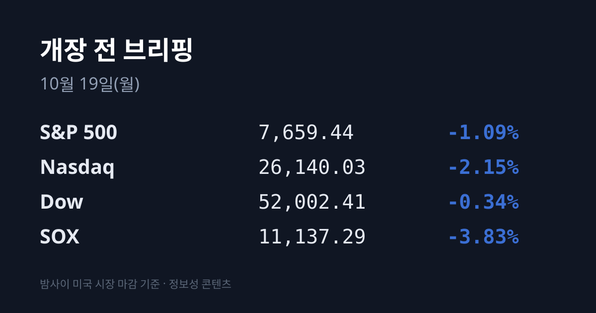
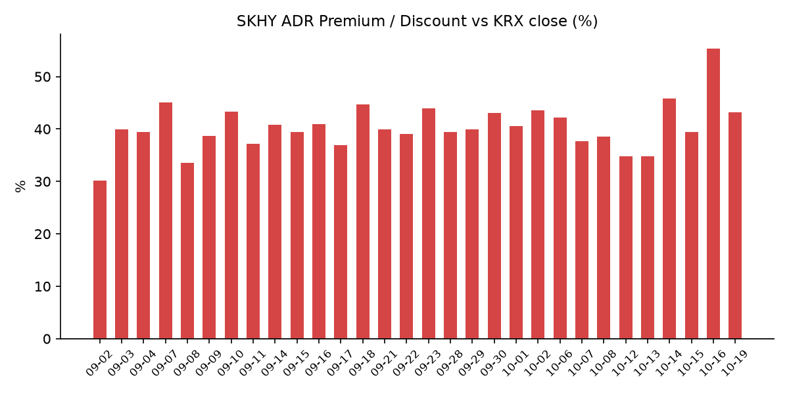
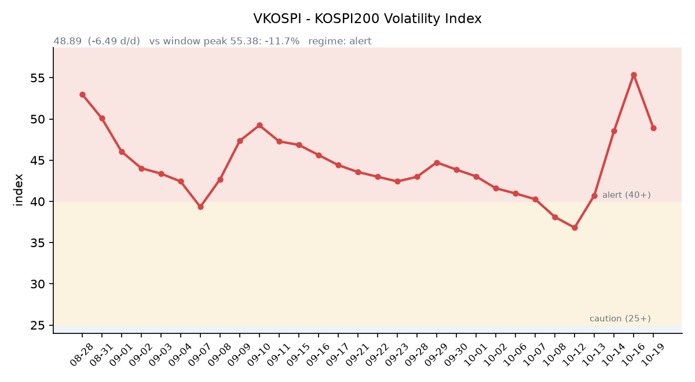

&nbsp;

【① 30초 요약 📈】

직전 거래일 10/16 코스피는 5,668.05(+2.05%), 코스닥은 794.78(+4.46%)로 반등했습니다. 외국인은 코스피에서 9거래일 만에 순매수로 돌아섰고, 원/달러는 1,331.4원으로 2년 만의 최저였습니다.

<mark>한국 장 마감 뒤 미국에서는 반도체 지수(SOX)가 −3.83%로 8거래일 연속 내렸습니다.</mark> 나스닥은 −2.15%, S&P500은 −1.09%였고 마이크론 −5.65%, 코어위브 −11.91%였습니다.

SKHY는 $136.49(**−6.58%**)로 내려 괴리율이 +55.28%에서 +43.21%로 좁혀졌습니다. EWY는 −3.70%였습니다.

주말 사이 중국 창신메모리(CXMT)가 1~3분기 순이익 1,310억~1,325억위안(약 26조원)의 잠정실적과 자사주 매입 제안을 내놨습니다. 한국 시장은 이 소식을 오늘 처음 반영합니다.

브렌트유는 금요일 $109.86(+3.72%)까지 올랐다가, 이란이 10/18 조건부 호르무즈 재개방안을 제시한 뒤 일요일 저녁 $108.86으로 내려왔습니다.

&nbsp;

【② 밤사이 미국 시장 🌙】

한국이 10/16 오후 3시 30분에 장을 마친 뒤 주말까지 미국은 10/16(금) 한 세션이 열렸습니다. 아래 수치가 그 사이 누적 변화입니다.

| 지수 | 10/16 종가 | 등락 |
| :--- | ---: | ---: |
| S&P 500 | 7,659.44 | −1.09% |
| 나스닥 종합 | 26,140.03 | −2.15% |
| 다우 | 52,002.41 | −0.34% |
| 필라델피아 반도체(SOX) | 11,137.29 | −3.83% |

다우는 장 초반 +0.60%까지 올랐다가 하락으로 돌아섰습니다. 시장에서는 AI 투자의 수익성과 자금 조달에 대한 의구심, 그리고 국제유가 급등이 겹쳤다는 해석이 나왔습니다(이투데이·톱스타뉴스). 주간으로 S&P500은 약 −2%로 6월 말 이후 가장 크게 내렸고, 나스닥은 −4.5%, 다우는 +0.7%였습니다.

<mark>반도체 지수는 8거래일 연속 내려 이 기간 낙폭이 약 15.7%가 됐습니다.</mark> 마이크론 $878.62(−5.65%), 샌디스크 −6.85%, AMD −5.95%, 인텔 −5.8%, 브로드컴 −4.52%, 엔비디아 $214.13(−1.43%)였습니다. AI 데이터센터 기업 코어위브는 −11.91%로 한 주 동안 약 25% 내렸습니다. 중국 CXMT의 차세대 D램 셀 구조(4F²) 공개 소식도 메모리 종목에 부담으로 거론됐습니다(녹색경제신문).

금요일 장 마감 뒤 주요 기업 실적 발표는 없었습니다. 일요일 저녁(미 동부) 재개된 지수선물은 S&P500 +0.2%, 나스닥100 +0.4%, 다우 +110포인트로 올랐습니다(CNBC).

미 국채 10년물은 약 5.09%로 전날과 거의 같았고, 2년물은 4.72~4.74%, 30년물은 5.43~5.44%, 10년물과 2년물의 차이는 0.35%p입니다. 10년물 실질금리(TIPS)는 10/15 기준 2.78%로 전날(2.84%)보다 낮아졌습니다. VIX는 16.46에서 19.99(+21.4%)로 올랐습니다. CME 페드워치 기준 10월 FOMC 금리 동결 확률은 72.3%입니다(뉴데일리).

WTI는 $101.41(+3.51%), 브렌트유는 $109.86(+3.72%), 두바이유는 $106.00이었습니다(페트로넷). 이란의 호르무즈 해협 공격이 강해졌다는 소식이 원인으로 꼽혔습니다. 일요일 저녁에는 브렌트 $108.86(−0.91%), WTI 12월물 $98.27(−0.76%)입니다. 금 12월물은 $4,181.10(+0.26%)로 소폭 올랐고, 같은 날 달러인덱스는 101.84로 내렸습니다.

&nbsp;

【③ 괴리율 트래커 — SK하이닉스 ADR】

| 항목 | 수치 |
| :--- | ---: |
| SKHY 종가 (10/16) | $136.49 (−6.58%) |
| 본주 환산가 (×10×환율 1,334.66원) | 1,821,677원 |
| 본주 직전 종가 (10/16) | 1,272,000원 |
| **괴리율** | **+43.2%** |

10/16 한국 본주는 +0.79% 올랐고, 그 뒤 미국 SKHY는 −6.58% 내렸습니다. 괴리율은 전일 +55.28%에서 **+43.21%로 12.07%포인트** 좁혀졌습니다. 트래커 63거래일 중 13번째로 높은 값이고, 9~10월의 통상 범위(+33.6~+45.9%) 위쪽으로 돌아왔습니다. SKHY 시간외 가격은 $136.89(+0.30%)입니다.

괴리율은 미국에 상장된 예탁증서(ADR) 가격을 본주 1주 기준으로 환산한 값과 한국 본주 종가를 비교한 수치입니다. 환산가가 본주보다 높은 프리미엄 상태에서는 전환 차익거래 구조상 본주 쪽에 매수 유인이 생기고, 디스카운트면 반대입니다. 프리미엄이 줄었다는 것은 그 유인의 크기가 작아졌다는 뜻입니다.

한국 시장 전체를 담는 EWY(iShares MSCI South Korea ETF)는 $150.44(−3.70%)였고, 시간외 가격은 $149.30(−0.76%)입니다. <mark>EWY의 10/14 이후 2세션 누적 등락은 −5.88%로, 같은 기간 코스피(−5.67%)와 거의 같아졌습니다.</mark>

&nbsp;

【④ 변동성 트래커 🌡️】

**판정 한 줄**: <mark>'경보' 구간 유지, 방향은 진정 — VKOSPI가 하루 만에 6.49포인트 내렸고 신용잔고는 사흘 새 1조5천억원 넘게 줄었습니다.</mark>

**기대 변동성**  VKOSPI **48.89**(10/16, 전일비 −6.49, −11.72%)로 '경보'(40~60) 구간입니다. 장중에는 57.94까지 올랐다가 내려왔습니다. 6월 고점 96.94 대비 −49.6%, 평시 상단인 25의 1.96배입니다.

**실현 변동성**  최근 7거래일 코스피 일별 등락률은 10/07 −1.98%, 10/08 −2.62%, 10/12 −3.65%, 10/13 −5.46%, 10/14 −0.44%, 10/15 −7.57%, 10/16 +2.05%입니다. 10/02 종가 7,003.74 대비 누적 −19.1%입니다. 최근 10거래일 중 ±3.5% 이상 등락일은 10/12·10/13·10/15 사흘입니다.

**매매 정지**  10/16 12:55 코스닥시장에 매수 사이드카가 발동했습니다. 앞서 10/15에는 09:07 유가증권시장·09:12 코스닥시장 매도 사이드카, 12:23 코스닥·12:38 유가증권시장 1단계 서킷브레이커가 발동했고, 10/13 09:47에도 유가증권시장 매도 사이드카가 발동했습니다(한국거래소 KIND 시장운영 공시).

**증폭 경로**  전체 ETF 거래대금 중 레버리지 ETF 비중은 22.99%로 직전(22.86%)과 비슷합니다. KODEX 레버리지 1조9,684억원(회전율 46.40%), KODEX 200선물인버스2X 1조2,179억원(**124.46%**), KODEX 코스닥150레버리지 6,232억원(21.48%), KODEX 반도체레버리지 3,710억원(44.30%), TIGER 반도체TOP10레버리지 2,027억원(48.25%)입니다(네이버 ETF 목록, 10/19 07:17 스냅샷). 코스피200 선물 베이시스는 +2.89(선물 881.05 − 현물 878.16)로 직전 +0.60에서 넓어졌습니다.

**청산 압력**  금융투자협회 집계로 신용융자 잔고는 10/15 기준 32조7,499억원으로 하루 새 9,558억원 줄었습니다. 10/12(34조2,887억원) 이후 1조5천억원 넘게 감소했습니다. 반대매매는 10/14 893억원, 10/15 805억원이었고 10월 1~15일 누적 3,339억원으로 9월 한 달 규모를 넘었습니다(매일일보·파이낸셜뉴스).

**하방 포지션**  공매도 순잔고는 T+2~3 공시 지연이 있어 개장 전 시점에는 확정치를 알 수 없습니다.

*미확인: 공매도 순잔고 최신치, 10/16 신용융자·반대매매, 오늘 개장 직전 밤의 코스피200 야간선물(한국거래소가 다음 날 아침 공개), 10/16 프로그램 매매, DRAM·NAND 당일 현물가.*

&nbsp;

【⑤ 직전 거래일(10/16) 한국장 리뷰 📊】

| 지수 | 종가 | 등락 |
| :--- | ---: | ---: |
| 코스피 | 5,668.05 | +113.83 (+2.05%) |
| 코스닥 | 794.78 | +33.96 (+4.46%) |

코스피는 장중 5,809.94(+4.6%)까지 올랐다가 오후에 상승분의 절반 이상을 내주고 마감했습니다. 전날 −7.57% 급락분의 약 4분의 1을 되찾았습니다. <mark>외국인은 코스피에서 약 3,400억~3,600억원을 순매수해 9거래일 만에 매수로 돌아섰습니다</mark>(매체별 3,413억~3,606억원). 기관은 약 6,830억원, 개인은 약 4,850억~5,095억원을 순매도했고, 자사주 매입이 포함된 기타법인이 약 9,000억원을 순매수했습니다(뉴데일리·베타뉴스).

삼성전자는 215,500원(**+2.62%**), SK하이닉스는 1,272,000원(+0.79%)으로 마감했습니다. 매체들은 전날 폭락 뒤 저가 매수와 외국인 순매수 전환, 자사주 매입 수급을 반등 이유로 꼽았고, 하이닉스의 상승 폭이 작았던 것은 미국 반도체 매도와 중국 CXMT 기술 소식으로 메모리 경쟁 우려가 남았기 때문이라고 분석했습니다(세계일보·녹색경제신문). 10월 1~15일 외국인은 두 종목을 16조3,900억원 순매도했습니다(세계일보).

시가총액 상위에서는 현대차가 +5.58%로 크게 올랐고 KB금융·SK스퀘어도 상승했습니다. 코스닥에서는 기관이 1,693억원을 순매수했고 외국인 947억원, 개인 909억원은 순매도였습니다. 알테오젠 +9.60%, 주성엔지니어링 +2.93%, 레인보우로보틱스 +2.03%였습니다.

원/달러는 서울 외환시장 주간 마감 기준 **1,331.4원으로 13.2원 내렸습니다.** 2024년 10월 2일(1,319.3원) 이후 2년 만의 최저입니다(이데일리·이투데이). 한국 시각 10/19 07:01 기준 환율은 1,334.66원, 달러/엔은 157.86입니다.

아시아 증시 10/16 종가는 닛케이225 65,324.29(+1.39%), 토픽스 4,066.00(+1.67%), 대만 가권 47,111.26(+0.30%), 상하이종합 3,716.28(+0.24%), CSI300 4,170.61(+0.11%), 항셍 24,186.83(+0.52%)입니다.

&nbsp;

【⑥ 오늘의 캘린더 & 관전 포인트 📅】

**오늘(10/19 월)** — 중국 3분기 GDP(11:00, 10/20 발표로 안내한 곳도 있음). 종목별 신용융자 쏠림 관리 시행 첫날.

**10/20(화)** 21:30 미국 주택지표, 미국 장 마감 뒤 넷플릭스 실적. 티앤이코리아·크리에이츠 공모 청약(10/20~21).

**10/21(수)** 06:00 한국 9월 생산자물가. <mark>미국 장 마감 뒤 테슬라·메타·텍사스인스트루먼트·램리서치·IBM 실적.</mark>

**10/22(목)** 한국은행 금통위, 21:30 미국 주간 실업수당.

**10/23(금)** 23:00 미시간대 소비심리 확정치.

**10/27:** SK하이닉스 3분기 실적, **10/27~28** FOMC, **10/29** 삼성전자 3분기 확정 실적, **10/30** 일본은행 회의, **11/3** 미국 중간선거.

시장 참가자들이 주시하는 레벨은 코스피 5,700선과 5,500선, 10/16 장중 고가 5,809.94, SK하이닉스 10/16 종가 1,272,000원, 원/달러 1,345원 선, VKOSPI 55 선입니다.

&nbsp;

【⑦ 정책 워치 ⚡】

10/19부터 종목별 신용융자 쏠림 관리가 시행되며 기존 대출은 새 기준에서 제외됩니다. KB증권은 같은 날부터 삼성전자 신용융자 종목 한도를 20억원에서 15억원으로 낮춘다고 공지했습니다(머니투데이 보도 인용). 10/15 금융위원회 긴급 점검회의 뒤 주말 사이 추가 대책은 발표되지 않았습니다. 공매도는 전면 재개 상태이며 10월 제도 변경 사항은 없었습니다.

중동에서는 10/17 이란 혁명수비대가 호르무즈 해협에서 초대형 유조선이 기뢰에 피격됐다고 밝혔고, 10/18 이란 외무장관이 미국에 조건부 해협 재개방안을 받아들이라고 촉구했습니다. 미국은 핵 문제를 먼저 다뤄야 한다는 입장이어서 합의는 이뤄지지 않았습니다(RFE/RL). 중국 CXMT는 10/16 장 마감 뒤 1~3분기 매출 2,650억~2,700억위안, 순이익 1,310억~1,325억위안의 잠정실적과 10억~20억위안 규모 자사주 매입 제안을 공시했습니다(톱스타뉴스·연합뉴스).

&nbsp;

【⑧ 오늘의 질문 ❓】

금요일 미국 반도체 −3.83%와 주말 CXMT 대형 이익 공시를 처음 마주하는 한국 시장에서, 사흘 새 1조5천억원 넘게 줄어든 신용잔고는 메모리 대형주의 매물을 얼마나 덜어 주는가.

&nbsp;

#개장전브리핑 #미국증시마감 #반도체 #필라델피아반도체 #하이닉스ADR #괴리율 #CXMT #VKOSPI #신용융자 #호르무즈 #원달러환율 #마이크론

&nbsp;

*본 글은 공개된 시장 데이터를 정리한 정보성 콘텐츠이며, 특정 종목·상품의 매매 권유가 아닙니다. 모든 투자 판단과 책임은 투자자 본인에게 있습니다. 수치는 작성 시점 기준이며 이후 변동될 수 있습니다.*