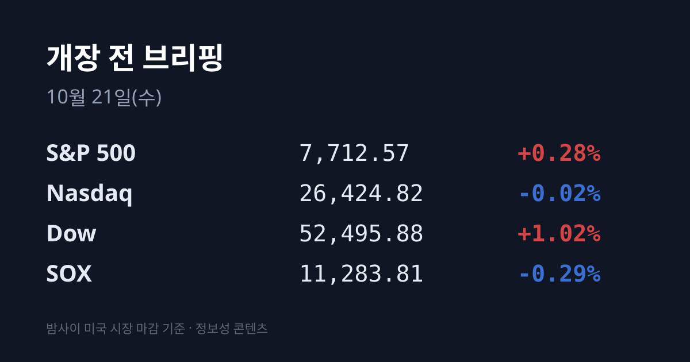
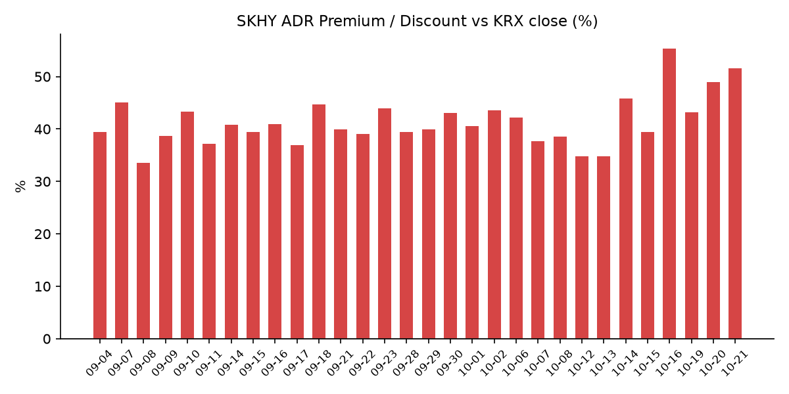
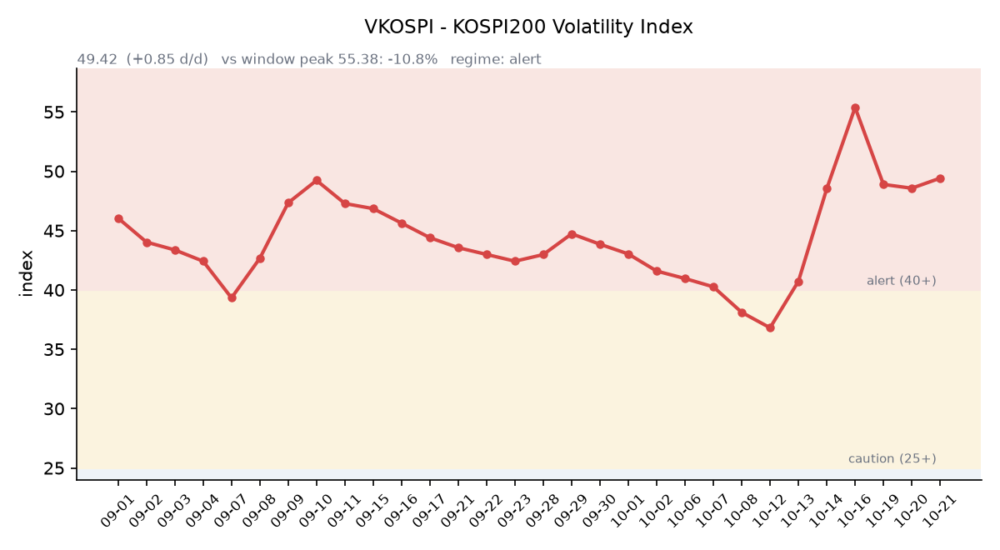

&nbsp;

【① 30초 요약 📈】

직전 거래일 10/20 코스피는 외국인(약 −5,300억원)과 기관(약 −1조48억원)이 함께 팔면서 <mark>5,552.74(−3.73%)로 전날 반등분을 모두 내줬습니다.</mark> 코스닥은 781.97(−3.33%)로 800선을 다시 내줬습니다.

SK하이닉스는 1,223,000원(−4.23%), 삼성전자는 211,500원(−2.98%)이었습니다. AI 관련 신용 우려와 반도체 수익성 의구심이 거론됐고, 방산주는 현대로템 실적 부진에 10%대 급락했습니다.

미국에서는 다우가 **+1.02%로** 3M·노스롭그루먼 실적 호조와 유가 하락에 올랐고, 나스닥은 −0.02%, 반도체 지수(SOX)는 −0.29%였습니다.

미국 장 마감 뒤 스페이스X가 상장 후 첫 분기 흑자를 냈고, 머스크 CEO가 테슬라와의 합병 검토를 공식화했습니다. 넷플릭스는 광고 매출 전망을 낮춰 시간외에서 내렸습니다.

SKHY는 $139.79(−2.16%)였지만 본주 낙폭이 더 커서 괴리율은 +51.64%로 넓어졌습니다. 시간외에서는 SKHY +2.96%, EWY +2.59%, 나스닥100 선물 +0.90%입니다.

&nbsp;

【② 밤사이 미국 시장 🌙】

| 지수 | 10/20 종가 | 등락 |
| :--- | ---: | ---: |
| S&P 500 | 7,712.57 | +0.28% |
| 나스닥 종합 | 26,424.82 | −0.02% |
| 다우 | 52,495.88 | +1.02% |
| 필라델피아 반도체(SOX) | 11,283.81 | −0.29% |

뉴욕 증시는 AI주 약세와 유가 상승으로 하락 출발했다가, 유가와 국채 금리가 내려가면서 다우가 500포인트 넘게 올랐습니다(뉴스1·CNBC). 3M은 조정 주당순이익(EPS) $2.50으로 예상치($2.38)를 웃돌고 아마존과의 데이터센터 협력을 넓히면서 5% 넘게 올랐습니다. 노스롭그루먼도 EPS $7.89(예상 $7.18)로 4~5% 올랐습니다. 헬스케어·산업재가 강했고 기술주에서는 자금이 빠졌습니다. 마이크론은 $896.07(−0.98%), 엔비디아는 $216.47(−0.29%), 테슬라는 $373.71(+1.54%)였습니다.

<mark>장 마감 뒤 스페이스X는 3분기 매출 $145.8억(+161%)과 순이익 $44억을 발표했습니다.</mark> 상장 후 첫 분기 흑자이고, 매출은 시장 예상(약 $127억~129억)을 웃돌았습니다. 설비투자는 $195.9억으로 예상 수준이었습니다. 머스크 CEO는 실적 발표 웹캐스트에서 테슬라와의 합병이 좋은 생각이라고 말했고, 양사는 각각 특별위원회를 꾸렸습니다. 구체적인 합병 조건은 아직 합의되지 않았습니다(뉴스1·블룸버그 인용). 스페이스X 주가는 시간외에서 2~5% 올랐습니다.

넷플릭스는 3분기 EPS $0.87로 예상치($0.82)를 웃돌았고 매출은 $128.7억(+11.8%)이었습니다. 그러나 4분기 영업이익률 가이던스를 26.0%로 제시했고, 2026년 광고 매출 전망을 약 $30억에서 $27억으로 낮췄습니다. 시간외 주가는 매체에 따라 −4~−7%로 집계됐습니다.

한국 시각 07:07 기준 지수선물은 S&P500 12월물 7,784.50(+0.38%), <mark>나스닥100 12월물 29,942.00(+0.90%)입니다.</mark> 나스닥 선물 상승은 스페이스X 실적과 합병 소식이 이끌었다는 보도가 나왔습니다(Chaincatcher). 시간외에서 마이크론은 $921.60(+2.85%), 엔비디아는 $220.84(+2.02%), 테슬라는 $379.79(+1.63%)입니다.

미 국채 10년물은 5.14%에서 5.12%로, 30년물은 5.47%에서 5.43%로 내렸습니다. 10년물과 2년물의 차이는 0.33%p(10/20)입니다. 10년물 실질금리(TIPS)는 10/19 기준 2.80%로 10/16(2.74%)보다 올랐습니다. VIX는 18.44에서 17.31(−6.13%)로 내렸습니다. 유럽에서는 프랑스 전국 시위와 재정 불안으로 프랑스 10년물 금리가 0.12%포인트 올라 4.9%가 됐습니다. CME 페드워치 기준 10월 FOMC 동결 확률은 약 80%이고, 12월 회의에서는 인상이 우세하게 반영돼 있습니다(Forbes).

브렌트유 12월물은 $108.79(−0.69%), WTI 11월물(만기 임박 계약)은 $101.79(−1.8%), WTI 12월물은 $97.82(−0.73%)로 마감했습니다. 두바이유 10/20 값은 집계 시점 기준 미확인입니다. 금 12월물은 약 $4,142.60(−0.46%)로 내렸고, 같은 시간 달러인덱스는 101.73(−0.25%)으로 내렸습니다.

&nbsp;

【③ 괴리율 트래커 — SK하이닉스 ADR】

| 항목 | 수치 |
| :--- | ---: |
| SKHY 종가 (10/20) | $139.79 (−2.16%) |
| 본주 환산가 (×10×환율 1,326.65원) | 1,854,524원 |
| 본주 직전 종가 (10/20) | 1,223,000원 |
| **괴리율** | **+51.6%** |

10/20 한국 본주는 −4.23% 내렸고, 그 뒤 미국 SKHY는 −2.16% 내렸습니다. 본주 낙폭이 더 컸기 때문에 괴리율은 전일 +48.89%에서 <mark>+51.64%로 2.75%포인트 넓어졌습니다.</mark> 트래커 65거래일 중 3번째로 높은 값입니다(1위 07/31 +62.0%, 2위 10/16 +55.28%). SKHY 시간외 가격은 $143.93(+2.96%)입니다.

괴리율은 미국에 상장된 예탁증서(ADR) 가격을 본주 1주 기준으로 환산한 값과 한국 본주 종가를 비교한 수치입니다. 환산가가 본주보다 높은 프리미엄 상태에서는 전환 차익거래 구조상 본주 쪽에 매수 유인이 생기고, 디스카운트면 반대입니다. 10/20에는 전날 +48.9% 프리미엄이 있었는데도 본주가 −4.23% 내렸습니다.

한국 시장 전체를 담는 EWY(iShares MSCI South Korea ETF)는 $153.99(−1.65%)였고, 시간외 가격은 $157.98(**+2.59%**)입니다. EWY의 10/20 세션에는 한국 10/20 장(코스피 −3.73%)과 그 뒤 미국 시간의 움직임이 함께 담겨 있습니다.

&nbsp;

【④ 변동성 트래커 🌡️】

**판정 한 줄**: <mark>'경보' 구간 유지, 지수 −3.73%에도 VKOSPI는 +0.85 상승에 그침 — 하방 헤지 거래는 늘었습니다.</mark>

**기대 변동성**  VKOSPI **49.42**(10/20, 전일비 +0.85, +1.75%)로 '경보'(40~60) 구간입니다. 장중 고가는 49.96이었습니다. 6월 고점 96.94 대비 −49.0%, 평시 상단인 25의 1.98배입니다.

**실현 변동성**  최근 9거래일 코스피 일별 등락률은 10/07 −1.98%, 10/08 −2.62%, 10/12 −3.65%, 10/13 −5.46%, 10/14 −0.44%, 10/15 −7.57%, 10/16 +2.05%, 10/19 +1.76%, 10/20 −3.73%입니다. 10/02 종가 7,003.74 대비 누적 −20.7%입니다. 최근 10거래일 중 ±3% 이상 등락일은 10/12·10/13·10/15·10/20 나흘입니다.

**매매 정지**  최근 열흘 사이 10/16 12:55 코스닥시장 매수 사이드카, 10/15 09:07 유가증권시장·09:12 코스닥시장 매도 사이드카, 12:23 코스닥·12:38 유가증권시장 1단계 서킷브레이커, 10/13 09:47 유가증권시장 매도 사이드카가 발동했습니다(한국거래소 KIND 시장운영 공시).

**증폭 경로**  전체 ETF 거래대금 중 레버리지 ETF 비중은 25.22%(직전 25.05%)입니다. KODEX 200선물인버스2X 거래대금은 1조4,428억원으로 **회전율이 153.43%까지** 올랐습니다(직전 144.41%). KODEX 레버리지 1조5,856억원(36.37%), KODEX 코스닥150레버리지 5,789억원(19.16%), KODEX 반도체레버리지 3,056억원(37.27%), SOL SK하이닉스선물단일종목인버스2X 1,812억원(136.87%)입니다(네이버 ETF 목록, 10/21 07:16 스냅샷). 코스피200 선물 베이시스는 +2.27(선물 861.05 − 현물 858.78)로 직전 +1.95보다 넓어졌습니다.

**청산 압력**  신용융자 잔고는 10/15 32조7,499억원, 10/16 32조8,160억원(+661억원)입니다. 반대매매는 10/14 893억원을 정점으로 10/16 572억원까지 줄었습니다(금융투자협회 집계 보도). 10/19 이후 수치는 집계 시점 기준 미확인입니다.

**하방 포지션**  공매도 순잔고는 T+2~3 공시 지연이 있어 개장 전 시점에는 확정치를 알 수 없습니다.

*미확인: 공매도 순잔고 최신치, 10/19~20 신용융자·반대매매, 오늘 개장 직전 밤의 코스피200 야간선물(한국거래소가 다음 날 아침 공개), 프로그램 매매, DRAM·NAND 당일 현물가.*

&nbsp;

【⑤ 직전 거래일(10/20) 한국장 리뷰 📊】

| 지수 | 종가 | 등락 |
| :--- | ---: | ---: |
| 코스피 | 5,552.74 | −215.27 (−3.73%) |
| 코스닥 | 781.97 | −26.92 (−3.33%) |

코스피는 5,733.57(−0.60%)에서 출발해 10시 17분께 5,493.24(−4.76%)까지 밀렸다가 일부 회복했습니다. <mark>외국인은 약 5,300억~5,377억원, 기관은 약 1조48억~1조52억원을 순매도했습니다</mark>(매체별 차이). 기관 중 사모펀드 −4,581억원, 금융투자 −2,896억원, 투신 −2,510억원, 연기금 −553억원이었습니다. 전날 2,153억원을 사들인 연기금이 매도로 돌아섰습니다. 개인은 약 8,981억~9,031억원, 기타법인은 약 6,366억원을 순매수했습니다. 시가총액 상위 30개 중 우리금융지주를 뺀 29개가 내렸고, 하락 773개·상승 118개였습니다.

SK하이닉스는 1,223,000원(−4.23%), 삼성전자는 211,500원(−2.98%)이었습니다. 키움증권 한지영 연구원은 코어위브발 AI 신용·투자 사이클 불확실성, 반도체 실적·수익성 의구심, 메타 실적을 앞둔 경계를 하락 요인으로 꼽았습니다. 대신증권 이경민 연구원은 미 10년물 5.1%대 재진입과 프랑스·이탈리아발 유럽 금리 상승을 함께 거론했습니다. 일본 매체 계열 보도에서는 SK하이닉스 자회사 솔리다임의 미국 상장(중복상장) 우려와 중국 CXMT의 3분기 매출 급증 관측이 언급됐습니다. CXMT의 공식 3분기 실적 발표는 10/31입니다.

<mark>방산주가 가장 크게 내렸습니다.</mark> 한화에어로스페이스는 11~12%대(장중 −14%), 한화시스템 −13.90%, 현대로템 −13.70%, LIG디펜스앤에어로스페이스 −8.21%, 한국항공우주 −6.26%였습니다. 현대로템의 3분기 영업이익이 시장 기대치를 10.5% 밑돌았고, DS투자증권은 한화에어로스페이스의 3분기 영업이익을 9,805억원으로 시장 전망보다 낮게 제시했습니다(글로벌이코노믹·파이낸셜뉴스). 현대차 −4.91%, 기아 −3.10%, SK스퀘어 −5.00%, LG에너지솔루션 −4.17%, 삼성바이오로직스 −2.52%였고 삼성전기는 오름세였습니다. 업종별로는 운송장비 −6.61%, 의료정밀 −6.43%, 화학 −6.14%, 금속 −5.96%였습니다. 원화 강세에 따른 조선·자동차 환산이익 감소 우려도 거론됐습니다.

코스닥에서는 외국인 1,838억원, 기관 1,106억원 순매도, 개인 2,942억원 순매수였습니다. 전날 급등한 에코프로비엠 −9.15%(105,200원), 에코프로 −7.74%(83,400원)가 크게 내렸고, 주성엔지니어링 −5.44%, 원익IPS −4.88%, 이오테크닉스 −3.77%, 알테오젠 −3.35%였습니다.

원/달러는 서울 외환시장 주간 마감 기준 **1,328.1원으로** 2.2원 내려 3거래일 연속 연저점을 경신했습니다. 종가 기준 2024년 10월 2일(1,319.3원) 이후 가장 낮습니다. 코스피 급락과 외국인 매도에도 반도체 수출기업의 달러 매도 물량이 더 컸다는 분석입니다(머니투데이·뉴스1). 한국 시각 07:16 기준 환율은 1,326.65원, 달러/엔은 158.26입니다.

아시아 증시 10/20 종가는 닛케이225 64,075.42(−1.30%), 토픽스 4,009.21(−1.43%), 대만 가권 46,292.93(−1.13%), 항셍 23,867.74(−1.32%), 상하이종합 3,735.37(+0.12%), CSI300 4,152.11(−0.54%)입니다. 도쿄에서도 키옥시아·어드밴테스트·소프트뱅크그룹 등 반도체·AI 관련주가 내렸습니다.

&nbsp;

【⑥ 오늘의 캘린더 & 관전 포인트 📅】

**오늘(10/21 수)** 06:00 한국 9월 생산자물가, <mark>관세청 10월 1~20일 수출입 잠정치</mark>(1~10일 수출 261억달러, +102.0%). 크리에이츠·티앤이코리아·한화플러스제6호스팩 청약 마감, 인텔리빅스 청약(10/21~22). 미국 장 마감 뒤 테슬라·메타·텍사스인스트루먼트·램리서치·IBM 실적.

**10/22(목)** 한국은행 금통위(현재 기준금리 3.00%), 재경부·금융위·금감원 종합 국정감사, 래블업·영광·이에스티 청약(10/22~23), 21:30 미국 주간 실업수당.

**10/23(금)** 22:45 미국 10월 S&P글로벌 PMI, 23:00 미시간대 소비심리 확정치.

**10/27:** SK하이닉스 3분기 실적(일부 보도 10/28), **10/27~28** FOMC, **10/29** 삼성전자 3분기 확정 실적, **10/30** 일본은행 회의, **10/31** CXMT 3분기 실적, **11/3** 미국 중간선거.

시장 참가자들이 주시하는 레벨은 코스피 5,500선(10/20 장중 저점 5,493.24)과 5,700선, SK하이닉스 10/20 종가 1,223,000원, 원/달러 1,345원 선, 미 10년물 5.2% 선, VKOSPI 55 선입니다.

&nbsp;

【⑦ 정책 워치 ⚡】

이재명 대통령은 10/19 정부가 증시 정상화를 위한 정책을 점검하고 있다며 "조만간 종합 보고를 받고 필요한 조치를 할 것"이라고 말했습니다. 뉴스핌은 경제당국이 증권시장안정펀드(증안펀드) 가동과 공매도 일시 중단을 포함한 시장 안정 조치를 준비하고 있다고 보도했습니다. 이형일 부총리 겸 재정경제부 장관은 10/16 조치 시점을 "가장 적기에 말씀드리겠다"고 밝혔고, 규모와 시점은 공개되지 않았습니다. 현재 공매도는 전면 재개 상태이며 10월 제도 변경 사항은 없습니다.

중동에서는 사우디와 후티 반군의 교전이 이어지고 있고, 미국과 이란의 협상은 진전이 없습니다(CBS·PBS).

&nbsp;

【⑧ 오늘의 질문 ❓】

괴리율 +48.9% 프리미엄 속에서도 본주가 −4.23% 내린 다음 날, 스페이스X 실적 뒤 시간외 반등(SKHY +2.96%)은 한국 반도체 수급과 어떤 관계를 보일 것인가.

&nbsp;

#개장전브리핑 #미국증시마감 #코스피급락 #반도체 #하이닉스ADR #괴리율 #방산주 #스페이스X #테슬라 #VKOSPI #원달러환율 #넷플릭스

&nbsp;

*본 글은 공개된 시장 데이터를 정리한 정보성 콘텐츠이며, 특정 종목·상품의 매매 권유가 아닙니다. 모든 투자 판단과 책임은 투자자 본인에게 있습니다. 수치는 작성 시점 기준이며 이후 변동될 수 있습니다.*