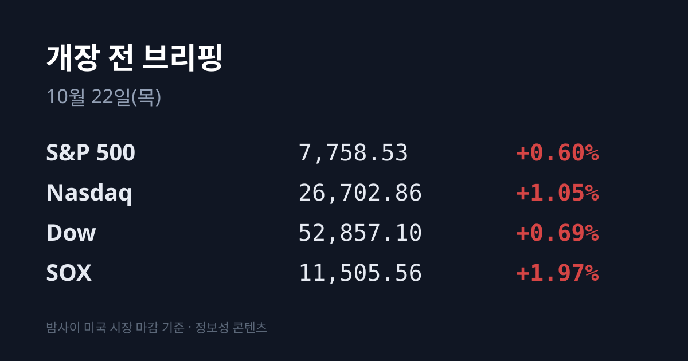
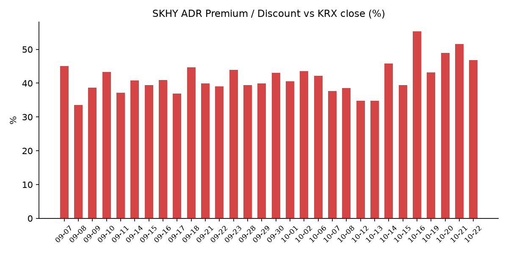
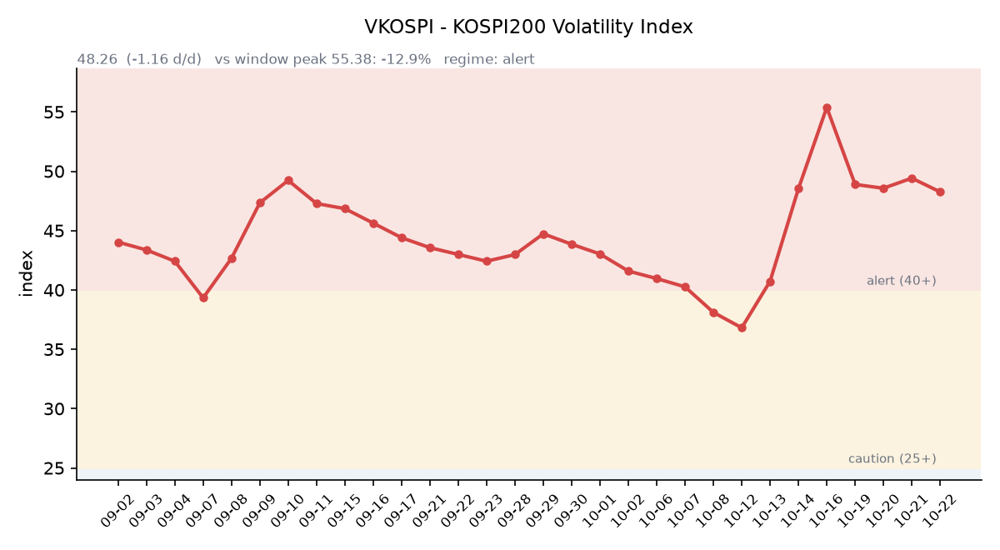

&nbsp;

【① 30초 요약 📈】

직전 거래일 10/21 코스피는 외국인 순매수에 <mark>5,735.66(+3.29%)로 하루 만에 5,700선을 되찾았습니다.</mark> 10시 51분에는 유가증권시장 매수 사이드카가 발동했습니다. 코스닥은 792.76(+1.38%)이었습니다.

삼성전자는 223,500원(+5.67%), SK하이닉스는 1,294,000원(+5.81%)이었습니다. 관세청 10월 1~20일 수출이 616억달러(+105.4%)로 같은 기간 역대 최대였고, 반도체 수출은 **+222.5% 늘었습니다.**

미국에서는 나스닥이 +1.05%, 반도체 지수(SOX)가 **+1.97% 올랐습니다.** 슈퍼마이크로가 매출 전망을 올리면서 AI 인프라 종목에 매수세가 돌아왔습니다.

장 마감 뒤 메타는 매출이 예상을 웃돌고 연간 설비투자 가이던스 하단을 올려 시간외 +1.9%입니다. 램리서치는 실적이 예상을 웃돌았는데도 시간외 −6.7%로 반도체 장비주가 함께 내렸습니다.

SKHY는 $143.25(+2.48%)였지만 본주가 더 크게 올라 괴리율은 +46.87%로 좁혀졌습니다. 시간외에서는 SKHY −1.22%, EWY −1.44%, 나스닥100 선물 −0.32%입니다. 오늘 한국은행 금통위가 열립니다.

&nbsp;

【② 밤사이 미국 시장 🌙】

| 지수 | 10/21 종가 | 등락 |
| :--- | ---: | ---: |
| S&P 500 | 7,758.53 | +0.60% |
| 나스닥 종합 | 26,702.86 | +1.05% |
| 다우 | 52,857.10 | +0.69% |
| 필라델피아 반도체(SOX) | 11,505.56 | +1.97% |

뉴욕 증시는 기술주가 이끌었습니다. 슈퍼마이크로가 매출 전망을 올리며 +9.55% 뛰었고, 전날 3분기 실적을 낸 스페이스X도 10% 올랐습니다. 델 +5.27%, 크레도 +6.28%, 시에나 +5.66%, 팔란티어 +4.72%, 버티브 +4.26% 등 AI 인프라 종목이 함께 강했습니다.

넷플릭스는 4분기 가이던스 부진으로 −5.31%, AT&T는 −6.45%였습니다(investingLive). 마이크론은 $913.67(+1.96%), 엔비디아는 $221.97(+2.54%), 테슬라는 $386.47(+3.41%)였습니다.

<mark>장 마감 뒤 메타는 3분기 매출 $646억(+26%)으로 시장 예상(약 $633억)을 웃돌았습니다.</mark> 청소년 관련 소송 합의 비용 $99억을 반영한 주당순이익(EPS)은 $3.83이었고, 이 비용을 빼면 $7.40입니다.

3분기 설비투자는 $349억으로 2분기($310억)보다 늘었고, 연간 설비투자 가이던스는 $1,350억~1,450억으로 하단이 올라갔습니다(종전 하단 $1,300억). 잉여현금흐름은 −$21.2억으로 적자가 됐고, 의결권 없는 C주 발행과 2대1 액면분할도 발표했습니다(Fortune·Forbes). 시간외 주가는 $711.00(+1.93%)입니다.

램리서치는 조정 EPS $2.20(예상 $2.18), 매출 $82.2억(예상 $81.3억)으로 예상을 웃돌았지만 시간외에서 $243.30(**−6.71%까지**) 내렸습니다. 1년 사이 주가가 80% 가까이 오른 상태에서 가이던스 범위가 넓었다는 점이 지적됐고, KLA와 어플라이드머티어리얼즈도 시간외에서 내렸습니다(Investing.com).

테슬라는 조정 EPS $0.48(예상 $0.45), 매출 $280.5억이었고 연간 설비투자 계획을 $250억에서 $200억으로 낮췄습니다. 시간외 초반 올랐다가 $378.32(−2.11%)로 돌아섰습니다. 텍사스인스트루먼트(EPS $2.62, 예상 $2.42)는 시간외 약 +2%, IBM(영업 EPS $2.95, 예상 $2.86)은 약 +5%입니다.

한국 시각 07:07 기준 지수선물은 S&P500 12월물 7,783.25(−0.22%), 나스닥100 12월물 29,912.00(−0.32%)입니다. 시간외에서 마이크론은 $905.00(−0.95%), 엔비디아는 $220.65(−0.59%)입니다.

미 국채 10년물은 5.12%에서 5.13%로, 2년물은 4.79%에서 4.81%로 올랐고 30년물은 5.42%로 그대로였습니다(미 재무부). 10년물과 2년물의 차이는 0.32%p입니다. 10년물 실질금리(TIPS)는 2.76%로 10/19(2.80%) 이후 사흘째 내렸습니다. 20년물 입찰($130억)은 낙찰 금리 5.469%로 할인이 필요했다는 평가가 나왔습니다.

VIX는 17.31에서 16.68(−3.64%)로 내렸습니다. CME 페드워치 기준 10월 FOMC 동결 확률은 10/19 기준 약 80%입니다(Forbes).

브렌트유 12월물은 약 $108.82로 보합, WTI 12월물은 $97.15(−0.68%)로 마감했습니다. 미 원유 재고가 306만 배럴 줄어 예상(82만 배럴 감소)보다 크게 감소했지만, 미국·이란 협상 절충안 보도와 걸프 재확전 우려가 엇갈렸습니다. 한국 시각 07:08 기준 브렌트는 $109.73(+0.84%)입니다. 두바이유 10/21 값은 집계 시점 기준 미확인입니다. 금 12월물은 약 $4,150.00(+0.18%), 달러인덱스는 101.70으로 보합이었습니다.

&nbsp;

【③ 괴리율 트래커 — SK하이닉스 ADR】

| 항목 | 수치 |
| :--- | ---: |
| SKHY 종가 (10/21) | $143.25 (+2.48%) |
| 본주 환산가 (×10×환율 1,326.69원) | 1,900,483원 |
| 본주 직전 종가 (10/21) | 1,294,000원 |
| **괴리율** | **+46.9%** |

10/21 한국 본주는 +5.81% 올랐고, 그 뒤 미국 SKHY는 +2.48% 올랐습니다. 본주 상승폭이 더 컸기 때문에 괴리율은 전일 +51.64%에서 <mark>+46.87%로 4.77%포인트 좁혀졌습니다.</mark> SKHY 시간외 가격은 $141.50(−1.22%)입니다.

괴리율은 미국에 상장된 예탁증서(ADR) 가격을 본주 1주 기준으로 환산한 값과 한국 본주 종가를 비교한 수치입니다. 환산가가 본주보다 높은 프리미엄 상태에서는 전환 차익거래 구조상 본주 쪽에 매수 유인이 생기고, 디스카운트면 반대입니다. 10/21에는 외국인이 SK하이닉스를 약 2,005억원 순매수하며 18거래일 연속 순매도를 끝냈습니다.

한국 시장 전체를 담는 EWY(iShares MSCI South Korea ETF)는 $156.88(+1.88%)였고, 시간외 가격은 $154.62(**−1.44%**)입니다. EWY의 10/21 세션에는 한국 10/21 장(코스피 +3.29%)과 그 뒤 미국 시간의 움직임이 함께 담겨 있습니다.

&nbsp;

【④ 변동성 트래커 🌡️】

판정 한 줄: <mark>'경보' 구간 유지, 방향은 완만한 진정 — VKOSPI 48.26으로 내렸고, 인버스 회전율은 줄고 레버리지 비중은 늘었습니다.</mark>

기대 변동성 — VKOSPI **48.26**(10/21, 전일비 −1.16, −2.35%)으로 '경보'(40~60) 구간입니다. 지수가 급반등한 날에도 장중 고가는 50.90까지 올랐습니다. 6월 고점 96.94 대비 −50.2%, 평시 상단인 25의 1.93배입니다.

실현 변동성 — 최근 10거래일 코스피 일별 등락률은 10/07 −1.98%, 10/08 −2.62%, 10/12 −3.65%, 10/13 −5.46%, 10/14 −0.44%, 10/15 −7.57%, 10/16 +2.05%, 10/19 +1.76%, 10/20 −3.73%, 10/21 +3.29%입니다. 10/02 종가 7,003.74 대비 누적 −18.1%입니다. 최근 10거래일 중 ±3% 이상 등락일은 닷새입니다.

매매 정지 — 최근 열흘 사이 10/21 10:51 유가증권시장 매수 사이드카(올해 25번째, 유가증권시장 매수 사이드카로는 8/20 이후 두 달 만), 10/16 12:55 코스닥시장 매수 사이드카, 10/15 09:07 유가증권시장·09:12 코스닥시장 매도 사이드카, 12:23 코스닥·12:38 유가증권시장 1단계 서킷브레이커, 10/13 09:47 유가증권시장 매도 사이드카가 발동했습니다(한국거래소 KIND 시장운영 공시).

증폭 경로 — 전체 ETF 거래대금 중 레버리지 ETF 비중은 **26.76%로** 직전 25.22%보다 올랐습니다. KODEX 레버리지 거래대금은 1조9,729억원(회전율 41.95%)으로 늘었고, KODEX 200선물인버스2X는 1조2,224억원으로 회전율이 153.43%에서 141.45%로 내려왔습니다. KODEX 코스닥150레버리지 4,921억원(16.05%), KODEX 반도체레버리지 2,868억원(31.38%), TIGER 반도체TOP10레버리지 2,529억원(54.21%)입니다(네이버 ETF 목록, 10/22 07:17 스냅샷). 코스피200 선물 베이시스는 +2.01로 직전 +2.27보다 좁아졌습니다.

청산 압력 — 가장 최근 보도된 신용융자 잔고는 10/16 32조8,160억원, 반대매매는 10/16 572억원입니다(금융투자협회 집계 보도). 10/19 이후 수치는 집계 시점 기준 미확인입니다.

하방 포지션 — 공매도 순잔고는 T+2~3 공시 지연이 있어 개장 전 시점에는 확정치를 알 수 없습니다. 10/21 공매도 거래대금은 SK하이닉스 1,446억원(+44.2%), 삼성전자 983억원(+10.8%)으로 지수 급등일에도 늘었습니다.

미확인: 공매도 순잔고 최신치, 10/19~21 신용융자·반대매매, 오늘 개장 직전 밤의 코스피200 야간선물(한국거래소가 다음 날 아침 공개), 프로그램 매매, DRAM·NAND 당일 현물가.

&nbsp;

【⑤ 직전 거래일(10/21) 한국장 리뷰】

| 지수 | 종가 | 등락 |
| :--- | ---: | ---: |
| 코스피 | 5,735.66 | +182.92 (+3.29%) |
| 코스닥 | 792.76 | +10.79 (+1.38%) |

코스피는 장중 5,816.43(+4.75%)까지 올랐다가 상승폭을 일부 줄였습니다. <mark>외국인은 약 6,600억~9,529억원을 순매수했습니다</mark>(장 마감 직후 집계와 뉴스핌 집계 차이). 개인은 약 1조1,300억~1조5,506억원을 순매도했고, 기관은 매체에 따라 소폭 순매도(약 −700억원)와 순매수(+924억원)로 엇갈렸습니다. 외국인은 삼성전자를 4,721억원, SK하이닉스를 2,005억원 순매수했습니다.

삼성전자는 223,500원(+5.67%), SK하이닉스는 1,294,000원(+5.81%)이었습니다. 관세청이 발표한 10월 1~20일 수출은 616억1,200만달러(+105.4%)로 같은 기간 역대 최대였고, 반도체 수출은 275억1,600만달러(+222.5%)로 전체 수출의 44.7%를 차지했습니다. 대신증권 이경민 연구원은 AI 투자 심리 회복과 외국인·기관의 반도체 대형주 매수를 상승 배경으로 꼽았습니다.

SK㈜는 **+14.02%로** 시가총액 상위 20개 종목 중 가장 많이 올랐습니다(12:20 기준). 행동주의 펀드 얼라인파트너스가 SK㈜ 지분 1.5% 보유 사실을 공개하고 순자산가치(약 100조원) 대비 시가총액이 약 75% 낮다고 주장했습니다(이투데이).

SK스퀘어 +5.13%, 삼성생명 +3.38%, 삼성바이오로직스 +1.87%, 삼성전기 +1.13%였고, LG에너지솔루션 −0.60%, 현대차 −0.16%, KB금융 −0.19%였습니다. 장중에는 한화생명이 −7.56%, 형지엘리트가 상한가였습니다. 전날 크게 내린 한화에어로스페이스(+2.25%)와 HD현대중공업(+0.47%)은 소폭 반등했습니다(12:20 기준).

코스닥에서는 외국인 약 1,720억~1,809억원 순매도, 기관 약 1,046억~1,073억원, 개인 약 518억~583억원 순매수였습니다. 알테오젠 +3.90%, 에코프로비엠 +3.33%, 주성엔지니어링 +3.48%, 이오테크닉스 +2.14%, 원익IPS +1.55%였고 HLB는 −1.51%였습니다.

원/달러는 서울 외환시장 주간 마감 기준 **1,325.2원으로** 2.9원 내려 4거래일 연속 연저점을 경신했습니다(뉴스핌). 한국 시각 07:17 기준 환율은 1,326.69원, 달러/엔은 158.19입니다.

아시아 증시 10/21 종가는 닛케이225 64,621.24(+0.85%), 토픽스 4,043.73(+0.86%), 대만 가권 46,887.77(+1.28%), 항셍 23,651.87(−0.90%), 상하이종합 3,713.03(−0.60%), CSI300 4,111.93(−0.97%)입니다. 중국에서는 배터리 업체 CATL이 3분기 순이익 증가율이 매출에 못 미치고 외국계 투자은행이 목표주가를 낮추면서 A주 −12.03%, 홍콩 H주 −11.7% 내렸습니다(뉴스핌).

&nbsp;

【⑥ 오늘의 캘린더 & 관전 포인트 📅】

**오늘(10/22 목)** <mark>한국은행 금통위 기준금리 결정</mark>(현재 3.00%, 금융투자협회 채권시장 조사 응답자 93%가 동결 예상)과 총재 기자회견. 재경부·금융위·금감원 종합 국정감사, 래블업·영광·이에스티 청약(10/22~23), 인텔리빅스 청약 마감. 미국 장 시작 전 허니웰·아메리칸항공 실적, 21:30 미국 주간 실업수당. 미국 장 마감 뒤 인텔 3분기 실적(10/22 예상, 회사 미확정).

**10/23(금)** 22:45 미국 10월 S&P글로벌 PMI, 23:00 미시간대 소비심리 확정치.

**10/27:** SK하이닉스 3분기 실적(일부 보도 10/28), **10/27~28** FOMC, **10/29** 삼성전자 3분기 확정 실적, **10/30** 일본은행 회의, **10/31** CXMT 3분기 실적, **11/3** 미국 중간선거.

시장 참가자들이 주시하는 레벨은 코스피 5,800선(10/21 장중 고점 5,816.43)과 5,600선, SK하이닉스 10/21 종가 1,294,000원, 원/달러 1,345원 선, 미 10년물 5.2% 선, VKOSPI 55 선입니다.

&nbsp;

【⑦ 정책 워치 ⚡】

한국은행 기준금리는 7월과 8월 두 차례 0.25%포인트씩 올라 연 3.00%입니다. 9월 소비자물가는 전년 대비 2.9% 올라 물가 목표(2.0%)를 웃돌았습니다. 일부 증권사는 11월과 내년 1분기 추가 인상 가능성을 거론했습니다(알파경제·한국금융신문).

정부는 증권시장안정펀드 가동과 공매도 일시 중단을 포함한 시장 안정 조치를 준비하고 있다는 보도(뉴스핌 10/20) 이후 아직 시점과 규모를 공개하지 않았습니다. 현재 공매도는 전면 재개 상태이며 10월 제도 변경 사항은 없습니다.

중동에서는 미 국무부가 걸프 지역 대사관 직원 출국명령을 준비하고 있다는 보도가 나왔습니다. 예멘 후티 반군의 재확전 가능성이 근거로 거론됐고, 실제 출국은 아직 없습니다. 미국·이란 협상에는 카타르·파키스탄이 절충안을 냈습니다(investingLive).

&nbsp;

【⑧ 오늘의 질문 ❓】

반도체 수출 +222.5%와 외국인 매수로 하루 +3.29%를 되찾은 다음 날, 램리서치 시간외 급락과 금통위 결정은 한국 반도체 수급과 어떤 관계를 보일 것인가.

&nbsp;

#개장전브리핑 #미국증시마감 #코스피반등 #반도체 #하이닉스ADR #괴리율 #메타 #램리서치 #금통위 #VKOSPI #원달러환율 #반도체수출

&nbsp;

*본 글은 공개된 시장 데이터를 정리한 정보성 콘텐츠이며, 특정 종목·상품의 매매 권유가 아닙니다. 모든 투자 판단과 책임은 투자자 본인에게 있습니다. 수치는 작성 시점 기준이며 이후 변동될 수 있습니다.*