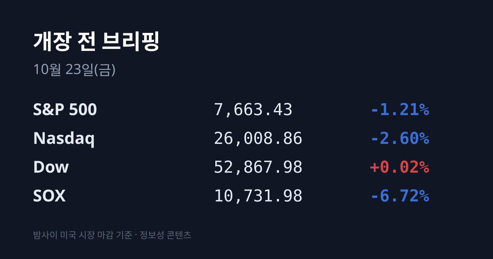
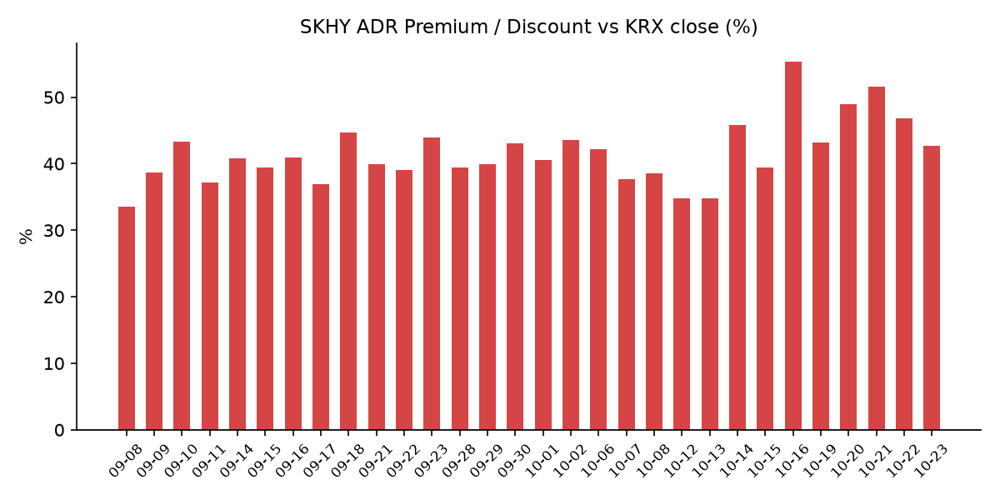
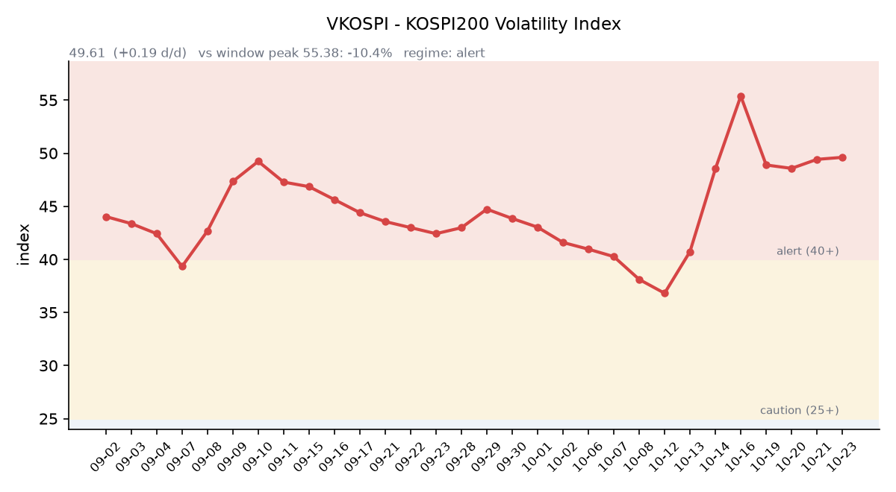

&nbsp;

【① 30초 요약 📈】

직전 거래일 10/22 코스피는 <mark>5,533.77(−3.52%)로 전날 상승분을 모두 반납했습니다.</mark> 코스닥은 764.10(−3.62%)이었습니다. 한국은행 금통위는 기준금리를 연 3.00%로 만장일치 동결했습니다.

삼성전자는 214,500원(−4.03%), SK하이닉스는 1,223,000원(−5.49%)이었습니다. SK하이닉스 40조원 자사주 매입이 10/21 예정보다 한 달 일찍 끝났고, 기관이 두 종목을 순매도했습니다.

한국 장 마감 뒤 미국에서는 <mark>나스닥 −2.60%, 반도체 지수(SOX) −6.72%</mark>였습니다. 메타가 −6.98% 내리며 AI 투자 수익성 우려가 다시 커졌고, 램리서치 −11.76%, 마이크론 −6.26%였습니다.

미 국채 10년물은 **4.96%로 17bp** 내려 9월 23일 이후 처음 5% 아래로 내려왔습니다. 브렌트유는 후티의 사우디 공격 소식에 $113.17(+4.00%)로 올랐습니다.

SKHY는 $131.69(−8.07%)로 본주보다 더 내려 괴리율은 +42.75%로 좁혀졌습니다. 한국 시각 07:09 기준 나스닥100 선물은 −0.05%, S&P500 선물은 +0.05%입니다.

&nbsp;

【② 밤사이 미국 시장 🌙】

| 지수 | 10/22 종가 | 등락 |
| :--- | ---: | ---: |
| S&P 500 | 7,663.43 | −1.21% |
| 나스닥 종합 | 26,008.86 | −2.60% |
| 다우 | 52,867.98 | +0.02% |
| 필라델피아 반도체(SOX) | 10,731.98 | −6.72% |

뉴욕 증시는 기술주가 크게 내렸습니다. 나스닥의 하루 낙폭은 6월 이후 가장 컸습니다(뉴스핌). 메타는 $648.85(−6.98%)로 마감했고 장중 낙폭은 7월 이후 가장 컸습니다. 전날 발표한 3분기 실적에서 AI 투자로 잉여현금흐름이 −$21.2억으로 돌아섰고, 의결권 없는 신주 발행 계획이 다년간 자금 조달 필요성으로 읽혔다는 해석이 나왔습니다. 테슬라는 $374.58(−3.08%)였습니다.

<mark>반도체주는 메모리와 장비가 함께 내렸습니다.</mark> 램리서치 $230.15(−11.76%), AMD $507.93(−8.10%), 인텔 $85.49(−8.04%), 마벨 −8.7%, 샌디스크 −8.51%, 웨스턴디지털 −6.43%, 마이크론 $856.49(−6.26%), 엔비디아 $212.21(−4.40%)입니다. 반면 스포티파이 +11.19%, 블랙스톤 +8.33%, 록히드마틴 +6.87%, P&G +5.57%가 올랐고 애플도 +1.23%였습니다(뉴스핌). 다우는 보합이었습니다.

직전 브리핑에서 10/22 장 마감 뒤 발표 예정으로 적었던 인텔 3분기 실적은 회사 공지 기준 **10/29(목) 장 마감 뒤**입니다. 10/22 장 마감 뒤에는 반도체·빅테크의 주요 실적 발표가 없었습니다. 시간외 가격은 SKHY $132.09(+0.30%), 마이크론 $848.99(−0.88%), 엔비디아 $213.46(+0.59%), 메타 $646.36(−0.38%)입니다. 한국 시각 07:09 기준 지수선물은 S&P500 12월물 7,708.50(+0.05%), 나스닥100 12월물 29,126.50(−0.05%)입니다.

미 국채 10년물은 5.13%에서 4.96%로, 2년물은 4.81%에서 4.65%로, 30년물은 5.42%에서 5.29%로 내렸습니다(미 재무부). 10년물과 2년물의 차이는 0.31%p입니다. 10년물 실질금리(TIPS)는 2.76%에서 2.64%로 내렸습니다. 기술주에서 빠진 자금이 국채로 옮겨 갔고 내년 금리 인상 기대가 줄었다는 분석이 나왔습니다(블룸버그 인용 보도). VIX는 16.68에서 19.03(+14.1%)으로 올랐습니다. CME 페드워치 10월 FOMC 확률의 10/22 값은 집계 시점 기준 미확인입니다.

브렌트유 12월물은 $113.17(+4.00%)로 5월 18일 이후 가장 높았고, WTI 12월물은 $99.47(+2.39%)입니다. 이란과 연계된 후티가 사우디 여러 목표를 공격했고, 아람코 샤이바 유전을 노린 드론은 요격됐으나 파편으로 2명이 숨졌습니다. 생산과 수출에는 영향이 없었습니다. 한국 시각 07:07 기준 브렌트는 $112.96입니다. 금 12월물은 $4,060.40(−2.16%)으로 내렸고, 달러인덱스는 101.62(−0.16%)입니다. 실질금리와 달러가 함께 내린 날 금도 내렸는데, 귀금속과 암호화폐가 함께 팔렸다는 분석이 나왔습니다(뉴스핌). 비트코인은 약 $81,000입니다.

&nbsp;

【③ 괴리율 트래커 — SK하이닉스 ADR】

| 항목 | 수치 |
| :--- | ---: |
| SKHY 종가 (10/22) | $131.69 (−8.07%) |
| 본주 환산가 (×10×환율 1,325.69원) | 1,745,801원 |
| 본주 직전 종가 (10/22) | 1,223,000원 |
| **괴리율** | **+42.7%** |

10/22 한국 본주는 −5.49% 내렸고, 그 뒤 미국 SKHY는 −8.07% 내렸습니다. SKHY 하락폭이 더 컸기 때문에 괴리율은 전일 +46.87%에서 <mark>+42.75%로 4.12%포인트 좁혀졌습니다.</mark> 본주 장 마감 이후 미국에서 반도체 지수가 −6.72% 내린 몫이 SKHY에 더해진 결과입니다. SKHY 시간외 가격은 $132.09(+0.30%)입니다.

괴리율은 미국에 상장된 예탁증서(ADR) 가격을 본주 1주 기준으로 환산한 값과 한국 본주 종가를 비교한 수치입니다. 환산가가 본주보다 높은 프리미엄 상태에서는 전환 차익거래 구조상 본주 쪽에 매수 유인이 생기고, 디스카운트면 반대입니다. 10/22 외국인은 SK하이닉스를 약 446억원 순매수했고 기관은 약 2,643억원 순매도했습니다.

한국 시장 전체를 담는 EWY(iShares MSCI South Korea ETF)는 $149.06(**−4.98%**)였고, 시간외 가격은 $148.79(−0.18%)입니다. EWY의 10/22 세션에는 한국 10/22 장(코스피 −3.52%)과 그 뒤 미국 시간의 움직임이 함께 담겨 있습니다.

&nbsp;

【④ 변동성 트래커 🌡️】

판정 한 줄: <mark>'경보' 구간 유지, 방향은 재상승 — VKOSPI가 사흘 만에 올랐고 선물 베이시스는 마이너스로 돌아섰습니다.</mark>

기대 변동성 — VKOSPI **49.61**(10/22, 전일비 +1.35, +2.80%)로 '경보'(40~60) 구간입니다. 지수가 −3.52% 내린 날 장중 고가는 50.07이었습니다. 6월 고점 96.94 대비 −48.8%, 평시 상단인 25의 1.98배입니다.

실현 변동성 — 최근 10거래일 코스피 일별 등락률은 10/08 −2.62%, 10/12 −3.65%, 10/13 −5.46%, 10/14 −0.44%, 10/15 −7.57%, 10/16 +2.05%, 10/19 +1.76%, 10/20 −3.73%, 10/21 +3.29%, 10/22 −3.52%입니다. 10/02 종가 7,003.74 대비 누적 −21.0%입니다. 최근 10거래일 중 ±3% 이상 등락일은 **엿새입니다.**

매매 정지 — 최근 열흘 사이 10/21 10:51 유가증권시장 매수 사이드카, 10/16 12:55 코스닥시장 매수 사이드카, 10/15 09:07 유가증권시장·09:12 코스닥시장 매도 사이드카, 12:23 코스닥·12:38 유가증권시장 1단계 서킷브레이커, 10/13 09:47 유가증권시장 매도 사이드카가 발동했습니다(한국거래소 KIND 시장운영 공시).

증폭 경로 — 전체 ETF 거래대금 중 레버리지 ETF 비중은 23.22%로 직전 26.76%보다 내렸습니다. KODEX 레버리지 거래대금은 1조6,007억원(회전율 37.43%), KODEX 200선물인버스2X는 1조685억원으로 회전율이 141.45%에서 124.18%로 내려왔습니다. KODEX 코스닥150레버리지 3,999억원(14.18%), KODEX 반도체레버리지 2,225억원(27.14%), TIGER 반도체TOP10레버리지 1,808억원(41.05%)입니다(네이버 ETF 목록, 10/23 07:17 스냅샷). 코스피200 선물 베이시스는 **−1.02(선물 857.00 − 현물 858.02)로** 직전 +2.01에서 마이너스로 돌아섰습니다.

청산 압력 — 신용융자 잔고는 10/20 30조5,138억원으로 8월 12일 이후 가장 적었습니다. 투자자예탁금은 10/20 90조2,975억원으로 6거래일 연속 줄었습니다(이투데이). 10/15 이후 반대매매 금액은 집계 시점 기준 미확인입니다.

하방 포지션 — 공매도 순잔고는 T+2~3 공시 지연이 있어 개장 전 시점에는 확정치를 알 수 없습니다.

미확인: 공매도 순잔고 최신치, 10/15 이후 반대매매, 오늘 개장 직전 밤의 코스피200 야간선물(한국거래소가 다음 날 아침 공개), 프로그램 매매, DRAM·NAND 당일 현물가.

&nbsp;

【⑤ 직전 거래일(10/22) 한국장 리뷰】

| 지수 | 종가 | 등락 |
| :--- | ---: | ---: |
| 코스피 | 5,533.77 | −201.89 (−3.52%) |
| 코스닥 | 764.10 | −28.66 (−3.62%) |

코스피는 전날 +3.29% 오른 상승분을 하루 만에 모두 반납했습니다. 기관은 약 4,630억~6,834억원을 순매도했고 개인은 순매수했습니다. 외국인 순매수 규모는 매체에 따라 약 +590억~+614억원(톱스타뉴스·다음 금융)과 −3,991억원(뉴스핌)으로 엇갈렸습니다. 외국인의 10월 유가증권시장 누적 순매도는 17조4,030억원이고, 그중 삼성전자·SK하이닉스 비중이 약 77%입니다(파이낸셜뉴스 인용).

<mark>SK하이닉스는 1,223,000원(−5.49%), 삼성전자는 214,500원(−4.03%)이었습니다.</mark> SK하이닉스는 40조원 규모 자사주 매입(2,407만 주, 발행주식의 약 3.3%)을 10/21 마쳤습니다. 공시상 기한은 11월 19일이었습니다. 삼성전자의 약 15조원 매입(8/24~10/6)도 이미 끝나 두 회사 합계 약 55조원의 매수세가 사라졌다는 분석이 나왔습니다(톱스타뉴스). 기관은 삼성전자를 856억원, SK하이닉스를 2,643억원 순매도했고, 외국인은 삼성전자를 약 1,262억원 팔고 SK하이닉스를 약 446억원 샀습니다. 메타의 잉여현금흐름 적자와 전날 급반등에 따른 차익실현도 배경으로 꼽혔습니다. SK하이닉스 거래대금은 2조9,883억원으로 전 종목 중 가장 많았습니다.

2차전지주도 크게 내렸습니다. LG에너지솔루션 390,000원(−5.22%), 에코프로비엠 98,200원(−9.66%), 에코프로 77,200원(−7.54%)입니다. 중국 CATL의 3분기 순이익이 시장 예상을 밑돈 여파가 거론됐습니다(비즈니스포스트). 반도체 장비주는 주성엔지니어링 −8.93%, 원익IPS −7.92%, 리노공업 −4.75%, 이오테크닉스 −4.65%였습니다. 그 밖에 SK스퀘어 −3.59%, 삼성바이오로직스 −3.95%, 현대차 −2.58%, 삼성전기 −1.97%, KB금융 −1.49%였습니다.

오른 종목도 있었습니다. 삼성E&A는 3분기 영업이익이 시장 전망을 웃돌고 6,900억원 규모 자사주 소각을 발표해 15:15 기준 **55,100원(+15.51%)이었습니다.** 비나텍은 데이터센터용 슈퍼커패시터 약 1,195억원 공급계약으로 장중 20% 넘게 올랐고, 엠에스바이오는 상장 첫날 급등했습니다. 삼성전기는 엔비디아와 AI 칩 기판 장기 공급 파트너십을 맺었다고 밝혔습니다.

코스닥에서는 외국인 1,566억원, 기관 1,047억원 순매도, 개인 2,577억원 순매수였습니다(뉴스핌). 알테오젠 −3.75%, 삼천당제약 −5.65%, HLB −2.48%, 레인보우로보틱스 −2.41%였습니다.

원/달러는 서울 외환시장 주간 마감 기준 1,324.2원으로 1.0원 내렸습니다(뉴스핌). 한국 시각 07:10 기준 환율은 1,325.69원, 달러/엔은 156.72로 엔화가 0.9% 강해졌습니다.

아시아 증시 10/22 종가는 닛케이225 62,907.84(−2.65%), 토픽스 3,997.50(−1.14%), 대만 가권 46,041.43(−1.81%), 항셍 22,934.68(−3.03%), 상하이종합 3,658.03(−1.48%), CSI300 4,036.30(−1.84%)입니다.

&nbsp;

【⑥ 오늘의 캘린더 & 관전 포인트 📅】

**오늘(10/23 금)** 디티에스·모비콘텐츠테크 코스닥 신규 상장, 래블업·영광·이에스티 청약 마감. <mark>22:45 미국 10월 S&P글로벌 PMI</mark>, 23:00 미시간대 소비심리 확정치.

**10/27~28:** FOMC. **10/28(수):** SK하이닉스 3분기 실적(보도자료 09:00 이전, 09:00 컨퍼런스콜) — 증권가 전망 평균 매출 98조2,257억원, 영업이익 76조9,640억원. 추가 주주환원 발표 여부에 관심이 모여 있습니다.

**다음 주:** 마이크로소프트·알파벳·아마존 실적. **10/29:** 삼성전자 3분기 확정 실적, 장 마감 뒤 인텔 3분기 실적. **10/30:** 일본은행 회의. **10/31:** CXMT 3분기 실적. **11/3:** 미국 중간선거.

시장 참가자들이 주시하는 레벨은 코스피 5,450선(10/15 저점)과 5,600선, SK하이닉스 10/22 종가 1,223,000원, VKOSPI 55 선, 원/달러 1,345원 선, 브렌트 $115 선입니다.

&nbsp;

【⑦ 정책 워치 ⚡】

한국은행 금통위는 10/22 기준금리를 연 3.00%로 만장일치 동결했습니다. 7월과 8월 연속 인상 뒤의 동결입니다. 결정문은 물가 등을 점검하면서 추가 인상의 시기와 속도를 정하겠다고 밝혔고, 내년 물가가 종전 전망을 웃돌 것으로 봤습니다. 한미 기준금리 차이(상단 기준)는 1.00%포인트입니다(한국금융신문·뉴스1).

정부의 시장 안정 조치(증권시장안정펀드, 공매도 일시 중단 포함) 준비 보도(뉴스핌 10/20) 이후 시점과 규모는 아직 공개되지 않았습니다. 현재 공매도는 전면 재개 상태이며 10월 제도 변경 사항은 없습니다.

중동에서는 미국이 사우디 주재 외교관을 철수시키고 11월 3일 중간선거 이후 이란 타격을 준비하고 있다는 보도가 나왔습니다(CNBC). 전날 보도된 걸프 지역 대사관 출국명령 준비에서 실제 철수로 이어진 것입니다.

&nbsp;

【⑧ 오늘의 질문 ❓】

자사주 매입이 끝난 뒤 하루 −3.5%를 먼저 겪은 한국 반도체는, 그 뒤에 나온 미국 SOX −6.7%와 미 10년물 5% 하회를 어떻게 함께 소화할 것인가.

&nbsp;

#개장전브리핑 #미국증시마감 #나스닥급락 #반도체 #하이닉스ADR #괴리율 #메타 #자사주 #VKOSPI #국제유가 #미국채금리 #금통위

&nbsp;

*본 글은 공개된 시장 데이터를 정리한 정보성 콘텐츠이며, 특정 종목·상품의 매매 권유가 아닙니다. 모든 투자 판단과 책임은 투자자 본인에게 있습니다. 수치는 작성 시점 기준이며 이후 변동될 수 있습니다.*