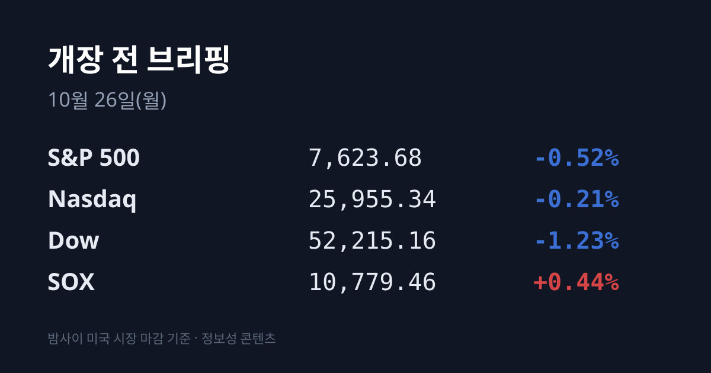
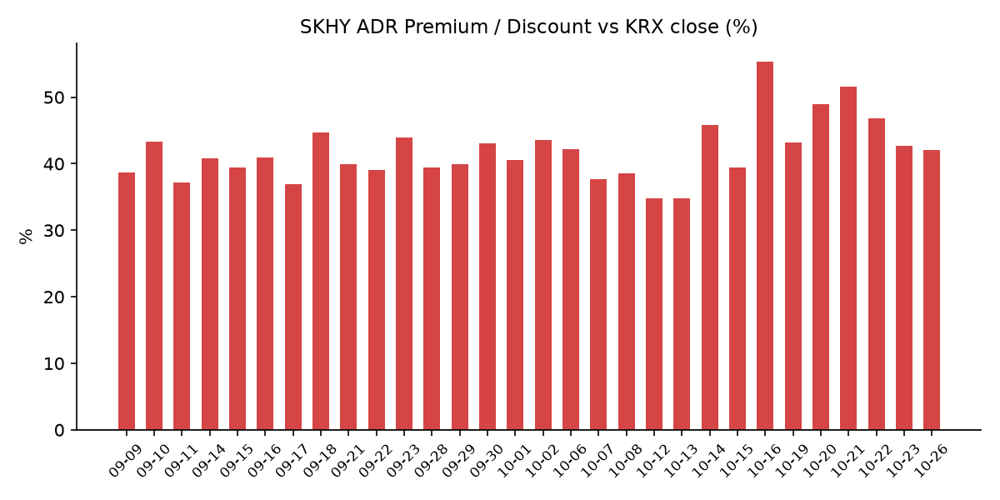
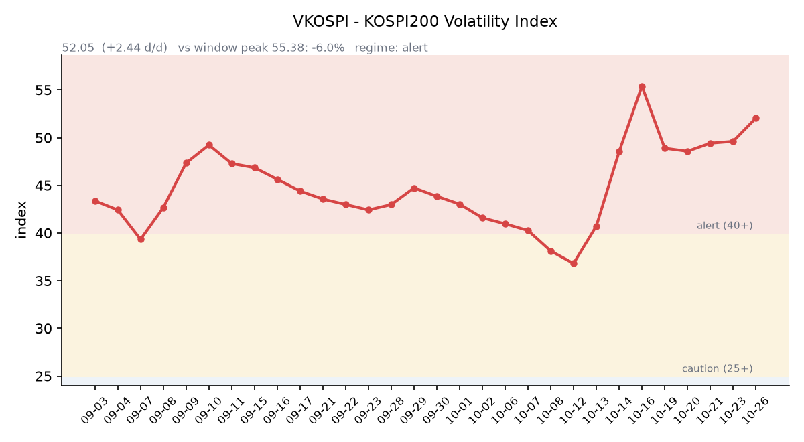

&nbsp;

【① 30초 요약 📈】

주말을 끼고 3일 만에 열리는 장입니다. 직전 거래일 10/23 이후 미국은 금요일 1세션이 열렸습니다. 10/23 코스피는 <mark>장중 5,305.98(−4.12%)까지 밀렸다가 5,550.30(+0.30%)으로 마감했습니다.</mark> 코스닥은 751.69(−1.62%)였습니다.

SK하이닉스는 손자회사 솔리다임의 미국 상장 검토를 중단한다고 공시한 뒤 **1,277,000원(+4.42%)에** 마감했습니다. 삼성전자는 215,500원(+0.47%)이었습니다.

10/23 미국에서는 유가가 뛰며 다우가 −1.23% 내렸습니다. 반도체 지수(SOX)는 전날 −6.72% 급락 뒤 +0.44%로 멈췄고 마이크론은 +2.46%였습니다.

<mark>브렌트유 12월물은 $116.72(+3.1%)</mark>, 두바이유는 $116.90으로 두바이가 브렌트를 웃돌았습니다. 미 국채 10년물은 5.00%로 다시 올라섰습니다.

SKHY는 $137.02(+4.05%)로 본주와 비슷하게 올라 괴리율은 +42.00%로 소폭 좁혀졌습니다. 이번 주에는 SK하이닉스 실적(10/28)과 FOMC 결정(10/29 03:00)이 이어집니다.

&nbsp;

【② 밤사이 미국 시장 🌙】

| 지수 | 10/23 종가 | 등락 |
| :--- | ---: | ---: |
| S&P 500 | 7,623.68 | −0.52% |
| 나스닥 종합 | 25,955.34 | −0.21% |
| 다우 | 52,215.16 | −1.23% |
| 필라델피아 반도체(SOX) | 10,779.46 | +0.44% |

한국 10/23 장 마감 뒤 열린 미국 세션은 금요일 하루입니다. 뉴욕 증시는 유가 급등에 3대 지수가 함께 내렸습니다. 다우는 652.82포인트 내렸고, 매도는 필수소비재·유틸리티·헬스케어 같은 방어 업종까지 번졌습니다. 아메리칸익스프레스는 전 세계 인력의 약 5%를 줄인다고 밝힌 뒤 3% 넘게 내렸고, 캐터필러도 인력 감축 발표 뒤 −2.42%였습니다. 크라우드스트라이크는 8% 넘게 올랐습니다.

<mark>반도체주는 전날 급락 뒤 진정됐습니다.</mark> SOX는 10/22 −6.72%에 이어 10/23 +0.44%였습니다. 마이크론 $877.55(+2.46%), AMD $516.79(+1.74%), 인텔 $86.96(+1.72%)이 올랐고 램리서치 $230.10(−0.02%)는 보합, 엔비디아 $210.96(−0.59%)은 소폭 내렸습니다. 메타 $642.62(−0.96%), 테슬라 $372.22(−0.63%)였습니다. 한 주 기준으로는 S&P500과 나스닥이 내렸고 다우는 소폭 올랐습니다.

10/23 장 마감 뒤 예정된 반도체·빅테크 실적 발표는 없었습니다. 시간외 가격은 SKHY $136.98(−0.03%), 마이크론 $879.90(+0.27%), 엔비디아 $211.11(+0.07%)로 움직임이 작았습니다. 한국 시각 07:09 기준 지수선물은 S&P500 12월물 7,659.75, 나스닥100 12월물 29,117.75로 금요일 마감값과 같습니다. 주간 거래가 다시 열린 직후라 방향은 집계 시점 기준 미확인입니다.

미 국채 10년물은 4.96%에서 **5.00%로 4bp** 올라 다시 5%선에 섰습니다. 2년물은 4.65%에서 4.69%, 30년물은 5.29%에서 5.33%로 모두 4bp씩 올랐고 10년물과 2년물의 차이는 0.31%p 그대로입니다(미 재무부). 10년물 실질금리(TIPS)는 2.64%에서 2.66%였습니다. VIX는 19.03에서 19.45로 올랐습니다. CME 페드워치 기준 이번 주 FOMC 금리 동결 확률은 10/25 오후 90%입니다(머니투데이 인용).

브렌트유 12월물은 $116.72(+3.1%)로 4월 이후 가장 높았고, WTI는 $103.27(+3.8%)입니다. 미국과 이스라엘이 11월 3일 중간선거 이후 이란 공격 재개를 계획하고 있다는 보도가 나왔습니다(ABC). 후티는 사우디 라비그 정유시설과 원유 펌핑 스테이션, 동서 송유관을 겨냥한 공격을 이어갔습니다. 한국 원유 수입의 기준인 두바이유는 10/23 $116.90으로 브렌트보다 $0.18 높았습니다(한국석유공사 페트로넷). 금 12월물은 $4,007.90(−1.29%), 달러인덱스는 101.75(+0.14%)입니다. 실질금리와 달러가 함께 오른 날 금은 내렸습니다.

&nbsp;

【③ 괴리율 트래커 — SK하이닉스 ADR】

| 항목 | 수치 |
| :--- | ---: |
| SKHY 종가 (10/23) | $137.02 (+4.05%) |
| 본주 환산가 (×10×환율 1,323.42원) | 1,813,350원 |
| 본주 직전 종가 (10/23) | 1,277,000원 |
| **괴리율** | **+42.0%** |

10/23 한국 본주는 솔리다임 상장 검토 중단 공시 뒤 +4.42% 올랐고, 미국 SKHY도 +4.05% 올랐습니다. 두 시장이 비슷한 폭으로 움직여 괴리율은 전일 +42.75%에서 <mark>+42.00%로 0.75%포인트 좁혀졌습니다.</mark> SKHY 시간외 가격은 $136.98(−0.03%)입니다. 괴리율은 10/16 +55.28% 이후 낮아지는 흐름입니다.

괴리율은 미국에 상장된 예탁증서(ADR) 가격을 본주 1주 기준으로 환산한 값과 한국 본주 종가를 비교한 수치입니다. 환산가가 본주보다 높은 프리미엄 상태에서는 전환 차익거래 구조상 본주 쪽에 매수 유인이 생기고, 디스카운트면 반대입니다. 10/23 기관은 SK하이닉스를 약 5,961억원 순매수했고 외국인은 매도 우위였습니다.

한국 시장 전체를 담는 EWY(iShares MSCI South Korea ETF)는 $151.26(**+1.48%**)였고 시간외 가격은 $151.00입니다. EWY의 10/23 세션에는 한국 10/23 장(코스피 +0.30%)과 그 뒤 미국 시간의 움직임이 함께 담겨 있습니다.

&nbsp;

【④ 변동성 트래커 🌡️】

판정 한 줄: <mark>'경보' 구간, 방향은 이틀 연속 상승 — 지수가 오른 날에도 VKOSPI가 52를 넘었고 인버스 ETF 회전율이 크게 뛰었습니다.</mark>

기대 변동성 — VKOSPI **52.05**(10/23, 전일비 +2.44, +4.92%)로 '경보'(40~60) 구간입니다. 이틀 연속 올랐고 장중 고가는 54.30이었습니다. 6월 고점 96.94 대비 −46.3%, 평시 상단인 25의 2.08배입니다.

실현 변동성 — 최근 10거래일 코스피 일별 등락률은 10/12 −3.65%, 10/13 −5.46%, 10/14 −0.44%, 10/15 −7.57%, 10/16 +2.05%, 10/19 +1.76%, 10/20 −3.73%, 10/21 +3.29%, 10/22 −3.52%, 10/23 +0.30%입니다. 10/23은 장중 저점 5,305.98에서 종가까지 4.6% 올랐습니다. 10/02 종가 7,003.74 대비 누적 −20.8%이고, 최근 10거래일 중 ±3% 이상 등락일은 **엿새입니다.**

매매 정지 — 최근 열흘 사이 10/21 10:51 유가증권시장 매수 사이드카, 10/16 12:55 코스닥시장 매수 사이드카가 발동했습니다(한국거래소 KIND 시장운영 공시).

증폭 경로 — 전체 ETF 거래대금 중 레버리지 ETF 비중은 22.97%로 직전 23.22%와 비슷했습니다. KODEX 200선물인버스2X는 거래대금 1조5,066억원으로 회전율이 124.18%에서 **174.76%로** 뛰었습니다. KODEX 레버리지 1조5,828억원(35.93%), KODEX 코스닥150레버리지 4,603억원(16.79%), KODEX 반도체레버리지 2,772억원(33.90%), TIGER 반도체TOP10레버리지 2,183억원(46.56%)입니다(네이버 ETF 목록, 10/26 07:17 스냅샷). 코스피200 선물 베이시스는 +0.53(선물 863.30 − 현물 862.77)으로 직전 −1.02에서 플러스로 돌아왔습니다.

청산 압력 — 신용융자 잔고는 10/21 30조2,710억원으로 10/12 34조2,887억원보다 약 4조원 줄었습니다. 9/21~10/21 19거래일 동안 반대매매 금액은 5,336억8,200만원이었고, 투자자예탁금은 10/21 89조6,344억원입니다(아주경제, 금융투자협회 집계).

하방 포지션 — 공매도 순잔고는 T+2~3 공시 지연이 있어 개장 전 시점에는 확정치를 알 수 없습니다.

미확인: 공매도 순잔고 최신치, 10/22 이후 반대매매 일별치, 오늘 개장 직전 밤의 코스피200 야간선물(한국거래소가 다음 날 아침 공개), 프로그램 매매, DRAM·NAND 당일 현물가.

&nbsp;

【⑤ 직전 거래일(10/23) 한국장 리뷰】

| 지수 | 종가 | 등락 |
| :--- | ---: | ---: |
| 코스피 | 5,550.30 | +16.53 (+0.30%) |
| 코스닥 | 751.69 | −12.41 (−1.62%) |

코스피는 −2.36%로 출발해 장 초반 5,305.98(−4.12%)까지 밀렸다가 장 마감 약 20분 전 플러스로 돌아섰습니다. 외국인은 약 9,655억~1조938억원을 순매도해 3거래일 만에 매도로 돌아섰고, 기관은 약 7,995억~8,726억원을 순매수했습니다(매체별 집계 차이). 한 주(10/19~23) 동안 코스피는 2.08% 내렸습니다.

<mark>SK하이닉스는 1,277,000원(+4.42%), 삼성전자는 215,500원(+0.47%)이었습니다.</mark> SK하이닉스는 장중 손자회사 솔리다임의 미국 상장과 프리IPO 검토를 중단한다고 공시했습니다. 자본시장 여건과 주가 흐름을 고려해 기존 주주에게 가장 유리한 선택인지 다시 따져 보겠다는 설명입니다. 솔리다임 별도 상장에 따른 주주가치 희석 우려가 컸던 만큼 시장은 이를 불확실성 해소로 받아들였다는 해석이 나왔습니다. SK하이닉스는 이달 10/22까지 31.1% 내린 상태였습니다. 기관은 SK하이닉스를 약 5,961억원, 삼성전자를 약 1,348억원 순매수했고 외국인은 두 종목 모두 매도 우위였습니다. 대신증권은 전날 급락에서 AI 투자 우려가 상당 부분 반영돼 추가 하락이 제한됐다고 분석했습니다.

삼성바이오로직스는 1,460,000원(+7.27%)으로 올랐습니다. 법원이 노조의 쟁의행위 금지 범위를 9개 생산공정 전체로 인정하면서 파업에 따른 생산 차질 우려가 줄었다는 평가가 나왔습니다(파이낸셜뉴스). SK스퀘어 +3.20%, 삼성생명 +1.45%였습니다. 반면 KB금융 −3.29%, 삼성전기 −2.01%, 현대차 −1.99%, LG에너지솔루션 −1.79%였습니다.

코스닥은 이틀 연속 내려 8월 3일 이후 처음 760 아래에서 마감했고, 장중 저점은 732.87이었습니다. 외국인과 기관이 소폭 순매도했고 개인이 순매수했습니다. 에코프로 −5.83%, 에코프로비엠 −5.50%로 2차전지주가 사흘째 약했고, 리노공업 −4.05%, 주성엔지니어링 −3.64%, 레인보우로보틱스 −3.42%, 알테오젠 −2.81%였습니다.

원/달러는 서울 외환시장 주간 마감 기준 1,324.6원으로 0.4원 올랐습니다(뉴스핌). 한국 시각 07:18 기준 환율은 1,323.42원, 달러/엔은 156.89입니다.

아시아 증시 10/23 종가는 닛케이225 62,693.16(−0.34%), 토픽스 3,965.81(−0.79%), 상하이종합 3,690.48(+0.89%), CSI300 4,105.33(+1.71%), 항셍 23,093.37(+0.69%)입니다.

&nbsp;

【⑥ 오늘의 캘린더 & 관전 포인트 📅】

**주말 사이:** 트럼프 대통령은 10/25 인터뷰에서 이란과 합의할지 공격할지 결정할 시점이 다가왔다며 "오늘은 공격이 없을 것"이라고 말했습니다. 이란 외무장관은 중재를 통한 간접 협상이 이어지고 있다고 밝혔습니다.

**10/27(화):** SK증권스팩14호 상장, 이스라엘 총선, FOMC 시작.

<mark>10/28(수): SK하이닉스 3분기 실적(09:00 컨퍼런스콜)</mark> — 증권가 전망 평균 매출 98조2,257억원, 영업이익 76조9,640억원. 추가 주주환원 발표 여부에 관심이 모여 있습니다.

**10/29(목):** 03:00 FOMC 결정, 05:00 이후 마이크로소프트·알파벳 실적, 삼성전자 3분기 확정 실적, 21:30 미국 3분기 GDP 속보치.

**10/30(금):** 05:00 이후 아마존·인텔 실적, 일본은행 회의. **10/31:** CXMT 3분기 실적. **11/3:** 미국 중간선거.

시장 참가자들이 주시하는 레벨은 코스피 5,500선과 5,650선, SK하이닉스 10/23 종가 1,277,000원, VKOSPI 55 선, 원/달러 1,340원 선, 브렌트 $120 선입니다.

&nbsp;

【⑦ 정책 워치 ⚡】

SK하이닉스의 솔리다임 상장 검토 중단을 두고 거버넌스포럼은 환영 입장을 내면서 이사회 의결이 필요하다고 밝혔습니다. 중복상장 문제는 금융당국과 정치권에서도 제기돼 왔습니다.

중동에서는 백악관이 11월 3일 중간선거 전에는 이란 공격을 재개하지 않겠다고 밝혔고, 미국과 이스라엘 군이 선거 이후 공동 공격 계획을 세웠다는 보도가 나왔습니다. 이란은 걸프 해저케이블 절단 가능성을 언급했다는 보도가 있었습니다.

현재 공매도는 전면 재개 상태이며 10월 제도 변경 사항은 없습니다.

&nbsp;

【⑧ 오늘의 질문 ❓】

지배구조 불확실성을 털어낸 SK하이닉스와 $116대로 오른 유가 가운데, 실적과 FOMC를 앞둔 한 주의 첫날 한국 시장은 어느 쪽에 더 무게를 둘 것인가.

&nbsp;

#개장전브리핑 #미국증시마감 #유가급등 #반도체 #하이닉스ADR #괴리율 #솔리다임 #VKOSPI #국제유가 #이란 #FOMC #SK하이닉스실적

&nbsp;

*본 글은 공개된 시장 데이터를 정리한 정보성 콘텐츠이며, 특정 종목·상품의 매매 권유가 아닙니다. 모든 투자 판단과 책임은 투자자 본인에게 있습니다. 수치는 작성 시점 기준이며 이후 변동될 수 있습니다.*