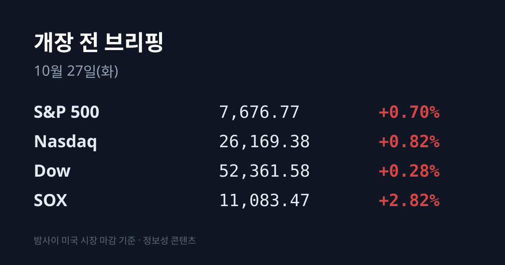
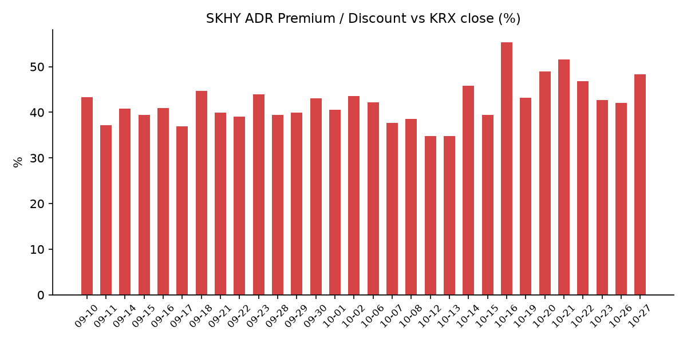
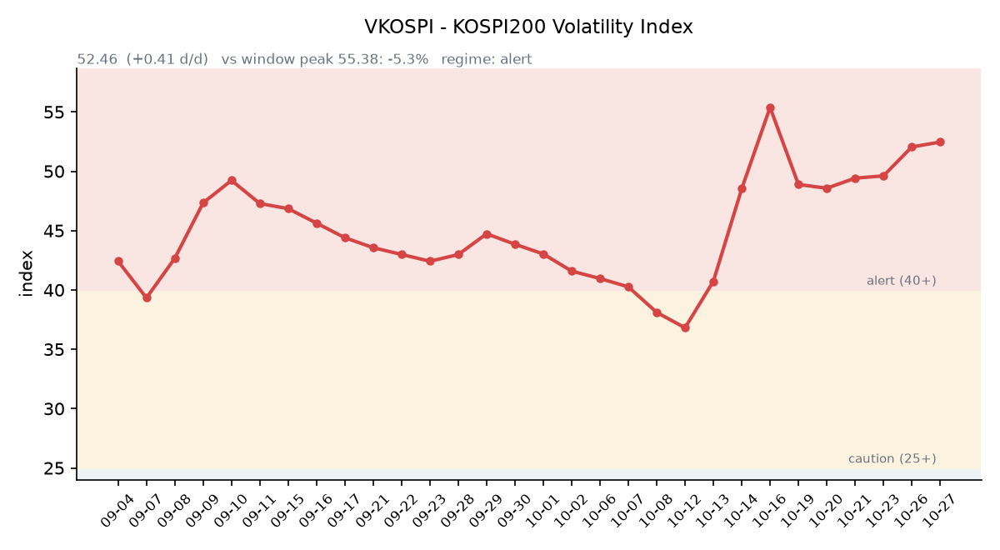

&nbsp;

【① 30초 요약 📈】

10/26 코스피는 외국인이 약 7천억원을 순매도하며 <mark>5,469.47(−1.46%)로 4월 6일 이후 가장 낮은 종가</mark>를 기록했습니다. 코스닥은 727.21(−3.26%)로 반도체 장비주가 크게 내렸습니다.

밤사이 미국에서는 앤트로픽이 나스닥 상장 신청서(S-1)를 공개하며 AI 투자 심리가 살아났습니다. 나스닥 +0.82%, **SOX +2.82%로** 반도체가 반등했습니다.

메타는 AI 인프라 자금을 위해 최대 950억 달러 규모 유상증자 계획을 발표했고 주가는 −1.88%였습니다.

SKHY는 $142.62(+4.09%)로 올랐고 본주는 보합이어서 <mark>괴리율이 +48.33%로 6.33%포인트 벌어졌습니다.</mark>

이틀 휴장한 대만 증시가 오늘 다시 열리고, 내일(10/28) SK하이닉스 3분기 실적이 발표됩니다.

&nbsp;

【② 밤사이 미국 시장 🌙】

| 지수 | 10/26 종가 | 등락 |
| :--- | ---: | ---: |
| S&P 500 | 7,676.77 | +0.70% |
| 나스닥 종합 | 26,169.38 | +0.82% |
| 다우 | 52,361.58 | +0.28% |
| 필라델피아 반도체(SOX) | 11,083.47 | +2.82% |

10/26 뉴욕 증시는 3대 지수가 모두 올랐습니다. 앤트로픽이 나스닥에 'ANT' 티커로 상장하겠다는 신청서를 공개한 것이 계기였습니다. 신청서에 따르면 앤트로픽의 올해 상반기 매출은 163억 달러로 1년 전보다 1,300% 늘었습니다. 월스트리트저널은 11월 16일 주 상장, 기업가치 1조5천억~2조 달러, 조달액 1,000억 달러 이상을 목표로 한다고 보도했습니다. <mark>AI 투자에 대한 회의론이 누그러지며 반도체주가 반등했습니다.</mark>

마이크론 $903.70(+2.98%), AMD $531.28(+2.80%), 엔비디아 $216.00(+2.39%), 브로드컴 +2.33%, 인텔 $90.47(+4.04%)였습니다. SOX는 10/22 −6.72% 급락 뒤 10/23 +0.44%, 10/26 +2.82%로 이틀 연속 올랐지만 10/21 종가보다는 아직 3.7% 낮습니다. 메타는 최대 950억 달러 규모 유상증자 계획을 발표한 뒤 −1.88%였습니다. 1차로 약 350억 달러를 보통주와 우선주로 조달하고, 엔비디아·AMD·브로드컴이 최대 50억 달러어치 인수 의향을 밝혔습니다. 메타의 연간 설비투자 가이던스는 1,350억~1,450억 달러입니다. 테슬라는 바클레이즈의 투자의견 상향에 +5.21%였고, 브라질 대통령 결선에서 룰라 대통령이 승리하자 브라질 ETF(EWZ)는 −19.82%였습니다.

10/26 장 마감 뒤 예정됐던 대형 반도체·빅테크 실적은 없었습니다. 반도체 설계 소프트웨어 기업 케이던스는 3분기 매출 16억3천만 달러, 조정 주당순이익 $2.11로 시장 예상을 넘었고 연간 매출 성장 가이던스를 21%로 올렸습니다. 시간외 가격은 $329.50으로 정규장 종가보다 2.28% 높습니다. 한국 시각 07:17 기준 SKHY 시간외 가격은 $143.75(+0.79%)입니다. 07:08 기준 지수선물은 S&P500 12월물 7,718.00(+0.05%), 나스닥100 12월물 29,492.75(+0.19%)입니다.

미 국채 10년물은 **5.00%로 보합**이었습니다. 2년물은 4.69%에서 4.68%, 30년물은 5.33%에서 5.31%로 내렸고 10년물과 2년물의 차이는 0.32%p입니다(미 재무부). 10년물 실질금리(TIPS)는 2.66%로 변동이 없었습니다. VIX는 19.45에서 18.39로 내렸습니다. CME 페드워치 기준 이번 주 FOMC 금리 동결 확률은 10/22 90.6%였고, 예측시장 칼시는 10/25 동결 93%를 반영했습니다.

브렌트유 12월물은 $115.81(−0.78%), WTI는 $101.76(−1.46%)으로 내렸습니다(로이터). 카타르 중재단이 테헤란을 방문하고 사우디 주도의 안보회의가 열리며 긴장 완화 기대가 생긴 영향입니다. 브렌트는 이달 들어 10% 넘게 올라 있습니다. 금 12월물은 한국 시각 07:06 기준 $4,029.50(+0.54%), 달러인덱스는 102.03(+0.22%)입니다. 실질금리가 그대로인 가운데 금과 달러가 함께 소폭 올랐습니다.

&nbsp;

【③ 괴리율 트래커 — SK하이닉스 ADR】

| 항목 | 수치 |
| :--- | ---: |
| SKHY 종가 (10/26) | $142.62 (+4.09%) |
| 본주 환산가 (×10×환율 1,326.08원) | 1,891,255원 |
| 본주 직전 종가 (10/26) | 1,275,000원 |
| **괴리율** | **+48.3%** |

10/26 한국 본주는 장중 1,315,000원까지 올랐다가 상승분을 반납해 1,275,000원(−0.16%)으로 마감했습니다. 그 뒤 미국 SKHY는 반도체 반등에 +4.09% 올랐습니다. 그 결과 괴리율은 전일 +42.00%에서 **+48.33%로 6.33%포인트** 벌어졌습니다. 10/21(+51.64%) 이후 가장 높은 수준입니다.

괴리율은 미국에 상장된 예탁증서(ADR) 가격을 본주 1주 기준으로 환산한 값과 한국 본주 종가를 비교한 수치입니다. 환산가가 본주보다 높은 프리미엄 상태에서는 전환 차익거래 구조상 본주 쪽에 매수 유인이 생기고, 디스카운트면 반대입니다. 외국인은 10월 들어 SK하이닉스를 약 10조7,074억원 순매도했습니다(머니투데이).

한국 시장 전체를 담는 EWY(iShares MSCI South Korea ETF)는 $152.72(+0.97%)였고 시간외 가격은 $154.12입니다. EWY의 10/26 세션에는 한국 10/26 장(코스피 −1.46%)과 그 뒤 미국 시간의 움직임이 함께 담겨 있습니다.

&nbsp;

【④ 변동성 트래커 🌡️】

**판정 한 줄**: <mark>'경보' 구간, VKOSPI는 사흘 연속 올랐지만 상승 폭은 줄었고 레버리지·인버스 ETF 회전은 식었습니다.</mark>

**기대 변동성**  VKOSPI **52.46**(10/26, 전일비 +0.41, +0.79%)으로 '경보'(40~60) 구간입니다. 사흘 연속 올랐으며, 시가 54.01이 장중 고점이었고 이후 내려 마감했습니다. 6월 고점 96.94 대비 −45.9%, 평시 상단인 25의 2.10배입니다.

**실현 변동성**  최근 10거래일 코스피 일별 등락률은 10/13 −5.46%, 10/14 −0.44%, 10/15 −7.57%, 10/16 +2.05%, 10/19 +1.76%, 10/20 −3.73%, 10/21 +3.29%, 10/22 −3.52%, 10/23 +0.30%, 10/26 −1.46%입니다. 10/02 종가 7,003.74 대비 누적 −21.9%이고, 최근 10거래일 중 ±3% 이상 등락일은 닷새입니다.

**매매 정지**  최근 열흘 사이 10/21 10:51 유가증권시장 매수 사이드카가 발동했습니다(한국거래소 KIND 시장운영 공시).

**증폭 경로**  전체 ETF 거래대금 중 레버리지 ETF 비중은 21.42%로 직전 22.97%에서 내려왔습니다. KODEX 200선물인버스2X 회전율은 174.76%에서 **124.59%로** 낮아졌습니다(거래대금 1조1,641억원). KODEX 레버리지 1조2,517억원(29.03%), KODEX 코스닥150레버리지 3,209억원(12.43%), KODEX 반도체레버리지 1,646억원(21.97%), TIGER 반도체TOP10레버리지 1,252억원(27.76%)입니다(네이버 ETF 목록, 10/27 07:16 스냅샷). 코스피200 선물 베이시스는 −1.51(선물 850.00 − 현물 851.51)로 직전 +0.53에서 마이너스로 돌아섰습니다.

**청산 압력**  신용융자 잔고는 10/21 30조2,710억원으로 10/12 34조2,887억원보다 약 4조원 줄었습니다. 9/21~10/21 반대매매 금액은 5,336억원, 투자자예탁금은 10/21 89조6,344억원입니다(금융투자협회 집계 보도).

**하방 포지션**  공매도 순잔고는 T+2~3 공시 지연이 있어 개장 전 시점에는 확정치를 알 수 없습니다.

*미확인: 공매도 순잔고 최신치, 10/22 이후 신용융자·반대매매 일별치, 오늘 개장 직전 밤의 코스피200 야간선물(한국거래소가 다음 날 아침 공개), 코스피 프로그램 매매, DRAM·NAND 당일 현물가.*

&nbsp;

【⑤ 직전 거래일(10/26) 한국장 리뷰】

| 지수 | 종가 | 등락 |
| :--- | ---: | ---: |
| 코스피 | 5,469.47 | −80.83 (−1.46%) |
| 코스닥 | 727.21 | −24.48 (−3.26%) |

코스피는 5,499.05로 내려 출발해 장중 5,565.67까지 올랐다가 밀렸습니다. 종가는 4월 6일(5,450.33) 이후 최저입니다. 외국인은 약 6,952억~6,972억원을 순매도해 이틀 연속 매도했고, 기관은 약 5,986억~6,106억원, 개인은 약 580억~596억원을 순매수했습니다(매체별 집계 차이). 외국인의 10월 코스피 누적 순매도는 19조1,139억원입니다(머니투데이).

<mark>삼성전자는 213,000원(−1.16%), SK하이닉스는 1,275,000원(−0.16%)이었습니다.</mark> 삼성전자에는 회사 고유의 악재가 보도되지 않았고, 시장에서는 외국인 매도와 유가·중동 리스크, AI 투자 수익성 논란, 빅테크 실적과 FOMC를 앞둔 관망이 겹쳤다는 해석이 나왔습니다. 다만 10/19~26 외국인 순매수 1위 종목은 삼성전자(5,916억원)였습니다. SK하이닉스는 장중 130만원을 넘었다가 보합권으로 마감했습니다. 회사는 10/28 실적 발표 때 이사회 의결을 전제로 추가 주주환원책을 내놓겠다고 밝힌 상태입니다. KB증권은 두 회사의 주가수익비율(PER)이 3배 수준으로 금융위기 때와 비슷한 저평가라고 분석했습니다.

코스피에서는 한화에어로스페이스 −4.04%, KB금융 −3.79%, 신한지주 −2.95%, 현대차 −2.54%, LG에너지솔루션 −2.09%가 내렸고, 삼성물산 +1.39%, 삼성생명 +0.61%는 올랐습니다.

코스닥은 7월 31일 이후 가장 낮은 종가로 마감했습니다. 기관이 약 1,280억원을 순매도했고 개인(약 854억원)과 외국인(약 403억원)이 순매수했습니다. 하락 종목이 1,309개로 상승 370개를 크게 웃돌았습니다. **주성엔지니어링 −6.84%**, 원익IPS −6.49%, 이오테크닉스 −6.19%, 리노공업 −4.22%로 반도체 장비주가 나흘째 약했고, HLB −5.65%, 삼천당제약 −5.17%, 에코프로 −4.13%, 에코프로비엠 −3.45%였습니다. 루닛은 미국 서밋테라퓨틱스와 AI 병리 바이오마커 개발 협업 소식에 상한가(+30.00%)를 기록했고 뷰노도 +29.95%였습니다.

원/달러는 서울 외환시장 주간 마감 기준 1,323.1원으로 1.5원 내렸습니다. 한국 시각 07:18 기준 환율은 1,326.08원, 달러/엔은 157.54입니다.

아시아 증시 10/26 종가는 닛케이225 62,189.65(−0.80%), 토픽스 3,972.98(+0.18%), 상하이종합 3,697.52(+0.19%), CSI300 4,103.54(−0.04%), 항셍 23,211.81(+0.51%)입니다. 대만 증시는 10/23 태풍, 10/26 대체공휴일로 이틀 쉬었습니다.

&nbsp;

【⑥ 오늘의 캘린더 & 관전 포인트 📅】

**10/27(화):** <mark>10:00 대만 증시 재개장</mark> — 10/22 종가(46,041.43) 이후 미국 SOX 3세션(−6.72%, +0.44%, +2.82%)이 지나갔습니다. 이스라엘 총선, FOMC 시작, SK증권스팩14호 상장, 23:00 미국 10월 소비자신뢰지수. 한국은행이 발표한 10월 소비자심리지수는 105.4로 1.2포인트 내렸습니다.

**10/28(수):** 05:00 이후 NXP 실적. <mark>SK하이닉스 3분기 실적(09:00 컨퍼런스콜)</mark> — 증권가 전망 평균 매출 98조2,257억원, 영업이익 76조9,640억원. 추가 주주환원 발표 여부에 관심이 모여 있습니다.

**10/29(목):** 03:00 FOMC 결정, 05:00 이후 마이크로소프트·알파벳 실적, 삼성전자 3분기 확정 실적, 21:30 미국 3분기 GDP 속보치.

**10/30(금):** 05:00 이후 아마존·인텔 실적, 일본은행 회의. **10/31:** CXMT 3분기 실적. **11/3:** 미국 중간선거.

시장 참가자들이 주시하는 레벨은 코스피 10/26 종가 5,469.47과 5,600선, SK하이닉스 10/26 종가 1,275,000원, 코스닥 720선, VKOSPI 55 선, 원/달러 1,340원 선, 브렌트 $120 선입니다.

&nbsp;

【⑦ 정책 워치 ⚡】

중동에서는 카타르 중재단의 테헤란 방문과 사우디 주도 안보회의가 이어졌습니다. 트럼프 대통령은 이란과 합의할지, 군사 작전으로 끝낼지를 저울질하고 있다고 보도됐습니다(폭스뉴스). 미국의 대이란 공격 재개 시점은 11월 3일 중간선거 이후라는 보도가 유지되고 있습니다.

현재 공매도는 전면 재개 상태이며 10월 제도 변경 사항은 없습니다.

&nbsp;

【⑧ 오늘의 질문 ❓】

밤사이 미국이 앤트로픽 IPO를 계기로 반도체를 다시 사들인 가운데, 10월 내내 SK하이닉스를 판 외국인은 실적 발표 하루 전 어떤 선택을 할 것인가.

&nbsp;

#개장전브리핑 #미국증시마감 #반도체 #하이닉스ADR #괴리율 #앤트로픽 #메타 #VKOSPI #대만증시 #FOMC #SK하이닉스실적

&nbsp;

*본 글은 공개된 시장 데이터를 정리한 정보성 콘텐츠이며, 특정 종목·상품의 매매 권유가 아닙니다. 모든 투자 판단과 책임은 투자자 본인에게 있습니다. 수치는 작성 시점 기준이며 이후 변동될 수 있습니다.*