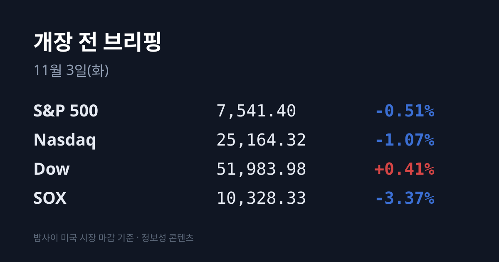
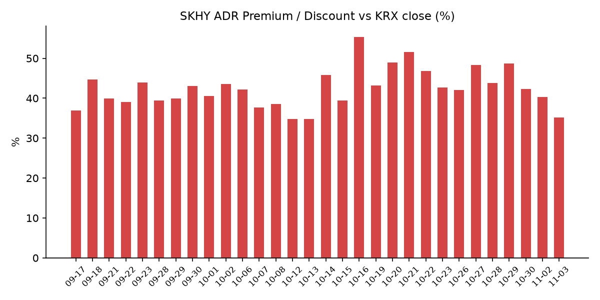
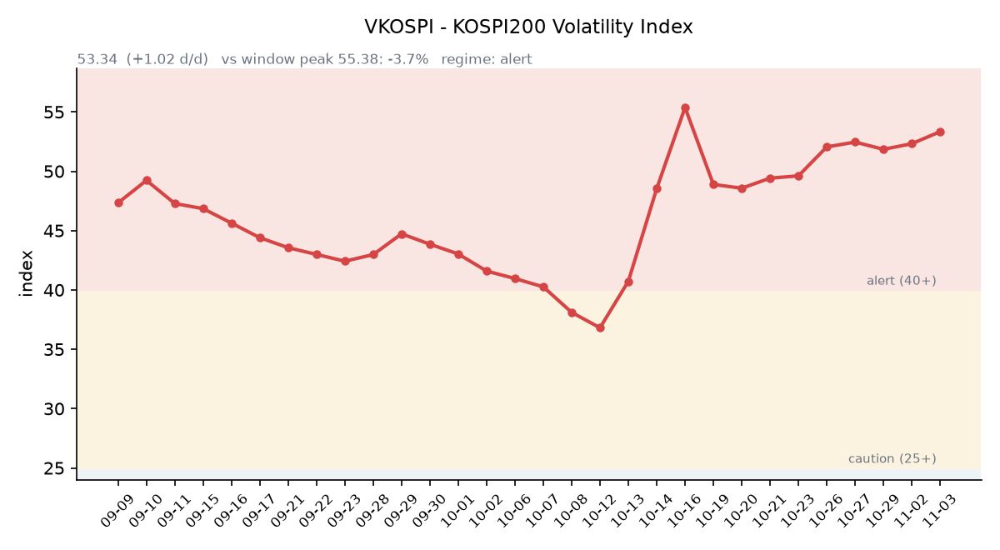

【① 30초 요약 📈】

11/2 코스피는 −1.62%로 출발했다가 기관이 1조2,329억원을 순매수하며 <mark>5,859.08(+2.24%)로 마감했습니다.</mark> SK하이닉스 +3.81%, 삼성전자 +1.78%였습니다.

밤사이 미국은 다우 +0.41%, 나스닥 −1.07%로 엇갈렸고 **SOX는 −3.37%였습니다**. 일본 키옥시아가 보수적인 분기 전망을 내놓은 뒤 마이크론이 −5.78% 내렸습니다.

미국과 이란의 외교적 해결 기대로 <mark>브렌트유는 $104.77(−7.6%), WTI는 $96.46(−7.3%)로</mark> 마감했습니다.

SKHY는 −1.01%로 본주(+3.81%)와 반대로 움직였고, 괴리율은 +35.1%로 5.18%포인트 줄었습니다.

애플은 회계 4분기 매출 1,144.8억 달러로 시장 예상을 넘었고 시간외 주가는 보합권입니다. 미국은 오늘(11/3) 중간선거입니다.

&nbsp;

【② 밤사이 미국 시장 🌙】

| 지수 | 11/2 종가 | 등락 |
| :--- | ---: | ---: |
| S&P 500 | 7,541.40 | −0.51% |
| 나스닥 종합 | 25,164.32 | −1.07% |
| 다우 | 51,983.98 | +0.41% |
| 필라델피아 반도체(SOX) | 10,328.33 | −3.37% |

장중에는 3대 지수가 모두 올랐지만 반도체 매도가 이어지며 S&P500과 나스닥은 하락 마감했습니다. S&P500 구성 종목 약 70%는 올랐습니다(야후 파이낸스). 블룸버그는 반도체 대형주 지수가 사흘 동안 약 12% 내렸고, 나스닥100은 10월 고점 대비 10% 내려 기술적 조정 구간에 들어섰다고 전했습니다.

<mark>이날 반도체 매도의 출발점은 일본 키옥시아였습니다.</mark> 키옥시아는 7~9월 분기 매출과 이익이 사상 최대였지만, 12월 분기 영업이익 전망을 2.0조엔으로 제시해 시장 예상(2.35조엔)에 못 미쳤습니다. 7~9월 NAND 평균판매가격 상승률은 약 25%로 직전 분기(약 70%)보다 낮아졌습니다. 회사는 NAND 수급이 2027년까지 빠듯하다고 봤지만 가격 상승 속도는 예측하기 어렵다고 밝혔고, 주가는 도쿄에서 **−13.29%** 내렸습니다(BigGo·TradingKey). 이어 미국에서는 마이크론 $833.59(−5.78%), 웨스턴디지털 −5%, 샌디스크 −3% 등 메모리주가 함께 내렸습니다(24/7 Wall St.).

인텔은 $59.97(−8.80%)로 이틀째 내렸고, AMD는 11/3 장 마감 뒤 실적 발표를 앞두고 PC 수요 우려 속에 $466.84(−7.52%)였습니다. 엔비디아는 $202.06(−1.26%)였습니다. 반도체 업종 시가총액은 하루에 4천억 달러 넘게 줄었습니다(야후 파이낸스).

장 마감 뒤에는 애플과 팔란티어가 실적을 발표했습니다. **애플은 회계 4분기 매출 1,144.8억 달러(+12%)로** 시장 예상(1,133.9억 달러, LSEG)을 넘었고, 주당순이익은 $2.10(관세 환급 효과 $0.05 포함)이었습니다. 아이폰 매출은 575.8억 달러였고 총이익률은 메모리·부품 원가 부담 속에 47.9%였습니다. 지난 9월 취임한 존 터너스 CEO의 첫 실적입니다. 정규장 $338.32(−1.83%) 마감 뒤 시간외 가격은 $338.80(+0.14%)입니다. 팔란티어는 3분기 매출이 처음으로 20억 달러를 넘었고 미국 상업 매출이 9.84억 달러(+148%)였습니다. 4분기 매출 전망은 약 26.5억 달러이며, 시간외 가격은 $179.10(+0.43%)입니다(CNBC).

미국 10월 ISM 제조업 지수는 55.5로 예상(54.5)을 웃돌았고, 지불가격 지수는 75.2로 예상(77.2)보다 낮았습니다. **미 국채 10년물은 4.94%에서 4.91%로** 내렸고, 30년물은 5.28%(−3bp), 2년물은 4.59%(+3bp)로 10년물과의 차이는 0.32%p로 좁혀졌습니다(미 재무부). 10년물 실질금리(TIPS)는 2.62%로 2bp 올랐습니다. VIX는 19.42에서 21.15로 8.9% 올랐습니다.

국제유가는 이란이 '미국이 해상 봉쇄를 풀면 이틀 안에 호르무즈 해협을 열 수 있다'는 입장을 내고 카타르 중재 협상이 진행되면서 크게 내렸습니다. 브렌트유는 10/30 기록한 6개월 최고치 $117.64에서 $104.77로 내려왔습니다(뉴스핌). OPEC+는 주말 회의에서 12월 생산 목표를 유지했습니다. 금 12월물은 $3,956.60(+1.48%)로 금요일 낙폭 일부를 되찾았고, 달러인덱스는 101.78(−0.10%)입니다.

지수선물은 정규 마감(06:59 KST) 기준 S&P500 12월물 7,587.25(10/30 대비 −0.35%), 나스닥100 12월물 28,223.75(−1.09%)입니다.

&nbsp;

【③ 괴리율 트래커 — SK하이닉스 ADR】

| 항목 | 수치 |
| :--- | ---: |
| SKHY 종가 (11/2) | $147.71 (−1.01%) |
| 본주 환산가 (×10×환율 1,346.69원) | 1,989,196원 |
| 본주 직전 종가 (11/2) | 1,472,000원 |
| **괴리율** | **+35.1%** |

11/2 한국 본주는 1,472,000원(+3.81%)으로 올랐지만, 그 뒤 미국 SKHY는 $147.71(−1.01%)로 내렸습니다. 본주와 ADR이 반대로 움직이면서 괴리율은 전일 +40.32%에서 <mark>+35.14%로 5.18%포인트 줄었습니다.</mark> 원화 약세(1,333.47원 → 1,346.69원)가 환산가를 끌어올려 축소 폭을 일부 상쇄했습니다. SKHY 시간외 가격은 $148.18(+0.32%)입니다.

괴리율은 미국에 상장된 예탁증서(ADR) 가격을 본주 1주 기준으로 환산한 값과 한국 본주 종가를 비교한 수치입니다. 환산가가 본주보다 높은 프리미엄 상태에서는 전환 차익거래 구조상 본주 쪽에 매수 유인이 생기고, 디스카운트면 반대입니다.

한국 시장 전체를 담는 EWY(iShares MSCI South Korea ETF)는 $151.62(−0.83%)였고 시간외 가격은 $152.86입니다. 11/2 코스피 상승률(+2.24%)과 원화 약세(−0.71%)를 반영한 한국장 달러 기준 수익률은 약 +1.5%로, 한국장 마감 이후 미국 정규장 시간에 약 2.3%포인트가 더 내린 셈입니다(시간외 가격 기준 약 1.5%포인트).

&nbsp;

【④ 변동성 트래커 🌡️】

**판정 한 줄**: <mark>'경보' 구간에서 코스피가 +2.24% 반등한 날에도 VKOSPI는 53.34로 이틀째 올라, 10/23 이후 이어진 51~52대 박스 위에서 마감했습니다.</mark>

**기대 변동성**  VKOSPI **53.34**(11/2, 전일비 +1.02, +1.95%)로 '경보'(40~60) 구간입니다. 시가 54.25에서 출발해 저가 근처에서 마감했습니다. 6월 고점 96.94 대비 −45.0%, 평시 상단인 25의 2.13배입니다.

**실현 변동성**  최근 10거래일 코스피 일별 등락률은 10/20 −3.73%, 10/21 +3.29%, 10/22 −3.52%, 10/23 +0.30%, 10/26 −1.46%, 10/27 +3.09%, 10/28 +6.63%, 10/29 −1.24%, 10/30 −3.48%, 11/2 +2.24%입니다. 이 중 ±3% 이상 등락일은 엿새입니다. 11/2 장중 고가 5,910.83과 저가 5,616.50의 차이는 **종가 대비 5.0%였고**, 최근 5거래일 평균 일중 변동폭은 4.0%입니다. 10/02 종가 7,003.74 대비로는 −16.3%입니다.

**매매 정지**  최근 열흘 사이 10/27 10:13, 10/28 09:54에 유가증권시장 매수 사이드카가, 10/30 10:04에 매도 사이드카가 발동했습니다(한국거래소 KIND 시장운영 공시).

**증폭 경로**  전체 ETF 거래대금 중 레버리지 ETF 비중은 23.78%로 직전(23.83%)과 비슷했습니다. KODEX 레버리지는 1조6,502억원(회전율 33.78%), KODEX 200선물인버스2X는 9,528억원(106.58%, 직전 124.82%), TIGER 반도체TOP10레버리지는 3,204억원(54.85%, 직전 66.36%)으로 인버스·반도체 레버리지 회전율이 함께 내려갔습니다. KODEX 코스닥150레버리지는 2,961억원(10.85%), KODEX 반도체레버리지 2,330억원(27.44%)입니다(네이버 ETF 목록, 11/3 07:17 스냅샷). 코스피200 선물 베이시스는 −1.98(선물 918.65 − 현물 920.63)로 나흘째 마이너스이며, 폭은 직전 −0.33보다 커졌습니다.

**청산 압력**  10/28 이후 신용융자 잔고와 반대매매 금액은 집계 시점 기준 미확인입니다. 가장 최근 확인치는 10/27 기준 잔고 29조6,372억원, 반대매매 193억원입니다.

**하방 포지션**  공매도 순잔고는 T+2~3 공시 지연이 있어 개장 전 시점에는 확정치를 알 수 없습니다.

*미확인: 공매도 순잔고 최신치, 10/28 이후 신용융자·반대매매, 오늘 개장 직전 밤의 코스피200 야간선물(한국거래소가 다음 날 아침 공개), 코스피 프로그램 매매, DRAM·NAND 당일 현물가.*

&nbsp;

【⑤ 직전 거래일(11/2) 한국장 리뷰】

| 지수 | 종가 | 등락 |
| :--- | ---: | ---: |
| 코스피 | 5,859.08 | +128.34 (+2.24%) |
| 코스닥 | 734.36 | +9.98 (+1.38%) |

코스피는 미국 금요일 반도체 급락 여파로 5,637.77(−1.62%)에서 출발해 장 초반 5,616.50까지 내렸다가 오후 한때 5,910.83까지 올랐습니다. <mark>기관이 1조2,329억원을 순매수했고</mark>, 이 가운데 금융투자 5,776억원, 투신 2,644억원, 연기금 1,699억원이었습니다. 외국인은 3,685억원, 개인은 1조3,475억원을 순매도했습니다(남도일보). 외국인은 3거래일 연속 순매도였지만 규모는 10/30(약 1조6천억원)보다 줄었습니다.

**SK하이닉스는 1,472,000원(+3.81%)**, 삼성전자는 229,000원(+1.78%)으로 마감했습니다. 장 초반에는 각각 1,389,000원, 217,000원(−3.56%)까지 밀렸습니다. 직전 거래일 급락으로 미국 반도체 약세가 상당 부분 반영됐고, PC 수요 둔화·생산 차질을 겪는 인텔과 HBM·서버 메모리 중심인 국내 업체의 사업 구조가 다르다는 분석이 나왔습니다(진일보). SK하이닉스 자사주 매입도 주가를 받쳤다는 평가입니다(뉴스핌). 외국인은 전기전자 업종에서 삼성전자를 1,210억원 순매수하고 SK하이닉스를 2,165억원 순매도했습니다(남도일보).

시가총액 상위에서는 SK스퀘어 +5.91%, 현대차 +1.77%, 삼성전자우 +1.67%였고 삼성바이오로직스 −4.37%, KB금융 −1.35%, LG에너지솔루션 −0.97%였습니다. 최근 낙폭이 컸던 조선·전력설비 업종에 매수가 들어왔고, 한국거래소의 저PBR 기업 명단 공개 이후 관련 종목이 올랐습니다(뉴스핌).

코스닥은 기관이 623억원을 순매수했고 외국인 322억원, 개인 260억원을 순매도했습니다. 반도체 장비·부품주는 심텍 +6.08%, 원익IPS +2.82%, 주성엔지니어링 +1.82%, 리노공업 +1.60%로 반등했고, HLB +4.25%, 에코프로 +2.22%였습니다.

원/달러는 서울 외환시장 주간 마감 기준 **1,343.8원으로 9.5원** 올랐습니다. 작성 시각(11/3 07:17) 현재 환율은 1,346.69원, 달러/엔은 157.86입니다.

아시아 증시 11/2 종가는 닛케이225 63,081.86(−0.33%), 토픽스 3,930.28(−0.88%), 상하이종합 3,638.03(+1.08%), CSI300 4,016.92(+0.79%), 항셍 23,393.32(+0.42%), 대만 가권 44,920.14(−0.65%)입니다.

&nbsp;

【⑥ 오늘의 캘린더 & 관전 포인트 📅】

**11/3(화) 08:00:** 한국 10월 소비자물가동향(국가데이터처), 미국 지수선물 거래 재개.

**11/3(화):** <mark>미국 중간선거</mark>(개표 결과는 한국 시각 11/4 오전부터), 미국 9월 JOLTS(23:00).

**11/4(수) 새벽:** AMD 3분기 실적(미국 11/3 장 마감 후). AMD가 앞서 제시한 3분기 매출 전망은 약 130억 달러(±3억 달러)입니다.

**11/6(금) 22:30:** 미국 10월 고용보고서. **11/9~10:** 엔비디아 AI 데이 서울. **11/11:** 한국 10월 고용동향.

시장 참가자들이 주시하는 레벨은 코스피 5,900선과 5,710선, 11/2 장중 저점 5,616.50, SK하이닉스 1,400,000원 선, VKOSPI 55 선, 원/달러 1,350원 선, 브렌트유 $110 선입니다.

&nbsp;

【⑦ 정책 워치 ⚡】

이란 대통령은 최고지도자가 평화 협상과 관련한 일정 권한을 정부에 부여했다고 밝혔고, 트럼프 대통령은 대화에 열려 있으며 진전이 있었다고 말했습니다(세부 내용은 밝히지 않음). 루비오 국무장관은 트럼프 대통령이 외교적 해결을 선호한다고 했습니다. 한편 중간선거 이후 공습 재개 가능성을 거론하는 보도도 이어지고 있습니다.

국내에서는 현재 공매도가 전면 재개 상태이며 최근 제도 변경 사항은 없습니다.

&nbsp;

【⑧ 오늘의 질문 ❓】

어제 한국 반도체주는 '인텔과 우리는 다르다'는 논리로 반등했다 — 밤사이 미국을 흔든 재료가 인텔이 아니라 같은 메모리 업체인 키옥시아였다는 사실을, 시장은 어떻게 받아들이고 있는가.

&nbsp;

#개장전브리핑 #미국증시마감 #반도체 #하이닉스ADR #괴리율 #키옥시아 #마이크론 #국제유가 #애플실적 #VKOSPI #중간선거

&nbsp;
*본 글은 공개된 시장 데이터를 정리한 정보성 콘텐츠이며, 특정 종목·상품의 매매 권유가 아닙니다. 모든 투자 판단과 책임은 투자자 본인에게 있습니다. 수치는 작성 시점 기준이며 이후 변동될 수 있습니다.*