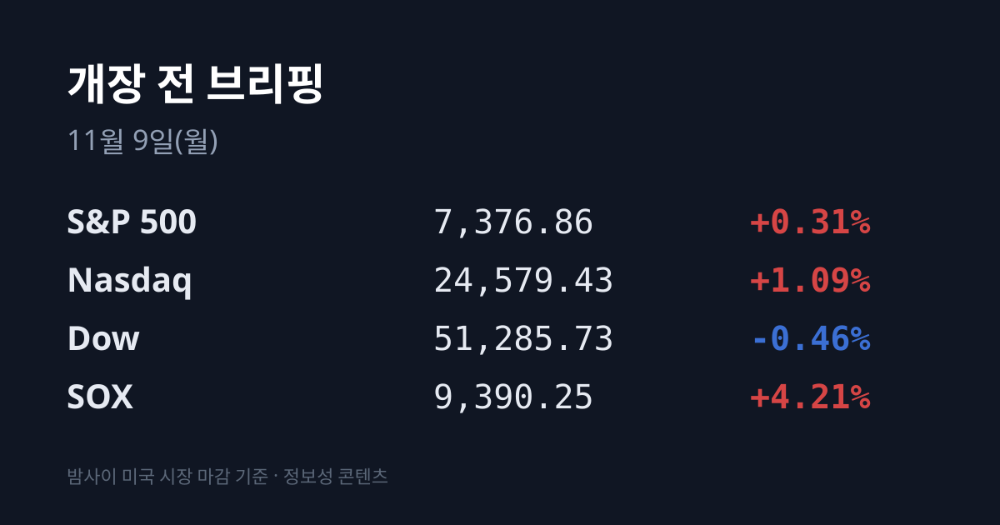
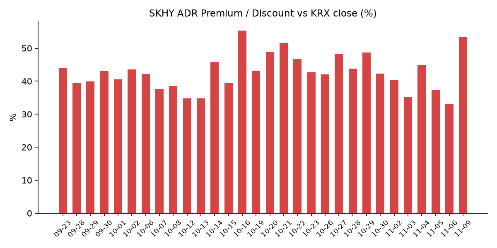
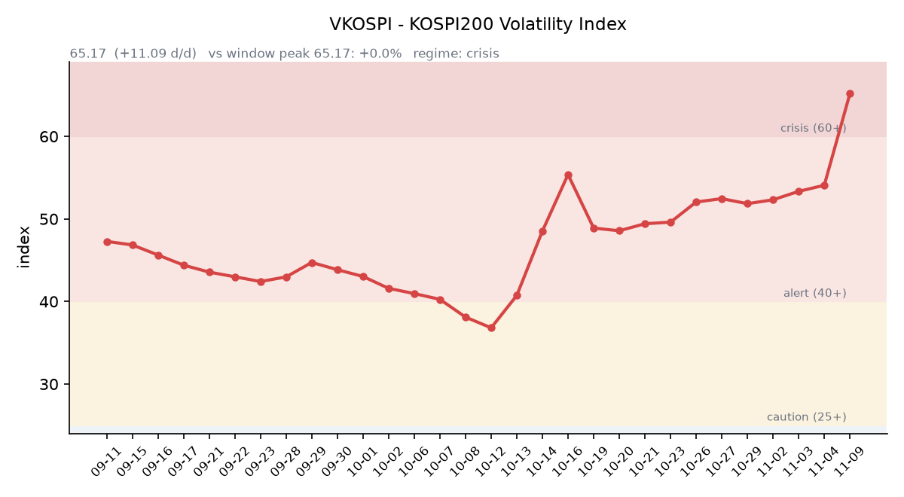

【① 30초 요약 📈】

11/6(금) 코스피는 <mark>5,059.69(−6.02%)로 마감했고, 장 시작 3분 만에 1단계 서킷브레이커가 발동</mark>해 20분간 매매가 멈췄습니다. 11/5~6 이틀 낙폭은 약 11%입니다.

같은 날 밤 미국은 **SOX +4.21%**, 나스닥 +1.09%, S&P500 +0.31%로 목요일 급락 일부를 되돌렸고 다우는 −0.46%였습니다. 한국 시장 전체를 담는 EWY는 +4.07%였습니다.

미국 10월 비농업 고용은 16만5천 명 늘어 예상(약 6만5천 명)을 크게 웃돌았고, 실업률은 4.1%로 내려갔습니다. 미 국채 10년물은 4.86%, 2년물은 4.51%로 올랐습니다.

본주가 −10.44% 내리는 동안 SKHY는 +2.78% 올라, SK하이닉스 ADR 괴리율이 하루 만에 +33.10%에서 +53.39%로 벌어졌습니다.

주말 사이 앤트로픽의 상장 기대 기업가치가 약 2조 달러에서 1조~1.3조 달러로 낮아졌다는 보도가 나왔습니다. 원/달러는 작성 시각 현재 1,363.55원입니다.

&nbsp;

【② 밤사이 미국 시장 🌙】

| 지수 | 11/6 종가 | 등락 |
| :--- | ---: | ---: |
| S&P 500 | 7,376.86 | +0.31% |
| 나스닥 종합 | 24,579.43 | +1.09% |
| 다우 | 51,285.73 | −0.46% |
| 필라델피아 반도체(SOX) | 9,390.25 | +4.21% |

한국 11/6 마감 이후 열린 미국 세션은 금요일 하루입니다. 반도체는 목요일 −12.25%에서 일부를 되돌렸습니다. AMD $449.04(+11.04%), 인텔 $56.28(+7.71%), TSMC ADR $375.44(+6.33%), 퀄컴 $165.41(+5.52%), <mark>마이크론 $690.00(+5.12%)</mark>, Arm $174.62(+4.74%), 어플라이드머티어리얼즈 $332.72(+4.22%), 엔비디아 $186.64(+2.78%), 브로드컴 $293.69(+0.74%)였습니다. 애플(−0.52%), 마이크로소프트(−0.99%)는 내렸고 코어위브는 +6.28%였습니다. 주간으로는 나스닥 −3.4%, S&P500 −2.7%, 다우 −0.9%입니다(야후 파이낸스).

목요일 장 마감 뒤 실적을 낸 기업들은 금요일 정규장에서 크게 올랐습니다. 에어비앤비 $189.99(+11.67%)는 매출 48억7천만 달러로 예상(47억5천만 달러)을 넘고 연간 전망을 올렸습니다(24/7 Wall St.). 클라우드플레어 $268.75(+9.91%), 아이렌 $21.64(+20.02%), 루멘텀 $538.59(+5.67%)였습니다. 테슬라는 사이버트럭 생산을 내년 중반께 끝낸다고 밝혔습니다.

미국 10월 비농업 고용은 16만5천 명 늘어 예상치를 크게 웃돌았고, 실업률은 4.2%에서 4.1%로 내려갔으며 8~9월 수치도 상향 수정됐습니다. **미 국채 10년물은 4.84%에서 4.86%로**(장중 4.878%), 2년물은 4.46%에서 4.51%로 올라 둘 사이 차이는 0.35%p로 좁혀졌습니다. 30년물은 5.26%(+1bp), 10년물 실질금리(TIPS)는 2.63%(+3bp)입니다(미 재무부). 금리선물 기준 12/9 FOMC의 0.25%p 인상 확률은 약 75%로 다시 올라갔습니다(톱스타뉴스). VIX는 28.18에서 25.64로 내렸습니다.

달러인덱스는 102.30(+0.74%)으로 올랐고 금 12월물은 $4,074.90(−0.94%)로 내렸습니다. 실질금리와 달러가 함께 오르는 가운데 금이 내린 조합입니다. 국제유가는 WTI $90.83(+0.34%), 브렌트유 $98.32(+0.03%)였고, 한국 원유 수입의 기준인 두바이유는 11/6 $96.30으로 $3.45 올라 브렌트와의 차이가 $2.02로 좁혀졌습니다(한국석유공사 페트로넷).

지수선물은 금요일 정산(06:59 KST) 기준 S&P500 12월물 7,402.00(+0.26%), 나스닥100 12월물 27,085.25(+1.25%)이며, 거래는 08:00 KST에 재개됩니다.

&nbsp;

【③ 괴리율 트래커 — SK하이닉스 ADR】

| 항목 | 수치 |
| :--- | ---: |
| SKHY 종가 (11/6) | $127.34 (+2.78%) |
| 본주 환산가 (×10×환율 1,363.55원) | 1,736,345원 |
| 본주 직전 종가 (11/6) | 1,132,000원 |
| **괴리율** | **+53.39%** |

11/6 한국 본주는 1,132,000원(−10.44%)으로 마감했고, 그 뒤 미국 SKHY는 $127.34(+2.78%)로 올랐습니다. 두 가격이 반대로 움직이면서 괴리율은 전일 +33.10%에서 <mark>+53.39%로 20.29%포인트 벌어졌습니다.</mark> 이 값은 트래커 78거래일 중 세 번째로 높고, 10/16(+55.28%) 이후 가장 높습니다.

괴리율은 미국에 상장된 예탁증서(ADR) 가격을 본주 1주 기준으로 환산한 값과 한국 본주 종가를 비교한 수치입니다. 환산가가 본주보다 높은 프리미엄 상태에서는 전환 차익거래 구조상 본주 쪽에 매수 유인이 생기고, 디스카운트면 반대입니다.

EWY(iShares MSCI South Korea ETF)는 $137.01(+4.07%)였습니다. 11/5 EWY 종가에 담긴 한국 하락폭보다 11/6 실제 한국 하락폭(달러 기준 약 −7.0%)이 작았기 때문에, 겹치는 부분을 빼면 **한국 11/6 마감 이후 미국 시간에 더해진 몫은 달러 기준 약 +2.5%포인트**입니다. 주말 사이 원화 약세를 반영해 원화 기준으로 환산하면 약 +3.0%포인트입니다.

&nbsp;

【④ 변동성 트래커 🌡️】

**판정 한 줄**: <mark>VKOSPI가 65.17로 여섯째 날 올라 '위기'(60 이상) 구간에 들어섰고, 11/6 유가증권시장에 1단계 서킷브레이커가 발동했습니다.</mark>

**기대 변동성**  VKOSPI **65.17**(11/6, 전일비 +6.96, +11.96%)로 '위기'(60 이상) 구간입니다. 장중에는 67.12까지 올랐습니다. 6월 고점 96.94 대비 −32.8%, 평시 상단인 25의 2.61배입니다. 같은 날 미국 VIX(25.64)는 내려, 한·미 변동성 차이가 다시 벌어졌습니다.

**실현 변동성**  최근 10거래일 코스피 일별 등락률은 10/26 −1.46%, 10/27 +3.09%, 10/28 +6.63%, 10/29 −1.24%, 10/30 −3.48%, 11/2 +2.24%, 11/3 −3.59%, 11/4 +0.62%, 11/5 −5.28%, 11/6 −6.02%입니다. 이 중 ±3% 이상 등락일은 엿새입니다. 11/6은 장중 4,911.28(−8.78%)까지 내려 일중 변동폭이 종가 대비 7.07%였고, 최근 5거래일 평균 일중 변동폭은 5.2%입니다. 10/02 종가 7,003.74 대비로는 **−27.8%입니다.**

**매매 정지**  11/6 09:03 유가증권시장 1단계 서킷브레이커가 발동해 20분간 매매가 정지됐고 파생상품시장 거래도 함께 중단됐습니다. 이어 09:06 코스닥시장, 09:34 유가증권시장에 매도 사이드카가 걸렸습니다. 최근 열흘 사이로는 10/30 10:04 유가증권시장 매도 사이드카, 11/5 10:16 유가증권시장·14:27 코스닥시장 매도 사이드카를 포함해 일곱 건입니다(한국거래소 KIND 시장운영 공시).

**증폭 경로**  전체 ETF 거래대금 중 레버리지 ETF 비중은 **30.58%로 직전(27.34%)보다** 높아졌습니다. KODEX 200선물인버스2X 2조5,080억원(회전율 218.03%), KODEX 레버리지 2조2,757억원(63.22%), KODEX 코스닥150레버리지 6,533억원(30.22%), TIGER 반도체TOP10레버리지 4,080억원(109.45%), KODEX SK하이닉스단일종목레버리지 3,127억원(35.53%)입니다(네이버 ETF 목록, 11/9 07:17 스냅샷). 코스피200 선물 베이시스는 −0.28(선물 782.95 − 현물 783.23)로 이틀째 마이너스이지만 폭은 줄었습니다.

**청산 압력**  10/28 이후 신용융자 잔고와 반대매매 금액은 집계 시점 기준 미확인입니다. 가장 최근 확인치는 10/27 기준 잔고 29조6,372억원, 반대매매 193억원입니다. 11/6 개인은 코스피에서 6,010억원을 순매수했습니다.

**하방 포지션**  공매도 순잔고는 T+2~3 공시 지연이 있어 개장 전 시점에는 확정치를 알 수 없습니다.

*미확인: 공매도 순잔고 최신치, 10/28 이후 신용융자·반대매매, 오늘 개장 직전 밤의 코스피200 야간선물(한국거래소가 다음 날 아침 공개), 코스피 프로그램 매매, DRAM·NAND 당일 현물가.*

&nbsp;

【⑤ 직전 거래일(11/6) 한국장 리뷰】

| 지수 | 종가 | 등락 |
| :--- | ---: | ---: |
| 코스피 | 5,059.69 | −324.11 (−6.02%) |
| 코스닥 | 644.27 | −34.14 (−5.03%) |

코스피는 5,263.26(−2.24%)으로 출발해 장중 4,911.28(−8.78%)까지 내린 뒤 저점에서 약 3% 되돌려 마감했습니다. <mark>외국인이 2조7,692억원을 순매도해 6거래일 연속 순매도</mark>했고, 기관은 1조7,042억원, 개인은 6,010억원을 순매수했습니다(톱스타뉴스). 11/5~6 이틀 외국인 순매도는 6조1,620억원입니다. 상승 종목은 131개, 하락 종목은 760개였습니다.

**SK하이닉스는 1,132,000원(−10.44%)**, 삼성전자는 188,700원(−6.35%)으로 마감했습니다. 장중 저점은 각각 1,089,000원, 179,200원이었습니다. 미국 중간선거 이후 AI 데이터센터 규제 강화 우려와 AI 투자 지속성에 대한 의문, 11/5 미국 SOX −12.25%가 반영됐고 외국인 매도가 두 종목에 집중됐습니다. 11/6 기준 외국인 보유율은 삼성전자 45.95%로 2009년 7월 이후 약 17년 4개월 만에 가장 낮았고, SK하이닉스는 48.27%로 2021년 11월 이후 가장 낮았습니다(아주경제).

매도는 전력기기·2차전지·조선·방산으로 번졌고, 플랫폼·IT서비스·통신 종목은 상대적으로 덜 내렸습니다(톱스타뉴스).

지난주(11/2~6) 코스피는 5,730.74에서 5,059.69로 11.71%, 코스닥은 724.38에서 644.27로 11.06% 내렸습니다. 같은 주 외국인은 약 10조4천억~11조원을 순매도했고(매체별 집계 차이), 이 중 삼성전자·SK하이닉스가 약 7조5천억원입니다. 기관은 약 4조8천억원, 개인은 약 4조2천억원을 순매수했습니다(파이낸셜뉴스·한국경제·시사저널e).

코스닥은 개인과 외국인이 순매도하고 기관이 순매수했으며, 하락 종목이 1,439개로 상승 종목 251개를 크게 웃돌았습니다.

원/달러는 서울 외환시장 주간 마감 기준 1,356.6원으로 14.5원 올랐습니다. 5/12 이후 가장 큰 상승폭이며, 장중에는 1,362.2원까지 올랐습니다(경향신문·베타뉴스). 작성 시각(11/9 07:16) 현재 환율은 **1,363.55원으로 주간 종가보다 6.95원** 높고, 달러/엔은 158.34입니다.

아시아 증시 11/6 종가는 대만 가권 39,701.64(−4.51%), 닛케이225 57,434.77(−5.96%), 토픽스 3,707.99(−5.90%), 상하이종합 3,649.18(−1.10%), CSI300 4,054.28(−1.44%), 항셍 24,481.86(−1.27%)입니다.

&nbsp;

【⑥ 오늘의 캘린더 & 관전 포인트 📅】

**11/9(월) 08:00:** 미국 지수선물 거래 재개. 일본(09:00)·대만(10:00) 증시가 금요일 SOX +4.21%를 처음 반영합니다.

**11/9~10:** 엔비디아 AI 데이 서울(코엑스). 삼성전자·SK하이닉스·LG전자 등 20개 파트너사가 참여합니다. 미국 의회 레임덕 회기도 11/9 시작됩니다.

**11/10(화) 22:30:** <mark>미국 10월 소비자물가지수(CPI).</mark> 시장 예상은 헤드라인·근원 모두 전월 대비 +0.3%입니다.

**11/11(수) 오전(미국 11/10 장 마감 후):** 코어위브 3분기 실적. **11/11:** 한국 10월 고용동향.

**11/12(목):** MSCI 11월 정기 리뷰 발표(미국 11/11, 월말 반영), 국내 옵션 만기, 인텔 AI 서밋 서울.

**11/13(금) 22:30:** 미국 10월 생산자물가지수(PPI). 이번 주 시스코·어플라이드머티어리얼즈 실적도 예정돼 있습니다.

**11월 중하순:** 앤트로픽 나스닥 상장(연기 가능성 보도). **11/18(수, 미국 현지):** 엔비디아 실적 예정. **12/9:** FOMC.

시장 참가자들이 주시하는 레벨은 코스피 5,000선, 11/6 장중 저점 4,911.28, SK하이닉스 11/6 장중 저점 1,089,000원, VKOSPI 70 선, 원/달러 1,350원·1,370원 선입니다. NH투자증권은 외국인 선물 순매수 지속 여부와 선물 베이시스의 플러스 전환 여부를 주요 변수로 꼽았습니다(파이낸셜뉴스).

&nbsp;

【⑦ 정책 워치 ⚡】

AP 집계 기준 민주당이 내년 미국 상·하원 다수당을 차지하게 됐습니다. 지역 데이터센터 관련 주민투표는 개표가 끝난 39건 중 38건에서 '제한' 쪽이 이겼고, NBC 출구조사에서 유권자 56%가 데이터센터를 '핵심 또는 주요 요인'으로 꼽았습니다. 주말 사이 새로운 규제 발표는 나오지 않았고, 코어위브 최고경영자는 텍사스 주지사 당선인 측에 데이터센터 협력을 요청했습니다(서울경제).

앤트로픽 상장과 관련해 블룸버그·WSJ는 기대 기업가치가 약 1조~1조3천억 달러로 낮아졌다고 보도했고, 12/1 이전 상장 확률을 묻는 예측시장 수치는 약 80%에서 50% 안팎으로 내려왔습니다(야후 파이낸스·악시오스).

국내에서는 현재 공매도가 전면 재개 상태이며 최근 제도 변경 사항은 없습니다.

&nbsp;

【⑧ 오늘의 질문 ❓】

본주와 ADR이 하루 사이 반대로 움직여 괴리율이 +53%까지 벌어진 상황에서, 외국인 보유 비중이 크게 줄어든 삼성전자·SK하이닉스에 누가 먼저 돌아오는가.

&nbsp;

#개장전브리핑 #미국증시마감 #반도체반등 #하이닉스ADR #괴리율 #서킷브레이커 #VKOSPI #외국인순매도 #고용보고서 #SK하이닉스 #삼성전자 #미국CPI

&nbsp;

*본 글은 공개된 시장 데이터를 정리한 정보성 콘텐츠이며, 특정 종목·상품의 매매 권유가 아닙니다. 모든 투자 판단과 책임은 투자자 본인에게 있습니다. 수치는 작성 시점 기준이며 이후 변동될 수 있습니다.*