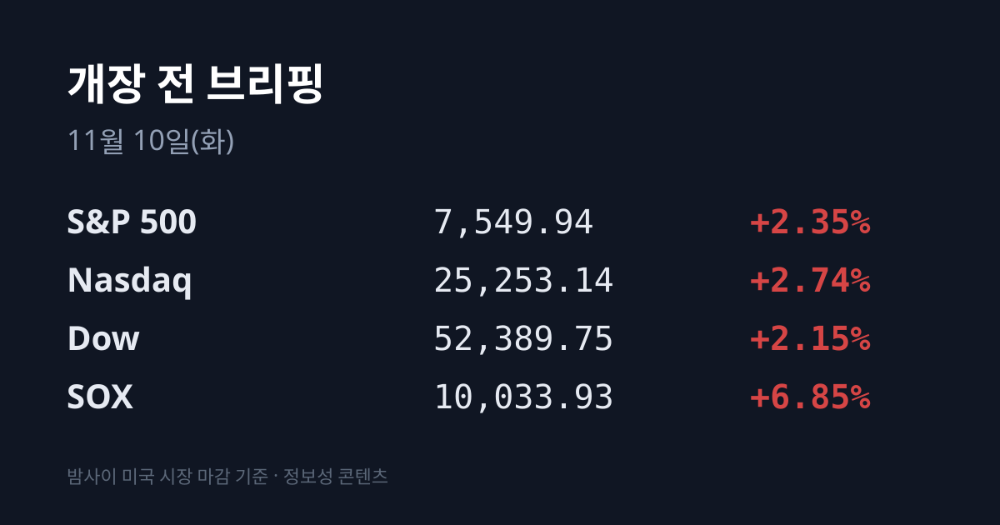
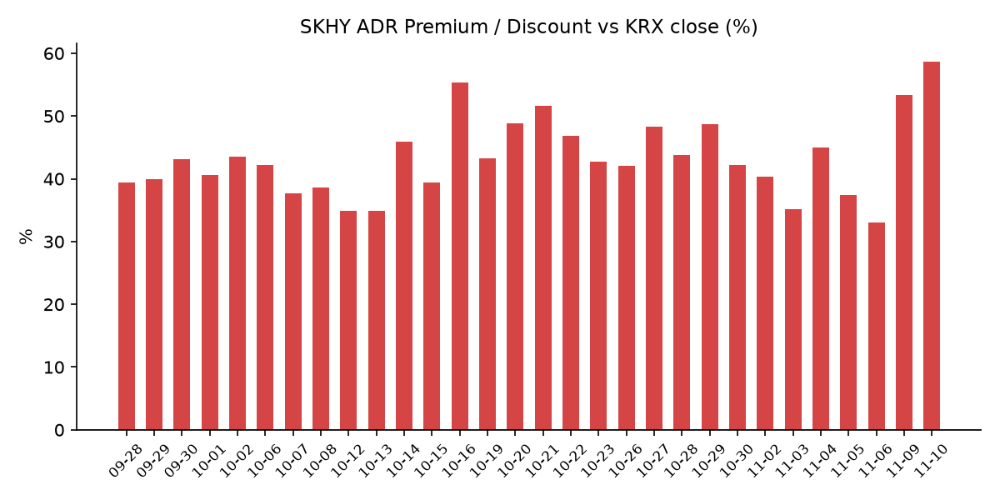
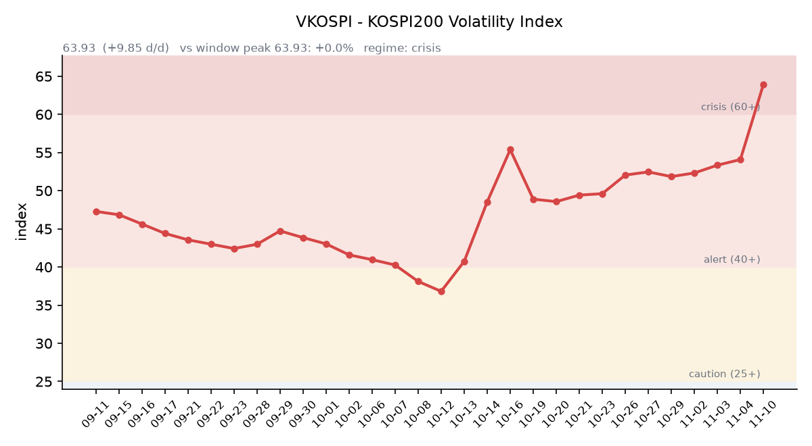

【① 30초 요약 📈】

11/9(월) 미국은 <mark>필라델피아 반도체지수(SOX) +6.85%</mark>, 나스닥 +2.74%, S&P500 +2.35%, 다우 +2.15%로 일제히 크게 올랐고, VIX는 25.64에서 19.92로 내려왔습니다.

엔비디아는 이사회가 젠슨 황 최고경영자에 대한 독립 조사에 착수했다는 소식에 −4.27%로 주요 반도체주 가운데 홀로 내렸습니다.

같은 날 코스피는 장중 5,172.94까지 올랐다가 **5,018.85(−0.81%)로** 마감했습니다. 외국인은 7거래일 연속 순매도했고 삼성SDI(−11.32%)·알테오젠(−16.01%)이 크게 내렸습니다.

SKHY는 $134.38(+5.53%)로 올라 SK하이닉스 ADR 괴리율이 +53.39%에서 +58.60%로 벌어졌습니다.

원/달러는 서울 외환시장 주간 마감 1,347.1원(−9.5원), 작성 시각 현재 1,340.73원입니다. 오늘 밤 22:30에는 미국 10월 소비자물가지수(CPI)가 발표됩니다.

&nbsp;

【② 밤사이 미국 시장 🌙】

| 지수 | 11/9 종가 | 등락 |
| :--- | ---: | ---: |
| S&P 500 | 7,549.94 | +2.35% |
| 나스닥 종합 | 25,253.14 | +2.74% |
| 다우 | 52,389.75 | +2.15% |
| 필라델피아 반도체(SOX) | 10,033.93 | +6.85% |

지난주 급락 뒤 저가 매수가 들어오면서 반도체가 상승을 이끌었고, 러셀2000도 +3.15%였습니다. AMD $508.58(+13.26%)는 투자의견 상향이 겹쳤고, 어플라이드머티어리얼즈 $370.55(+11.37%), 램리서치 $221.31(+10.41%), 브로드컴 $319.48(+8.78%), **마이크론 $733.15(+6.25%)**, 인텔 $59.37(+5.49%), TSMC ADR $388.62(+3.51%)가 뒤를 이었습니다. SOX는 10,000선 위에서 마감했습니다. 코어위브는 $48.98(+5.56%)였고, NASA가 최대 100억 달러 규모의 달 기지 계약을 발표하면서 로켓랩($58.86, +10.91%) 등 우주 관련주도 올랐습니다(야후 파이낸스).

엔비디아는 $178.67(−4.27%)로 내렸습니다. 젠슨 황 최고경영자가 11/8 직원 메모에서 혼외 관계를 인정했고, 이사회는 독립 조사에 착수했습니다. 상대 인물이 중국 정보기관과 연계됐을 수 있다는 미 정보당국 판단이 보도됐으나 확인되지 않은 주장입니다. 주가는 장중 6~8% 내렸다가 낙폭을 줄였고, 시장에서는 '핵심 인물 리스크'라는 해석이 나왔습니다. 하락은 엔비디아에 머물고 반도체 전반으로 번지지는 않았습니다(야후 파이낸스·upstox).

장 마감 뒤 시간외 거래(07:23 KST 기준)에서는 실적을 발표한 트레이드데스크가 +11.86%, 테이크투가 +3.90%, 로켓랩이 −4.02%, 힘스앤허스가 −3.66%였습니다. 코어위브 3분기 실적은 미국 11/10 장 마감 뒤(한국 11/11 오전) 발표됩니다.

주가와 달리 금리는 내려오지 않았습니다. **미 국채 2년물은 4.51%에서 4.56%로** 5bp, 10년물은 4.86%에서 4.88%로 2bp 올랐고, 30년물은 5.26%로 그대로였습니다. 10년물과 2년물의 차이는 0.32%p로 좁혀졌고, 10년물 실질금리(TIPS)는 2.66%(+3bp)입니다(미 재무부). CME FedWatch 기준 12/9 FOMC의 0.25%p 인상 확률은 82.2%로 지난주 약 75%보다 높아졌습니다(upstox 인용).

국제유가는 크게 내렸습니다. WTI는 $86.38(−4.90%), 브렌트유는 $92.17(−6.26%)입니다. 금 12월물은 $4,149.50(+1.83%)로 올랐고, 달러인덱스는 101.68(−0.61%)로 내렸습니다. 실질금리가 오르는 가운데 달러가 약해지면서 금이 오른 조합입니다.

지수선물은 11/9 정산(07:00 KST) 기준 S&P500 12월물 7,580.25(+2.41%), 나스닥100 12월물 28,073.50(+3.65%)이며, 거래는 08:00 KST에 재개됩니다.

&nbsp;

【③ 괴리율 트래커 — SK하이닉스 ADR】

| 항목 | 수치 |
| :--- | ---: |
| SKHY 종가 (11/9) | $134.38 (+5.53%) |
| 본주 환산가 (×10×환율 1,340.73원) | 1,801,673원 |
| 본주 직전 종가 (11/9) | 1,136,000원 |
| **괴리율** | **+58.60%** |

11/9 한국 본주는 1,136,000원(+0.35%)으로 거의 제자리였고, 그 뒤 미국 SKHY는 $134.38(+5.53%)로 올랐습니다. 원화가 강해져 환산가를 일부 깎았지만 괴리율은 전일 +53.39%에서 <mark>+58.60%로 5.21%포인트 더 벌어졌습니다.</mark> 이 값은 트래커 79거래일 중 두 번째로 높고, 07/31(+62.0%) 이후 가장 높습니다.

괴리율은 미국에 상장된 예탁증서(ADR) 가격을 본주 1주 기준으로 환산한 값과 한국 본주 종가를 비교한 수치입니다. 환산가가 본주보다 높은 프리미엄 상태에서는 전환 차익거래 구조상 본주 쪽에 매수 유인이 생기고, 디스카운트면 반대입니다.

한국 시장 전체를 담는 EWY(iShares MSCI South Korea ETF)는 $142.10(+3.72%)였습니다. 11/6 EWY 종가에 담겼던 한국 몫을 11/9 한국장이 반영하지 않았고(달러 기준 약 −0.1%), 그 위에 11/9 EWY 상승분이 더해졌습니다. 이를 어림 계산하면 **한국 11/9 마감 이후 미국 시간에 더해진 몫은 달러 기준 약 +6%포인트**, 원화 기준 약 +5.5~6%포인트입니다. 11/9 아침에도 같은 방식의 값(원화 기준 약 +3%포인트)이 있었으나 그날 코스피는 −0.50%로 출발했습니다.

&nbsp;

【④ 변동성 트래커 🌡️】

**판정 한 줄**: <mark>VKOSPI가 63.93으로 7거래일 만에 처음 내렸지만 여전히 '위기'(60 이상) 구간이고, 같은 날 미국 VIX는 20 아래로 내려와 한·미 변동성 차이가 더 벌어졌습니다.</mark>

**기대 변동성**  VKOSPI **63.93**(11/9, 전일비 −1.24, −1.90%)으로 '위기'(60 이상) 구간입니다. 6거래일 연속 오른 뒤 첫 하락이며, 6월 고점 96.94 대비 −34.1%, 평시 상단인 25의 2.56배입니다. 미국 VIX는 19.92로, VKOSPI가 VIX의 약 3.2배입니다.

**실현 변동성**  최근 10거래일 코스피 일별 등락률은 10/27 +3.09%, 10/28 +6.63%, 10/29 −1.24%, 10/30 −3.48%, 11/2 +2.24%, 11/3 −3.59%, 11/4 +0.62%, 11/5 −5.28%, 11/6 −6.02%, 11/9 −0.81%입니다. 이 중 ±3% 이상 등락일은 엿새입니다. 11/9 일중 변동폭은 종가 대비 3.63%로 직전 이틀보다 좁았고, 최근 5거래일 평균은 4.9%입니다. 10/02 종가 7,003.74 대비로는 **−28.3%입니다.**

**매매 정지**  최근 열흘 사이 매매 정지 장치는 여섯 건 걸렸습니다. 11/5 10:16 유가증권시장·14:27 코스닥시장 매도 사이드카, 11/6 09:03 유가증권시장 1단계 서킷브레이커(파생상품시장 거래 중단 동반), 09:06 코스닥시장·09:34 유가증권시장 매도 사이드카입니다(한국거래소 KIND 시장운영 공시).

**증폭 경로**  전체 ETF 거래대금 중 레버리지 ETF 비중은 **27.69%로 직전(30.58%)보다** 내려왔습니다. KODEX 200선물인버스2X 2조55억원(회전율 174.42%), KODEX 레버리지 1조4,289억원(39.59%), KODEX 코스닥150레버리지 5,151억원(24.23%), TIGER 반도체TOP10레버리지 3,050억원(77.38%), KODEX 반도체레버리지 2,245억원(42.94%)입니다(네이버 ETF 목록, 11/10 07:20 스냅샷). 코스피200 선물 베이시스는 −2.50(선물 775.85 − 현물 778.35)으로 사흘째 마이너스였고 폭은 직전 −0.28보다 커졌습니다.

**청산 압력**  10/28 이후 신용융자 잔고와 반대매매 금액은 집계 시점 기준 미확인입니다. 가장 최근 확인치는 10/27 기준 잔고 29조6,372억원, 반대매매 193억원입니다.

**하방 포지션**  공매도 순잔고는 T+2~3 공시 지연이 있어 개장 전 시점에는 확정치를 알 수 없습니다.

*미확인: 공매도 순잔고 최신치, 10/28 이후 신용융자·반대매매, 오늘 개장 직전 밤의 코스피200 야간선물(한국거래소가 다음 날 아침 공개), DRAM·NAND 당일 현물가.*

&nbsp;

【⑤ 직전 거래일(11/9) 한국장 리뷰】

| 지수 | 종가 | 등락 |
| :--- | ---: | ---: |
| 코스피 | 5,018.85 | −40.84 (−0.81%) |
| 코스닥 | 638.97 | −5.30 (−0.82%) |

코스피는 5,034.20(−0.50%)으로 출발해 기관 매수와 반도체 반등에 장중 5,172.94까지 올랐지만, 오후 외국인 매도가 커지면서 상승분을 내주고 장중 4,990.66까지 내렸습니다. <mark>외국인은 6,930억원을 순매도해 7거래일 연속 순매도</mark>했고(매체별 6,470억~6,930억원), 기관은 7,204억원을 순매수, 개인은 4,887억원을 순매도했습니다. 프로그램 매매는 1,761억원 순매도(차익 432억원 순매수, 비차익 2,193억원 순매도)였습니다. 상승 종목은 340개, 하락 종목은 530개였습니다(서울신문).

삼성전자는 189,900원(+0.64%), SK하이닉스는 1,136,000원(+0.35%)으로 마감했습니다. 장중 고가는 각각 195,400원, 1,193,000원이었습니다. 금요일 미국 반도체 반등에 저가 매수가 들어왔으나 오후 외국인 매도에 상승폭 대부분을 반납했습니다(뉴스핌·서울신문). 코스닥 반도체 장비주는 주성엔지니어링 +6.70%, 심텍 +6.84%, 이오테크닉스 +6.00%로 올랐습니다.

지수를 끌어내린 것은 2차전지와 바이오였습니다. **삼성SDI는 415,000원(−11.32%)**, LG에너지솔루션은 318,000원(−5.78%), 에코프로는 −8.46%, 에코프로비엠은 −8.66%였습니다. 미국 중간선거 뒤 친환경 정책 기대로 올랐던 몫에 차익실현 매물이 나왔다는 해석이 나왔습니다(비즈니스포스트). 코스닥 시가총액 1위 알테오젠은 168,400원(−16.01%, 장중 −23.94%)으로 마감했습니다. 미국 CMS가 11/5 발표한 약가협상 최종 규정(2029년 적용)이 투여 방식을 바꾼 의약품을 기존 약과 같은 약으로 묶을 수 있어, 알테오젠 기술이 쓰인 키트루다 피하주사(SC) 제형의 로열티에 대한 우려가 나왔고 회사는 반박했습니다(한국경제·뉴스핌). 삼성전기(−3.10%), 현대차(−2.86%)도 내렸습니다.

코스닥에서는 외국인이 943억원, 개인이 167억원을 순매도했고 기관이 1,048억원을 순매수했습니다(뉴스핌).

원/달러는 서울 외환시장 주간 마감 기준 1,347.1원으로 9.5원 내렸습니다(뉴스핌). 원화가 강해졌는데도 외국인 매도는 이어졌습니다. 작성 시각(11/10 07:22) 현재 환율은 **1,340.73원으로 주간 종가보다 6.37원** 낮고, 달러/엔은 157.90입니다.

아시아 증시 11/9 종가는 대만 가권 41,661.70(+4.94%), 닛케이225 58,775.50(+2.33%), 토픽스 3,818.16(+2.97%), 상하이종합 3,660.79(+0.32%), CSI300 4,056.11(+0.05%), 항셍 24,448.95(−0.13%)입니다. 대만·일본이 크게 오른 날 코스피는 내렸습니다.

&nbsp;

【⑥ 오늘의 캘린더 & 관전 포인트 📅】

**11/10(화) 08:00:** 미국 지수선물 거래 재개. 일본(09:00)·대만(10:00) 증시가 SOX +6.85%를 반영합니다. 엔비디아 AI 데이 서울(코엑스)은 오늘이 마지막 날입니다.

**11/10(화) 22:30:** <mark>미국 10월 소비자물가지수(CPI).</mark> 시장 예상은 헤드라인 전월 대비 +0.3%(9월 +0.6%), 근원 +0.2%(9월 +0.3%)입니다. 같은 날 월러 연준 이사 연설이 있습니다.

**11/11(수) 오전(미국 11/10 장 마감 후):** 코어위브 3분기 실적. **11/11:** 한국 10월 고용동향.

**11/12(목):** MSCI 11월 정기 리뷰 발표(미국 11/11, 월말 반영), **국내 옵션 만기**, 인텔 AI 서밋 서울.

**11/13(금) 오전(미국 11/12 장 마감 후):** 어플라이드머티어리얼즈·시스코 실적. **11/13(금) 22:30:** 미국 10월 생산자물가지수(PPI).

**11/18(수, 미국 현지):** 엔비디아 실적 예정. **12/9:** FOMC.

시장 참가자들이 주시하는 레벨은 코스피 5,000선, 11/6 장중 저점 4,911.28, SK하이닉스 11/9 저가 1,116,000원, VKOSPI 70 선, 원/달러 1,350원·1,360원 선입니다. 증권가는 외국인 선물 순매수 지속 여부와 선물 베이시스의 플러스 전환 여부를 반등 전환의 주요 변수로 꼽아 왔습니다(NH투자증권, 파이낸셜뉴스).

&nbsp;

【⑦ 정책 워치 ⚡】

미국 CMS(메디케어·메디케이드서비스센터)는 11/5 약가협상 최종 규정을 발표했습니다. 2029년부터 적용되며, 기존 의약품에 성분을 더해 투여 방식을 바꾼 제품도 요건에 따라 같은 의약품으로 묶어 협상 대상으로 분류하는 내용입니다(한국경제).

국내에서는 현재 공매도가 전면 재개 상태이며 최근 제도 변경 사항은 없습니다.

&nbsp;

【⑧ 오늘의 질문 ❓】

미국 반도체가 하루에 7% 가까이 오르고 원/달러가 1,340원대로 내려온 아침, 7거래일째 코스피를 판 외국인은 오늘 밤 CPI를 보기 전에 방향을 바꿀 것인가.

&nbsp;

#개장전브리핑 #미국증시마감 #반도체반등 #하이닉스ADR #괴리율 #VKOSPI #외국인순매도 #엔비디아 #2차전지 #알테오젠 #SK하이닉스 #미국CPI

&nbsp;

*본 글은 공개된 시장 데이터를 정리한 정보성 콘텐츠이며, 특정 종목·상품의 매매 권유가 아닙니다. 모든 투자 판단과 책임은 투자자 본인에게 있습니다. 수치는 작성 시점 기준이며 이후 변동될 수 있습니다.*