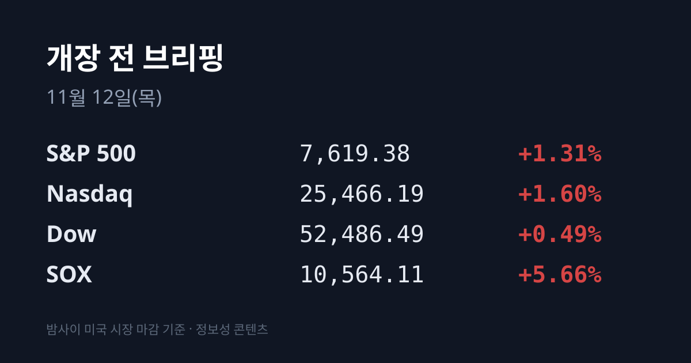
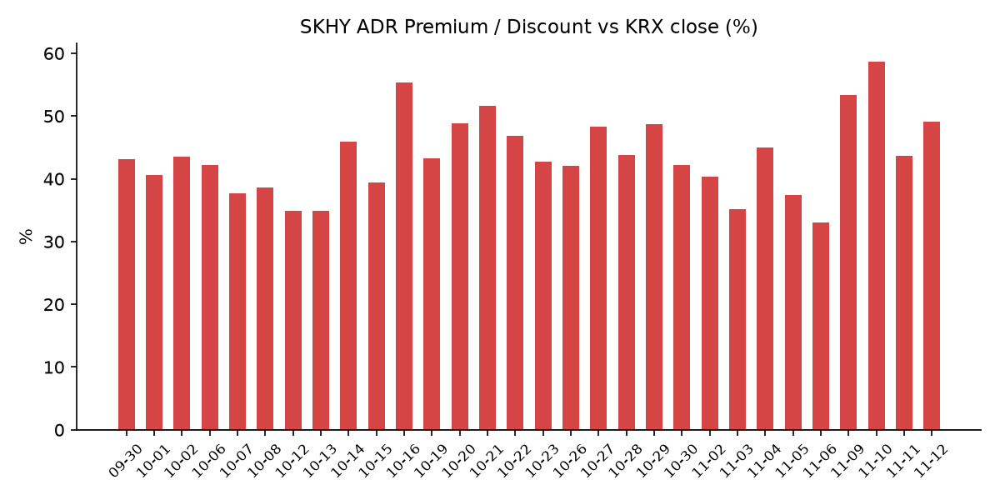
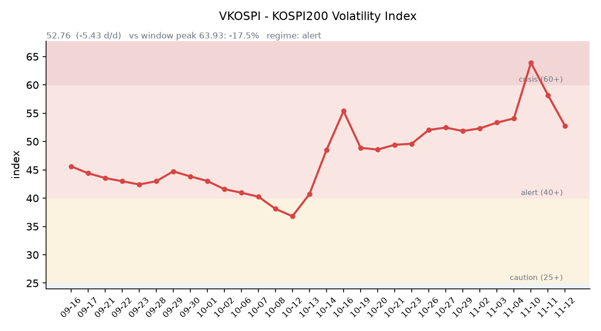

【① 30초 요약 📈】

11/11(수) 미국은 S&P500 +1.31%, 나스닥 +1.60%, 다우 +0.49%로 올랐고, <mark>필라델피아 반도체지수(SOX)는 +5.66%</mark> 급등했습니다. VIX는 17.49로 하루 10% 내렸습니다.

코어위브가 향후 3개월 고객 선수금 약 90억 달러와 2027년까지 고비용 신규 차입 계획이 없다는 점을 밝히며 **+24.71%** 올랐고, 마이크론(+11.89%)을 비롯한 AI·메모리주가 함께 뛰었습니다.

엔비디아는 정규장에서 +2.87%로 3거래일 만에 올랐지만, 시간외에서는 07:17 KST 기준 정규장 종가보다 −3.21%입니다. 시간외 하락 사유는 집계 시점 기준 미확인입니다.

같은 날 코스피는 5,375.36(+2.60%)으로 이틀째 올랐고, 코스닥은 705.10(+5.62%)으로 고가에 마감하며 이틀 연속 매수 사이드카가 걸렸습니다. 외국인은 유가증권시장에서 이틀째 순매수했습니다.

SKHY가 $142.25(+9.71%)로 뛰면서 SK하이닉스 ADR 괴리율은 +43.64%에서 +49.06%로 다시 커졌습니다.

&nbsp;

【② 밤사이 미국 시장 🌙】

| 지수 | 11/11 종가 | 등락 |
| :--- | ---: | ---: |
| S&P 500 | 7,619.38 | +1.31% |
| 나스닥 종합 | 25,466.19 | +1.60% |
| 다우 | 52,486.49 | +0.49% |
| 필라델피아 반도체(SOX) | 10,564.11 | +5.66% |

이날의 중심은 AI 인프라였습니다. 전날 장 마감 뒤 실적을 낸 코어위브는 시간외에서 상승분을 내줬다가, 정규장에서 $60.77(+24.71%)로 급등했습니다. 3분기 실적 상회와 연간 가이던스 상향에 더해, 향후 3개월간 고객 선수금 약 90억 달러를 예상하고 2027년까지 고비용 신규 차입 계획이 없다고 밝힌 점이 AI 투자 자금 조달에 대한 우려를 덜었다는 설명이 나왔습니다(야후 파이낸스). 나스닥은 이날 상승으로 중간선거 이후 낙폭을 모두 되찾았습니다.

반도체가 일제히 올랐습니다. <mark>마이크론은 $811.30(+11.89%)</mark>, ARM $203.36(+12.05%), 인텔 $62.50(+7.52%), AMD $552.90(+7.32%), 램리서치 $235.88(+6.07%), 어플라이드머티어리얼즈 $395.08(+6.05%), TSMC ADR $413.35(+4.25%), 브로드컴 $345.22(+3.99%)입니다. 샌디스크도 10% 넘게 올랐습니다. 엔비디아는 $173.73(+2.87%)로 이틀간의 하락을 멈췄습니다. AI 인프라 관련주인 네비우스(약 +15~17%), 블룸에너지(약 +13~16%), 오라클(+8.82%)도 강했습니다. 반면 마이크로소프트(−2.26%), 메타(−1.97%), 아마존(−1.74%)은 내렸고, 리게티는 매출이 예상에 못 미쳐 약 8% 하락했습니다.

앤트로픽 상장도 관심을 모았습니다. 기업가치 최대 1.4조 달러를 목표로 하며 다음 주 거래를 시작할 수 있다는 보도가 나왔습니다(야후 파이낸스).

장 마감 뒤 엔비디아는 시간외에서 $168.15(07:17 KST)로 정규장 종가 대비 **−3.21%입니다.** 이 하락의 사유를 다룬 보도는 집계 시점 기준 확인되지 않았습니다. 마이크론(+0.21%), AMD(+1.28%)는 시간외에서도 소폭 올랐고, 코어위브는 −1.43%입니다.

11/11은 미국 재향군인의 날로, 주식시장은 정상 개장했지만 채권시장은 휴장했습니다. 그래서 미 국채 금리는 11/10 확정치가 가장 최근 값입니다: 10년물 4.98%, 2년물 4.73%, 30년물 5.35%, 10년물 실질금리(TIPS) 2.78%, 10년물과 2년물 차이 0.25%p(미 재무부). 보먼 연준 이사는 인플레이션이 넓게 퍼지고 있어 추가 인상이 필요할 수 있다고 말했습니다(야후 파이낸스).

달러인덱스는 102.90(+0.65%)으로 이틀째 올랐고, 금 12월물은 $3,994.30(−0.89%)으로 4,000달러 아래로 내려왔습니다. 달러가 오르는 가운데 금이 내린 조합입니다. WTI는 $86.42(+0.44%), 브렌트유는 $92.63(+1.25%)이며, 한국 원유 수입의 기준인 두바이유는 11/10 기준 $87.82로 브렌트보다 3.67달러 낮습니다(페트로넷).

지수선물은 11/11 정산 기준 S&P500 12월물 7,642.75(+1.31%), 나스닥100 12월물 28,444.25(+2.19%)이며, 거래는 08:00 KST에 재개됩니다.

&nbsp;

【③ 괴리율 트래커 — SK하이닉스 ADR】

| 항목 | 수치 |
| :--- | ---: |
| SKHY 종가 (11/11) | $142.25 (+9.71%) |
| 본주 환산가 (×10×환율 1,338.09원) | 1,903,433원 |
| 본주 직전 종가 (11/11) | 1,277,000원 |
| **괴리율** | **+49.06%** |

11/11 한국 본주는 1,277,000원(+5.36%)으로 올랐고, 그 뒤 미국 SKHY는 $142.25(+9.71%)로 더 크게 올랐습니다. 그 결과 괴리율은 전일 +43.64%에서 <mark>+49.06%로 5.42%포인트 커졌습니다.</mark> 하루 만에 다시 확대로 돌아선 것입니다.

괴리율은 미국에 상장된 예탁증서(ADR) 가격을 본주 1주 기준으로 환산한 값과 한국 본주 종가를 비교한 수치입니다. 환산가가 본주보다 높은 프리미엄 상태에서는 전환 차익거래 구조상 본주 쪽에 매수 유인이 생기고, 디스카운트면 반대입니다. 이번 확대는 미국 시간에 메모리주가 급등하면서 ADR이 본주의 하루 상승폭을 앞지른 결과입니다.

한국 시장 전체를 담는 EWY(iShares MSCI South Korea ETF)는 **$147.81(+6.20%)였고**, 시간외에서는 $148.01(+0.14%)입니다. 11/11 EWY 등락에는 한국 11/11 장중 상승분이 함께 들어 있어, 이를 빼고 어림 계산하면 **한국 11/11 마감 이후 미국 시간에 더해진 몫은 달러 기준 약 +2.8%포인트**, 원화 기준 약 +2.5~3%포인트입니다.

&nbsp;

【④ 변동성 트래커 🌡️】

**판정 한 줄**: <mark>VKOSPI가 52.76으로 사흘 연속 내려 '경보'(40~60) 구간 안에서 진정 흐름을 이어 갔습니다.</mark>

**기대 변동성**  VKOSPI **52.76**(11/11, 전일비 −5.43, −9.33%)로 '경보'(40~60) 구간입니다. 11/09(63.93)·11/10(58.19)에 이어 사흘 연속 내렸고, 6월 고점 96.94 대비 −45.6%, 평시 상단인 25의 2.11배입니다. 미국 VIX는 17.49로, VKOSPI가 VIX의 약 3.0배입니다.

**실현 변동성**  최근 10거래일 코스피 일별 등락률은 10/29 −1.24%, 10/30 −3.48%, 11/2 +2.24%, 11/3 −3.59%, 11/4 +0.62%, 11/5 −5.28%, 11/6 −6.02%, 11/9 −0.81%, 11/10 +4.39%, 11/11 +2.60%입니다. 이 중 ±3% 이상 등락일은 닷새입니다. 11/11 일중 변동폭은 종가 대비 3.17%였고, 최근 5거래일 평균은 4.2%입니다. 10/02 종가 7,003.74 대비로는 **−23.3%입니다.**

**매매 정지**  최근 열흘 사이 매매 정지 장치는 아홉 건 걸렸습니다. 11/5 10:16 유가증권시장·14:27 코스닥시장 매도 사이드카, 11/6 09:03 유가증권시장 1단계 서킷브레이커(파생상품시장 거래 중단 동반), 09:06 코스닥시장·09:34 유가증권시장 매도 사이드카, 11/10 09:06 유가증권시장·09:10 코스닥시장 매수 사이드카, 그리고 11/11 11:28 코스닥시장 매수 사이드카입니다(한국거래소 KIND 시장운영 공시). 코스닥 매수 사이드카는 이틀 연속이며, 올해 38번째 사이드카라는 보도가 나왔습니다(한국경제TV).

**증폭 경로**  전체 ETF 거래대금 중 레버리지 ETF 비중은 **25.31%로 직전(26.94%)보다** 내려왔습니다. KODEX 레버리지 1조4,730억원(회전율 33.23%), KODEX 200선물인버스2X 7,959억원(99.02%, 직전 1조1,822억원), KODEX 코스닥150레버리지 5,402억원(17.90%), TIGER 반도체TOP10레버리지 2,826억원(54.65%), KODEX 반도체레버리지 2,658억원(35.35%)입니다(네이버 ETF 목록, 11/12 07:16 스냅샷). 인버스2X 거래대금은 이틀 연속 크게 줄었습니다. 코스피200 선물 베이시스는 −1.77(선물 836.55 − 현물 838.32)로 닷새째 마이너스였고 폭은 직전 −2.21보다 줄었습니다.

**청산 압력**  10/28 이후 신용융자 잔고와 반대매매 금액은 집계 시점 기준 미확인입니다. 가장 최근 확인치는 10/27 기준 잔고 29조6,372억원, 반대매매 193억원입니다.

**하방 포지션**  공매도 순잔고는 T+2~3 공시 지연이 있어 개장 전 시점에는 확정치를 알 수 없습니다.

*미확인: 공매도 순잔고 최신치, 10/28 이후 신용융자·반대매매, 오늘 개장 직전 밤의 코스피200 야간선물(한국거래소가 다음 날 아침 공개), DRAM·NAND 당일 현물가.*

&nbsp;

【⑤ 직전 거래일(11/11) 한국장 리뷰】

| 지수 | 종가 | 등락 |
| :--- | ---: | ---: |
| 코스피 | 5,375.36 | +136.23 (+2.60%) |
| 코스닥 | 705.10 | +37.49 (+5.62%) |

코스피는 5,209.71(−0.56%)로 내려 출발해 장중 5,207.44까지 밀렸다가 반등했고, 고가 5,377.99 부근에서 마감했습니다. 이틀째 상승입니다. 코스닥은 668.48로 출발한 뒤 줄곧 올라 고가 705.10에서 마감했고, 700선을 되찾았습니다. 코스닥 상승에는 정부 지원책 기대와 기관 매수가 꼽혔습니다(라이센스뉴스).

<mark>외국인은 유가증권시장에서 6,553억원을 순매수해 이틀 연속 매수 우위를 이어 갔습니다</mark>(매체별 6,553억~7,760억원). 기관은 4,817억원, 개인은 7,157억원을 순매도했습니다(라이센스뉴스). 외국인 순매수 1·2위는 삼성전자(5,375억원)와 SK하이닉스(1,306억원)였습니다(한국경제). 코스닥에서는 기관이 3,136억원을 순매수했고 외국인(1,334억원)과 개인(1,856억원)은 순매도했습니다.

삼성전자는 **206,000원(+3.57%)으로** 20만원 선을 되찾았고, SK하이닉스는 1,277,000원(+5.36%)으로 마감했습니다. 전날 급등 뒤에도 반도체 대형주에 저가 매수가 이어졌고, 코어위브 실적과 오는 19일 앤트로픽 상장에 대한 기대가 AI 투자 수요에 대한 신뢰를 되살렸다는 분석이 나왔습니다(블루밍비트·라이센스뉴스). SK스퀘어(+4.74%), 삼성전기(+4.65%), 삼성전자우(+3.77%)도 올랐습니다.

반도체 밖에서는 로봇과 방산이 강했습니다. 두산 +8.18%, 레인보우로보틱스 +7.08%, 삼익THK +3.52%, LIG디펜스앤에어로스페이스 +9.73%입니다. 코스닥에서는 에코프로비엠(+11.39%)과 에코프로(+10.03%) 등 2차전지, 반도체 장비주 주성엔지니어링(+17.14%)이 크게 올랐고 알테오젠은 +4.08%였습니다. 반면 삼성바이오로직스(−2.59%), 현대차(−0.91%), 기아(−1.56%), HD현대중공업(−1.87%)은 내렸습니다.

원/달러는 서울 외환시장 주간 마감 기준 1,333.6원으로 3.9원 내렸습니다(라이센스뉴스). 작성 시각(11/12 07:12) 현재 환율은 **1,338.09원으로 주간 종가보다 4.49원** 높고, 달러/엔은 159.71입니다.

아시아 증시 11/11 종가는 대만 가권 44,257.15(+3.62%), 닛케이225 61,248.59(+1.31%), 토픽스 3,929.39(+0.92%), 상하이종합 3,680.64(+0.46%), CSI300 4,075.71(+0.41%), 항셍 24,315.92(−0.98%)입니다.

&nbsp;

【⑥ 오늘의 캘린더 & 관전 포인트 📅】

**11/12(목) 07:00경:** MSCI 11월 정기 리뷰 결과 발표(11/11 23:00 CET). 편입·편출은 **11/30 장 마감 뒤** 반영됩니다(MSCI 사전 공지). 9월 말 사전 분석에서는 한국 신규 편입 종목이 없을 것으로 집계됐습니다(서울경제).

**11/12(목):** <mark>국내 옵션 만기</mark>, 인텔 AI 서밋 서울. 08:00 미국 지수선물 거래 재개, 일본(09:00)·대만(10:00) 개장. 미국 채권시장은 이날 거래를 재개합니다.

**11/13(금) 오전(미국 11/12 장 마감 후):** 어플라이드머티어리얼즈(주당순이익 예상 4.06달러, 매출 103.0억 달러)·시스코(1.33달러, 180.9억 달러) 실적. **11/13(금) 22:30:** 미국 10월 생산자물가지수(PPI).

**11/16(미국):** PDD 실적(장 전). **11/17(미국):** 디즈니·홈디포 실적(장 전).

**11/18(수) 오전(미국 11/17 장 마감 후):** 엔비디아 실적. **11/19(미국):** 앤트로픽 나스닥 상장 예정이 보도됐습니다. **12/9:** FOMC. **12/10:** 국내 선물·옵션 동시 만기.

시장 참가자들이 주시하는 레벨은 코스피 5,320선과 5,590선, 전일 종가 5,375선, SK하이닉스 1,250,000원, VKOSPI 58 선, 원/달러 1,350원 선입니다.

&nbsp;

【⑦ 정책 워치 ⚡】

보먼 연준 이사는 인플레이션이 넓게 퍼지고 있어 추가 금리 인상이 필요할 수 있다고 말했습니다. 10월 CPI가 예상을 웃돈 뒤 시장은 12월 인상을 거의 확실한 것으로 받아들이고 있습니다(야후 파이낸스).

국내에서는 현재 공매도가 전면 재개 상태이며 최근 제도 변경 사항은 없습니다.

&nbsp;

【⑧ 오늘의 질문 ❓】

SKHY가 하룻밤에 9.7% 뛰고 엔비디아가 시간외에서 3% 밀린 아침, 옵션 만기일의 한국 반도체는 어느 쪽 신호를 더 크게 받아들일 것인가.

&nbsp;

#개장전브리핑 #미국증시마감 #필라델피아반도체 #코어위브 #마이크론 #하이닉스ADR #괴리율 #VKOSPI #외국인순매수 #엔비디아 #SK하이닉스 #옵션만기

&nbsp;

*본 글은 공개된 시장 데이터를 정리한 정보성 콘텐츠이며, 특정 종목·상품의 매매 권유가 아닙니다. 모든 투자 판단과 책임은 투자자 본인에게 있습니다. 수치는 작성 시점 기준이며 이후 변동될 수 있습니다.*