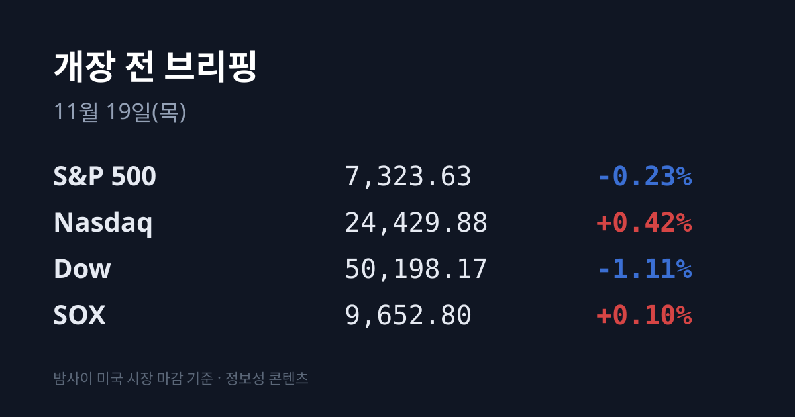
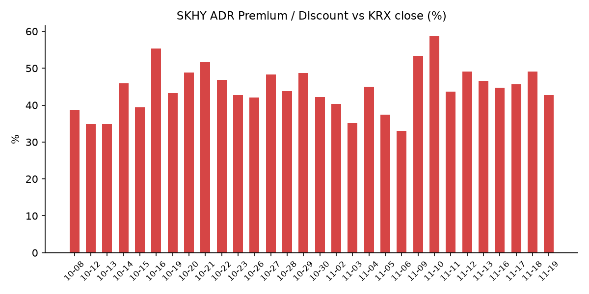
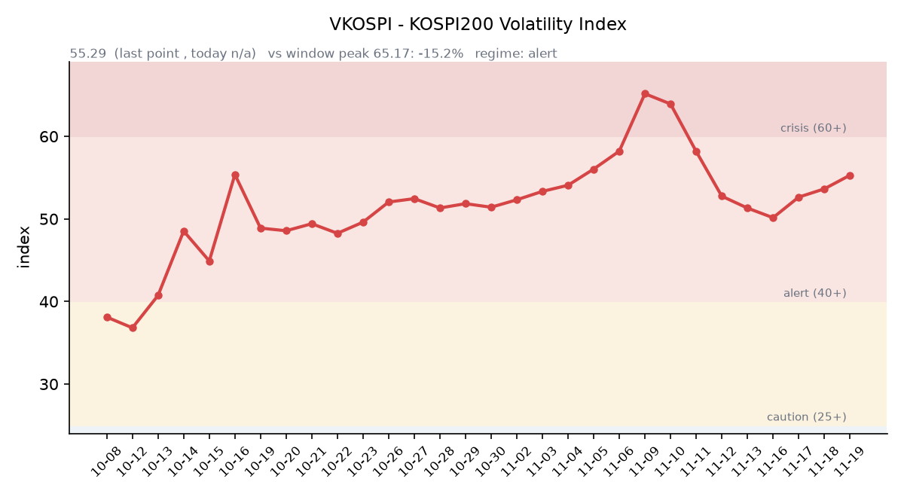

&nbsp;

【① 30초 요약 📈】

11/18(수) 미국은 S&P500 −0.23%, 나스닥 +0.42%, 다우 −1.11%로 마감했습니다. S&P500은 5거래일 연속 내렸고, **필라델피아 반도체지수(SOX)는 +0.10%였습니다.**

<mark>엔비디아는 실적이 예상을 웃돌았지만 정규장에서 $150.96(−2.89%)로 내렸습니다.</mark> 장 전 약 4% 올랐다가 방향을 바꿨습니다.

FOMC 의사록에서 거의 모든 참석자가 추가 인상이 적절하다고 봤고, 월러 이사는 12월 0.5%포인트 인상이 필요할 것 같다고 말했습니다. 달러인덱스는 103.79로 19개월 만의 최고였고 금과 유가는 크게 내렸습니다.

11/18 코스피는 5,067.44(+1.99%)로 하루 만에 5,000선을 되찾았습니다. 기관이 5,118억원을 순매수했고 외국인은 3,338억원을 순매도했습니다.

앤트로픽은 공모가를 주당 83달러로 정했다는 보도가 나왔고(희망 범위 70~78달러), 한국 시간 오늘 밤 나스닥에서 거래를 시작합니다.

&nbsp;

【② 밤사이 미국 시장 🌙】

| 지수 | 11/18 종가 | 등락 |
| :--- | ---: | ---: |
| S&P 500 | 7,323.63 | −0.23% |
| 나스닥 종합 | 24,429.88 | +0.42% |
| 다우 | 50,198.17 | −1.11% |
| 필라델피아 반도체(SOX) | 9,652.80 | +0.10% |

다우는 561.25포인트 내렸습니다. 유나이티드헬스(−10%), 셰브론(약 −4%), 캐터필러(−2%대)가 끌어내렸고, 유가 급락으로 에너지 업종이 S&P500 업종 가운데 가장 크게(약 −3%) 내렸습니다. 타깃은 3분기 순매출이 7.1% 늘어 5년여 만에 가장 높은 증가율을 기록하면서 6% 올랐습니다. 앤트로픽 상장을 앞두고 아마존·알파벳은 올랐습니다(CNBC).

엔비디아는 3분기 매출 1,158억 달러(예상 1,091억 달러), 4분기 매출 가이던스 1,300억 달러(예상 약 1,251억 달러)로 예상을 웃돌았고, 회계연도 2028 매출 성장 전망도 70%에서 75%로 올렸습니다. 그런데도 주가는 **$150.96(−2.89%)로** 마감했습니다. 젠슨 황 사임 뒤 후계 구도가 비어 있다는 우려(오펜하이머 "리더십 공백"), 이사회 의장이 후임 선임에 서두르지 않는다는 지적, 중국 데이터센터 매출이 가이던스에 빠진 점이 거론됐습니다. 미 상무부는 중국 기업이 해외 데이터센터에서 첨단 칩에 원격 접근하는 것을 제한했고, 하원 위원회는 12/2까지 콜레트 크레스 임시 CEO의 브리핑을 요구했습니다(CNBC·야후 파이낸스). 코어위브(−4.13%)와 아이렌(−3.61%)도 내렸습니다.

다른 반도체는 엇갈렸습니다. AMD $530.14(+5.31%), 브로드컴 $354.05(+3.64%), TSMC ADR $362.62(+0.81%)는 올랐고 마이크론 $705.27(−1.00%), 인텔 $54.67(−0.91%)은 내렸습니다. 한국 시간 07:17 기준 시간외에서는 엔비디아 $150.60(−0.24%), 마이크론 $700.00(−0.75%), AMD $525.10(−0.95%)입니다(야후 파이낸스).

<mark>FOMC 의사록(10/27~28 회의)에서는 거의 모든 참석자가 추가 금리 인상이 적절하다고 판단했습니다.</mark> 두 명은 물가 지표가 나쁘면 12월에 0.25%포인트보다 큰 인상을 검토할 수 있다고 했고, AI가 금융안정 리스크로 언급됐습니다. 같은 날 월러 이사는 12/8~9 회의에서 0.5%포인트 인상이 아마 필요하다고 말했습니다(CNBC·벤징가). 미 국채 10년물은 5.066%, 30년물은 5.412%로 전날(5.103%, 5.458%)보다 내렸습니다. FRED 기준(11/17) 10년물 5.10%, 2년물 4.80%, 30년물 5.46%, 10년물 실질금리(TIPS) 2.89%이고, 11/18 기준 10년물과 2년물 차이는 0.27%p입니다.

달러인덱스는 **103.79로 19개월 만의 최고였습니다.** 금 현물은 $3,758(−2.4%)로 1년여 만의 최저로 내려가 3,800달러 선이 깨졌습니다. 실질금리는 소폭 내렸고 달러가 올랐습니다. 유가는 미국 원유·연료 재고 증가로 WTI $82.19(4% 넘게 하락), 브렌트유 $90.83(2% 넘게 하락)였습니다(CNBC). VIX는 24.56(−3.53%)입니다. 지수선물은 한국 시간 06:59 기준 S&P500 12월물 7,340.25(−0.25%), 나스닥100 12월물 27,175.00(+0.37%)이며 08:00 KST에 거래를 재개합니다.

&nbsp;

【③ 괴리율 트래커 — SK하이닉스 ADR 🔍】

| 항목 | 수치 |
| :--- | ---: |
| SKHY 종가 (11/18) | $122.47 (−0.11%) |
| 본주 환산가 (×10×환율 1,332.69원) | 1,632,145원 |
| 본주 직전 종가 (11/18) | 1,144,000원 |
| **괴리율** | **+42.67%** |

11/18 한국 본주는 1,144,000원(+4.19%)으로 올랐고, 그 뒤 미국 SKHY는 $122.47(−0.11%)로 보합이었습니다. 시간외에서는 $121.92(−0.45%)입니다. 본주가 오른 만큼 차이가 좁혀져 괴리율은 전일 +49.06%에서 <mark>+42.67%로 6.39%포인트 줄었습니다.</mark>

괴리율은 미국에 상장된 예탁증서(ADR) 가격을 본주 1주 기준으로 환산한 값과 한국 본주 종가를 비교한 수치입니다. 환산가가 본주보다 높은 프리미엄 상태에서는 전환 차익거래 구조상 본주 쪽에 매수 유인이 생기고, 디스카운트면 반대입니다.

한국 시장 전체를 담는 EWY(iShares MSCI South Korea ETF)는 $136.73(+1.04%)였고, 시간외에서는 $136.54(−0.14%)입니다. 11/18 EWY 등락에는 한국 11/18 장중 움직임(코스피 +1.99%, 원화 강세 포함 달러 기준 약 +2.4%)이 함께 들어 있어, 이를 빼고 어림 계산하면 **한국 11/18 마감 이후 미국 시간에 더해진 몫은 약 −1.3%포인트**, 시간외까지 넣으면 약 −1.5%포인트입니다.

&nbsp;

【④ 변동성 트래커 🌡️】

**판정 한 줄**: <mark>코스피가 1.99% 오른 날에도 VKOSPI는 55.29로 사흘째 올라 '경보'(40~60) 구간 안에서 55를 다시 넘었습니다.</mark>

**기대 변동성**  VKOSPI **55.29**(11/18, 전일비 +1.65, +3.08%)로 '경보'(40~60) 구간입니다. 장중 고가는 57.26이었습니다. 6월 고점 96.94 대비 −43.0%, 평시 상단인 25의 2.21배입니다. 미국 VIX는 24.56으로, VKOSPI가 VIX의 약 2.3배입니다.

**실현 변동성**  최근 10거래일 코스피 일별 등락률은 11/5 −5.28%, 11/6 −6.02%, 11/9 −0.81%, 11/10 +4.39%, 11/11 +2.60%, 11/12 −0.61%, 11/13 −0.98%, 11/16 −3.59%, 11/17 −2.59%, 11/18 +1.99%입니다. 이 중 ±3% 이상 등락일은 나흘입니다. 11/18 코스피는 5,133.14까지 올랐다가 4,943.17까지 내린 뒤 마감해 일중 변동폭이 종가 대비 3.75%였고, 최근 5거래일 평균은 3.82%입니다.

**증폭 경로**  전체 ETF 거래대금 중 레버리지 ETF 비중은 **29.86%로 직전(25.55%)보다** 올랐습니다. KODEX 200선물인버스2X 거래대금은 1조4,430억원(회전율 155.38%)으로 이틀째 KODEX 레버리지(1조2,301억원, 33.57%)를 웃돌았습니다. KODEX 코스닥150레버리지 5,689억원(21.50%), KODEX 반도체레버리지 2,574억원(44.66%), TIGER 반도체TOP10레버리지 2,159억원(53.80%)입니다(네이버 ETF 목록, 11/19 07:16 스냅샷). 11/18 코스피200 선물 베이시스는 −1.26(선물 786.45 − 현물 787.71)으로 열흘째 마이너스였고, 폭은 전날(−3.54)보다 줄었습니다.

**청산 압력**  신용융자 잔고는 26조3,339억원(11/17 기준)으로 직전 거래일보다 751억원 늘었습니다. 유가증권시장 20조3,850억원, 코스닥 5조9,489억원입니다. 같은 날 위탁매매 미수금은 9,102억원, **반대매매 금액은 174억원으로** 전날(32억원)의 약 5.4배였습니다(금융투자협회).

**하방 포지션**  공매도 순잔고는 T+2~3 공시 지연이 있어 개장 전 시점에는 확정치를 알 수 없습니다.

&nbsp;

【⑤ 직전 거래일(11/18) 한국장 리뷰 🇰🇷】

| 지수 | 종가 | 등락 |
| :--- | ---: | ---: |
| 코스피 | 5,067.44 | +98.96 (+1.99%) |
| 코스닥 | 662.81 | +12.75 (+1.96%) |

코스피는 5,098.82로 올라 출발해 5,133.14까지 올랐고, 정오 무렵 외국인이 매도로 돌아서며 장중 4,943.17까지 내려 하락 전환하기도 했습니다. 이후 다시 올라 5,067.44로 마감해 4거래일 연속 하락을 끊고 하루 만에 5,000선을 되찾았습니다. 코스닥은 662.81로 마감했습니다.

<mark>유가증권시장에서 기관은 5,118억원을 순매수했고</mark>, 외국인은 3,338억원, 개인은 6,380억원을 순매도했습니다(매체별 외국인 3,280억~3,338억원, 기관 5,050억~5,118억원). 외국인은 4거래일째 순매도했지만 규모는 전날(1조4,459억원)보다 줄었습니다. 코스닥에서는 기관이 약 1,770억원을 순매수했고 개인(약 1,230억원)과 외국인(약 450억원)은 순매도했습니다(위키트리·시사저널e·서플).

삼성전자는 **194,700원(+2.31%), SK하이닉스는 1,144,000원(+4.19%)으로** 마감했습니다. SK하이닉스는 장중 1,162,000원까지 올랐습니다(뉴스핌). 엔비디아의 실적과 가이던스가 예상을 웃돌았고, 엔비디아의 공급 약정이 한 분기 만에 2,790억 달러에서 3,900억 달러로 늘었는데 그 증가분이 주로 다년 메모리 조달이라는 점이 메모리 업종에 반영됐습니다. KB증권은 메모리 공급 불균형이 2028년까지 심해질 것으로 봤습니다. 두 종목의 시가총액 증가분은 58조원 이상으로 이날 코스피 시가총액 증가(약 83조원)의 약 70%였습니다. 외국인은 삼성전자를 1,587억원, SK하이닉스를 348억원 순매도했습니다(서플). SK스퀘어는 709,000원(+4.42%), LG에너지솔루션은 305,000원(−0.16%)입니다(위키트리). 업종별로는 금융이 +1.74%로 올랐고 제약(−2.88%)과 통신(−1.42%)은 내렸습니다. 개별 종목으로는 삼진제약이 알츠하이머 치료제 후보물질 상업화 기대에 장중 13%대 올랐습니다(이투데이).

원/달러는 11/18 서울 외환시장 주간 거래에서 1,333.0원으로 5.2원 내렸고, 작성 시각(11/19 07:08) 현재 **1,332.69원입니다.** 달러/엔은 159.29입니다.

아시아 증시 11/18 종가는 대만 가권 40,194.91(+0.26%), 닛케이225 59,024.28(+0.28%), 토픽스 3,824.00(−0.42%), 상하이종합 3,587.83(+0.09%), CSI300 3,983.77(+0.18%), 항셍 23,294.75(−0.91%)입니다. D램 현물가는 11/18 대만 세션 기준 DDR5 16Gb $60.50(+0.28%), DDR4 16Gb $78.95(−0.22%), DDR4 8Gb $44.03(−0.50%)입니다(DRAMeXchange).

&nbsp;

【⑥ 이번 주 캘린더 & 관전 포인트 📅】

- **11/19(목):** 08:00 미국 지수선물 거래 재개. 일본(09:00)·대만(10:00) 개장.
- **11/19(목) 밤(한국 시간):** <mark>앤트로픽 나스닥 거래 시작(티커 ANT)</mark> — 공모가는 주당 83달러로 희망 범위(70~78달러)를 넘었다는 보도입니다(CNBC, 소식통 인용). 8억2,500만 주 규모이고 로드쇼에서 6~7배 청약이 몰렸다는 보도가 있습니다. 엔비디아·구글 각 100억 달러를 포함한 260억 달러 규모의 비의결권 주식 사모 배정도 함께 진행됩니다.
- **11/30:** MSCI 정기 변경 반영. **12/2:** 미 하원 위원회의 엔비디아 브리핑 요구 시한.
- **12/8~9:** FOMC(결과는 한국 시간 12/10 새벽). **12/10:** 국내 선물·옵션 동시 만기.

시장 참가자들이 주시하는 레벨은 코스피 5,000선과 5,130선, SK하이닉스 1,100,000원, VKOSPI 58 선, 원/달러 1,345원 선, 외국인 순매도 규모입니다.

&nbsp;

【⑦ 정책 워치 🏛️】

미국에서는 FOMC 의사록과 월러 이사 발언으로 12월 인상 폭에 대한 관심이 0.5%포인트 가능성으로 옮겨 갔습니다. 미 상무부는 중국 기업의 해외 데이터센터 첨단 칩 원격 접근을 제한했습니다. 중동에서는 11/18 바레인 국방군이 이란의 공중 공격을 요격했다고 밝혔고, 호르무즈 해협 통과 선박에 대한 공격 보도도 이어졌습니다.

국내에서는 현재 공매도가 전면 재개 상태이며 최근 제도 변경 사항은 없습니다.

&nbsp;

【⑧ 오늘의 질문 ❓】

엔비디아 호재가 한국장에 먼저 반영된 뒤 미국장에서 되돌려진 지금, 어제 지수를 받친 기관 매수는 앤트로픽 상장을 앞두고도 이어질 것인가.

&nbsp;

#개장전브리핑 #미국증시마감 #엔비디아 #FOMC의사록 #달러강세 #앤트로픽 #하이닉스ADR #괴리율 #VKOSPI #코스피5000 #SK하이닉스 #삼성전자

&nbsp;

*본 글은 공개된 시장 데이터를 정리한 정보성 콘텐츠이며, 특정 종목·상품의 매매 권유가 아닙니다. 모든 투자 판단과 책임은 투자자 본인에게 있습니다. 수치는 작성 시점 기준이며 이후 변동될 수 있습니다.*