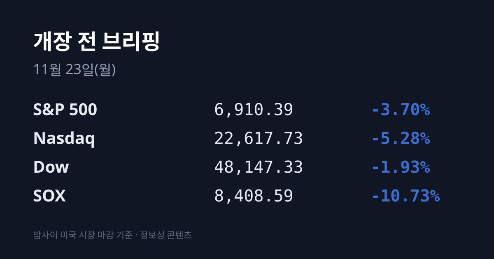
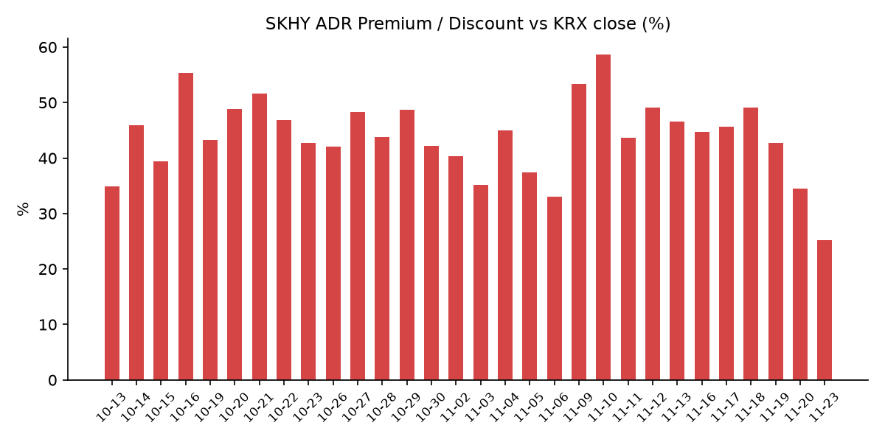
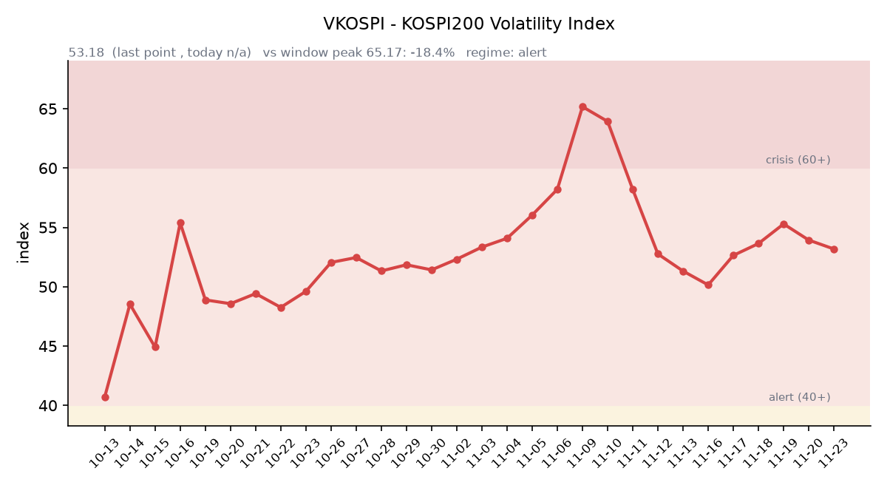

&nbsp;

【① 30초 요약 📈】

<mark>11/20(금) 미국은 나스닥 −5.28%, 필라델피아 반도체지수(SOX) −10.73%로 급락했습니다.</mark> S&P500은 −3.70%로 7,000선 아래에서 마감했습니다.

엔비디아는 SEC가 회계를 조사하고 있다는 로이터 보도가 나온 날 **14.01% 내린 $125.53에** 마감했습니다. 마이크론·AMD·브로드컴도 12~14% 내렸습니다.

같은 날 한국은 미국 정규장보다 먼저 끝났습니다. 코스피는 4,869.96(−5.21%), 코스닥은 645.68(−5.71%)로 마감했고 양 시장에서 매도 사이드카가 발동됐습니다.

주말인 11/22 정부는 긴급 F4 회의를 열어 증권시장안정펀드 가동 준비에 착수하고, 상장사 자기주식 매수 한도를 11/24부터 3개월간 완화한다고 밝혔습니다.

SK하이닉스 ADR(SKHY)은 −13.11%였고, 괴리율은 +25.25%로 하루 새 9.18%포인트 줄었습니다.

&nbsp;

【② 밤사이 미국 시장 🌙】

한국 11/20 마감 이후 미국은 11/20(금) 한 세션이 열렸습니다. 아래 등락률이 곧 주말 공백 동안의 누적 변화입니다.

| 지수 | 11/20 종가 | 등락 |
| :--- | ---: | ---: |
| S&P 500 | 6,910.39 | −3.70% |
| 나스닥 종합 | 22,617.73 | −5.28% |
| 다우 | 48,147.33 | −1.93% |
| 필라델피아 반도체(SOX) | 8,408.59 | −10.73% |

나스닥은 이날 하락으로 2026년 상승분을 모두 반납했고, S&P500과 다우는 고점 대비 10% 넘게 내린 조정 국면에 들어갔습니다. 러셀2000은 −2.76%였습니다. 주간으로는 S&P500이 약 8.6%, SOX가 17.13% 내렸습니다.

<mark>엔비디아는 $125.53(−14.01%)로 52주 신저가에 마감했습니다.</mark> 로이터는 SEC 집행 부서가 엔비디아의 회계를 조사하고 있다고 소식통 2명을 인용해 보도했고, 뉴욕타임스는 초기 단계의 조사라고 전했습니다. 엔비디아와 SEC는 공식 입장을 내지 않았고, 주말 동안 새 공시도 없었습니다. 젠슨 황 사임 뒤 콜레트 크레스가 임시 CEO를 맡고 있으며 이사회도 자체 조사를 진행 중입니다. 엔비디아는 중국향 호퍼 제품 출하를 중단했다고 밝혔습니다.

다른 반도체도 크게 내렸습니다. 마이크론 $594.51(−13.89%), AMD $424.39(−13.25%), 브로드컴 $304.41(−12.19%), TSMC ADR $318.71(−9.48%), 인텔 $51.28(−7.97%)입니다. 메타(−5.9%), 테슬라(−7.6%), 아마존(−4.1%)도 내렸습니다. 앤트로픽은 상장 이틀째 $88.91(−8.50%)로 공모가 83달러 대비 상승폭이 7%대로 줄었습니다. 11/20 장 마감 뒤 주요 기업의 실적 발표는 없었습니다. 시간외 마지막 체결가는 엔비디아 $130.01(+3.57%), 마이크론 $610.60(+2.71%), AMD $439.39(+3.53%), TSMC ADR $328.60(+3.10%)입니다(야후 파이낸스).

트럼프 대통령은 11/20 백악관 회견에서 중국에는 구형 반도체만 판매한다는 입장을 다시 밝혔습니다. 미 상무부의 첨단 반도체 수출통제 강화는 11/19부터 적용됐습니다.

VIX는 **35.89로 26.2% 올랐습니다.** 미 국채 10년물은 4.912%로 하루 새 0.14%포인트 내려 4거래일 연속 하락했고, 30년물은 5.303%입니다. FRED 기준(11/19) 2년물 4.76%, 10년물 실질금리(TIPS) 2.88%이고, 11/20 기준 10년물과 2년물 차이는 0.29%p입니다. CME FedWatch 기준 12월 FOMC 0.25%포인트 인상 확률은 약 91.5%로 집계됐습니다.

금 12월물은 $3,515.40(−4.62%)로 사흘째 크게 내렸습니다. 같은 날 실질금리는 내렸고 달러인덱스는 103.81(−0.09%)로 거의 그대로였습니다. 브렌트유는 $89.95(−2.21%), WTI는 $83.41(+0.24%)이고, 한국 원유 수입 기준인 두바이유는 $87.41(페트로넷 11/20 기준)입니다. 발틱운임지수(BDI)는 2,898(11/20, −0.10%)입니다. 지수선물은 11/20 마감 기준 S&P500 12월물 6,935.00, 나스닥100 12월물 25,126.50이며 한국 시간 08:00에 거래를 재개합니다.

&nbsp;

【③ 괴리율 트래커 — SK하이닉스 ADR 🔍】

| 항목 | 수치 |
| :--- | ---: |
| SKHY 종가 (11/20) | $103.57 (−13.11%) |
| 본주 환산가 (×10×환율 1,345.99원) | 1,394,042원 |
| 본주 직전 종가 (11/20) | 1,113,000원 |
| **괴리율** | **+25.25%** |

11/20 한국 본주는 1,113,000원(−5.92%)으로 내렸고, 그 뒤 미국 SKHY는 $103.57(−13.11%)로 더 크게 내렸습니다. 시간외에서는 $106.30(+2.63%)입니다. ADR 낙폭이 본주의 두 배를 넘으면서 괴리율은 전일 +34.43%에서 <mark>+25.25%로 9.18%포인트 줄어 08/03(+19.1%) 이후 가장 낮아졌습니다.</mark>

괴리율은 미국에 상장된 예탁증서(ADR) 가격을 본주 1주 기준으로 환산한 값과 한국 본주 종가를 비교한 수치입니다. 환산가가 본주보다 높은 프리미엄 상태에서는 전환 차익거래 구조상 본주 쪽에 매수 유인이 생기고, 디스카운트면 반대입니다.

한국 시장 전체를 담는 EWY(iShares MSCI South Korea ETF)는 $123.26(−8.42%)였고, 시간외에서는 $125.53(+1.84%)입니다. 11/20 EWY 등락에는 한국 11/20 장중 움직임(코스피 −5.21%, 원화 약세 포함 달러 기준 약 −5.65%)이 함께 들어 있어, 이를 빼고 어림 계산하면 **한국 마감 이후 미국 시간에 더해진 몫은 약 −2.9%포인트**, 시간외까지 넣으면 약 −1.1%포인트입니다. 같은 방식으로 SKHY를 보면 미국 시간 몫은 약 −7.2%포인트, 시간외 포함 약 −4.8%포인트입니다.

&nbsp;

【④ 변동성 트래커 🌡️】

**판정 한 줄**: <mark>VKOSPI는 53.18로 이틀째 내려 '경보'(40~60) 구간에 머물렀지만, 이 값은 미국 11/20 급락과 VIX 35.89 이전에 확정된 것이고 같은 날 양 시장에서 사이드카가 발동됐습니다.</mark>

**기대 변동성**  VKOSPI **53.18**(11/20, 전일비 −0.75, −1.39%)로 '경보'(40~60) 구간입니다. 장중 범위는 52.07~53.81이었습니다. 6월 고점 96.94 대비 −45.1%, 평시 상단인 25의 2.13배입니다. 코스피가 5% 넘게 내린 날 VKOSPI가 내린 것은 드문 조합입니다. 미국 VIX는 35.89로, VKOSPI가 VIX의 약 1.5배입니다.

**실현 변동성**  최근 10거래일 코스피 일별 등락률은 11/9 −0.81%, 11/10 +4.39%, 11/11 +2.60%, 11/12 −0.61%, 11/13 −0.98%, 11/16 −3.59%, 11/17 −2.59%, 11/18 +1.99%, 11/19 +1.39%, 11/20 −5.21%입니다. 이 중 ±3% 이상 등락일은 사흘입니다. 11/20 일중 변동폭은 종가 대비 2.87%였고, 최근 5거래일 평균은 3.53%입니다. 코스피는 한 주 동안 7.95% 내렸습니다.

**매매 정지**  11/20 유가증권시장은 11:54, 코스닥시장은 13:28에 매도 사이드카가 발동돼 프로그램 매도호가 효력이 각각 5분간 정지됐습니다. 양 시장 동시 발동은 10거래일 만입니다(한국경제·시사저널e).

**증폭 경로**  전체 ETF 거래대금 중 레버리지 ETF 비중은 26.67%로 직전(29.72%)보다 낮아졌습니다. KODEX 레버리지 1조3,143억원(회전율 37.69%), KODEX 200선물인버스2X 1조67억원(108.30%), KODEX 코스닥150레버리지 5,421억원(20.60%), KODEX 반도체레버리지 2,666억원(50.83%), TIGER 반도체TOP10레버리지 1,722억원(46.56%)입니다(네이버 ETF 목록, 11/23 07:16 스냅샷). 반도체 레버리지 ETF 두 종목의 회전율은 전날(34.09%, 38.64%)보다 높아졌습니다. 11/20 코스피200 선물 베이시스는 **−2.59(선물 752.75 − 현물 755.34)** 수준으로 12거래일째 마이너스였고, 폭은 전날(−3.57)보다 줄었습니다.

**청산 압력**  신용융자 잔고는 26조833억원(11/19 기준)으로 직전 거래일보다 1,831억원 줄었습니다. 유가증권시장 20조2,069억원, 코스닥 5조8,764억원입니다. 같은 날 위탁매매 미수금은 9,701억원, 반대매매 금액은 120억원으로 전날(285억원)보다 줄었습니다(금융투자협회). 이 수치는 코스피가 오른 11/19 기준입니다.

**하방 포지션**  공매도 순잔고는 T+2~3 공시 지연이 있어 개장 전 시점에는 확정치를 알 수 없습니다. 11/2~19 양대 시장 공매도 거래대금 가운데 외국인 비중은 75.1%였다는 보도가 있습니다.

&nbsp;

【⑤ 직전 거래일(11/20) 한국장 리뷰 🇰🇷】

| 지수 | 종가 | 등락 |
| :--- | ---: | ---: |
| 코스피 | 4,869.96 | −267.93 (−5.21%) |
| 코스닥 | 645.68 | −39.13 (−5.71%) |

코스피는 4,928.51로 크게 내려 출발했고 장중 4,971.31까지 반등을 시도했지만 4,831.69까지 밀린 뒤 4,869.96으로 마감했습니다. 종가 기준 약 10개월 만의 최저치입니다. 유가증권시장에서 800개 넘는 종목, 코스닥에서 1,500개 넘는 종목이 내렸습니다.

유가증권시장에서 <mark>외국인은 1조1,320억~1조2,682억원을 순매도해 6거래일째 매도했고</mark>, 기관도 3,499억~9,513억원을 순매도했습니다. 개인은 1조5,950억~1조6,182억원을 순매수했습니다(한국경제·시사저널e, 매체별 집계 차이). 프로그램 매매는 1조3,626억원 순매도였습니다. 외국인의 주간 순매도는 약 4조5,000억원입니다. 코스닥에서는 외국인이 약 1,700억~1,800억원, 기관이 약 1,050억~1,080억원을 순매도했고 개인이 약 2,900억원을 순매수했습니다.

삼성전자는 **183,100원(−7.01%), SK하이닉스는 1,113,000원(−5.92%)에** 마감했습니다. 미 상무부의 대중 반도체 수출통제 강화와 함께, 파이낸셜타임스가 삼성전자와 TSMC가 일부 중국 고객사(바이두 쿤룬·바이트댄스)에 상무부 허가 전까지 특정 프로세서 출하를 중단하겠다고 통보했다고 보도한 영향이 컸다는 설명입니다. 월스트리트저널은 중국 AI 기업의 미국산 반도체 접근을 막는 추가 규제가 검토되고 있다고 보도했습니다. KRX 반도체 업종은 9%대 내렸습니다. 외국인은 11/16~20 한 주 동안 삼성전자를 1조7,905억원, SK하이닉스를 9,401억원 순매도했습니다. SK하이닉스는 2027~2028년 생산능력의 50% 이상에 대해 장기공급계약을 맺었다고 밝혔습니다.

삼성전기는 774,000원(−12.54%), SK스퀘어는 675,000원(−8.39%), 효성중공업은 −6.51%, 현대차는 −4.67%였습니다. 업종별로는 전기·가스(+0.42%)만 올랐고 기계·장비(−7.86%), 통신(−7.78%), 전기·전자(−6.57%), 건설(−6.42%)이 크게 내렸습니다. 코스닥은 전 업종이 내렸고 리노공업(−15.07%), 이오테크닉스(−14.48%), 주성엔지니어링(−9.31%) 등 전날 급등한 반도체 장비·부품주의 낙폭이 컸습니다. 이날 상장한 하나에어로다이내믹스는 공모가 5,700원 대비 6.14% 오른 6,050원에 마감했습니다(시사저널e).

원/달러는 11/20 서울 외환시장 주간 거래에서 1,336.2원으로 6.2원 올랐고(장중 고점 1,340.3원), 작성 시각(11/23 07:15) 현재 **1,345.99원입니다.** 달러/엔은 158.57입니다.

아시아 증시 11/20 종가는 대만 가권 36,033.29(−6.23%), 닛케이225 56,436.65(−5.06%), 토픽스 3,674.22(−3.88%), 상하이종합 3,533.79(−1.22%), CSI300 3,954.57(−0.76%), 항셍 22,410.80(−1.89%)입니다. 아시아 장 역시 미국 11/20 정규장보다 먼저 끝났습니다. D램 현물가는 11/20 대만 세션 기준 DDR5 16Gb $60.67(+0.00%), DDR4 16Gb $78.62(−0.16%), DDR4 8Gb $43.75(−0.39%)로 보합권입니다(DRAMeXchange).

&nbsp;

【⑥ 오늘의 캘린더 & 관전 포인트 📅】

- **11/23(월):** 08:00 미국 지수선물 거래 재개. <mark>관세청 11월 1~20일 수출 동향 발표</mark>(1~10일 반도체 수출은 166억3,000만 달러, +331.2%). 한국·일본(09:00), 대만(10:00) 개장. 금융위원회 자기주식 매수 한도 완화 의결. 밤 미국·유럽 11월 S&P글로벌 PMI 잠정치(미국 23:45). 미국 장 마감 뒤 HPE 실적.
- **11/24(화):** 자기주식 매수 한도 완화 시행. 델 실적(11/24~25, 매체별 일정 차이).
- **11/25(수):** 미국 3분기 GDP 잠정치, **10월 PCE 물가 22:30**(블룸버그 컨센서스 전년 대비 3.8%, 근원 3.2%).
- **11/26(목):** <mark>한국은행 금융통화위원회</mark>(현재 기준금리 3.00%). 미국 추수감사절 휴장. **11/27(금):** 미국 조기 폐장.
- **11/30:** MSCI 정기 변경 반영. **12/8~9:** FOMC(결과는 한국 시간 12/10 새벽). **12/10:** 국내 선물·옵션 동시 만기. **1/10:** 미중 무역휴전 만료.

시장 참가자들이 주시하는 레벨은 코스피 11/20 저가 4,831선과 4,700선, SK하이닉스 1,050,000원 선, VKOSPI 60 선('위기' 구간 경계), 원/달러 1,360원 선, 외국인 순매도 규모, 대만 가권의 추가 등락입니다.

&nbsp;

【⑦ 정책 워치 🏛️】

11/22 이형일 부총리 겸 재정경제부 장관이 신현송 한국은행 총재, 이억원 금융위원장, 이찬진 금융감독원장과 긴급 시장상황점검회의(F4)를 열었습니다. 정부는 **증권시장안정펀드를 바로 가동할 수 있도록 발동 체계 준비에 착수했고**, 아직 실제 가동은 아닙니다. 실제 투입되면 글로벌 금융위기 이후 18년 만입니다. 상장기업의 1일 자기주식 매수주문 수량 한도는 11/24부터 3개월간 완화되며 금융위원회가 11/23 의결합니다. 불법 공매도에는 3개월 특별 집중 감시 기간을 운영하고, 장기 투자 유도와 수급 불균형 완화를 위한 자본시장 개혁 TF도 꾸립니다. 일부 매체는 공매도 제한이 대책에 포함되지 않았다고 지적했습니다. 정부는 11/6에도 증권사 신용융자 담보비율 유지 의무(140%)를 3개월 면제했습니다.

공매도는 2025년 3월 전면 재개 이후 그대로이며, 이번 대책에서도 제도 변경은 없었습니다. 미국에서는 상원이 11/19 데이터센터 전력비용 법안을 62 대 33으로 통과시켰고 하원은 아직 처리하지 않았습니다.

&nbsp;

【⑧ 오늘의 질문 ❓】

금요일 한국장이 끝난 뒤에 나온 미국 반도체 −10.7%와 주말 정부 대책, 오늘 시장은 둘 중 어느 쪽을 먼저 반영할 것인가.

&nbsp;

#개장전브리핑 #미국증시마감 #나스닥급락 #엔비디아 #반도체 #증안펀드 #수출규제 #하이닉스ADR #괴리율 #VKOSPI #SK하이닉스 #삼성전자

&nbsp;

*본 글은 공개된 시장 데이터를 정리한 정보성 콘텐츠이며, 특정 종목·상품의 매매 권유가 아닙니다. 모든 투자 판단과 책임은 투자자 본인에게 있습니다. 수치는 작성 시점 기준이며 이후 변동될 수 있습니다.*