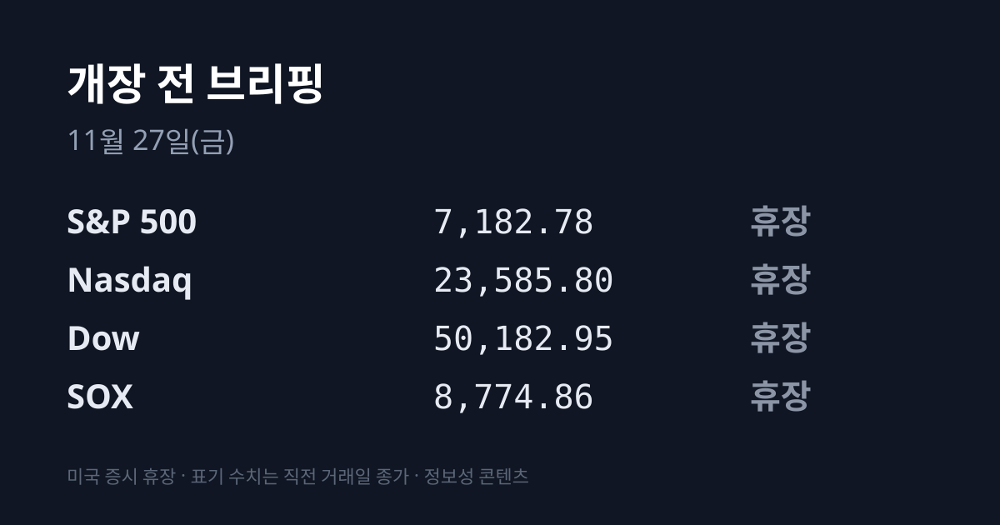
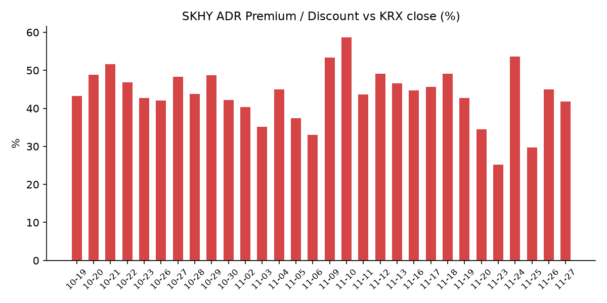
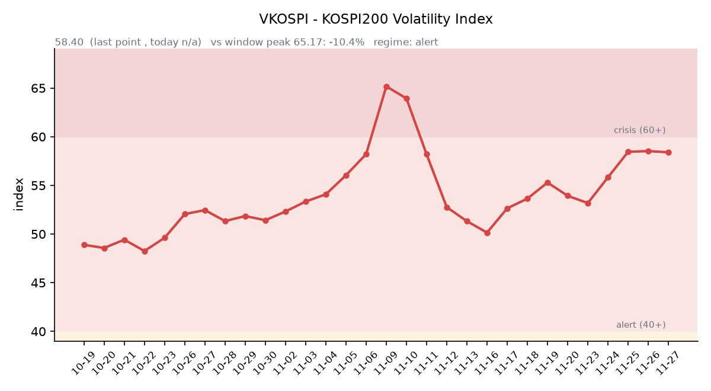

【① 30초 요약 📈】

미국 증시는 11/26(목) 추수감사절로 휴장했습니다. 지수의 최신 종가는 11/25 기준이며, 오늘 밤 미국장은 한국 시간 11/28 03:00에 일찍 닫힙니다.

<mark>11/26 코스피는 장중 4,817.77(+2.56%)까지 올랐다가 외국인이 매도로 돌아서며 4,711.21(+0.29%)로 마감했습니다.</mark> SK하이닉스는 +2.23%, 삼성전자는 +0.35%였습니다.

한국은행은 기준금리를 3.00%에서 **3.25%로 0.25%포인트** 올렸습니다. 올해 경제성장률 전망은 3.3%에서 3.9%로, 내년 전망은 2.9%에서 4.1%로 높였습니다.

미국 SKHY 가격이 휴장으로 멈춘 사이 본주가 올라 ADR 괴리율은 +44.98%에서 +41.78%로 줄었습니다.

엔비디아는 S&P글로벌의 신용등급 '부정적 관찰대상' 지정에 이어 측근 연루 대중국 밀수 의혹 보도가 나왔고, 젠슨 황 CEO는 12/3 미 상원 청문회에 출석합니다.

&nbsp;

【② 밤사이 미국 시장 🌙】

| 지수 | 11/25 종가 | 등락 |
| :--- | ---: | ---: |
| S&P 500 | 7,182.78 | 휴장 |
| 나스닥 종합 | 23,585.80 | 휴장 |
| 다우 | 50,182.95 | 휴장 |
| 필라델피아 반도체(SOX) | 8,774.86 | 휴장 |

11/26(목) 미국 주식·채권시장은 추수감사절로 문을 닫았습니다. 표의 종가는 직전 거래일인 11/25 값으로, 그날 등락률은 S&P500 −0.25%, 나스닥 −0.62%, 다우 +0.33%, SOX −0.65%였습니다. 11/25 장 마감 뒤나 휴장일에 나온 주요 기업 실적 발표는 없었습니다.

휴장 중에도 지수선물은 단축 거래됐습니다. 마지막 체결가 기준으로 **S&P500 12월물은 7,234.50으로 11/25 정산가보다 +0.54%,** 나스닥100 12월물은 26,221.25로 +0.46%입니다. 선물 거래는 한국 시간 08:00에 다시 열립니다.

엔비디아를 둘러싼 소식이 이어졌습니다. S&P글로벌은 11/25 엔비디아의 AA 신용등급을 '부정적 관찰대상'에 올렸고, 젠슨 황 CEO의 이탈·복귀 이후 지배구조 우려를 이유로 들었습니다. 월스트리트저널은 젠슨 황의 측근인 제이 푸리 선임고문이 슈퍼마이크로 대중국 서버 밀수 의혹 수사 선상에 오른 인물과 결혼한 것으로 보도했습니다. 젠슨 황은 12/3 미 상원 은행위원회 청문회에 단독 증인으로 출석합니다(머니투데이).

미국 국채 금리는 11/25 종가가 마지막입니다. 10년물 4.848%, 30년물 5.235%였고, FRED 기준(11/24) 10년물 실질금리(TIPS)는 2.79%, 11/25 기준 10년물과 2년물 차이는 0.24%p입니다. VIX는 11/25 28.29로 마감했습니다.

금 12월물은 $3,593.40으로 11/25 정산가 대비 1.63% 올랐고(휴장 중 전자거래, 한국 시간 04:29 기준), 달러인덱스는 103.78로 0.11% 올라 거의 그대로였습니다. 달러가 함께 오르지 않은 금 상승이었습니다. WTI는 $84.91, 브렌트유는 $91.73입니다(야후 근월물). 한국 원유 수입 기준인 두바이유는 $87.00으로 $2.81 올랐고, 같은 날 페트로넷 기준 브렌트($96.57)보다 $9.57 낮습니다(페트로넷 11/26 기준).

&nbsp;

【③ 괴리율 트래커 — SK하이닉스 ADR 🔍】

| 항목 | 수치 |
| :--- | ---: |
| SKHY 종가 (11/25) | $111.14 (−0.75%) |
| 본주 환산가 (×10×환율 1,343.32원) | 1,492,966원 |
| 본주 직전 종가 (11/26) | 1,053,000원 |
| **괴리율** | **+41.78%** |

미국이 휴장해 SKHY는 11/25 종가 $111.14에서 움직이지 않았습니다. 그 사이 한국 본주는 11/26 1,053,000원(+2.23%)으로 올랐고, 그 결과 <mark>괴리율은 전일 +44.98%에서 +41.78%로 3.20%포인트 줄었습니다.</mark> ADR 가격이 멈춘 채 본주만 움직인 하루의 계산상 변화입니다.

괴리율은 미국에 상장된 예탁증서(ADR) 가격을 본주 1주 기준으로 환산한 값과 한국 본주 종가를 비교한 수치입니다. 환산가가 본주보다 높은 프리미엄 상태에서는 전환 차익거래 구조상 본주 쪽에 매수 유인이 생기고, 디스카운트면 반대입니다.

한국 시장 전체를 담는 EWY(iShares MSCI South Korea ETF)도 11/25 종가 $129.19(−1.16%)에 머물러 있습니다. 전날 어림 계산한 '한국 마감 이후 미국 시간에 더해진 몫' 약 +5.4%포인트 가운데, 11/26 한국장의 달러 기준 상승(약 +0.3%)을 빼면 남은 몫은 약 +5.1%포인트입니다. 같은 방식으로 SKHY 쪽 남은 몫은 약 +9.1%포인트입니다(모두 어림값). 미국 가격이 이틀째 갱신되지 않은 값이라는 점이 오늘의 특징입니다.

&nbsp;

【④ 변동성 트래커 🌡️】

**판정 한 줄**: <mark>VKOSPI는 장중 62.02로 '위기' 경계(60)를 넘었다가 58.40으로 내려와, 3거래일째 '경보' 구간 58선에 머물러 있습니다.</mark>

**기대 변동성**  VKOSPI **58.40**(11/26, 전일비 −0.12, −0.21%)으로 '경보'(40~60) 구간입니다. 시가 61.49, 장중 범위는 57.86~62.02였습니다. 11/24 58.45, 11/25 58.52, 11/26 58.40으로 사흘 연속 58선입니다. 6월 고점 96.94 대비 −39.8%, 평시 상단인 25의 2.34배입니다.

**실현 변동성**  최근 10거래일 코스피 일별 등락률은 11/13 −0.98%, 11/16 −3.59%, 11/17 −2.59%, 11/18 +1.99%, 11/19 +1.39%, 11/20 −5.21%, 11/23 −3.31%, 11/24 +6.32%, 11/25 −6.16%, 11/26 +0.29%입니다. 이 중 **±3% 이상 등락일은 닷새**입니다. 11/26 일중 변동폭은 종가 대비 2.40%로 최근 5거래일 중 가장 작았고, 5거래일 평균은 3.17%입니다.

**매매 정지**  최근 열흘 사이드카는 유가증권시장 11/20·11/23·11/25 매도, 11/24 매수, 코스닥시장 11/20 매도·11/24 매수로 모두 여섯 차례 발동됐습니다(KIND).

**증폭 경로**  전체 ETF 거래대금 중 레버리지 ETF 비중은 31.14%로 직전(26.30%)보다 높아졌습니다. 거래대금 1위는 KODEX 200선물인버스2X로 1조2,361억원(회전율 133.84%)이었고, KODEX 레버리지 1조2,047억원(35.82%), KODEX 코스닥150레버리지 6,040억원(19.96%), KODEX 반도체레버리지 2,210억원(44.11%), SOL SK하이닉스선물단일종목인버스2X 1,800억원(239.98%) 순입니다(네이버 ETF 목록, 11/27 07:16 스냅샷). 11/26 코스피200 선물 베이시스는 −0.33(선물 726.75 − 현물 727.08)으로 하루 만에 다시 마이너스가 됐습니다.

**청산 압력**  신용융자 잔고는 25조4,123억원(11/25 기준)으로 직전 거래일보다 4,654억원 줄었습니다. 유가증권시장 19조6,822억원, 코스닥 5조7,301억원입니다. 같은 날 위탁매매 미수금은 **1조84억원으로 1조원을** 넘었고(11/24 9,660억원), 반대매매 금액은 84억원(미수금 대비 0.9%)이었습니다(금융투자협회).

**하방 포지션**  공매도 순잔고는 T+2~3 공시 지연이 있어 개장 전 시점에는 확정치를 알 수 없습니다.

&nbsp;

【⑤ 직전 거래일(11/26) 한국장 리뷰 🇰🇷】

| 지수 | 종가 | 등락 |
| :--- | ---: | ---: |
| 코스피 | 4,711.21 | +13.70 (+0.29%) |
| 코스닥 | 655.71 | +5.07 (+0.78%) |

코스피는 4,745.10(+1.01%)으로 올라 출발해 장중 4,817.77까지 올랐지만, 오후 들어 상승분 대부분을 반납하고 4,711.21로 마감했습니다. 전날 미국 반도체주의 낙폭이 장중보다 크게 줄어든 점과 엔비디아 관련 우려 완화가 초반 매수를 이끌었고, 미국 추수감사절 휴장을 앞둔 경계감과 외국인 매도 전환, 금리 인상 소화 과정이 상승폭을 줄인 요인으로 거론됐습니다. 거래대금은 연중 최저 수준이었다는 보도가 나왔습니다.

유가증권시장에서 <mark>기관은 7,508억원을 순매수했고, 외국인은 1,136억원, 개인은 1조439억원을 순매도했습니다</mark>(글로벌이코노믹). 외국인은 오전에 약 2,300억원 순매수였다가 오후에 매도로 돌아섰습니다(파이낸셜뉴스). 외국인은 SK하이닉스를 순매수하고 삼성전자를 순매도한 것으로 보도됐습니다. 코스닥에서는 기관 2,326억원 순매수, 외국인 1,063억원·개인 1,351억원 순매도였습니다.

삼성전자는 171,300원(+0.35%)으로 장중 176,700원까지 올랐고, SK하이닉스는 1,053,000원(+2.23%)으로 장중 한때 5% 넘게 올랐습니다. 삼성전기 +3.84%, SK스퀘어 +2.68%, 삼성전자우 +1.63%가 강했습니다. 반면 전날 강했던 업종은 되돌림을 보여 현대차 −3.90%, LG에너지솔루션 −2.11%, 삼성바이오로직스 −1.91%, KB금융 −1.89%, 셀트리온 −0.69%였습니다.

코스닥에서는 **삼천당제약 +9.62%,** 주성엔지니어링 +3.39%, HLB +2.65%가 올랐고 에코프로비엠 −3.80%, 에코프로 −3.47%, 로보티즈 −2.77%가 내렸습니다. 우원개발은 한화와 1,528억원 규모의 GTX-C 노선 공사 계약을 공시하며 장중 16%대, 대주전자재료는 AI 서버용 MLCC 수요 기대로 장중 16%대 올랐습니다(와이드경제).

원/달러는 11/26 서울 외환시장 15:30 종가 기준 1,342.7원으로 0.5원 내렸습니다(철강금속신문). 작성 시각(11/27 07:16) 현재는 1,343.32원이고, 달러/엔은 159.22입니다.

아시아 증시 11/26 종가는 대만 가권 39,151.81(+2.50%), 닛케이225 57,499.16(+0.86%), 토픽스 3,750.40(+0.11%), 상하이종합 3,476.88(+0.01%), CSI300 3,900.55(+0.06%), 항셍 22,226.88(+1.19%)입니다. 일본에서는 키옥시아홀딩스가 자회사로부터 2조2,149억엔 배당을 받는다고 발표해 장중 상한가를 기록했고, 엔비디아와 메모리를 AI 연산에 활용하는 검증 작업에도 착수했다고 밝혔습니다(머니투데이). D램 현물가는 11/26 대만 세션 기준 DDR5 16Gb $60.77(보합), DDR4 16Gb $77.50(−0.32%), DDR4 8Gb $43.12(−0.21%)였습니다(DRAMeXchange).

&nbsp;

【⑥ 오늘의 캘린더 & 관전 포인트 📅】

**11/27(금):** 08:00 미국 지수선물 거래 재개. 한국·일본(09:00), 대만(10:00) 개장. <mark>23:30 미국 증시 블랙프라이데이 단축장 개장, 한국 시간 11/28 03:00 조기 폐장</mark>(채권은 04:00). 엔비디아·마이크론의 휴장 후 첫 거래입니다.

**11/30(월):** MSCI 정기 변경 반영, 중국 11월 공식 PMI(통상 월말 발표). **12/1(화):** 한국 11월 수출입동향(통상 매월 1일 발표), 미 하원 위원회 젠슨 황 비공개 면담.

**12/3(목):** 젠슨 황 미 상원 은행위원회 청문회. **12/8~9:** FOMC(결과는 한국 시간 12/10 새벽). **12/10:** 국내 선물·옵션 동시 만기. **12/17:** 마이크론 실적.

**1/5:** 301조 관세안 서면 의견 마감. **1/10:** 미중 무역휴전 만료. **1/25:** 301조 공청회.

시장 참가자들이 주시하는 레벨은 코스피 4,829선과 4,617선, 11/26 장중 고가 4,817.77선, SK하이닉스 1,000,000원 선, VKOSPI 60 선('위기' 구간 경계), 원/달러 1,350원 선, 외국인 순매도가 5,000억원 이상으로 커지는지 여부입니다.

&nbsp;

【⑦ 정책 워치 🏛️】

한국은행 금융통화위원회는 11/26 기준금리를 연 3.00%에서 3.25%로 0.25%포인트 올렸습니다. 8월 이후 석 달 만이며 올해 세 번째 인상입니다. 금통위원 7명 중 5명이 찬성했고 황건일·이수형 위원은 동결 의견을 냈습니다. 수정 경제전망에서 올해 성장률은 3.3%에서 3.9%로, 내년은 2.9%에서 4.1%로 상향됐고, 소비자물가 상승률은 올해 2.7%(유지), 내년 2.4%로 제시됐습니다. 점도표에서는 내년 5월까지 기준금리가 3.50%에 이를 것이라는 점이 8개 찍혔습니다. 다음 회의는 내년 1월입니다(이투데이·아시아경제).

공매도는 2025년 3월 전면 재개 이후 그대로이며, 11/26 제도 변경 보도는 없었습니다.

&nbsp;

【⑧ 오늘의 질문 ❓】

미국이 쉬는 동안 한국이 하루 먼저 소화한 +41.78%의 ADR 프리미엄을, 오늘 밤 미국 단축장은 어떤 가격으로 다시 매길 것인가.

&nbsp;

#개장전브리핑 #미국증시휴장 #추수감사절 #반도체 #SK하이닉스 #삼성전자 #하이닉스ADR #괴리율 #VKOSPI #금통위 #기준금리 #엔비디아

&nbsp;

*본 글은 공개된 시장 데이터를 정리한 정보성 콘텐츠이며, 특정 종목·상품의 매매 권유가 아닙니다. 모든 투자 판단과 책임은 투자자 본인에게 있습니다. 수치는 작성 시점 기준이며 이후 변동될 수 있습니다.*