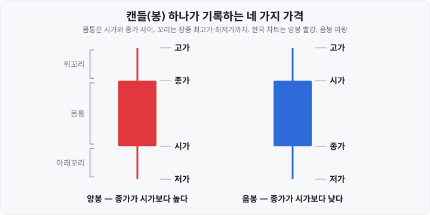
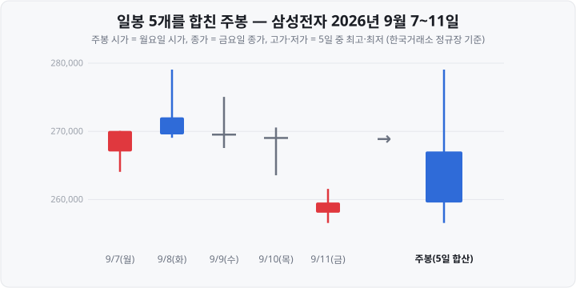

저는 주식을 처음 시작했을 때 빨간 봉은 오른 날, 파란 봉은 내린 날이라고만 알고 있었습니다. 그런데 시세표에는 하락으로 표시된 날의 봉이 빨간색이어서 한동안 혼동했습니다. <mark>봉의 색과 등락률이 서로 다른 기준으로 정해진다는 점을 알고 나서야 차트가 제대로 읽히기 시작했습니다.</mark>

2026년 9월 11일 삼성전자의 일봉은 빨간색이었습니다. 그런데 그날 삼성전자 주가는 전날보다 **3.53% 내렸습니다.** 빨간 봉이 상승을 뜻한다고 알고 있던 투자자에게는 모순처럼 보입니다. 이 차이는 <mark>봉의 색이 '전날 종가'가 아니라 '그날 시가'와 비교해 정해지기 때문</mark>에 생깁니다.

이 글은 주식 차트의 기본 단위인 **캔들**(봉)을 다룹니다. ① 봉 하나가 나타내는 네 가지 가격, ② 양봉·음봉과 전일 대비 등락의 차이, ③ 한국과 미국의 색 표시 차이, ④ 일봉·주봉·월봉·분봉의 계산 방법, ⑤ 2026년 9월 애프터마켓 개설 이후 차트마다 달라진 종가, ⑥ 수정주가와 로그 눈금 설정을 차례로 정리합니다. 예시는 한국거래소 공식 시세로 확인한 삼성전자·SK하이닉스의 실제 값이며, 기준 시점은 **2026년 10월**입니다. 봉 모양을 매매 신호로 해석하는 방법은 다루지 않습니다.

&nbsp;

【봉 하나가 나타내는 네 가지 가격】

캔들 하나는 정해진 기간(하루·한 주·1분 등) 동안의 가격 네 가지를 한 도형으로 표시합니다.

| 가격 | 뜻 | 한국거래소 정규장에서 정해지는 방식 |
| :-- | :-- | :-- |
| **시가** | 그 기간의 첫 체결 가격 | 08:30~09:00 주문을 모아 09:00에 단일가로 결정 |
| **고가** | 그 기간의 가장 높은 체결 가격 | 장중 접속매매 중 최고 체결가 |
| **저가** | 그 기간의 가장 낮은 체결 가격 | 장중 접속매매 중 최저 체결가 |
| **종가** | 그 기간의 마지막 체결 가격 | 15:20~15:30 주문을 모아 15:30에 단일가로 결정 |

시가와 종가가 정해지는 단일가매매(동시호가)의 원리는 [동시호가 편](https://blog.naver.com/hdglace/224387372100)에서 다뤘습니다.

봉은 **몸통**과 **꼬리**로 이루어집니다.

- **몸통**은 시가와 종가 사이의 구간입니다. 종가가 시가보다 높으면 **양봉**, 낮으면 **음봉**입니다.
- **위꼬리**는 몸통 윗변에서 고가까지, **아래꼬리**는 몸통 아랫변에서 저가까지 이어진 선입니다. <mark>꼬리가 길다는 것은 장중에 고가나 저가까지 크게 움직였다가 종가는 그 수준에서 멀어졌다는 뜻</mark>입니다. 시가와 종가가 같아 몸통이 없는 봉은 가로선 하나로 그려집니다.

2026년 9월 11일 삼성전자의 일봉을 숫자로 풀면 다음과 같습니다. 시가 258,000원, 고가 261,500원, 저가 256,500원, 종가 259,500원입니다. 종가가 시가보다 1,500원 높으므로 양봉이고, 몸통은 258,000~259,500원(1,500원), 위꼬리는 259,500~261,500원(2,000원), 아래꼬리는 256,500~258,000원(1,500원)입니다.

&nbsp;

【양봉·음봉과 전일 대비 등락은 기준이 다릅니다】

시세 화면의 등락률은 **전일 종가**와 비교한 값이고, 봉의 색은 **당일 시가**와 비교한 결과입니다. 두 기준이 다르기 때문에 다음과 같은 날이 생깁니다.

**표 1. 봉의 색과 전일 대비 등락이 반대인 날 — 삼성전자, 한국거래소 공식 시세**

| 날짜 | 전일 종가 | 시가 | 종가 | 봉 | 전일 대비 |
| :-- | --: | --: | --: | :-- | --: |
| 2026년 9월 11일 | 269,000원 | 258,000원 | 259,500원 | **양봉**(빨강) | −9,500원(−3.53%) |
| 2026년 8월 5일 | 240,000원 | 254,000원 | 246,000원 | **음봉**(파랑) | +6,000원(+2.50%) |

9월 11일에는 시가가 전일 종가보다 4.1% 낮게 형성됐고, 장중에 1,500원 올라 마감했습니다. 하루 전체로는 하락했지만 시가 이후로는 상승했기 때문에 양봉이 됩니다. 8월 5일은 반대로 시가가 전일 종가보다 5.8% 높게 형성된 뒤 장중에 8,000원 내렸습니다. 전날보다는 올랐지만 음봉입니다.

이처럼 시가가 전일 종가에서 크게 벗어나 형성되는 것을 **갭**(gap)이라고 하며, 차트에서는 전날 봉과 당일 봉 사이의 빈 공간으로 나타납니다. <mark>"빨간 봉이면 오른 날"이라고 읽으면 갭이 생긴 날을 잘못 해석하게 됩니다.</mark> 전날보다 올랐는지는 봉의 색이 아니라 **전날 봉의 종가와 당일 봉의 종가를 비교해** 확인합니다.

&nbsp;

【한국과 미국은 색이 반대입니다】

국내 증권사와 포털의 차트는 상승(양봉)을 빨간색, 하락(음봉)을 파란색으로 표시합니다. 시세표의 등락률도 같은 색을 씁니다.

미국 등 해외 차트 서비스는 상승을 **초록색**, 하락을 **빨간색**으로 표시하는 경우가 많습니다. 해외 사이트에서 미국 주식 차트를 볼 때 <mark>빨간 봉은 상승이 아니라 하락</mark>입니다. 많은 차트 도구는 설정 화면에서 양봉·음봉의 몸통·꼬리 색을 바꿀 수 있으므로, 한 가지 색 체계로 통일해 두면 혼동을 줄일 수 있습니다.

&nbsp;

【일봉·주봉·월봉·분봉】

봉 하나가 나타내는 기간을 바꾸면 같은 종목의 차트가 다르게 그려집니다.

| 종류 | 봉 하나의 기간 | 시가 | 종가 | 고가·저가 |
| :-- | :-- | :-- | :-- | :-- |
| **분봉** | 1분·5분·30분 등 | 그 구간 첫 체결가 | 그 구간 마지막 체결가 | 구간 중 최고·최저 |
| **일봉** | 하루 | 그날 시가 | 그날 종가 | 그날 최고·최저 |
| **주봉** | 한 주 | 그 주 첫 거래일 시가 | 그 주 마지막 거래일 종가 | 그 주 최고·최저 |
| **월봉** | 한 달 | 그 달 첫 거래일 시가 | 그 달 마지막 거래일 종가 | 그 달 최고·최저 |

주봉은 그 주의 일봉을 합쳐 계산합니다. 2026년 9월 7~11일 삼성전자 일봉 5개로 계산하면 다음과 같습니다.

**표 2. 일봉 5개로 주봉 계산하기 — 삼성전자, 한국거래소 공식 시세**

| 날짜 | 시가 | 고가 | 저가 | 종가 | 거래량 |
| :-- | --: | --: | --: | --: | --: |
| 9월 7일(월) | **267,000** | 270,000 | 264,000 | 270,000 | 18,314,016 |
| 9월 8일(화) | 272,000 | **279,000** | 269,000 | 269,500 | 22,716,517 |
| 9월 9일(수) | 269,500 | 275,000 | 267,500 | 269,500 | 16,370,962 |
| 9월 10일(목) | 269,000 | 270,500 | 263,500 | 269,000 | 22,517,075 |
| 9월 11일(금) | 258,000 | 261,500 | **256,500** | **259,500** | 13,939,111 |
| **주봉** | **267,000** | **279,000** | **256,500** | **259,500** | **93,857,681** |

(단위: 원, 주)

주봉의 시가는 월요일 시가, 종가는 금요일 종가, 고가는 화요일 고가, 저가는 금요일 저가이고, 거래량은 5일의 합계입니다. 네이버 증권이 제공하는 같은 주의 주봉 값과 다섯 항목이 모두 일치합니다.

이 주의 주봉은 음봉입니다. 주 시가(267,000원)보다 주 종가(259,500원)가 낮기 때문입니다. 그러나 전주 금요일(9월 4일) 종가는 255,500원이었으므로 <mark>주간 등락으로는 4,000원(+1.57%) 상승</mark>했습니다. 앞 절에서 본 일봉의 경우와 같은 이유로, 주봉에서도 색과 등락이 반대로 나타날 수 있습니다.

하루 안의 움직임을 보려면 분봉을 씁니다. 네이버 증권의 삼성전자 1분봉은 오전 9시에 시작해 저녁 7시 59분까지 이어집니다(2026년 10월 13일 기준). 정규장(09:00~15:30)에 이어 시간외종가매매(15:40~16:00)와 한국거래소 애프터마켓(16:00~20:00)의 체결까지 표시하기 때문입니다. 오전 8시대 분봉은 없으므로 넥스트레이드의 체결은 포함되지 않은 한국거래소 시세입니다.

&nbsp;

【같은 날이라도 차트마다 봉이 다를 수 있습니다】

2026년 9월 14일 한국거래소가 오후 4시~8시 **애프터마켓**(시간외 접속매매)을 열면서, 같은 종목의 같은 날 봉이 조회하는 서비스에 따라 달라지게 됐습니다.

한국거래소 코스닥시장본부는 애프터마켓 개설 직후 관련 상장사에 보낸 안내에서 종가를 '오후 3시 30분경 정규장 종료 시 형성되는 최종가격'으로 정의하고, 애프터마켓 개설 이후에도 같다고 밝혔습니다(이투데이 2026년 9월 17일 보도). 거래소는 네이버 증권과 다음 증권 등 시세 조회 사이트가 **애프터마켓 종료 시점의 가격을 종가로 표시**하고 있어 주의가 필요하다고 덧붙였습니다. 네이버 증권 일봉으로 확인하면 종가뿐 아니라 고가·저가도 달라지는 날이 있습니다. 9월 14일부터 10월 13일까지 18거래일 가운데 삼성전자 일봉의 종가가 한국거래소 값과 다른 날은 15일, 저가가 다른 날은 5일, 고가가 다른 날은 1일이었습니다.

**표 3. 같은 날 같은 종목의 두 일봉 — 삼성전자, 2026년 10월 7일**

| 항목 | 한국거래소 공식 시세 | 네이버 증권 일봉 |
| :-- | --: | --: |
| 시가 | 269,500원 | 269,500원 |
| 고가 | 279,500원 | 279,500원 |
| 저가 | **268,500원** | **268,000원** |
| 종가 | **268,500원** | **269,000원** |
| 몸통(음봉) | 1,000원 | 500원 |
| 아래꼬리 | 없음 | 1,000원 |
| 거래량 | 16,395,504주 | 16,395,504주 |

한국거래소 공식 시세로는 종가와 저가가 같아 아래꼬리가 없는 음봉입니다. 네이버 증권 일봉에는 오후 4시 이후 애프터마켓에서 체결된 268,000원(저가)과 저녁 8시 직전 마지막 체결가 269,000원(종가)이 반영돼, 몸통이 절반으로 줄고 아래꼬리가 생겼습니다. 네이버 1분봉을 정규장(15:30까지)만 합산하면 저가·종가가 한국거래소 값과 같아집니다. 이날 거래량은 두 곳 모두 16,395,504주로 같았습니다. 한국거래소가 공표하는 일별 거래량에도 시간외·애프터마켓 체결분이 포함되기 때문입니다. 다만 거래량이 서로 다른 날도 있습니다(10월 13일 한국거래소 26,790,913주, 네이버 증권 25,359,015주).

넥스트레이드(NXT, Nextrade, 대체거래소)에서도 거래되는 종목에는 선택지가 하나 더 있습니다. 신한투자증권·키움증권 등은 현재가·차트 화면에서 **통합·KRX·NXT** 시세 가운데 하나를 고를 수 있게 하고, 통합 시세는 두 거래소의 시세를 통합한 것이라고 안내합니다. 넥스트레이드는 오전 8시부터 저녁 8시 사이에 프리마켓·메인마켓·애프터마켓 세 구간으로 거래하므로, 통합 시세 차트의 봉은 한국거래소 시세 차트의 봉과 시가·고가·저가가 다를 수 있습니다. 두 시장의 거래 시간 차이는 [NXT와 KRX 애프터마켓 편](https://blog.naver.com/hdglace/224412184369)에 정리했습니다.

<mark>공식 종가를 확인하거나 수익률을 계산할 때는 한국거래소 시세를 기준으로 삼는 것이 안전합니다.</mark> 한국거래소는 개별 종목의 일자별 종가를 **KRX 정보데이터마켓플레이스**(KDM, KRX Data Marketplace)에서 확인하도록 안내하고 있습니다. 데이터를 내려받는 방법은 [과거 주가 데이터 받는 법](https://blog.naver.com/hdglace/224404481437)에서 다뤘습니다.

&nbsp;

【수정주가 — 액면분할 전후를 이어 보는 설정】

액면분할·주식병합 등으로 주식 수가 바뀌면 주가가 그 비율만큼 바뀝니다. 과거 가격을 그대로 두면 차트에 실제로는 일어나지 않은 폭락이나 폭등이 나타납니다. 이를 막기 위해 분할 이전의 가격을 분할 비율로 나눠 다시 계산한 값을 **수정주가**라고 합니다.

삼성전자는 2018년 5월 4일 1주를 50주로 나누는 액면분할을 했습니다.

**표 4. 삼성전자 액면분할 전후 — 수정 전 시세와 수정주가**

| 날짜 | 한국거래소 시세(수정 전) | 네이버 증권 차트(수정주가) | 거래량(두 곳 동일) |
| :-- | --: | --: | --: |
| 2018년 4월 27일 종가 | 2,650,000원 | 53,000원 | 606,216주 |
| 2018년 5월 4일 종가 | 51,900원 | 51,900원 | 39,565,391주 |

삼성전자는 분할을 위해 4월 30일부터 3거래일 동안 거래가 정지됐습니다. 수정 전 시세로 차트를 그리면 정지 직전인 4월 27일과 거래가 재개된 5월 4일 사이에 98% 폭락한 것처럼 보입니다. 수정주가로 그리면 53,000원에서 51,900원으로 2.1% 내린 것으로 나타나며, 이것이 주주가 실제로 겪은 가격 변화입니다. 분할이 기업가치를 바꾸지 않는 이유는 [액면분할·주식병합 편](https://blog.naver.com/hdglace/224425710598)에서 계산했습니다.

<mark>네이버 증권 차트는 가격에는 수정주가를 적용하지만 거래량은 수정하지 않았습니다.</mark> 그래서 거래량 막대는 4월 27일 606,216주에서 5월 4일 39,565,391주로 약 65배가 됩니다. 이 가운데 50배는 주식 수가 50배로 늘어난 효과입니다. 같은 금액이 거래돼도 주식 수로는 50배가 됩니다. 분할이 있었던 종목의 거래량을 비교할 때는 거래대금을 함께 보는 편이 정확합니다.

수정주가 적용 여부는 도구마다 다릅니다.

- **증권사 HTS(Home Trading System, PC용 주식 거래 프로그램)·MTS(Mobile Trading System, 모바일 주식 거래 앱) 차트**: 수정주가를 적용할지 고르는 설정이 있는 경우가 많습니다. 키움증권 Open API의 일봉 조회에도 '수정주가구분' 입력 항목이 있습니다.
- **한국거래소 일별 시세 데이터**: 수정 전 가격입니다. 내려받은 데이터로 기간 수익률을 계산할 때는 액면분할·병합일 전후의 가격을 직접 조정해야 합니다.

&nbsp;

【선형 눈금과 로그 눈금】

차트의 세로축(가격축)에는 두 가지 눈금이 있습니다.

- **선형 눈금**은 같은 **금액**을 같은 높이로 그립니다. 1만원 오른 것은 주가가 10만원일 때나 100만원일 때나 같은 높이입니다.
- **로그 눈금**은 같은 **비율**을 같은 높이로 그립니다. 10만원→20만원과 100만원→200만원(둘 다 2배)이 같은 높이입니다.

주가가 크게 오른 종목을 긴 기간에 걸쳐 보면 두 눈금의 차이가 커집니다. SK하이닉스 월봉 종가로 두 구간을 비교하면 다음과 같습니다.

**표 5. 선형 눈금과 로그 눈금에서 두 구간의 높이 — SK하이닉스 월말 종가**

| 구간 | 가격 변화 | 등락률 | 선형 눈금에서 높이 | 로그 눈금에서 높이 |
| :-- | :-- | --: | --: | --: |
| 2023년 1월 → 7월 | 88,500원 → 123,400원 | +39.4% | 1 | 1 |
| 2026년 6월 → 7월 | 2,650,000원 → 1,718,000원 | −35.2% | **약 26.7** | **약 1.3** |

(높이는 2023년 구간을 1로 놓은 상대값)

선형 눈금 차트에서는 2026년 7월의 하락폭이 2023년 상반기 상승폭의 약 26.7배로 그려집니다. 2023년 구간은 차트 하단에 거의 평평한 선으로 나타납니다. 로그 눈금에서는 두 구간의 높이가 1.3배 차이에 그칩니다. 35.2% 하락은 가격이 1.54배 차이 나는 움직임이고 39.4% 상승은 1.39배 차이이므로, 하락 구간이 조금 더 길게 그려집니다.

<mark>몇 년 이상의 긴 기간을 볼 때는 로그 눈금이 등락률의 크기를 더 정확하게 보여 줍니다.</mark> 하루나 몇 주처럼 가격 범위가 좁은 차트에서는 두 눈금의 차이가 거의 없습니다. 많은 차트 도구가 가격축 설정에서 로그 눈금을 선택할 수 있게 하며, 메뉴 위치와 이름은 도구마다 다릅니다.

&nbsp;

【봉 모양에 붙은 이름들】

봉의 모양에는 이름이 붙어 있습니다. 각 이름이 어떤 가격 움직임을 가리키는지만 정리하면 다음과 같습니다.

| 이름 | 모양 | 그 기간에 일어난 일 |
| :-- | :-- | :-- |
| **도지**(doji) | 몸통이 없거나 매우 얇다 | 시가와 종가가 같거나 거의 같다 |
| **장대양봉·장대음봉** | 몸통이 길고 꼬리가 짧다 | 시가에서 종가까지 한 방향으로 크게 움직였다 |
| **망치형**(hammer) | 아래꼬리가 몸통보다 훨씬 길고 위꼬리가 거의 없다 | 장중 크게 내렸다가 시가 근처까지 회복해 마감했다 |
| **역망치형** | 위꼬리가 몸통보다 훨씬 길고 아래꼬리가 거의 없다 | 장중 크게 올랐다가 시가 근처로 돌아와 마감했다 |

표 2의 9월 9일(시가·종가 269,500원)과 10일(시가·종가 269,000원)이 도지입니다. 9일은 장중 고가 275,000원과 저가 267,500원 사이에서 움직였지만 시가와 같은 가격에 마감했습니다.

이런 모양들을 매매 신호로 쓰는 방법이 널리 소개돼 있지만, 효과에 대한 연구 결과는 일관되지 않습니다. 미국 다우존스산업평균지수 구성 종목의 1992~2002년 데이터를 분석한 연구(Marshall·Young·Rose, 2006)는 캔들 신호를 따른 매매가 주가 움직임을 예측한다는 증거를 찾지 못했습니다. 다른 시장을 대상으로 한 이후 연구들에서도 수익성에 대한 합의는 이루어지지 않았습니다. <mark>봉의 이름은 그 기간에 가격이 어떻게 움직였는지를 설명하는 용어로 이해하는 것이 정확합니다.</mark>

&nbsp;

【정리】

- **캔들 하나는 시가·고가·저가·종가를 표시합니다.** 몸통은 시가~종가, 위꼬리는 고가까지, 아래꼬리는 저가까지입니다.
- **양봉·음봉은 당일 시가와 종가를 비교한 결과이고, 등락률은 전일 종가와 비교한 값입니다.** 삼성전자는 2026년 9월 11일 3.53% 내렸지만 양봉이었습니다.
- **한국은 상승을 빨간색, 미국 등 해외 차트는 상승을 초록색으로 표시하는 경우가 많습니다.** 해외 차트의 빨간 봉은 하락입니다.
- **주봉은 첫 거래일 시가, 마지막 거래일 종가, 기간 중 최고·최저가로 계산합니다.** 월봉·분봉도 같은 방식입니다.
- **2026년 9월 14일 애프터마켓 개설 이후 네이버 증권 일봉의 종가는 저녁 8시 직전 가격입니다.** 한국거래소는 다음 증권 등도 같은 방식으로 표시한다고 안내했습니다. 공식 종가는 오후 3시 30분 정규장 종가이며 한국거래소 시세로 확인합니다.
- **액면분할 종목은 수정주가로, 긴 기간은 로그 눈금으로 보면 실제 등락률에 맞는 차트를 볼 수 있습니다.**

&nbsp;

【다음 편에서는】

다음 공부방 글에서는 **자사주 매입과 소각의 차이**를 다룹니다. 회사가 자기 주식을 사들이는 방법과 소각이 주당 가치에 미치는 영향, 공시에서 취득 기간·수량·목적을 확인하는 법, 현행 자사주 관련 규정을 정리하겠습니다.

&nbsp;

【🔗 함께 보면 좋은 글】

- [동시호가 뜻과 시간 — 장 시작·마감 단일가에 주문이 체결되는 방식](https://blog.naver.com/hdglace/224387372100)
- [대체거래소 NXT와 KRX 애프터마켓 — 밤 8시까지 열린 두 시장의 차이](https://blog.naver.com/hdglace/224412184369)
- [액면분할·주식병합 뜻 — 주식 수가 바뀌면 내 돈은 어떻게 되나](https://blog.naver.com/hdglace/224425710598)
- [과거 주가 데이터 받는 법 — KRX 엑셀·CSV 다운로드와 Open API](https://blog.naver.com/hdglace/224404481437)
- [52주 신고가·신저가 종목 찾는 법 — 종가 기준과 장중 기준은 다르다](https://blog.naver.com/hdglace/224414554438)

&nbsp;

【📊 데이터 출처 및 기준일】

- **삼성전자 일별 시가·고가·저가·종가·전일 대비·거래량(2026년 8월 5일, 9월 7~11일, 10월 7일), 2018년 4월 27일·5월 4일 수정 전 시세**: 한국거래소 Open API 「유가증권 일별매매정보」, **2026년 10월 14일 조회**. 갭 비율(−4.1%·+5.8%)과 주봉·주간 등락률은 본 사이트 자체 계산입니다.
- **네이버 증권 일봉·주봉·월봉·1분봉(삼성전자 2018년 4~5월·2026년 9~10월, SK하이닉스 월봉 2023~2026년)**: 네이버 증권 차트 데이터, **2026년 10월 14일 조회**. 10월 7일 정규장 합산값(저가 268,500원·종가 268,500원)과 수정주가·거래량 배율은 1분봉·일봉으로 본 사이트가 계산했습니다. SK하이닉스는 2023년 이후 액면분할·병합이 없어 수정주가와 수정 전 시세가 같습니다.
- **종가 기준 안내(정규장 종료 시 최종가격, 포털의 애프터마켓 종료 가격 표시, KDM에서 확인)**: 한국거래소 코스닥시장본부의 상장사 안내를 전한 이투데이 보도(2026년 9월 17일). 안내문 원문은 열람하지 못했습니다. **9월 14일~10월 13일 종가·고가·저가·거래량 불일치 일수와 10월 13일 거래량**: 한국거래소 Open API와 네이버 증권 일봉을 본 사이트가 대조했습니다(10월 13일 거래량 차이의 원인은 확인하지 못했습니다). **다음 증권 일봉 종가**는 직접 확인하지 못했습니다.
- **애프터마켓 개설일·거래시간(2026년 9월 14일, 16:00~20:00), 넥스트레이드 거래시간(08:00~20:00)**: 한국거래소·넥스트레이드 안내.
- **통합·KRX·NXT 시세 선택**: 신한투자증권 「NXT 앱 이용 안내」, 키움증권 영웅문 도움말 [6600] 통합키움차트. 화면 구성은 증권사마다 다를 수 있습니다.
- **키움증권 Open API '수정주가구분'**: 키움증권 OpenAPI+ 주식일봉차트조회 요청(opt10081) 입력 항목.
- **해외 차트의 색 표시**: 해외 차트 서비스의 도움말·설명 자료(상승 초록·하락 빨강 기본 설정). 서비스마다 기본값이 다르고 바뀔 수 있습니다.
- **캔들 신호 연구**: Ben R. Marshall, Martin R. Young, Lawrence C. Rose, 「Candlestick technical trading strategies: Can they create value for investors?」, Journal of Banking & Finance 30(8), 2006(다우존스산업평균지수 구성 종목, 1992~2002년). 이후 연구의 결론이 엇갈린다는 점은 태국 증권거래소를 분석한 SAGE Open 논문(2017)의 선행연구 정리를 참고했습니다.
- **봉 모양 이름(도지·장대봉·망치형·역망치형)**: 업계에서 통용되는 명칭과 모양 기준이며, 수치 기준은 자료마다 조금씩 다릅니다.

*이 글은 캔들차트를 읽는 방법을 정리한 정보성 콘텐츠이며, 특정 봉 모양이나 차트 설정을 매매 판단의 근거로 권유하지 않습니다. 특정 종목이나 상품의 매수·매도를 권유하지 않습니다. 본문의 수치는 위 기준일 시점의 값이며, 최신 시세는 한국거래소 등 원 출처에서 확인하시기 바랍니다. 모든 투자 판단과 책임은 투자자 본인에게 있습니다.*

&nbsp;

#캔들차트 #캔들차트보는법 #양봉음봉 #시가고가저가종가 #주봉월봉 #수정주가 #로그차트 #도지캔들 #주식차트색깔 #애프터마켓종가 #삼성전자차트 #주식초보 #투자공부 #재테크
