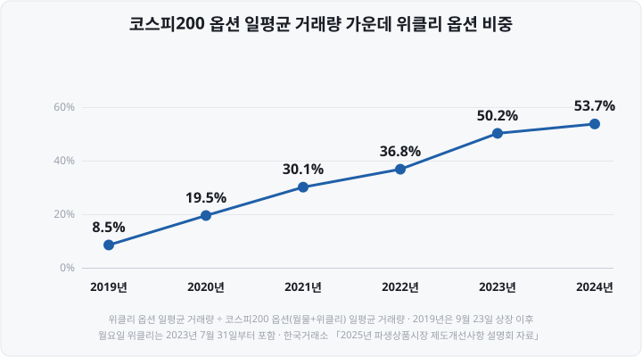

옵션을 거래하지 않던 시절에는 '오늘은 옵션 만기일'이라는 시황 기사를 보고도 주식 투자와는 관계없는 일로 여겼습니다. 그런데 보유 종목의 종가가 장 마감 10분 사이에 크게 바뀐 날을 되짚어 보면 만기일과 겹친 경우가 있었습니다. 이번 글을 준비하며 만기일 44일의 코스피200 기록을 직접 계산해 보니, 하루 등락폭은 다른 날보다 크지 않았고 오른 날과 내린 날이 섞여 있었습니다. 연구 자료를 찾아보니 만기일의 변동성은 하루 전체가 아니라 장 마감 10분에 몰려 있었습니다. 만기일에 달라지는 것은 지수의 방향이 아니라 종가가 정해지는 방식이라고 판단했습니다.

선물·옵션 만기일에는 장 마감 직전 10분 동안 코스피200 종가가 평소보다 크게 움직일 수 있습니다. **방향은 정해져 있지 않습니다.** <mark>만기일 종가는 오르는 쪽으로도, 내리는 쪽으로도 크게 움직일 수 있습니다.</mark> 2026년 8월 13일 만기일에는 코스피200이 4.06% 올랐고, 10월 8일 만기일에는 2.71% 내려 장중 최저치인 1,044.52에서 마감했습니다. 10월 8일에는 반도체 ETF(Exchange Traded Fund, 상장지수펀드) 리밸런싱 일정도 겹쳐 있었습니다. 두 날의 하루 등락에는 만기 외의 재료도 함께 반영돼 있습니다. 다음 월물 만기일은 **11월 12일(목)**, 그다음은 코스피200 선물과 옵션이 함께 만기를 맞는 **12월 10일(목)입니다.**

만기일 시황 기사에는 "만기일 수급 영향", "장 막판 프로그램 매물" 같은 표현이 자주 나옵니다. <mark>만기일에는 코스피200 지수의 종가가 선물·옵션의 최종 손익을 결정합니다.</mark> 그래서 그날 장 마감 단일가매매에 주문이 집중됩니다. 주문이 매도 쪽으로 몰리면 종가가 내리고, 매수 쪽으로 몰리면 종가가 오릅니다.

이 글은 ① 선물·옵션 만기일의 규칙, ② 매월 만기와 분기 동시만기의 차이, ③ 위클리 옵션, ④ 만기일 거래시간과 최종결제가격, ⑤ 만기일 종가가 흔들리는 이유, ⑥ 실제 만기일 지수 등락을 다룹니다. 장 마감 단일가매매의 체결 방식은 [동시호가 뜻과 시간](https://blog.naver.com/hdglace/224387372100) 편에서 다뤘습니다. 기준 시점은 **2026년 11월 5일**입니다.

&nbsp;

【선물과 옵션, 만기일의 뜻】

**선물**(先物)은 지금 정한 가격으로 정해진 날에 사고팔기로 약속하는 계약입니다. **옵션**은 정해진 가격(행사가격)으로 사거나 팔 수 있는 **권리를** 사고파는 계약입니다. 살 수 있는 권리가 콜옵션, 팔 수 있는 권리가 풋옵션입니다.

두 상품 모두 계약이 끝나는 날이 정해져 있습니다. 한국거래소(KRX, Korea Exchange) 규정에서는 이 날을 **최종거래일**이라고 하고, 시장에서는 흔히 **만기일**이라고 부릅니다. 최종거래일까지 보유한 계약은 그날의 기초자산 가격으로 손익을 확정하고, 다음 거래일(최종결제일)에 현금으로 정산합니다.

코스피200 선물과 옵션은 실물 주식을 주고받지 않습니다. 지수를 주고받을 수는 없기 때문에 **현금결제** 방식을 씁니다. 계약 금액은 코스피200 선물의 경우 선물가격에 **거래승수 25만원**을 곱해 계산합니다. 선물가격이 1,000포인트이면 1계약은 2억 5,000만원어치 지수에 해당합니다.

&nbsp;

【만기일은 매월 둘째 목요일입니다】

한국거래소 상품명세에 따르면 국내 주가지수 선물·옵션의 최종거래일은 **각 결제월의 두 번째 목요일**입니다. 그날이 공휴일이면 순차적으로 앞당깁니다.

| 상품 | 결제월(만기가 돌아오는 달) | 최종거래일 | 거래승수 |
| :-- | :-- | :-- | :-- |
| 코스피200 선물 | 3·6·9·12월(분기월) | 결제월 두 번째 목요일 | 25만원 |
| 코스피200 옵션(월물) | 매월 | 결제월 두 번째 목요일 | 25만원 |
| 미니코스피200 선물·옵션 | 매월 | 결제월 두 번째 목요일 | 5만원 |
| 주식선물 | 분기월 4개와 비분기월 2개 | 결제월 두 번째 목요일 | 종목별 |

*공휴일이면 순차적으로 앞당깁니다. 최종결제일은 모두 최종거래일의 다음 거래일입니다.*

정리하면 <mark>매월 둘째 목요일에는 코스피200 옵션 월물이 만기를 맞고, 3·6·9·12월 둘째 목요일에는 코스피200 선물까지 함께 만기를 맞습니다.</mark> 이 분기월 만기일을 **동시만기일**이라고 합니다. 주가지수 선물·옵션과 개별주식 선물·옵션 네 가지가 같은 날 만기를 맞아, 시장에서는 이 날을 '네 마녀의 날'(쿼드러플 위칭 데이, Quadruple Witching Day)이라고도 부릅니다.

2026년에 남은 월물 만기일은 두 번입니다.

| 날짜 | 구분 | 만기를 맞는 주요 상품 |
| :-- | :-- | :-- |
| **11월 12일(목)** | 월물 만기 | 코스피200 옵션 11월물, 미니코스피200 선물·옵션 11월물, 주식선물 11월물 |
| **12월 10일(목)** | **분기 동시만기** | 위 상품의 12월물 + **코스피200 선물 12월물** |

&nbsp;

【위클리 옵션 — 매주 월요일과 목요일】

월물과 별도로 **위클리 옵션**(결제주 옵션)이 있습니다. 만기가 1주일 안에 돌아오는 코스피200 옵션입니다. 목요일 만기 상품은 2019년 9월 23일, 월요일 만기 상품은 2023년 7월 31일 상장됐습니다.

| 구분 | 최종거래일 | 휴장일이면 | 상장 방식 |
| :-- | :-- | :-- | :-- |
| 목요일 위클리 | 두 번째 목요일을 **제외한** 매주 목요일 | 앞당김 | 매주 목요일에 다음 주 목요일 만기 상품 상장 |
| 월요일 위클리 | 매주 월요일 | **늦춤** | 매주 월요일에 다음 주 월요일 만기 상품 상장 |

두 번째 목요일을 제외하는 이유는 그날 월물 옵션이 만기를 맞기 때문입니다. <mark>휴장일 처리 방향이 서로 반대라는 점도 다릅니다.</mark> 목요일 상품은 앞으로 당기고 월요일 상품은 뒤로 미룹니다. 2026년 11월을 예로 들면 목요일 위클리는 5일·19일·26일, 월요일 위클리는 2일·9일·16일·23일·30일에 만기를 맞습니다. 12일은 월물 만기일입니다.

한국거래소 자료에 따르면 2024년 코스피200 옵션 일평균 거래량 308만 5,218계약 가운데 위클리 옵션이 165만 6,832계약(목요일 92만 3,353계약, 월요일 73만 3,479계약)으로 **53.7%였습니다.** <mark>2023년부터는 위클리 옵션 거래량이 월물 옵션 거래량을 넘어섰습니다.</mark> 위클리 옵션은 커버드콜 ETF가 매주 매도하는 상품이기도 합니다. 그 구조는 [커버드콜 ETF 분배율의 함정](https://blog.naver.com/hdglace/224447475052) 편에서 다뤘습니다. 한국거래소는 2025년 10월 27일 코스닥150 지수를 기초로 하는 월·목 위클리 옵션도 상장했습니다.

&nbsp;

【만기일에는 15시 20분에 거래가 끝납니다】

만기일에는 만기가 돌아온 상품의 거래시간이 평소보다 짧습니다. 코스피200 선물·옵션의 정규거래는 평소 08:45~15:45이지만, **최종거래일에는 08:45~15:20**입니다. 만기가 돌아오지 않은 다른 결제월 상품은 평소처럼 15:45까지 거래됩니다.

| 시각 | 주식시장(유가증권시장) | 만기가 돌아온 선물·옵션 |
| :-- | :-- | :-- |
| 08:45 | — | 거래 시작 |
| 09:00 | 시가 결정, 접속매매 시작 | 거래 중 |
| **15:20** | 접속매매 종료, **종가 단일가 호가접수 시작** | **거래 종료** |
| **15:30** | **종가 결정**(최대 30초 범위의 랜덤엔드) | 코스피200 종가로 최종 손익 확정 |
| 다음 거래일 | — | 최종결제(현금 정산) |

<mark>손익을 확정하는 기준 가격은 최종거래일의 코스피200 지수 종가입니다.</mark> 한국거래소 교육자료는 코스피200 선물에 대해 "최종거래일의 최종거래시한까지 포지션을 보유한 경우, 최종거래일의 코스피200지수 종가로 손익을 계산하여 최종거래일의 다음 거래일에 최종결제"한다고 설명합니다. 옵션도 같은 방식입니다. 행사가격과 **권리행사결제기준가격**(최종거래일의 지수 종가)의 차이에 계약 수와 거래승수를 곱해 정산합니다. 코스피200 옵션은 최종거래일에만 권리를 행사할 수 있는 유럽형이고, 권리행사 이익이 거래소가 정한 기준 이상인 종목은 신고하지 않아도 행사한 것으로 처리됩니다(자동권리행사).

<mark>15시 20분에 파생상품 거래는 끝나지만 결제 기준이 되는 지수 종가는 15시 30분에 정해집니다.</mark> 그 10분 동안 만기 상품은 더 이상 거래할 수 없습니다. 이 시간에 포지션을 조정하려면 코스피200 구성 종목을 종가 단일가매매에서 사고팔아야 합니다.

&nbsp;

【만기일 종가가 흔들리는 이유】

&nbsp;

【차익거래 포지션의 청산】

만기일 종가에 큰 주문이 집중되는 대표적인 이유는 **차익거래**입니다. 선물가격은 이론적으로 현물 지수에 금리와 배당을 반영한 값에 가깝게 움직입니다. 실제 선물가격이 이 이론가격에서 벗어나면 두 가격의 차이를 이용하는 거래가 생깁니다.

| 구분 | 진입할 때 | 만기일에 |
| :-- | :-- | :-- |
| **매수차익거래** | 선물이 고평가됐을 때 현물(코스피200 구성 종목 바스켓) **매수** + 선물 **매도** | 선물은 지수 종가로 자동 정산, 현물은 **종가에 매도** |
| **매도차익거래** | 선물이 저평가됐을 때 현물 **매도** + 선물 **매수** | 선물은 지수 종가로 자동 정산, 현물은 **종가에 매수** |

예를 들어 매수차익거래를 한 투자자가 만기일 종가에 현물 바스켓을 팔면, 매도 가격과 선물 정산 가격이 모두 같은 코스피200 종가가 됩니다. 진입할 때 확보한 가격 차이가 그대로 수익으로 확정됩니다. 그래서 <mark>만기일까지 남아 있는 차익거래 포지션은 대개 종가 단일가매매에서 한꺼번에 청산됩니다.</mark> 한국거래소 교육자료도 차익거래의 청산 방법을 "선물: 최종거래일에 최종결제 / 주식: 최종거래일에 모두 청산하거나 매수 또는 롤오버"로 정리합니다. **롤오버**는 만기가 돌아온 선물을 정리하고 다음 결제월 선물로 포지션을 옮기는 것입니다. 롤오버를 선택하면 현물을 팔 필요가 없습니다.

청산 매도 주문과 매수 주문의 규모가 비슷하면 종가는 크게 움직이지 않습니다. 한쪽으로 크게 치우치면 종가 단일가매매의 체결 가격이 그 방향으로 움직입니다. 매수차익거래 청산(현물 매도)이 많으면 종가가 내리는 쪽으로, 매도차익거래 청산(현물 매수)이 많으면 오르는 쪽으로 움직입니다.

&nbsp;

【같은 날 겹치는 다른 일정】

만기일 종가에는 차익거래 외의 주문도 함께 들어옵니다. 2026년 9월 10일 동시만기일에는 KRX 반도체지수 정기변경이 겹쳤습니다. 이 지수는 개별 종목 비중에 20% 상한을 두는데, 9월 4일 기준 SK하이닉스(36.75%)와 삼성전자(22.78%)가 상한을 넘어 있었습니다. 변경 지수는 11일부터 적용됐고, 지수를 추종하는 ETF의 매매는 10일 종가 부근에서 이뤄질 예정이었습니다(헤럴드경제, 9월 8일).

이날 코스피는 0.25% 하락한 7,033.92로 마감했습니다. 프로그램매매는 차익거래가 순매수, 비차익거래가 수조원대 순매도였습니다(집계 금액은 매체마다 다름). 차익거래 청산보다 비차익거래 매도가 훨씬 컸던 셈입니다. 프로그램매매의 차익·비차익 구분은 [외국인·기관 순매수 보는 법](https://blog.naver.com/hdglace/224403259248) 편에서 다뤘습니다.

&nbsp;

【장 마감 10분에 종가가 급변한 사례】

장 마감 10분 동안 종가가 오르는 쪽으로 크게 움직인 만기일도, 내리는 쪽으로 크게 움직인 만기일도 있습니다. 한국개발연구원(KDI) 연구에 따르면 2003년 8월물 옵션 만기일에는 장 마감 동시호가에서 프로그램 매수가 들어와 주가지수가 4포인트 이상 올랐습니다. 행사가격 92.5짜리 콜옵션을 산 투자자는 400%에 가까운 수익을 냈습니다. 한 증권사가 보유 포지션을 바꾸는 과정에서 현물 매수 주문이 나온 것으로 분석됐습니다.

내리는 쪽의 대표 사례는 2010년 11월 11일 옵션 만기일입니다. 금융위원회 정책브리핑(2010년 11월 22일)에 따르면 이날 코스피는 장중 보합권에서 약 5포인트 내려 있다가 **장 마감 직전 10분 동안 48포인트(2.5%) 하락했습니다.** 이 10분 동안 <mark>약 2조 4,000억원어치 매도 주문이 나왔고</mark>, 그 가운데 약 97%(2조 3,000억원)가 한 증권사 창구에서 나왔습니다. 금융당국은 외국인 차익거래 물량이 한꺼번에 청산되면서 대량 매도가 일어났다고 설명했습니다.

조사 결과 매도 전에 풋옵션을 사 둔 뒤 현물을 대량 매도한 정황이 드러났고, 부당이득은 약 449억원으로 조사됐습니다. 형사재판에서는 한국도이치증권 법인과 국내 임원이 1심에서 유죄(임원 징역 5년)를 받았으나 2심에서 무죄를 받았고, 2024년 1월 대법원에서 무죄가 확정됐습니다. 해외 피고인 3명은 국내 수사와 재판에 응하지 않았습니다(뉴데일리, 2024년 1월 17일).

이 사건 이후 한국거래소는 만기일 프로그램매매 호가 제출 제도와 종가 단일가매매의 랜덤엔드 발동 기준을 보완해 2011년 5월 30일부터 시행했습니다(이데일리·서울경제, 2011년 1월 27일). 당시 정규장은 15시에 끝났고, 이후 거래시간과 제도가 여러 차례 바뀌었습니다. 만기일 프로그램매매에 관한 현행 세부 기준은 한국거래소 규정 원문으로 확인하지 못했습니다.

&nbsp;

【실제 만기일 지수 등락】

만기일의 변동성이 하루 등락에도 나타나는지 실제 기록으로 계산해 봤습니다. 2023년 3월부터 2026년 10월까지 월물 만기일 44일과 나머지 거래일 849일의 코스피200 등락률을 비교했습니다.

| 구분 | 일수 | 등락률 절댓값 평균 | 등락률 절댓값 중앙값 | 장중 변동폭 평균 |
| :-- | --: | --: | --: | --: |
| 월물 만기일 | 44일 | 1.09% | 0.71% | 1.67% |
| 그중 분기 동시만기일 | 15일 | 0.87% | 0.88% | 1.70% |
| 나머지 거래일 | 849일 | 1.43% | 0.92% | 1.91% |

*등락률 = 전 거래일 종가 대비 당일 종가. 장중 변동폭 = (당일 고가 − 저가) ÷ 전 거래일 종가. 네이버 증권 코스피200 일별 시세로 본 공부방 계산.*

하루 단위로 보면 이 기간 만기일의 등락폭은 다른 날보다 오히려 작았습니다. 연도별로 보면 만기일 평균이 더 컸던 해는 2025년(만기일 1.26%, 나머지 1.09%) 한 해였습니다. 2026년에는 시장 전체의 변동성이 커서 나머지 거래일 평균이 3.09%, 만기일 평균이 1.65%였습니다.

하루 등락폭이 작았다고 해서 만기일에 변동성이 없다는 뜻은 아닙니다. <mark>만기일의 변동성은 하루 전체가 아니라 장 마감 10분에 몰립니다.</mark> 한국개발연구원(KDI) 박창균·임경묵 연구(2003년)는 일별 자료를 쓴 기존 연구에서는 만기일 효과가 나타나지 않았지만, 장 마감 직전 10분·30분·60분 수익률 같은 장중 자료로 보면 폐장 전 10분을 중심으로 강한 만기일 효과가 있다고 분석했습니다. 1997년 6월~2002년 12월 표본에서 옵션만 만기를 맞은 날의 마지막 10분 수익률 분산은 만기가 없는 목요일의 약 7배였습니다. 일별 종가로 계산한 위 표에는 이 10분의 움직임이 따로 드러나지 않습니다. 다만 이 연구는 동시호가가 14시 50분~15시였던 시기의 자료이고, 장 마감 10분의 움직임을 최근 자료로 계산한 공개 통계는 찾지 못했습니다.

<mark>방향은 정해져 있지 않습니다.</mark> 같은 KDI 연구에서 옵션만 만기를 맞은 날은 장 마감 직전 지수가 내리는 쪽으로, 선물과 옵션이 함께 만기를 맞은 날은 오르는 쪽으로 움직였습니다. 2023년 3월~2026년 10월 월물 만기일 44일 가운데 코스피200이 오른 날은 29일, 내린 날은 15일이었습니다. 오른 날의 비율(66%)이 나머지 거래일(55%)보다 높았지만, 이 기간 코스피200은 3배 넘게 오른 상승장이었고 44일로 방향을 일반화하기는 어렵습니다. 분기 동시만기일만 보면 2023년 9월~2026년 6월 12번 가운데 10번 올랐고(평균 +0.74%, 신아일보 집계와 본 공부방 계산 일치), 2025년 12월 11일(−0.92%)과 2026년 3월 12일(−0.78%), 2026년 9월 10일(−0.22%)에는 내렸습니다.

"만기일에는 지수가 내린다"거나 "오른다"는 식으로 방향을 단정할 근거는 찾을 수 없었습니다. 만기일에 확인할 것은 방향이 아니라 장 마감 10분의 변동성입니다. 미래에셋증권 박연주 AI리서치센터장도 신아일보 인터뷰에서 "네 마녀의 날은 하락하는 날이 아니라 네 가지 파생상품 만기가 겹치면서 수급 변동성이 커지는 날로 보는 것이 적절하다"고 말했습니다.

&nbsp;

【개인 투자자가 확인할 것】

선물·옵션을 거래하지 않아도 만기일은 주식 매매에 영향을 줍니다.

| 확인할 것 | 내용 |
| :-- | :-- |
| 만기일 날짜 | 매월 둘째 목요일, 분기 동시만기는 3·6·9·12월. 공휴일이면 앞당겨짐 |
| 종가 주문 | 15:20~15:30 종가 단일가매매에서 대형주 체결가가 접속매매 마지막 가격과 크게 다를 수 있음(오르는 쪽·내리는 쪽 모두 가능) |
| 겹치는 일정 | 지수 정기변경, ETF 리밸런싱 등이 같은 날 종가에 집중되는지 |
| 위클리 옵션 | 매주 월·목에도 만기가 있으나 대상은 위클리 옵션뿐(선물 만기 아님) |
| 옵션 보유자 | 최종거래일 15:20 이후 거래 불가, 지수 종가로 자동 정산 |

**코스피200 종가가 그대로 결제 가격이 된다**는 점을 기억하면 만기일 시황 기사의 "장 막판 수급"이라는 표현이 무엇을 가리키는지 이해할 수 있습니다. 시장 전체가 급변할 때 켜지는 사이드카도 코스피200 선물 가격을 기준으로 합니다. 발동 요건은 [공매도·사이드카·서킷브레이커 차이](https://blog.naver.com/hdglace/224381139813) 편에서 다뤘습니다.

&nbsp;

【정리】

- **코스피200 옵션은 매월, 코스피200 선물은 3·6·9·12월 둘째 목요일에 만기를 맞습니다.** 공휴일이면 앞당깁니다. 2026년 남은 만기일은 11월 12일, 12월 10일(분기 동시만기)입니다.
- **위클리 옵션은 매주 월요일과 목요일에 만기를 맞습니다.** 2024년 코스피200 옵션 거래량의 53.7%가 위클리 옵션이었습니다.
- **만기가 돌아온 상품은 15시 20분에 거래가 끝나고, 15시 30분에 정해지는 코스피200 종가로 최종 정산됩니다.** 그 10분 동안 포지션을 조정하려면 현물을 종가 단일가매매에서 사고팔아야 합니다.
- **차익거래 포지션의 청산, 지수 정기변경·ETF 리밸런싱이 만기일 종가에 겹치면** 종가 단일가매매에서 주문이 한쪽으로 치우칠 수 있습니다.
- **만기일의 변동성은 장 마감 10분에 몰리고, 방향은 정해져 있지 않습니다.** 종가는 오르는 쪽으로도 내리는 쪽으로도 크게 움직일 수 있습니다. 하루 등락폭으로 보면 2023년 3월~2026년 10월 만기일은 다른 날보다 크지 않았습니다.

&nbsp;

【다음 편에서는】

다음 공부방 글에서는 **대주주 양도세 기준**을 다룹니다. 국내 상장주식 대주주 요건(종목별 보유액·지분율), 판정 기준일이 직전 사업연도 말인 이유, 가족 합산 범위와 세율, 연말에 매도가 집중되는 이유와 결제일(D+2) 기준 마지막 매도일을 2026년 현행 법령으로 정리하겠습니다.

&nbsp;

【📊 데이터 출처 및 기준일】

| 항목 | 내용 | 출처·기준일 |
| :-- | :-- | :-- |
| 코스피200 선물 명세 | 결제월 3·6·9·12월, 상장결제월 3년 이내 7개, 최종거래일 결제월 두 번째 목요일(공휴일이면 순차적으로 앞당김), 최종결제일 다음 거래일, 정규거래 08:45~15:45(최종거래일 08:45~15:20), 야간거래 18:00~06:00, 거래승수 25만원, 현금결제, 상장일 1996년 5월 3일 | 한국거래소 상품 안내(국문·영문), 2026년 11월 5일 확인 |
| 코스피200 옵션 명세 | 비분기월 4개·분기월 7개 상장, 최종거래일 두 번째 목요일, 최종거래일 거래시간 08:45~15:20 / 위클리: 매주 월·목에 다음 주 월·목 만기 상품 상장, 월물 만기와 겹치면 위클리 미상장, 월요일 만기는 휴장일이면 순연, 목요일 만기는 두 번째 목요일 제외·휴장일이면 앞당김 | 한국거래소 코스피200옵션 상품 안내, 2026년 11월 5일 확인 |
| 미니코스피200 선물·옵션 | 결제월 매월, 연속 6개월 상장, 최종거래일 두 번째 목요일, 최종거래일 08:45~15:20 | 한국거래소 상품 안내, 2026년 11월 5일 확인 |
| 주식선물 명세 | 결제월 분기월 4개·비분기월 2개, 최종거래일 두 번째 목요일(휴장일이면 앞당김), 최종거래일 거래시간 09:00~15:20 | 다올투자증권 상품 안내, 한국거래소 영문 상품 안내. 2026년 11월 5일 확인 |
| 최종결제 기준 | 코스피200 선물: 최종거래일 코스피200지수 종가로 손익 계산, 다음 거래일 최종결제 / 옵션: 행사가격과 권리행사결제기준가격의 차이로 정산, 최종거래일에만 권리행사(유럽형), 행사이익이 거래소 기준 이상인 종목 자동 권리행사 | 한국거래소 아카데미 교육자료 「파생상품거래의 이해와 위험관리 4차시 — 주가지수선물」(2012년), 키움증권 「장내파생상품 거래설명서」(2024년 11월 심의). 같은 방식이 한국거래소 2025년 제도개선 자료의 코스닥150 위클리옵션(권리행사결제기준가격 = 최종거래일 코스닥150지수 종가)에도 적용됨. 코스피200 선물의 최종결제가격 조문은 거래소 규정 원문으로 확인하지 못함 |
| 위클리 옵션 상장일·거래량 | 목요일 위클리 2019년 9월 23일, 월요일 위클리 2023년 7월 31일 상장 / 일평균 거래량 2019~2024년(2024년 월물 1,428,386계약, 위클리 1,656,832계약 = 목 923,353 + 월 733,479, 합계 3,085,218계약, 위클리 비중 53.7%) | 한국거래소 주식파생사업부 「2025년 파생상품시장 제도개선사항 설명회 자료」(2025년 7월) |
| 코스닥150 위클리옵션 | 2025년 10월 27일 상장, 월·목 만기, 정규·야간 동시 상장 | 같은 자료(시행일), 뉴데일리(2025년 10월 22일), 비즈워치(2025년 9월 22일) |
| 2026년 남은 만기일 | 11월 12일(목), 12월 10일(목) | 상품명세 규칙으로 본 공부방 계산, 하나증권 투자전략 자료(9월 10일 동시만기 표기)로 규칙 대조 |
| 2026년 8월 13일 | 코스피200 1,071.24(+4.06%) | 네이버 증권 코스피200 일별 시세 |
| 2026년 10월 8일 | 코스피200 1,044.52(−2.71%), 코스피 6,625.93(−177.97p, −2.62%), 외국인 2조 195억원·기관 1조 2,960억원 순매도, 반도체 ETF 리밸런싱·옵션 만기일 언급 / 코스피200 종가 1,044.52 = 당일 저가 | 파이낸셜뉴스(2026년 10월 8일), 네이버 증권 코스피200 일별 시세 |
| 2026년 9월 10일 | 코스피 7,033.92(−17.72p, −0.25%), 프로그램 차익 순매수·비차익 순매도(한국경제 차익 3,142억원 순매수·비차익 3조 2,567억원 순매도), 외국인 2조 4,900억원 순매도 / KRX 반도체지수 20% 상한, 9월 4일 비중 SK하이닉스 36.75%·삼성전자 22.78%, 11일 적용·10일 종가 부근 매매 예정 | 한국경제(2026년 9월 10일), 헤럴드경제(2026년 9월 8일). 프로그램 순매도 총액은 매체마다 집계가 다름(다른 보도는 전체 2조 5,245억원 순매도) |
| 2010년 11월 11일 | 장 마감 직전 10분 48p(2.5%) 하락, 매도 약 2조 4,000억원 중 약 97%(2조 3,000억원) 한 창구 | 정책브리핑 「옵션만기일(11.11일) 종가시 주가지수 급락 관련 대응방향」(금융위원회 자본시장국장, 2010년 11월 22일) |
| 사건 경과 | 풋옵션 선매수 후 매도, 부당이득 약 449억원 / 1심 징역 5년·법인 벌금 15억원 → 2심 무죄 → 2024년 1월 대법원 무죄 확정, 해외 피고인 3명 재판 불응 | 뉴데일리(2024년 1월 17일) |
| 2011년 제도 보완 | 최종거래일 프로그램매매 호가 접수시간·사후보고 시한 연장, 종가 단일가 랜덤엔드 발동 기준 추가, 2011년 5월 30일 시행 | 이데일리·서울경제(2011년 1월 27일). 현행 세부 기준은 확인하지 못함 |
| 동시만기 12회 | 2023년 9월~2026년 6월 코스피200 10회 상승·2회 하락, 평균 +0.74% / 박연주 미래에셋증권 AI리서치센터장 발언 | 신아일보(2026년 9월 9일). 같은 수치를 본 공부방 계산으로 검산 |
| 만기일 등락 비교 | 2023년 3월 9일~2026년 10월 8일 월물 만기일 44일(상승 29·하락 15)·같은 기간 나머지 849거래일(상승 비율 55%)의 등락률 절댓값·장중 변동폭, 연도별 평균 | 네이버 증권 코스피200 일별 시세로 **본 공부방 계산**(2026년 11월 5일 재검산) |
| 만기일 장 마감 10분 | 일별 자료로는 만기일 효과가 없으나 고빈도 자료로는 폐장 전 10분 중심으로 강한 만기일 효과, 옵션 단독 만기일 마지막 10분 수익률 분산 약 7배(1.0519 대 0.1487), 옵션 단독 만기는 하향·동시만기는 상향 가격압력, 표본 1997년 6월 19일~2002년 12월 26일 / 2003년 8월물 옵션 만기일 동시호가 지수 4포인트 이상 상승 | 박창균·임경묵, 「한국 주식시장에서의 만기일효과: Wag the Dog?」, 『한국개발연구』 제25권 제2호(2003년), 한국개발연구원 |
| 동시호가·랜덤엔드 | 종가 단일가 15:20~15:30, 랜덤엔드 최대 30초 | [동시호가 뜻과 시간](https://blog.naver.com/hdglace/224387372100) 편(한국거래소 자료 기준) |

&nbsp;

【🔗 함께 보면 좋은 글】

- [동시호가 뜻과 시간 — 장 시작·마감 단일가에 주문이 체결되는 방식](https://blog.naver.com/hdglace/224387372100) — 만기일 결제 기준이 되는 15:20~15:30 종가 단일가매매의 체결 방식
- [커버드콜 ETF 분배율의 함정 — 연 15%가 수익률이 아닌 이유](https://blog.naver.com/hdglace/224447475052) — 위클리 옵션을 매주 매도하는 커버드콜 ETF의 구조
- [외국인·기관 순매수 보는 법 — 수급 데이터 집계 방식과 한계](https://blog.naver.com/hdglace/224403259248) — 프로그램매매의 차익거래·비차익거래 구분
- [공매도·사이드카·서킷브레이커 차이 — 급락장에 켜지는 장치들](https://blog.naver.com/hdglace/224381139813) — 코스피200 선물 가격을 기준으로 발동하는 사이드카
- [VKOSPI·VIX 뜻과 읽는 법 — 공포지수 40은 하루 몇 % 움직임인가](https://blog.naver.com/hdglace/224422310544) — 코스피200 옵션 가격으로 계산하는 변동성지수

&nbsp;

⚠️ **면책 안내** — 이 글은 한국거래소 상품명세·교육자료와 언론 보도를 정리한 정보성 콘텐츠이며, 선물·옵션 거래나 특정 종목의 매수·매도를 권유하지 않고 만기일의 지수 방향을 예측하지 않습니다. 선물·옵션은 원금을 초과하는 손실이 발생할 수 있는 상품이며, 거래 전에 증권사의 적격 요건과 교육 이수 요건을 확인해야 합니다. 만기일과 거래시간은 거래소 사정에 따라 바뀔 수 있으므로 실제 매매 전에는 한국거래소 공지를 확인하시기 바랍니다. 모든 투자 판단과 그 결과에 대한 책임은 투자자 본인에게 있습니다.

&nbsp;

#선물옵션만기일 #옵션만기일 #동시만기 #네마녀의날 #코스피200선물 #코스피200옵션 #위클리옵션 #차익거래 #프로그램매매 #최종결제가격 #동시호가 #주식초보 #투자공부 #재테크
