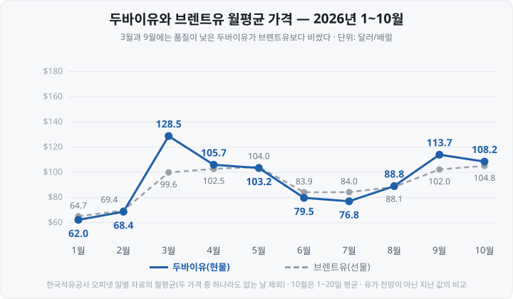

국제유가 기사를 처음 읽을 때는 '국제유가'가 하나의 가격인 줄 알았습니다. 그런데 올해 3월에는 같은 날 두바이유와 브렌트유 가격이 70달러 가까이 벌어졌고, 9~10월에는 달러가 강세라는 기사와 원/달러 환율이 내린다는 기사가 함께 나왔습니다. <mark>기준 유가가 세 가지이고 달러인덱스에 원화가 없다는 점을 알고 나서야 두 기사가 모두 맞다는 걸 이해했습니다.</mark>

한국석유공사 오피넷 기준 브렌트유 선물 가격은 2026년 1월 2일 배럴당 60.75달러에서 3월 31일 **118.35달러로** 올랐습니다. 같은 기간 두바이유 현물 가격은 3월 23일 **169.75달러까지** 올라 그날 브렌트유(99.94달러)보다 69.81달러 높았습니다. 2026년 3월 초 미국과 이란의 전쟁으로 호르무즈 해협 통항이 사실상 막힌 뒤의 일입니다. <mark>평소에는 품질이 낮아 브렌트유보다 싸게 거래되던 두바이유가 더 비싸졌습니다.</mark>

환율은 다른 흐름을 보였습니다. 원/달러 환율은 7월 1일 서울 외환시장 주간 종가 1,554.9원으로 2009년 3월 이후 가장 높았다가 10월 21일 1,325.2원까지 내렸습니다. 그사이 8월 말부터 10월 14일까지는 달러인덱스가 3.1% 올랐는데도 원/달러 환율은 오히려 30.3원 내렸습니다. <mark>'달러 강세'와 '원/달러 환율 상승'은 같은 말이 아닙니다.</mark>

이 글은 ① 국제유가의 세 가지 기준인 WTI·브렌트·두바이유의 차이, ② 유가 상승이 정유·화학·항공에 다르게 작용하는 구조, ③ 달러인덱스의 구성과 원/달러 환율의 관계, ④ 환율과 외국인 수급의 관계, ⑤ 직접 조회하는 방법을 정리합니다. 기준 시점은 유가 **2026년 10월 20일**, 환율 **10월 21일**이며, 유가·환율 방향에 대한 전망은 다루지 않습니다.

&nbsp;

【국제유가의 세 가지 기준 — WTI·브렌트·두바이유】

원유는 생산지마다 성분이 달라 거래 가격도 다릅니다. 시장은 거래량이 많은 원유 몇 가지의 가격을 기준으로 삼고, 나머지 원유는 이 기준 가격에 품질과 운송비만큼 더하거나 빼서 가격을 정합니다. 뉴스에 나오는 국제유가는 대개 다음 세 가지입니다. WTI(West Texas Intermediate, 서부텍사스산 원유)는 NYMEX(New York Mercantile Exchange, 뉴욕상업거래소)에서, 브렌트유는 ICE(Intercontinental Exchange, 인터컨티넨털거래소)에서 선물로 거래되고, 두바이유는 가격평가회사 플래츠(Platts)가 싱가포르 거래 시간대의 현물 거래를 바탕으로 매기는 평가 가격을 씁니다. 품질은 원유의 무게를 나타내는 API(American Petroleum Institute, 미국석유협회) 비중과 황 함량으로 구분합니다.

| 구분 | 주요 거래 시장 | 생산 지역 | 품질 | 주로 기준이 되는 거래 |
| :-- | :-- | :-- | :-- | :-- |
| **WTI** | 뉴욕상업거래소 선물 | 미국 텍사스 일대(인도 장소는 오클라호마주 쿠싱) | API 비중 39.6, 황 0.24% | 미국 내 원유 거래 |
| **브렌트유** | ICE 선물 | 북해(영국·노르웨이), 미국산 WTI 미들랜드 | API 비중 38.3, 황 0.37%(브렌트 블렌드 기준) | 유럽·아프리카산 원유, 국제 거래 전반 |
| **두바이유** | 싱가포르 현물 평가 가격(플래츠) | 중동(아랍에미리트 두바이 등) | API 비중 28~31, 황 2.0~2.9% | 아시아로 수출되는 중동산 원유 |

브렌트유 가격 평가에는 2023년 6월부터 미국산 WTI 미들랜드도 포함됐습니다. 북해 원유 생산이 줄어 평가 대상 물량을 늘리기 위한 조치였습니다.

**API 비중**은 원유가 얼마나 가벼운지를 나타내는 지표로, 높을수록 가볍습니다. 가벼운 원유에서는 휘발유·경유처럼 비싼 제품이 많이 나옵니다. 황 함량이 높으면 황을 제거하는 데 비용이 듭니다. 그래서 무겁고 황이 많은 두바이유는 <mark>평상시 브렌트유보다 낮은 가격에 거래됩니다.</mark> 두바이유의 비중과 황 함량은 자료마다 28~31, 2.0~2.9%로 차이가 있어 표에는 범위로 적었습니다.

&nbsp;

【한국의 원유 도입 가격과 두바이유】

한국이 수입하는 원유의 절반 이상은 중동산입니다. 한국석유공사 페트로넷 통계에서 중동산 비중은 2024년 71.5%였고, 수입처 다변화가 진행된 2026년 1~8월에도 61.8%였습니다.

중동 산유국은 아시아에 원유를 팔 때 **오만·두바이유 평균 가격**에 할증 또는 할인을 붙여 판매가격을 정합니다. 사우디아라비아 국영 석유회사 아람코가 매달 발표하는 **OSP**(Official Selling Price, 공식판매가격)가 대표적입니다. 아람코는 11월 아시아향 아랍라이트 OSP를 오만·두바이유 평균보다 배럴당 5.00달러 낮게 정했습니다. 10월분(2.00달러 할인)보다 할인폭을 3.00달러 키운 것입니다. <mark>한국 정유사의 원유 도입 비용은 브렌트유나 WTI보다 두바이유 가격과 OSP에 더 직접 연동됩니다.</mark>

&nbsp;

【2026년 두바이유와 브렌트유의 가격 역전】

1~2월에는 두바이유가 브렌트유보다 월평균 약 1~3달러 낮았습니다. 3월에는 두바이유 월평균이 128.52달러로 브렌트유(99.60달러)보다 **28.92달러 높았습니다.** 6~7월에는 다시 두바이유가 4~7달러 낮아졌고, 9월에는 11.69달러 높았습니다. 2026년 1월 2일부터 10월 20일까지 두 가격이 모두 있는 201거래일 가운데 두바이유가 더 비쌌던 날은 91일입니다. 두바이유가 브렌트유보다 비싸진 일 자체는 처음이 아닙니다. 2020년 4~6월과 2023년에도 OPEC+ 감산으로 중동산 원유 공급이 줄면서 역전이 나타났지만, 그때 차이는 배럴당 2달러 안팎이었습니다. <mark>2026년에 달랐던 것은 역전 여부가 아니라 폭입니다.</mark>

이 차이를 해석할 때 주의할 점이 있습니다. 오피넷의 두바이유는 **현물** 가격이고 브렌트유는 **선물** 가격입니다. 현물은 지금 바로 인도되는 원유의 가격이고, 선물은 몇 달 뒤 인도되는 원유의 가격입니다. 공급이 갑자기 부족해지면 당장 필요한 원유의 가격이 먼저 오르기 때문에, 두 가격의 차이에는 원유 종류의 차이뿐 아니라 인도 시점의 차이도 들어 있습니다.

&nbsp;

【같은 날 유가가 여러 개인 이유】

같은 원유라도 가격의 종류에 따라 값이 다릅니다. 10월 20일 브렌트유는 ICE 선물(12월 인도분) 기준 108.79달러였지만, **EIA**(Energy Information Administration, 미국 에너지정보청)가 집계한 브렌트유 현물 가격은 115.22달러였습니다. 선물은 인도 월마다 가격이 따로 있어서, 매체마다 어느 월물을 인용했는지에 따라서도 값이 달라집니다. WTI 11월 인도분은 10월 20일이 최종 거래일이었습니다. 이 무렵 기사에서는 11월물과 12월물 가격이 함께 인용됐습니다. 유가 기사를 볼 때는 **현물인지 선물인지, 선물이라면 몇 월 인도분인지**를 먼저 확인해야 합니다.

&nbsp;

【유가 상승이 업종마다 다르게 작용하는 구조】

유가가 오르면 원유나 석유제품을 원료로 쓰는 기업의 비용이 늘어납니다. 다만 늘어난 비용을 판매 가격에 얼마나 빨리 반영할 수 있는지가 업종마다 달라 실적에 미치는 영향도 다릅니다.

| 업종 | 원료 | 판매 제품 | 유가 상승 시 실적에 작용하는 요인 |
| :-- | :-- | :-- | :-- |
| **정유** | 원유 | 휘발유·경유·항공유 등 | 정제마진, 재고평가이익(유가 하락 시 손실) |
| **석유화학** | 나프타 | 에틸렌·프로필렌 등 | 원료 가격 상승분을 제품 가격에 반영하는 속도 |
| **항공** | 항공유 | 항공권 | 유류비 증가, 유류할증료로 반영하는 시차 |

&nbsp;

【정유 — 정제마진과 재고평가이익】

정유사의 이익은 원유를 사서 휘발유·경유 등을 만들어 팔 때의 가격 차이에서 나옵니다. 제품 가격에서 원유 가격을 뺀 값을 **정제마진**이라고 합니다. 여기에 시차가 더해집니다. 중동에서 원유를 사서 한국에서 정제해 팔기까지 한두 달이 걸리기 때문에, 유가가 오르는 동안에는 <mark>싼 값에 사 둔 원유로 만든 제품을 오른 가격에 팔게 됩니다.</mark> 이를 **래깅효과**(lagging effect, 원가가 판매 가격을 시차를 두고 따라오면서 생기는 효과)라고 하고, 보유 중인 원유·제품 재고의 평가액이 오르는 것을 **재고평가이익**이라고 합니다.

에쓰오일의 2026년 1분기 실적이 이 구조를 보여 줍니다. 연결 기준 영업이익은 1조 2,311억원으로 전년 같은 기간(215억원 영업손실)에서 흑자로 돌아섰습니다. 이 가운데 **재고 관련 효과가 6,434억원으로** 영업이익의 절반을 넘었습니다. 전년 같은 기간의 재고 관련 효과는 122억원이었습니다. 회사는 정기보수와 석유 최고가격제(정부가 석유제품 가격의 상한을 정한 제도) 시행이 정제마진 개선을 일부 상쇄했다고 설명했습니다. 2분기 영업이익은 9,650억원으로 1분기보다 21.6% 줄었습니다.

재고 효과는 유가가 내릴 때 반대로 작용합니다. 비싸게 사 둔 원유로 만든 제품을 내린 가격에 팔아야 하므로 **재고평가손실**이 생깁니다. 그래서 정유사 실적을 볼 때는 영업이익에서 재고 관련 손익을 뺀 값도 함께 확인합니다. 에쓰오일 1분기라면 1조 2,311억원에서 6,434억원을 뺀 5,877억원입니다.

&nbsp;

【석유화학 — 원료 가격을 제품 가격에 반영하는 속도】

나프타분해설비(NCC, Naphtha Cracking Center)를 운영하는 석유화학사는 원유를 정제해 얻는 **나프타**를 원료로 에틸렌·프로필렌 등을 만듭니다. 나프타 가격이 오르면 원가가 바로 늘어나지만, 제품 수요가 충분하지 않으면 판매 가격을 같은 폭으로 올리기 어렵습니다. 업계 관계자는 제품 가격과 나프타 가격의 차이(스프레드)가 톤당 300달러 이상이어야 NCC 가동의 손익분기점을 넘는다고 설명합니다.

2026년 3월에는 나프타 가격이 16일 기준 톤당 1,060달러로 4주 연속 올랐고, 전주보다 36.5% 높았습니다. 이에 앞서 3월 4일에는 중동산 나프타 도입이 늦어지면서 여천NCC가 불가항력을 선언하고 생산을 최소 수준으로 낮췄습니다. 같은 달 장부상 마진은 전쟁 전에 사 둔 나프타 덕분에 개선된 것으로 나타났는데, 업계는 고가 원료가 투입되는 4월 이후 실적 부담이 커질 것으로 봤습니다. 원료 가격이 실적에 시차를 두고 반영되는 구조는 정유와 같고, <mark>원료 조달 자체가 막히면 가격과 상관없이 생산량을 줄여야 합니다.</mark>

&nbsp;

【항공 — 유류비와 유류할증료】

항공사는 항공유를 원료로 쓰기 때문에 유가 상승이 곧 비용 증가입니다. 대한항공 IR 자료에 따르면 영업비용에서 연료비가 차지하는 비중은 2025년 3분기 28%, 2026년 1분기 27%였습니다.

항공사는 늘어난 유류비의 일부를 **유류할증료**로 승객에게 부과합니다. 국제선 유류할증료는 **MOPS**(Mean of Platts Singapore, 플래츠가 싱가포르 시장에서 평가한 석유제품 가격의 평균) 가운데 항공유 가격을 기준으로 단계가 정해지며, 전전월 16일부터 전월 15일까지의 평균을 씁니다. 11월 발권분은 MOPS 평균이 배럴당 173.89달러로 직전 기간(158.57달러)보다 9.7% 올라 10월 23단계에서 **27단계로** 올랐습니다. 대한항공 기준 인천~뉴욕 편도 유류할증료는 36만 2,600원에서 40만 8,100원이 됐습니다.

할증료는 한두 달 전 가격으로 정해지므로, 유가가 빠르게 오르는 기간에는 비용 증가가 먼저 실적에 반영됩니다. 대한항공의 2026년 2분기 별도 기준 매출은 5조 199억원으로 전년 같은 기간보다 26% 늘었지만, 영업이익은 2,618억원으로 34% 줄었습니다. 회사는 유가 상승에 따른 연료비 증가를 영업이익 감소 요인으로 들었습니다.

&nbsp;

【달러인덱스 — 원화가 포함되지 않은 지수】

**달러인덱스**(DXY, U.S. Dollar Index)는 주요 6개 통화에 대한 미국 달러의 가치를 하나의 숫자로 나타낸 지수입니다. 1973년 3월을 100으로 놓고 계산하며, ICE가 산출합니다. 지수가 오르면 6개 통화에 비해 달러 가치가 올랐다는 뜻입니다.

| 통화 | 비중 |
| :-- | --: |
| 유로 | **57.6%** |
| 일본 엔 | 13.6% |
| 영국 파운드 | 11.9% |
| 캐나다 달러 | 9.1% |
| 스웨덴 크로나 | 4.2% |
| 스위스 프랑 | 3.6% |

ICE 산출 방법서는 이 비중이 1973년 당시 미국의 6대 교역 상대를 기준으로 정해졌고, 이후 바뀌지 않았다고 설명합니다. 1999년 유로화 출범 때 독일 마르크화 등이 유로로 대체된 것이 유일한 구성 변경입니다. 그 결과 <mark>달러인덱스의 절반 이상은 유로/달러 환율로 결정되고, 원화와 중국 위안화는 포함되지 않습니다.</mark>

원화를 포함한 달러 지수도 있습니다. 연준(Fed, Federal Reserve, 미국 연방준비제도)이 공표하는 **광의 달러지수**(Nominal Broad U.S. Dollar Index)는 미국과의 교역 비중으로 26개 통화를 가중하며, 2026년 원화 비중은 3.621%입니다. 국내 시황 기사에 '달러인덱스'로 인용되는 값은 ICE 달러인덱스입니다.

&nbsp;

【8월 말 이후 달러인덱스 상승과 원화 강세】

| 시점 | 달러인덱스 | 원/달러(서울 외환시장 주간 종가) |
| :-- | --: | --: |
| 2026년 7월 1일 | 101.39 | 1,554.9원 |
| 8월 말 | 99.43 | 1,368.6원 |
| 10월 14일 | 102.55 | 1,338.3원 |
| 10월 21일 | **101.78** | **1,325.2원** |

한국은행은 10월 16일 발표한 「9월 이후 국제금융·외환시장 동향」에서 8월 말부터 10월 14일까지 <mark>달러인덱스가 3.1% 오르는 동안 원/달러 환율은 30.3원 내려 원화 가치가 2.3% 올랐다</mark>고 밝혔습니다. 원화 강세의 배경으로는 수출업체의 달러 매도 물량 증가를 들었습니다. 10월 21일 시장 보도에서도 반도체 수출 호조에 따른 수출업체의 달러 매도와 경상수지 흑자 확대 기대가 원화 강세 요인으로 거론됐습니다.

원/달러 환율은 **달러 전반의 강약**과 **원화 자체의 수급**이 함께 결정합니다. 달러인덱스가 오르면 원/달러 환율도 오르는 경우가 많지만, 2026년 9~10월처럼 수출 대금이 대량으로 들어오는 시기에는 두 지표가 반대로 움직일 수 있습니다.

&nbsp;

【유가와 원/달러 환율】

유가는 원화 수급에도 영향을 줍니다. 한국은 원유를 거의 전량 수입하고 대금을 달러로 지급하므로, 유가가 오르면 같은 양을 들여오는 데 필요한 달러가 늘어납니다. 원유 수입 대금이 늘면 무역수지가 나빠지고, 이는 원화 약세 압력으로 작용할 수 있습니다. 반대로 원/달러 환율이 오르면 같은 달러 유가라도 원화로 환산한 원유 도입 비용이 커집니다. 오피넷이 국제유가를 달러/배럴과 함께 원/리터로도 공표하는 이유입니다.

&nbsp;

【환율과 외국인 수급의 관계】

외국인 투자자는 한국 주식의 수익을 결국 달러로 계산합니다. 원화 기준 수익률이 같아도 그 사이 환율이 오르면 달러로 환산한 수익은 줄어듭니다. 계산하면 다음과 같습니다.

> 달러 기준 수익률 = (1 + 원화 기준 수익률) × (매수 시점 환율 ÷ 매도 시점 환율) − 1

예를 들어 코스피 종목을 원/달러 1,400원일 때 사서 10% 오른 뒤 1,540원일 때 팔면, 달러 기준 수익률은 1.10 × (1,400 ÷ 1,540) − 1 = **0%입니다.** 주가 상승분이 환율 상승분과 같아 달러로는 남는 것이 없습니다. 그래서 <mark>원화 약세가 예상되는 시기에는 외국인이 한국 주식 보유를 줄이려는 유인이 생깁니다.</mark>

다만 방향이 반대인 경로도 있습니다. 외국인이 한국 주식을 팔고 그 대금을 달러로 바꿔 송금하면 달러 수요가 늘어 환율이 오릅니다. 2026년 월별 기록은 다음과 같습니다.

| 월 | 원/달러 월평균 | 외국인 상장주식 순매수 |
| :-- | --: | --: |
| 1월 | 1,456.51원 | −980억원 |
| 2월 | 1,449.32원 | −19조 5,580억원 |
| 3월 | 1,486.64원 | −43조 5,050억원 |
| 4월 | 1,487.39원 | −4조 460억원 |
| 5월 | 1,490.11원 | −47조 190억원 |
| 6월 | **1,527.30원** | **−49조 3,360억원** |
| 7월 | 1,497.43원 | −31조 6,640억원 |
| 8월 | 1,406.30원 | +3,440억원 |
| 9월 | 1,359.00원 | — |

원/달러 월평균은 한국은행 매매기준율, 순매수는 금융감독원 「외국인 증권투자 동향」(결제 기준, 코스피·코스닥 합계)입니다.

순매도 규모가 가장 컸던 6월에 환율 월평균도 1,527.30원으로 가장 높았고, 8개월 만에 순매수로 돌아선 8월에는 월평균이 1,406.30원으로 내렸습니다. 환율이 1,554.9원을 기록한 7월 1일 시장 보도는 환율 상승의 핵심 요인으로 <mark>외국인이 주식을 판 뒤 달러로 바꿔 송금하는 역송금 수요</mark>를 꼽았습니다. 이 표만으로는 환율이 올라서 외국인이 판 것인지, 외국인이 팔아서 환율이 오른 것인지 구분할 수 없습니다. 두 경로가 함께 작용합니다.

9월에는 원화 강세와 외국인 주식자금 유출이 함께 나타났습니다. 금융감독원의 9월분 자료는 10월 22일 현재 아직 발표되지 않아 표에 적지 않았습니다. 한국은행 집계로는 9월 외국인 주식자금이 141억 6,000만 달러 순유출됐고, 한국은행은 글로벌 장기금리 상승과 AI 투자 둔화 우려에 따른 투자심리 위축을 원인으로 들었습니다. 같은 달 원/달러 월평균은 1,359.00원으로 8월보다 47.3원 낮았습니다. 원화가 강세를 보인 달에도 외국인 자금이 빠져나갈 수 있다는 뜻입니다. 한국은행 집계는 달러 기준이라 금융감독원 집계와 직접 비교할 수 없습니다.

외국인 순매수 숫자를 읽는 방법과 집계 기준(체결 기준과 결제 기준)의 차이는 외국인·기관 순매수 보는 법 편에서 다뤘습니다. 해외 ETF 투자자에게 환율이 미치는 영향은 환헤지(H) ETF 편에 정리돼 있습니다.

&nbsp;

【직접 조회하는 곳】

| 자료 | 조회 경로 | 확인할 점 |
| :-- | :-- | :-- |
| 두바이·브렌트·WTI 일별 가격 | 한국석유공사 오피넷 → 유가관련정보 → 국제유가 → 원유 | 두바이유는 현물, 브렌트·WTI는 선물. 달러/배럴과 원/리터 두 가지로 조회 |
| 브렌트·WTI 현물 가격 | EIA 누리집 Petroleum → Spot Prices | 선물 가격과 값이 다를 수 있음 |
| 원/달러 월평균·월말 환율 | 한국은행 경제통계시스템(ECOS) → 환율 | 매매기준율 기준. 서울 외환시장 종가와 소수점 단위에서 다를 수 있음 |
| 외국인 증권투자 동향 | 금융감독원 보도자료(다음 달 중순~하순 발표) | 결제 기준. 한국거래소 집계(체결 기준)와 다름 |
| 국제선 유류할증료 | 각 항공사 공지(매달 중순 다음 달분 공지) | 발권일 기준 적용 |

오피넷 국제유가는 현지와의 시차 때문에 T일의 가격을 T+1일에 조사해 게시합니다. 국내 데이터 조회 경로 전반은 주식 데이터 무료로 보는 곳 편에서 다뤘습니다. 개장 전 브리핑도 매일 두바이유·브렌트유·WTI 가격과 달러인덱스, 원/달러 환율을 함께 기록합니다.

유가 상승이 물가지표로 이어지는 경로는 CPI·PPI 편에, 고유가와 함께 오른 미국 장기금리는 미국 국채금리 편에 정리돼 있습니다.

&nbsp;

【정리】

- **국제유가는 WTI(미국)·브렌트유(유럽·국제 거래)·두바이유(아시아향 중동산) 세 가지가 기준입니다.** 한국은 수입 원유의 61.8%(2026년 1~8월)가 중동산이라 두바이유와 아람코 OSP에 도입 비용이 연동됩니다.
- **품질이 낮아 평소 더 싼 두바이유가 2026년 3월에는 월평균 28.92달러, 9월에는 11.69달러 브렌트유보다 비쌌습니다.** 오피넷의 두바이유는 현물, 브렌트유는 선물이라 인도 시점의 차이도 반영돼 있습니다.
- **정유는 래깅효과와 재고평가이익, 석유화학은 원료 가격 전가 속도와 원료 조달, 항공은 유류비와 유류할증료의 시차가 실적을 좌우합니다.** 에쓰오일 1분기 영업이익 1조 2,311억원 가운데 6,434억원이 재고 관련 효과였습니다.
- **달러인덱스는 유로 비중이 57.6%이고 원화가 포함되지 않습니다.** 8월 말~10월 14일 달러인덱스가 3.1% 오르는 동안 원화 가치는 2.3% 올랐습니다.
- **환율과 외국인 수급은 서로 영향을 주고받습니다.** 2026년 5~6월에는 대규모 순매도와 높은 환율이 함께 나타났지만, 9월에는 원화 강세 속에서도 외국인 주식자금이 순유출됐습니다.

&nbsp;

【다음 편에서는】

다음 공부방 글에서는 [**CME FedWatch 보는 법**](https://blog.naver.com/hdglace/224452083307)을 다룹니다. CME(Chicago Mercantile Exchange, 시카고상업거래소)가 제공하는 기준금리 확률 화면입니다. FedWatch 화면에서 FOMC(Federal Open Market Committee, 연방공개시장위원회) 회의별 금리 목표범위 확률을 읽는 법과 그 확률이 연방기금금리 선물 가격에서 계산되는 원리, 확률이 하루 만에 크게 바뀌는 이유를 10월 27~28일 FOMC 직전의 실제 값으로 정리하겠습니다.

&nbsp;

【🔗 함께 보면 좋은 글】

- [외국인·기관 순매수 보는 법 — 수급 데이터 집계 방식과 한계](https://blog.naver.com/hdglace/224403259248) — 외국인 순매수의 체결 기준·결제 기준
- [환헤지(H) ETF 뜻 — 환노출형과 수익률이 갈리는 이유와 헤지 비용](https://blog.naver.com/hdglace/224438801049) — 환율이 해외 ETF 수익률에 미치는 영향
- [CPI·PPI란 — 물가지표 발표에 증시가 반응하는 이유](https://blog.naver.com/hdglace/224435981513) — 유가 상승이 물가지표로 이어지는 경로
- [미국 국채금리 보는 법 — 2년물·10년물과 장단기 금리차](https://blog.naver.com/hdglace/224439966975) — 고유가와 함께 오른 미국 장기금리
- [주식 데이터 무료로 보는 곳 — KRX·금투협·DART 활용법](https://blog.naver.com/hdglace/224372833633) — 국내 데이터 조회 경로

&nbsp;

【📊 데이터 출처 및 기준일】

- **두바이유·브렌트유·WTI 일별 가격(2026년 1월 2일 브렌트 60.75달러, 3월 23일 두바이 169.75달러·브렌트 99.94달러, 3월 31일 브렌트 118.35달러, 10월 20일 두바이 110.70달러·브렌트 108.79달러·WTI 101.79달러)과 월평균·두바이유가 더 비쌌던 거래일 수(201거래일 중 91일)**: 한국석유공사 오피넷 「국제유가 → 원유」 일별 자료(달러/배럴), **2026년 10월 22일 조회**. 월평균과 거래일 수는 본 사이트가 계산했으며, 두바이유·브렌트유 가운데 한 가격이라도 없는 날은 제외했습니다. 오피넷 기준 두바이유는 싱가포르에서 거래된 현물 가격 추정값, 브렌트유는 ICE 선물, WTI는 NYMEX 선물 가격입니다.
- **브렌트유 현물 115.22달러(10월 20일)**: 미국 에너지정보청(EIA) 「Europe Brent Spot Price FOB」 일별 자료, 2026년 10월 22일 내려받음.
- **WTI·브렌트유 품질(API 비중·황 함량)**: EIA 설명 자료 기준. **두바이유 품질 범위**: 기획재정부 시사경제용어사전(API 28·황 2.9%)과 업계·언론 자료(API 31·황 2.0%)의 차이를 범위로 적었습니다. **두바이유·브렌트유 과거 역전(2020년 4~6월, 2023년)**: Quantum Commodity Intelligence 보도. **두바이유 평가 방식(플래츠 싱가포르 평가)**: 오피넷 국제유가 설명(「싱가포르에서 거래된 Dubai(현물) 가격 추정값」). **브렌트 평가 대상에 WTI 미들랜드 포함(2023년 6월 인도분부터)**: S&P Global Platts 공지(2023년 5월 2일).
- **중동산 원유 도입 비중(2024년 71.5%, 2026년 1~8월 61.8%)**: 한국석유공사 페트로넷 통계 인용 보도(2024년), 한국석유공사·대한석유협회 자료 인용 보도(파이낸셜뉴스, 2026년 10월 5일).
- **아람코 11월 아시아향 아랍라이트 OSP(오만·두바이 평균 대비 배럴당 5.00달러 할인, 전월 대비 3.00달러 인하)**: 사우디 아람코 발표 인용 보도(2026년 10월 5일 전후). **10월분 2.00달러 할인**: 머니투데이방송 보도(2026년 9월 10일).
- **호르무즈 해협 통항 중단과 유가 급등 배경**: AAP 보도(커먼웰스은행 게재, 2026년 3월 31일), NPR 보도(2026년 3월 9일).
- **에쓰오일 2026년 1분기 실적(연결 영업이익 1조 2,311억원, 재고 관련 효과 6,434억원, 전년 동기 영업손실 215억원·재고 효과 122억원)**: 에쓰오일 2026년 5월 11일 공시 및 실적 발표 인용 보도(뉴데일리·데일리안). **2분기 영업이익 9,650억원(전 분기 대비 21.6% 감소)**: 2026년 8월 3일 실적 발표 인용 보도. **원유 도입부터 판매까지 한두 달**: 머니투데이방송 보도(2026년 9월 10일).
- **나프타 가격(3월 16일 기준 톤당 1,060달러, 전주 대비 36.5% 상승), NCC 손익분기 스프레드 톤당 300달러**: 뉴시스 보도(2026년 3월 19일, 업계 인용). **여천NCC 불가항력 선언(3월 4일 고객사 통보)**: 2026년 3월 6일 보도.
- **대한항공 영업비용 중 연료비 비중(2025년 3분기 28%, 2026년 1분기 27%)**: 대한항공 IR 자료. **대한항공 2026년 2분기 별도 실적(매출 5조 199억원·영업이익 2,618억원)**: 2026년 7월 13일 공시 인용 보도.
- **11월 국제선 유류할증료(27단계, MOPS 평균 173.89달러, 인천~뉴욕 편도 40만 8,100원)**: 대한항공 「2026년 11월 국제선 유류할증료」 공지, SBS Biz 보도(2026년 10월 16일). **산정 기간(전전월 16일~전월 15일)**: 5월분 산정 기간을 3월 16일~4월 15일로 적은 대한항공 2분기 실적 보도(시대일보, 2026년 7월 15일)로 확인.
- **달러인덱스 구성 통화·비중·기준 시점(1973년 3월=100)·비중 불변**: ICE 「ICE FX Indexes Methodology」. **1999년 유로 대체**: 위키백과 「U.S. Dollar Index」 등 2차 자료. **달러인덱스 일별 종가(7월 1일 101.39, 8월 31일 99.43, 10월 14일 102.55, 10월 21일 101.78)**: ICE 달러인덱스, 네이버페이 증권 제공 일별 시세로 확인(2026년 10월 22일 조회). 제공처·기준 시각에 따라 소수점 아래 값이 다릅니다(10월 21일 Investing.com 101.71).
- **연준 광의 달러지수(26개 통화, 2026년 원화 비중 3.621%)**: 미국 연방준비제도 H.10 「Currency weights」(2026년 2월 2일 기준).
- **원/달러 주간 종가(7월 1일 1,554.9원·2009년 3월 5일 이후 최고, 10월 21일 1,325.2원)**: 머니투데이(2026년 7월 1일), 뉴스핌·SBS Biz 등(2026년 10월 21일) 보도. **8월 말 1,368.6원·10월 14일 1,338.3원, 달러인덱스 3.1% 상승·원화 가치 2.3% 상승, 9월 외국인 주식자금 141억 6,000만 달러 순유출**: 한국은행 「2026년 9월 이후 국제금융·외환시장 동향」(2026년 10월 16일) 인용 보도. 표의 8월 말·10월 14일 달러인덱스는 일별 종가이며, 한국은행의 3.1%와 일치합니다.
- **원/달러 월평균(1~9월)**: 한국은행 경제통계시스템(ECOS) 「주요국 통화의 대원화환율」 원/미국달러 매매기준율 평균자료, **2026년 10월 22일 조회**.
- **외국인 상장주식 순매수(1~8월)**: 금융감독원 「외국인 증권투자 동향」 각 월 발표분(결제 기준) 인용 보도. 2026년 9월분은 10월 22일 현재 미발표입니다(8월분은 9월 18일 발표). **9월 주식자금 순유출 원인 설명**: 한국은행 관계자 발언 인용 보도(SBS Biz, 2026년 10월 16일).
- **달러 기준 수익률 계산 예시**: 본 사이트 자체 계산입니다.

⚠️ **면책 안내** — 이 글은 국제유가와 달러인덱스, 원/달러 환율을 읽는 방법을 정리한 **교육·정보 제공 목적**의 자료이며, 유가·환율·주가의 향방에 대한 예측을 담고 있지 않습니다. 본문에 나온 기업은 구조를 설명하기 위한 사례이며 특정 종목이나 상품의 매수·매도를 권유하지 않습니다. 본문의 수치는 위 기준일 시점의 값으로 이후 변동되며, 최신 값은 오피넷·한국은행·금융감독원 등 원 출처에서 확인하시기 바랍니다. 투자 판단과 그 결과에 대한 책임은 투자자 본인에게 있습니다.

&nbsp;

#국제유가 #두바이유 #브렌트유 #WTI #달러인덱스 #원달러환율 #외국인수급 #정제마진 #재고평가이익 #유류할증료 #호르무즈해협 #환율 #주식초보 #투자공부 #재테크
