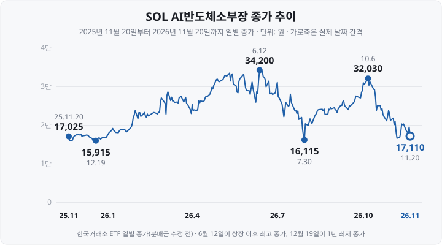

반도체 소부장 ETF의 구성 종목을 처음 열어 봤을 때, 이름에 '반도체'가 들어 있는데 삼성전자와 SK하이닉스가 없다는 점이 의외였습니다. 상위 10종목에는 장비 기업뿐 아니라 기판을 만드는 기업도 여럿 있었습니다.

2026년 11월 20일 국내 반도체 소재·부품·장비(소부장) ETF 다수가 하루에 10% 넘게 하락했습니다. 이번 글의 대상 상품도 종가 기준 **12.01% 내렸고**, 같은 날 코스피 하락률은 5.21%였습니다. 오늘은 국내 반도체 소부장·장비 ETF 가운데 순자산이 가장 큰 상품 하나를 골라 **지수 규칙, 구성 종목, 설비투자와의 관계, 1년 실측 데이터, 비용·과세와 위험**을 정리하겠습니다. 특정 상품의 매수·매도를 권하지 않으며, 상품 간 우열도 판단하지 않습니다.

&nbsp;

【대상 상품과 선정 기준】

선정 기준은 **작성일 기준으로 국내에 상장된 반도체 소부장·장비 ETF(Exchange Traded Fund, 상장지수펀드) 가운데 순자산이 가장 큰 상품**이고, 레버리지·인버스·커버드콜 상품은 제외했습니다. 한국거래소(KRX, Korea Exchange) Open API의 ETF 일별 매매정보에서 이름에 '반도체'가 들어가고 이름이나 기초지수명에 '소부장'·'장비'·'공정'·'소재'가 들어간 10개 상품의 순자산총액을 비교했습니다. 11월 20일 자료는 순자산총액이 0으로 표시돼 11월 19일 값을 썼습니다.

| 항목 | 내용 |
| :-- | :-- |
| 상품명 | SOL AI반도체소부장(종목코드 455850) |
| 운용사 | 신한자산운용 |
| 상장일 | 2023년 4월 25일 |
| 기초지수 | FnGuide AI 반도체 소부장 지수(가격지수) — 에프앤가이드 산출 |
| 순자산총액 | **1조 25억원**(2026년 11월 19일, KRX) · 8,916억원(11월 20일, 운용사) |
| 총보수 | 연 0.45% |
| 구성 종목 수 | 주식 20종목 + 현금성자산(2026년 11월 20일 기준) |

상장 당시 이름은 'SOL 반도체소부장Fn'이었습니다. 투자설명서 연혁에 따르면 **2024년 2월 29일** 기초지수가 'FnGuide 반도체 소부장 지수'에서 지금의 'FnGuide AI 반도체 소부장 지수'로 바뀌면서 상품 이름도 함께 바뀌었습니다. 그보다 앞선 2023년 12월 15일에는 종전 지수의 규칙이 일부 바뀌었습니다.

&nbsp;

【지수 규칙 — 제조사는 제외하고 키워드로 고릅니다】

기초지수는 유가증권시장·코스닥 상장 종목 중 다음 조건을 통과한 종목을 대상으로 합니다.

1. **기초 조건**: 관리종목·투자주의환기종목(상장 유지에 문제가 있어 거래소가 지정한 종목) 등을 제외하고, 유동주식비율(전체 주식 가운데 시장에서 거래할 수 있는 주식의 비율) 10% 이상, 60영업일 평균 거래대금 10억원 이상인 종목. 에프앤가이드 방법론 문서에는 시가총액 1,000억원 이상 조건도 있습니다.
2. **업종 조건**: 에프앤가이드 업종 분류(FICS, FnGuide Industry Classification Standard) 기준 하드웨어·소재·반도체·디스플레이.
3. **키워드 점수**: 직전 1년 동안의 증권사 보고서와 사업보고서의 '사업의 내용'을 분석해, 반도체 소부장 관련 키워드와 얼마나 비슷한지 점수를 매깁니다.
4. **상위 50종목 → 시가총액 상위 20종목**: 점수 상위 50종목을 고르되 **한국반도체산업협회 회원사 중 소자 업체로 분류된 기업은 제외**합니다. 방법론 문서는 소자 업체를 '반도체 제조시설 보유기업'으로 정의합니다. 이렇게 고른 최종 후보 50종목 가운데 시가총액 상위 20종목이 구성 종목이 됩니다.

삼성전자·SK하이닉스가 빠지는 이유가 4번 조건입니다. 비중은 **유동시가총액**(대주주 지분 등 시장에서 거래되기 어려운 주식을 뺀 시가총액) 비율로 정하고, 정기변경 때 종목당 상한은 20%입니다. 정기변경 사이에도 매월 마지막 영업일 종가 기준으로 한 종목 비중이 30%를 넘으면 25%로 낮추는 규칙이 있습니다. 투자설명서는 이 조정을 조건 없이 적고 있고, 에프앤가이드 방법론 문서는 투자자 보호가 필요한 경우 지수위원회 검토를 거친다는 조건을 붙입니다.

| 항목 | 규칙 |
| :-- | :-- |
| 종목 선정일 | 매년 5월·11월 마지막 영업일 |
| 정기변경일 | 매년 6월·12월 선물·옵션 만기일 이후 2영업일째 |
| 종목 수 | 20종목 |
| 종목당 상한 | 정기변경 시 20% |

규칙대로라면 다음 종목 선정일은 2026년 11월 30일이고, 12월 정기변경이 이어집니다. 정기변경의 일반적인 구조는 코스피200 정기변경 편에서 다뤘습니다.

간이투자설명서는 키워드 방식의 한계도 밝힙니다. 키워드로 고른 종목이 실제로 그 사업을 하는 정도나, 시장점유율·매출 같은 실적과는 차이가 날 수 있다는 내용입니다. <mark>종목 선정 기준은 매출 비중이 아니라 문서에 나타난 키워드입니다.</mark>

&nbsp;

【20종목의 공정별 비중】

반도체는 웨이퍼 위에 회로를 만드는 **전공정**과, 완성된 칩을 자르고 쌓고 포장해 검사하는 **후공정**을 거쳐 만들어집니다. 11월 20일 적용 PDF(Portfolio Deposit File, 납입자산구성내역)의 20종목을 주력 사업 기준으로 나누면 다음과 같습니다. 분류는 본 사이트의 판단입니다.

| 분류 | 종목 수 | 비중 합계 | 해당 종목(비중 순) |
| :-- | --: | --: | :-- |
| 전공정 장비 | 6 | 31.54% | 주성엔지니어링, HPSP, 원익IPS, 피에스케이, 유진테크, 테스 |
| 후공정 장비 | 3 | 20.16% | 한미반도체, 테크윙, 피에스케이홀딩스 |
| 기판(PCB) | 4 | 24.53% | 이수페타시스, 대덕전자, 심텍, 코리아써키트 |
| 소재·공정 부품 | 4 | 11.65% | SKC, 한솔케미칼, 솔브레인, 티씨케이 |
| 테스트 소켓·핀 | 2 | 9.06% | 리노공업, ISC |
| 후공정 패키징·테스트 위탁 | 1 | 2.59% | 하나마이크론 |

(현금성자산 0.48%는 표에서 뺐습니다. 합계는 반올림 때문에 100%와 약간 다를 수 있습니다.)

**장비 기업의 비중은 51.70%입니다.** 나머지 약 절반은 기판·소재·부품 기업입니다. 특히 **기판**(PCB, Printed Circuit Board, 인쇄회로기판) 4종목이 24.53%를 차지합니다. 이수페타시스는 인공지능(AI) 서버와 네트워크 장비에 쓰이는 고다층 기판을 만들고, 대덕전자·심텍은 반도체 칩을 올리는 패키지 기판을 만듭니다. 기판 기업의 고객은 메모리 제조사만이 아니라 서버·네트워크 장비 업체이기도 합니다.

&nbsp;

【상위 10종목이 74.28%입니다】

표의 HBM(High Bandwidth Memory, 고대역폭 메모리)은 D램 칩을 여러 층으로 쌓아 만든 메모리이고, TC본더는 그 칩을 쌓아 붙이는 장비입니다.

| 순위 | 종목 | 비중 | 분류 | 주요 사업 |
| --: | :-- | --: | :-- | :-- |
| 1 | 한미반도체 | 15.83% | 후공정 장비 | HBM 적층용 TC본더 |
| 2 | 주성엔지니어링 | 11.56% | 전공정 장비 | 증착 장비 |
| 3 | 이수페타시스 | 9.87% | 기판 | AI 서버·네트워크용 고다층 기판 |
| 4 | 대덕전자 | 6.15% | 기판 | 패키지 기판 |
| 5 | 심텍 | 6.01% | 기판 | 메모리 모듈·패키지 기판 |
| 6 | HPSP | 5.94% | 전공정 장비 | 고압 수소 어닐링(열처리) 장비 |
| 7 | 리노공업 | 5.79% | 테스트 소켓·핀 | 검사용 핀·소켓 |
| 8 | 원익IPS | 5.35% | 전공정 장비 | 증착 장비 |
| 9 | 피에스케이 | 4.00% | 전공정 장비 | 감광액 제거(스트립) 장비 |
| 10 | SKC | 3.78% | 소재·공정 부품 | 화학 소재, 유리기판 자회사 앱솔릭스, ISC 최대주주 |

(비중은 운용사 표시값입니다. 1CU(설정 단위, 5만 좌)에 담긴 주식을 11월 19일 종가로 평가한 금액 기준이며, 이 합계는 11월 19일 NAV(Net Asset Value, 1좌당 순자산가치)와 일치합니다.)

1위 한미반도체의 **TC본더**는 HBM을 만들 때 쌓은 칩을 열과 압력으로 붙이는 장비입니다. 한미반도체는 2026년 6월 8일 SK하이닉스와 HBM4용 TC본더 442억원 공급계약을 공시했습니다. <mark>비중 1~3위 세 종목의 합계는 37.26%로, 전체의 3분의 1이 넘습니다.</mark>

&nbsp;

【장비 매출은 메모리 제조사의 설비투자를 따릅니다】

장비 기업의 매출은 반도체 제조사가 공장을 짓고 장비를 사들이는 **설비투자(capex, capital expenditure)** 규모에 따라 달라집니다. 메모리 가격이 오르고 제조사 이익이 늘면 설비투자가 늘고, 장비 주문이 그 뒤를 따릅니다. 메모리 가격과 사이클의 구조는 메모리 반도체 사이클 편에 정리했습니다.

**① 세계 장비 매출.** 국제반도체장비재료협회(SEMI)에 따르면 2025년 세계 반도체 장비 매출은 1,351억 달러로 전년보다 15% 늘어 사상 최대였습니다. SEMI의 지역별 수치는 그 지역의 장비 회사 매출이 아니라 그 지역에서 사들인 장비 금액입니다. 한국에서 집행된 장비 구매액은 258억 달러로 26% 늘었습니다. 2026년 2분기 세계 매출은 405억 3,000만 달러(전년 동기 대비 +23%)였고, <mark>한국의 장비 구매액은 90억 8,000만 달러로 54% 늘어 3대 시장(중국·대만·한국) 가운데 증가율이 가장 높았습니다.</mark>

**② 국내 제조사의 설비투자.** 삼성전자는 2026년 3분기 실적 발표(10월 29일)에서 올해 시설투자(삼성전자는 설비투자를 '시설투자'라고 부릅니다) 계획을 84조 4,000억원(전년 대비 +31조 7,000억원)으로 밝혔고, 이 중 반도체 부문이 76조 8,000억원입니다. SK하이닉스의 1~9월 설비투자는 분기보고서 기준 31조 2,160억원으로, 2025년 연간 투자액(30조 1,730억원)을 이미 넘었습니다. 삼성전자는 같은 자리에서 2027년 업계 전반의 시설투자가 큰 폭으로 늘 것으로 추정하면서도, 그 증가분의 상당 부분이 신규 공간 확보에 쓰이고 장비를 주문해서 받기까지 걸리는 기간도 길어지고 있다고 설명했습니다.

**③ 메모리 가격.** D램익스체인지 집계로 PC용 범용 D램(DDR4 8Gb)의 10월 평균 고정거래가격(메모리 제조사가 PC 업체 같은 대형 고객과 계약하는 가격)은 27.5달러로 9월보다 5.77% 올라, 2016년 조사 시작 이후 최고였습니다. 낸드플래시 범용 제품(128Gb MLC)은 30.61달러로 9월과 같아 21개월 동안 이어진 상승이 멈췄습니다.

설비투자 계획은 1년에 몇 번 발표되지만 주가는 매일 움직입니다. 뒤에서 보듯 <mark>설비투자 계획이 커지던 최근 1년 동안에도 이 상품의 종가가 하루 10% 이상 오르내린 날은 18일이었습니다.</mark>

&nbsp;

【지수 변경과 구성 종목의 변화】

이 상품의 변화를 설명하는 시점 다섯을 골랐습니다. 종가와 순자산은 KRX 자료이고, 비중은 운용사 월간 자료와 PDF입니다.

| 시점 | 고른 이유 | 종가 | 순자산총액 | 비중 상위 3종목 |
| :-- | :-- | --: | --: | :-- |
| 2023년 4월 25일 | 상장일(종전 지수) | 9,675원 | 77억원 | LX세미콘 8.79%, 원익IPS 7.44%, 한솔케미칼 7.37% |
| 2024년 3월 29일 | 기초지수 변경(2월 29일) 다음 달 말 | 16,620원 | 3,620억원 | 한미반도체 20.95%, 리노공업 9.34%, HPSP 9.25% |
| 2025년 12월 30일 | 2026년 급등 직전 연말, 기판 기업이 비중 1위 | 16,735원 | 4,646억원 | 이수페타시스 17.38%, 한미반도체 15.31%, 리노공업 8.45% |
| 2026년 6월 30일 | 최고 종가(6월 12일) 직후, 6월 정기변경 반영 | 30,050원 | 1조 2,408억원 | 한미반도체 16.39%, 이수페타시스 9.02%, 주성엔지니어링 8.83% |
| 2026년 11월 20일 | 작성일 직전 거래일 | 17,110원 | 8,916억원 | 한미반도체 15.83%, 주성엔지니어링 11.56%, 이수페타시스 9.87% |

(상장일 비중은 2023년 4월 30일, 2024년 3월 29일 비중은 3월 31일, 2025년 12월 30일 비중은 12월 31일 기준 월간 자료입니다. 11월 20일 순자산은 운용사 표시값이고 비중은 11월 20일 적용 PDF입니다.)

표에서 확인할 점은 세 가지입니다.

- **1위는 지수 변경 전에 이미 바뀌었고, 지수 변경 뒤에는 1위의 비중이 커졌습니다.** 상장 당시 1위 LX세미콘은 디스플레이 구동칩을 설계하는 기업이었습니다. 종전 지수를 따르던 2023년 12월 말에 이미 한미반도체가 11.60%로 1위였고, 지수가 바뀐 뒤인 2024년 3월 말에는 그 비중이 20.95%로 커졌습니다. 한미반도체는 표의 2024년 3월 이후 네 시점에서 모두 1~2위였습니다.
- **기판 기업의 비중이 커졌습니다.** 2024년 말 월간 자료에서 이수페타시스가 상위 10종목(6.36%)에 있었고, 2025년 말에는 17.38%로 1위였습니다. 11월 20일 PDF에서는 기판 4종목이 24.53%입니다.
- **전공정 장비 기업의 순위가 올라갔습니다.** 주성엔지니어링은 2025년 말 상위 10종목에 없었으나 11월 20일 PDF에서는 2위(11.56%)입니다. 반대로 2025년 말 4위였던 이오테크닉스(6.26%)는 11월 20일 PDF에 없습니다.

<mark>지수를 따르는 상품이라도 1년에 두 번 구성 종목이 바뀔 수 있으므로, 같은 이름의 상품에 투자해도 시점에 따라 투자 대상 기업이 다릅니다.</mark>

&nbsp;

【최근 1년 — 가격과 좌수】

1년 전(2025년 11월 20일) 종가 17,025원과 11월 20일 종가 17,110원은 거의 같습니다(+0.50%). 1년 중 가장 낮은 종가는 2025년 12월 19일의 15,915원이었습니다. 그 뒤 종가는 최고 34,200원(2026년 6월 12일)까지 올랐고, 7월 30일 16,115원으로 내렸다가 10월 6일 32,030원까지 다시 올랐습니다. 10월 6일부터 11월 6일(16,555원)까지 한 달 동안에는 **48.3% 하락했습니다.** 상장일 종가 9,675원과 비교하면 76.8% 높은 수준입니다(분배금 미포함).

&nbsp;

【하루에 크게 움직인 날과 그 배경】

| 날짜 | 사건 | 코스피 등락률 | ETF 등락률 |
| :-- | :-- | --: | --: |
| 2026년 3월 4일 | 중동 전쟁 확산 우려로 유가증권시장·코스닥 서킷브레이커 발동 | −12.06% | −10.94% |
| 2026년 3월 5일 | 전날 급락 뒤 반등 | +9.63% | +21.20% |
| 2026년 6월 12일 | 상장 이후 최고 종가 34,200원 | +4.63% | +8.50% |
| 2026년 6월 23일 | 코스피 첫 9,000 돌파(6월 18일) 이후 반도체 대형주 차익실현 | −9.99% | −10.47% |
| 2026년 7월 28일 | 전날(7월 27일) 상하이 증시에 상장한 중국 창신메모리(CXMT, ChangXin Memory Technologies)의 첫날 급등과 중국 노광장비(회로 패턴을 웨이퍼에 새기는 장비) 국산화 소식. 원익IPS·피에스케이 10% 이상 하락 | −10.84% | −13.69% |
| 2026년 7월 31일 | 전날 미국 필라델피아 반도체지수 +8.19%, 외국인 순매수 사상 최대 | +17.91% | +26.00% |
| 2026년 10월 15일 | 미국 9월 소비자물가 상승률 3.7%, AI 기업 수익성 의문, CXMT 추격 우려 | −7.57% | −12.93% |
| 2026년 11월 6일 | 전날 미국 필라델피아 반도체지수 −12.25%(미국 선거 이후 AI 데이터센터 규제 우려) | −6.02% | −8.94% |
| 2026년 11월 20일 | AMD 기술의 중국 제재 대상 기업 유출 의혹, 앤트로픽 상장 첫날 주가 상승에 따른 자금 이동 우려. 리노공업 −15.07%, 원익IPS −14.47%, 비중 3위 이수페타시스 −16.14% | −5.21% | −12.01% |

(코스피·ETF 등락률은 전 거래일 종가 대비입니다. 사건의 배경은 당시 보도를 옮긴 것이며, 같은 사건이 앞으로 같은 결과를 낳는다는 뜻은 아닙니다.)

표의 9일 가운데 3월 4일을 제외한 8일은 <mark>ETF 등락률의 절댓값이 코스피보다 컸습니다.</mark> 1년 244거래일 중 종가가 하루 10% 이상 오른 날은 10일, 10% 이상 내린 날은 8일이었고, 5% 이상 움직인 날은 72일이었습니다. 서킷브레이커 제도는 공매도와 서킷브레이커 편에서 다뤘습니다.

&nbsp;

【상장좌수 — 하락 구간에 950만 좌 증가】

ETF는 투자 자금이 들어오면 새 좌수를 발행합니다. KRX 자료로 상장좌수의 변화를 보면 다음과 같습니다.

| 날짜 | 상장좌수 | 종가 |
| :-- | --: | --: |
| 2025년 11월 20일 | 2,685만 좌 | 17,025원 |
| 2026년 6월 12일 | 3,900만 좌 | 34,200원 |
| 2026년 9월 30일 | 4,210만 좌 | 28,935원 |
| 2026년 10월 30일 | 4,940만 좌 | 21,210원 |
| 2026년 11월 20일 | 5,160만 좌 | 17,110원 |

1년 동안 상장좌수는 1.92배가 됐습니다. 9월 30일부터 11월 20일까지 종가가 40.9% 내리는 동안 상장좌수는 950만 좌 늘었습니다. 매일 늘어난 좌수에 그날 NAV를 곱해 더하면 이 기간 들어온 자금은 약 2,455억원입니다(본 사이트 추정). 서울파이낸스는 11월 9일 보도에서 이 상품을 포함한 반도체 소부장 ETF 4종에 최근 1개월 동안 개인 순매수가 906억원(이 상품은 537억원)이었다고 전했습니다. <mark>지금 상장좌수의 약 18%가 최근 7주 동안 늘어난 몫입니다.</mark>

&nbsp;

【직접 계산한 1년 — 괴리율·추적오차·회전율】

아래 표는 KRX Open API의 ETF 일별 매매정보(종가·NAV·기초지수·거래대금·순자산총액)로 **2025년 11월 21일~2026년 11월 20일, 244거래일**을 본 사이트가 직접 계산한 결과입니다.

| 항목 | 값 | 계산 방법 |
| :-- | --: | :-- |
| 괴리율 평균 | +0.03% | 매일 (종가 − NAV) ÷ NAV의 평균 |
| 괴리율 평균 절댓값 | 0.25% | 부호를 떼고 평균 |
| 괴리율 최대 | +1.23% | 2026년 3월 5일 |
| 괴리율 최소 | −1.47% | 2026년 4월 9일 |
| ±1%를 벗어난 날 | 3일 | 2026년 2월 12일(−1.02%), 3월 5일(+1.23%), 4월 9일(−1.47%) |
| 1년 수익률 — 종가 기준 | +0.50% | 2025년 11월 20일 17,025원 → 11월 20일 17,110원 |
| 1년 수익률 — NAV 기준 | +0.95% | 17,017.91원 → 17,179.92원 |
| 1년 수익률 — 기초지수 | +2.83% | 2,901.85 → 2,984.00 |
| 추적오차 | 연 1.85% | 매일 (NAV 수익률 − 기초지수 수익률)의 표준편차 × √252 |
| 종가·NAV 일간 수익률 차이 | 평균 0.30%p | 매일 (종가 수익률 − NAV 수익률)의 절댓값 평균 |
| 일평균 거래대금 | 767.3억원 | 중앙값 609.1억원 |
| 거래대금 회전율 | 연 19.57배 | 기간 거래대금 합계(18조 7,211억원) ÷ 기간 평균 순자산총액(9,568억원) |

(종가·NAV 수익률은 분배금을 포함하지 않았습니다. 기간 중 분배금은 12원(2026년 4월 30일 기준)으로 종가의 0.1%에 못 미칩니다. 평균 순자산총액은 순자산총액이 0으로 표시된 11월 20일을 뺀 243거래일로 계산했습니다.)

**괴리율**은 시장 가격이 NAV에서 얼마나 벗어났는지를 나타냅니다. 1년 동안 ±0.5%를 벗어난 날은 20일, ±1%를 벗어난 날은 3일이었습니다. 최댓값을 기록한 3월 5일은 종가가 하루 21.20% 오른 날로, 종가가 NAV보다 1.23% 높았습니다. 최솟값을 기록한 4월 9일에는 기초지수가 0.83% 내렸는데 종가는 1.89% 내렸습니다. 11월 20일의 괴리율은 −0.41%(종가 17,110원, NAV 17,179.92원)였습니다.

**추적오차**는 이 상품이 기초지수를 얼마나 고르게 따라갔는지를 나타냅니다. 연 1.85%는 일간 차이의 변동 폭을 1년 단위로 환산한 값입니다. 한편 1년 누적으로는 NAV(+0.95%)가 기초지수(+2.83%)보다 1.88%p 낮았습니다. 운용사 월간 자료(2026년 10월 31일 기준)의 최근 1년 수익률도 ETF가 20.07%, 기초지수가 22.25%로 차이가 2.18%p였습니다. <mark>이 차이는 연간 총보수·비용(0.5082%)보다 큽니다.</mark> 기초지수는 배당을 반영하지 않는 가격지수이고 운용사 수익률은 분배금 재투자를 가정한 값인데도 차이가 났다는 점에서, 비용 외의 요인이 있었던 것으로 보입니다. 운용사 공시에서 그 원인은 확인하지 못했습니다.

**거래대금 회전율** 19.57배는 1년 동안 평균 순자산의 약 20배가 거래됐다는 뜻입니다. 10월 1일 이후 35거래일만 보면 하루 거래대금이 순자산의 평균 9.68%였고(순자산총액이 0으로 표시된 11월 20일 제외), 일평균 거래대금은 1,095억원이었습니다. <mark>가격이 크게 내린 최근 7주에 거래가 오히려 늘었습니다.</mark>

&nbsp;

【보수와 비용】

| 항목 | 연 비율 | 근거 |
| :-- | --: | :-- |
| 총보수 | 0.45% | 집합투자 0.40% + 지정참가회사 0.01% + 신탁 0.02% + 일반사무 0.02% |
| 기타비용 | 0.0582% | 투자설명서 기준 |
| **총보수·비용** | **0.5082%** | 총보수 + 기타비용 |
| 증권거래비용 | 0.0161% | 위와 별도, 직전 회계연도(2025년) 기준 |

간이투자설명서의 예시에 따르면 1,000만원을 1년 투자할 때 총보수·비용은 약 5만 2,000원입니다(연 수익률 5% 가정). 2025년 이 상품의 **매매회전율**(1년 동안 매도한 주식 금액 ÷ 평균 보유 주식 금액)은 17.00%였습니다. 비용 항목별 의미는 ETF 총보수와 세금 편에 정리해 두었습니다.

&nbsp;

【분배금 — 1년에 한 번, 종가의 0.07%】

| 지급기준일 | 1좌당 분배금 | 지급일 |
| :-- | --: | :-- |
| 2024년 4월 30일 | 23원 | 2024년 5월 2일 |
| 2025년 4월 30일 | 24원 | 2025년 5월 2일 |
| 2026년 4월 30일 | 12원 | 2026년 5월 4일 |

투자설명서는 1·4·7·10월 마지막 영업일과 회계기간 종료일을 지급기준일로 두지만, 실제 분배는 지금까지 매년 4월 한 번이었습니다. 2026년 분배금 12원은 11월 20일 종가의 약 0.07%입니다. 이 상품의 수익은 대부분 가격 변동에서 나옵니다.

&nbsp;

【과세 — 매매차익은 비과세입니다】

투자설명서는 "국내 증권시장에서 거래되는 주식의 가격만을 기반으로 하는 지수의 변화를 그대로 추적하는 것을 목적으로 하는 ETF"를 **국내주식형 ETF**로 정의하고, 여기에는 보유기간 과세가 적용되지 않는다고 적고 있습니다. 이 상품은 국내 주식 가격지수를 추적하므로 일반 계좌에서 매도할 때의 **매매차익은 과세되지 않습니다.** 분배금에는 15.4%(지방소득세 포함)가 원천징수됩니다. 로봇 ETF 편에서 다룬 액티브 ETF와 다른 점입니다. 분배금 과세는 ETF 분배금 세금 편에서 다뤘습니다.

&nbsp;

【기대와 어긋날 수 있는 경우】

- **반도체 제조사에 투자하기를 기대하는 경우.** 삼성전자·SK하이닉스는 지수 규칙상 편입 대상이 아닙니다. 이 상품은 두 회사의 설비투자에 매출이 좌우되는 공급 기업에 투자합니다.
- **장비 기업에만 투자하기를 기대하는 경우.** 장비 기업의 비중은 51.70%이고, 기판 4종목이 24.53%, 소재·부품·테스트 소켓 기업이 나머지입니다.
- **소수 종목에 집중되는 것을 피하려는 경우.** 20종목만 편입하고, 상위 3종목이 37.26%, 상위 10종목이 74.28%입니다. 1위 한미반도체는 15.83%이며 정기변경 때 상한은 20%입니다.
- **큰 가격 변동을 감당하기 어려운 경우.** 최근 1년 NAV 일간 수익률의 표준편차를 연간으로 환산한 **변동성은 연 82.4%였습니다**(본 사이트 계산). 최고 종가에서 5개월여 만에 49.97% 내렸고, 한 달 사이 48.3% 내린 구간(10월 6일~11월 6일)도 있었습니다.
- **설비투자 계획이 곧 주가 상승으로 이어진다고 보는 경우.** 2026년 국내 제조사의 설비투자 계획은 크게 늘었지만, 같은 해 이 상품의 종가는 최고가 대비 절반으로 내렸습니다. 주가는 설비투자 외에도 미국 규제 관련 소식(AI 데이터센터 규제 우려, AMD 기술 유출 의혹), 중국 메모리 기업의 추격, 미국 반도체 주가 등에 반응했습니다.
- **정기 분배금을 기대하는 경우.** 2026년 분배금은 종가의 약 0.07%입니다.

&nbsp;

【정리】

- **선정 기준**: 2026년 11월 19일 기준 국내 상장 반도체 소부장·장비 ETF 10개 중 순자산 1위(레버리지·인버스·커버드콜 제외). SOL AI반도체소부장, 순자산 1조 25억원.
- **지수 규칙**: 키워드 점수 상위 50종목 중 시가총액 상위 20종목. 반도체 제조시설 보유기업(소자 업체)은 제외해 삼성전자·SK하이닉스가 없습니다. 6월·12월 정기변경, 종목당 상한 20%.
- **편입 범위**: 장비 51.70%(전공정 31.54%·후공정 20.16%), 기판 24.53%, 소재·공정 부품 11.65%, 테스트 소켓·핀 9.06%. 1위는 한미반도체(15.83%).
- **산업 배경**: 2026년 2분기 한국 장비 구매액 +54%(SEMI), 삼성전자 2026년 시설투자 계획 84조 4,000억원, SK하이닉스 1~9월 설비투자 31조 2,160억원.
- **가격**: 1년 전 17,025원 → 최고 34,200원(6월 12일) → 17,110원(11월 20일). 하루 10% 이상 움직인 날 18일.
- **좌수**: 1년 동안 2,685만 좌 → 5,160만 좌. 9월 30일 이후 가격이 40.9% 내리는 동안 950만 좌가 늘었습니다.
- **1년 실측**: 괴리율 평균 +0.03%, ±1% 밖 3일, 추적오차 연 1.85%, 거래대금 회전율 연 19.57배.
- **비용·과세**: 총보수 0.45%, 기타비용 포함 0.5082%. 매매차익 비과세(국내주식형).

&nbsp;

【함께 보면 좋은 글】

- [메모리 반도체는 아직 사이클 산업일까 — 장기계약·HBM 논쟁과 D램 가격 읽는 법](https://blog.naver.com/hdglace/224445419460)
- [로봇 ETF 해부 — KODEX 로봇액티브 구성 종목과 상장 이후 변화](https://blog.naver.com/hdglace/224480344433)
- [전력 ETF 해부 — KODEX AI전력핵심설비 구성 종목과 상장 이후 변화](https://blog.naver.com/hdglace/224469444724)
- [ETF 총보수와 세금 — 실제로 내 수익에서 얼마가 빠지나](https://blog.naver.com/hdglace/224367512124)
- [ETF 분배금 세금 — 국내형·해외형·연금계좌가 다 다른 이유](https://blog.naver.com/hdglace/224463142232)

【다음 편에서는】

다음 공부방 글에서는 **신용융자 잔고와 코스피 — 2026년 10~11월 급락기에 빚투는 얼마나 줄었나**를 다룹니다. 금융투자협회 자료로 신용공여 잔고·위탁매매 미수금·반대매매 금액을 코스피 종가와 같은 날짜로 맞춰, 급락 구간에서 각 수치가 어떻게 움직였는지 정리하겠습니다.

&nbsp;

【📊 데이터 출처 및 기준일】

| 항목 | 수치 | 출처·기준일 |
| :-- | :-- | :-- |
| 상품 기본정보·분배·순자산 | 상장 2023-04-25, 총보수 0.45%, 8,916억원 | 신한자산운용 SOL ETF 상품 페이지, 2026-11-22 확인 |
| 구성 종목·비중 | 20종목, 한미반도체 15.83% 등 | 신한자산운용 PDF, 2026-11-20 적용분 |
| 지수 규칙·비용·과세 | 소자 업체 제외, 상한 20%, 총보수·비용 0.5082% | 투자설명서·간이투자설명서(작성기준일 2026-09-04), 에프앤가이드 지수 방법론 v1.3 |
| 과거 비중·성과 | 2023-04 ~ 2026-10 월말 | 신한자산운용 월간 운용 보고서 |
| 종가·NAV·기초지수·거래대금·좌수 | 2025-11-20 ~ 2026-11-20 일별 | KRX Open API ETF 일별 매매정보(이수페타시스 하락률은 유가증권 일별 매매정보), 실측치는 자체 계산 |
| 코스피 등락률 | 사건일 9일 | 네이버페이 증권 시세로 자체 계산 |
| 장비 매출·구매액 | 2025년 세계 1,351억 달러, 한국 구매액 2분기 +54% | SEMI 보도자료(2026-04-08 / 2026-09-03) |
| 설비투자 | 삼성전자 84조 4,000억원, SK하이닉스 31조 2,160억원 | 디일렉(2026-10-29)·아시아경제(2026-11-16) 보도 |
| 메모리 가격 | DDR4 8Gb 27.5달러(전월 대비 +5.77%) | D램익스체인지, SBS Biz·지디넷코리아 보도(2026-10-30) |
| 주요 사건 | 서킷브레이커, CXMT 상장, 11월 20일 급락 등 | 인베스트조선·서울신문·한국경제·머니투데이·동아일보·한국경제TV·딜사이트·SBS Biz·뉴스핌·서울경제·헤럴드경제·서울파이낸스 보도 |

&nbsp;

⚠️ **면책 안내** — 이 글은 공개된 상품 공시·투자설명서·거래소 자료·보도를 정리한 **교육·정보 제공 목적**의 자료이며, 특정 종목·산업·상품의 매수·매도를 권유하거나 상품 간 우열을 판단하지 않습니다. 대상 상품은 본문의 선정 기준(작성일 기준 순자산 1위)에 따라 골랐고, 유사한 상품이 여럿 있습니다. 구성 종목 분류는 본 사이트의 판단입니다. 이 글은 작성일 기준 데이터로 작성했으며 이후 갱신하지 않습니다. 과거 수익률이 미래 수익을 보장하지 않으며, 투자 판단과 그 결과에 대한 책임은 투자자 본인에게 있습니다.

&nbsp;

#반도체소부장ETF #반도체장비ETF #SOLAI반도체소부장 #ETF해부 #반도체소부장 #한미반도체 #주성엔지니어링 #이수페타시스 #HBM #메모리설비투자 #ETF구성종목 #주식초보 #투자공부 #재테크
